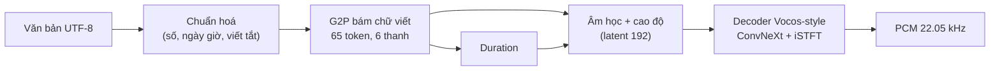

# vtts

Giọng đọc tiếng Việt nhỏ gọn, chạy hoàn toàn trên vi điều khiển ESP32-P4 và ESP32-S3: văn bản vào, âm thanh ra loa, không cần mạng.

> **English summary.** vtts is a tiny Vietnamese text-to-speech stack: a rule-based, dialect-ready
> Vietnamese front-end (Python + C99, exact parity), a VITS teacher, a 0.8–1.7M-parameter distilled
> student, and a malloc-free C99 int8 runtime with streaming synthesis. On an ESP32-P4 (360 MHz,
> PIE SIMD, 2 cores) the 1.7M model (v0.2, with an explicit pitch/energy predictor) runs at RTF ≈ 0.34–0.42 and the
> 0.8M model at RTF ≈ 0.20–0.22, with speech starting after 0.3–1.2 s. On an ESP32-S3 (240 MHz, 8 MB PSRAM)
> both models also run faster than real time (RTF ≈ 0.42–0.47 and 0.85–0.99). Supported boards: Waveshare
> ESP32-P4-86-Panel, ESP32-P4-NANO and ESP32-S3-Touch-LCD-2.8. Code is Apache-2.0. Prototype int8 models (`.vtts`) are attached to GitHub Releases for non-commercial research use only (CC BY-NC 4.0).

## Kết quả

Đo trên 50 câu ngoài miền (thông báo thiết bị, số, tên riêng, câu hỏi, câu dài). CER là tỉ lệ lỗi ký tự khi ASR (PhoWhisper-large) nghe lại, có tính dấu thanh. UTMOS dự đoán độ tự nhiên. Audio của student được tạo bằng chính runtime C int8 chạy trên chip.

| Hệ thống | Tham số | CER ↓ | UTMOS ↑ | Tiếng rít ↓ |
|---|---:|---:|---:|---:|
| **vtts M-vocos v0.2** (int8, ngữ điệu v2) | 1.73M | **0.012** | 2.19 | 7.8 |
| vtts M-vocos v0.1 (int8) | 1.73M | 0.012 | 2.08 | 3.3 |
| vtts S-vocos (int8) | 0.77M | 0.023 | 1.86 | 61.5 |
| Teacher VITS | 23.7M | 0.015 | 2.50 | 14.8 |
| sanoTTS `vi` (baseline) | 1.57M | 0.064 | 1.49 | 1.5 |
| Piper `vi_VN-25hours_single` (baseline) | — | 0.089 | 2.06 | 1.1 |

Trên ESP32-P4 (chip rev 1.3, 360 MHz, PSRAM 32 MB), đo trên Waveshare ESP32-P4-NANO. ESP32-P4-86-Panel dùng cùng chip và cùng firmware:

| Model | RTF (2 lõi, PIE SIMD) | Bắt đầu phát | Flash | RAM làm việc |
|---|---:|---:|---:|---:|
| S-vocos | 0.20–0.22 | khoảng 0.3 s | 1.1 MB | ~0.4 MB (streaming) |
| M-vocos v0.2 | 0.34–0.42 | khoảng 1.2 s | 2.6 MB | ~0.6 MB (streaming) |

RTF < 1 nghĩa là tổng hợp nhanh hơn thời gian thực. Đoạn văn dài 56 giây phát liền mạch, không ngắt quãng.

**Tải CPU khi vừa tổng hợp vừa phát loa** (đoạn bản tin thời tiết 5 câu, tính trung bình suốt thời gian phát; core0 gồm cả task console và task đẩy audio ra loa):

| Model | Core 0 | Core 1 | Phát không bị ngắt |
|---|---:|---:|---|
| S-vocos | 21% | 16% | Có (0 lần ngắt) |
| M-vocos v0.2 | 35% | 28% | Có (0 lần ngắt) |

Hai core còn hơn 60% thời gian rảnh cho các việc khác của ứng dụng, như wake word, Wi-Fi hay giao diện. Firmware in dòng `CPU core0 ..% core1 ..%` sau mỗi câu phát.

**Tối ưu hiệu năng.** Runtime đã được tối ưu cho ESP32-P4. Model và file `.vtts` giữ nguyên, audio gần như giống hệt bản cũ (tương quan 0.9998):

| Model | RTF trước tối ưu | RTF sau tối ưu | Nhanh hơn | Bắt đầu phát (trước → sau) |
|---|---:|---:|---:|---:|
| S-vocos | 0.41–0.45 | 0.20–0.22 | ~2,1 lần | 0.6–0.9 s → 0.3 s |
| M-vocos v0.2 | 0.79–0.94 | 0.34–0.42 | ~2,3 lần | 2.4 s → 1.2 s |

Những thay đổi chính:
- GELU dùng bảng tra thay cho `tanhf`.
- Kernel int8 tính nhiều frame trong một lần gọi, vòng lặp được pipeline bằng lệnh `vmulas...ld.ip` của PIE.
- iSTFT dùng FFT thực nửa kích thước.
- Depthwise conv, LayerNorm, lượng tử hoá activation và iSTFT được chia cho cả 2 lõi.

**ESP32-S3.** Đo trên Waveshare ESP32-S3-Touch-LCD-2.8 (ESP32-S3R8, 240 MHz, PSRAM octal 8 MB, flash 16 MB). Firmware và hai model giống bản P4. Kernel int8 dùng lệnh SIMD 128-bit của S3 (`ee.vmulas.s8.accx`):

| Model | RTF (2 lõi, SIMD) | Bắt đầu phát | CPU core0 / core1 khi phát | Phát không bị ngắt |
|---|---:|---:|---:|---|
| S-vocos | 0.42–0.47 | khoảng 0.8 s | 40% / 29% | Có |
| M-vocos v0.2 | 0.85–0.99 | khoảng 2.4 s | 75% / 62% | Có |

Audio từ S3 khớp với runtime trên máy tính (tương quan 1.000000 với S, 0.999992 với M). Trên S3 nên dùng S cho ứng dụng cần phản hồi nhanh hoặc phải chạy thêm việc khác. M vẫn nhanh hơn thời gian thực nhưng gần sát giới hạn. S3 cần PSRAM ít nhất 8 MB: hai model chép vào PSRAM, vùng làm việc khoảng 1.9 MB. Board PSRAM 2 MB không đủ.

**Ngữ điệu v0.2.** Model M có thêm bộ dự đoán cao độ và năng lượng tường minh, và sửa lỗi đọc quá nhanh. Đo trên 50 câu giữ lại: thời lượng trung bình mỗi câu 5.80 s (v0.1: 4.95 s, người đọc thật: 6.08 s), độ dao động cao độ 2.37 semitone (v0.1: 2.32, người thật: 2.60).

### Nghe thử: audio sinh trực tiếp trên ESP32-P4

Bấm ▶ để phát (trình duyệt mở trình phát âm thanh). Các file được tạo trên board bằng lệnh `dump` của firmware: chip tổng hợp câu, gửi PCM 16-bit qua cổng serial về máy tính, rồi chỉ nén sang mp3, không xử lý gì thêm. Audio từ chip khớp với runtime C chạy trên máy tính (hệ số tương quan 0.9999999, sai khác mẫu lớn nhất bằng 1 bước lượng tử 16-bit).

| Câu | M-vocos v0.2 (1.73M) | S-vocos (0.77M) | Thời lượng M / S | RTF M / S |
|---|---|---|---:|---:|
| Xin chào, tôi là giọng đọc tiếng Việt chạy hoàn toàn trên chip ESP32-P4. | [▶ Nghe M](https://raw.githubusercontent.com/tuanpmt/vtts/main/docs/audio/p4-m-intro.mp3) | [▶ Nghe S](https://raw.githubusercontent.com/tuanpmt/vtts/main/docs/audio/p4-s-intro.mp3) | 6.5 / 5.4 s | 0.37 / 0.22 |
| Mưa kéo dài hơn hai giờ khiến nhiều đường ở Long Thành, Nhơn Trạch ngập gần nửa mét, xe chết máy, người dân phải dắt bộ, sáng 15/11. | [▶ Nghe M](https://raw.githubusercontent.com/tuanpmt/vtts/main/docs/audio/p4-m-news.mp3) | [▶ Nghe S](https://raw.githubusercontent.com/tuanpmt/vtts/main/docs/audio/p4-s-news.mp3) | 9.1 / 8.2 s | 0.37 / 0.21 |
| Pin còn 15%, nhiệt độ phòng là 28°C. Báo thức đã được đặt lúc 6 giờ 30 sáng mai. | [▶ Nghe M](https://raw.githubusercontent.com/tuanpmt/vtts/main/docs/audio/p4-m-numbers.mp3) | [▶ Nghe S](https://raw.githubusercontent.com/tuanpmt/vtts/main/docs/audio/p4-s-numbers.mp3) | 8.2 / 6.9 s | 0.36 / 0.20 |
| Bạn có muốn bật đèn phòng khách không? | [▶ Nghe M](https://raw.githubusercontent.com/tuanpmt/vtts/main/docs/audio/p4-m-question.mp3) | [▶ Nghe S](https://raw.githubusercontent.com/tuanpmt/vtts/main/docs/audio/p4-s-question.mp3) | 2.7 / 2.2 s | 0.42 / 0.22 |
| Đoạn bản tin thời tiết 5 câu (dấu phẩy, dấu chấm, số đọc thành chữ) | [▶ Nghe M](https://raw.githubusercontent.com/tuanpmt/vtts/main/docs/audio/p4-m-paragraph.mp3) | [▶ Nghe S](https://raw.githubusercontent.com/tuanpmt/vtts/main/docs/audio/p4-s-paragraph.mp3) | 30 / 26 s | 0.34 / 0.20 |

RTF ở bảng này đo khi tổng hợp cả câu một lần. Câu càng ngắn thì RTF càng cao vì có chi phí cố định cho mỗi câu. Khi phát loa, firmware dùng streaming nên câu bắt đầu phát trước khi tổng hợp xong.

## Kiến trúc



Model nhỏ (student) được chưng cất từ một teacher VITS lớn: teacher sinh dữ liệu (thời lượng, latent, âm thanh) cho hàng chục nghìn câu, student học lại với ba giai đoạn (front, decoder, joint với bộ phân biệt đa phân giải). Chi tiết trong `docs/design/`.

Bộ token **bám chữ viết, không gắn với một vùng miền**: `tr`/`ch`, `s`/`x`, `r`/`d`/`gi` là các token riêng, 6 thanh theo dấu viết. Thêm giọng Huế, Nghệ An... chỉ cần thêm dữ liệu.

## Cấu trúc repo

| Thư mục | Nội dung |
|---|---|
| `runtime/` | Runtime C99 không `malloc`: tổng hợp fp32/int8, streaming khớp từng bit với tổng hợp cả câu, front-end văn bản tiếng Việt (`vtts_text`). `ports/esp32p4/` và `ports/esp32s3/` là kernel SIMD, `ports/freertos/` chia việc cho 2 lõi |
| `firmware/esp32p4/` | Ứng dụng mẫu cho ESP32-P4 (86-Panel, NANO) và ESP32-S3 (Touch-LCD-2.8): gõ câu qua serial, board đọc ra loa |
| `src/vtts/` | Gói Python: front-end, chuẩn bị dữ liệu, đánh giá, teacher, student, export |
| `scripts/` | Các bước pipeline, chia theo nhóm `data/`, `frontend/`, `teacher/`, `student/`, `eval/`, `device/` |
| `eval/` | Tập câu đánh giá, baseline, cấu hình trang nghe A/B |
| `docs/` | Thiết kế, định dạng file model, báo cáo số đo |
| `tests/` | Test Python và test runtime C (golden, int8, streaming, parity front-end, fuzz) |

## Bắt đầu nhanh

### Front-end và runtime trên máy tính

```bash
uv sync --extra gpu                 # Python 3.11, PyTorch
uv run pytest -q                    # test nhanh (gồm cả build runtime C với ASan/UBSan)
make -C runtime build/vtts_cli      # công cụ dòng lệnh C
uv run python -c "from vtts.frontend.text import text_to_ids; print(text_to_ids('Xin chào, hôm nay là 15/11.'))"
```

### Firmware ESP32-P4 và ESP32-S3

Cần ESP-IDF v6.1 và hai file model int8 (`.vtts`): tải từ [Releases](https://github.com/tuanpmt/vtts/releases) hoặc tự export bằng `scripts/student/export_student.py --int8`.

```bash
gh release download v0.2.0 -R tuanpmt/vtts -p '*.vtts' -D models
cd firmware/esp32p4
# Waveshare ESP32-P4-86-Panel (mặc định)
./build.sh ../../models/vtts-vi-s-v0.1.q8.vtts ../../models/vtts-vi-m-v0.2.q8.vtts -p /dev/cu.usbmodemXXXX flash monitor
# Waveshare ESP32-P4-NANO
BOARD=nano ./build.sh ../../models/vtts-vi-s-v0.1.q8.vtts ../../models/vtts-vi-m-v0.2.q8.vtts -p /dev/cu.usbmodemXXXX flash monitor
# Waveshare ESP32-S3-Touch-LCD-2.8 (console qua cổng USB của chip)
BOARD=s3 ./build.sh ../../models/vtts-vi-s-v0.1.q8.vtts ../../models/vtts-vi-m-v0.2.q8.vtts -p /dev/cu.usbmodemXXXX flash monitor
```

Âm lượng mặc định: NANO là `vol 90`, `gain 12` dB, vì loa của NANO nhỏ hơn; 86-Panel là `vol 70`, `gain 0`; S3-Touch-LCD-2.8 là `vol 80`, `gain 6` dB. Gain số có bộ giới hạn mềm nên tăng gain không làm vỡ tiếng. Có thể chỉnh lúc chạy bằng `vol` và `gain`.

Firmware không cần BSP màn hình. Phần loa nằm trong `main/board_audio.c`: board P4 dùng codec ES8311 (I2C, I2S, chân bật ampli); board S3 dùng DAC PCM5101 nối thẳng I2S (BCLK 48, WS 38, DOUT 47), chạy 44,1 kHz (firmware nhân đôi mẫu từ 22,05 kHz), gửi ra cả hai kênh, âm lượng chỉnh bằng phần mềm. Muốn thêm board khác thì thêm một lựa chọn trong `main/Kconfig.projbuild` và khai báo chân tương ứng.

Trong cửa sổ serial, gõ một câu tiếng Việt rồi Enter. Các lệnh: `model s|m`, `vol 0-100`, `gain dB`, `speed 0.7-1.6`, `expr 0.5-2.5` (độ lên xuống của ngữ điệu, với model có cao độ), `bench`, `prof`, `selftest`, `dump <câu>` (tổng hợp và gửi audio về máy tính; lưu thành WAV bằng `scripts/device/p4_say.py PORT "dump <câu>" --dump-dir out/`).

### Train lại toàn bộ

1. Dữ liệu: `scripts/data/prepare_infore.py` → `score_dataset.py` → `filter_and_split.py`
2. Teacher: `scripts/teacher/train_teacher.py`, đánh giá bằng `eval_checkpoints.py`
3. Chưng cất: `scripts/student/build_distill_pack.py` → `convert_shards.py` → `add_prosody.py` → `run_prosody_chain.sh`
4. Export và kiểm tra: `export_student.py --int8`, `render_student_c.py`, `scripts/eval/eval_dir.py`

Quy trình không phụ thuộc nguồn dữ liệu: thay thư mục audio + transcript là chạy lại được từ đầu.

## Trạng thái

- Đây là prototype kiểm chứng chất lượng, train trên InfoRe1 (25 giờ, một người đọc).
- **Model prototype chỉ dùng phi thương mại**: hai file `.vtts` int8 (S và M) được đính kèm ở [Releases](https://github.com/tuanpmt/vtts/releases) theo giấy phép CC BY-NC 4.0, chỉ để nghiên cứu và chạy thử. Lý do: teacher được khởi tạo từ checkpoint Piper lessac (dữ liệu gốc chỉ cho dùng phi thương mại) và điều khoản thương mại của InfoRe1 chưa rõ. Checkpoint PyTorch và teacher không được phát hành. Bản dùng được cho thương mại sẽ có sau khi train lại trên bản thu âm có bản quyền.
- Ngữ điệu: v0.2 đã sửa tốc độ đọc và thêm bộ dự đoán cao độ; độ lên xuống vẫn còn hơi đều do người đọc InfoRe1 đọc khá đều giọng.
- Đang train một giọng mới trên bộ dữ liệu mở VietBibleVox (CC BY-SA 4.0, khoảng 60 giờ, một người đọc) với teacher train từ đầu, hướng tới model dùng được cho thương mại. Xem `scripts/data/prepare_bible.py`.

## Giấy phép

Code: Apache-2.0 (`LICENSE`). Phần sao chép từ Piper/VITS giữ giấy phép MIT gốc; xem `NOTICE`.

Model `.vtts` trong Releases: CC BY-NC 4.0, chỉ dùng phi thương mại (xem mục Trạng thái). Giấy phép Apache-2.0 của code không áp dụng cho các file model này.
