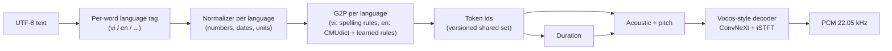

# vtts

**Tiny multilingual text-to-speech that runs entirely on ESP32 microcontrollers.** Text in, speech out of the speaker: no cloud, no network, no Linux. A C99 int8 runtime with streaming synthesis, a rule-based front-end per language, and distilled voices small enough for 1–3 MB of flash.

🇻🇳 [Tiếng Việt](README.vi.md) · 🌐 [Website with audio samples](https://tuanpmt.github.io/vtts/) · 🤗 [Models on Hugging Face](https://huggingface.co/tuanpm/vtts) · 📚 [Documentation](docs/README.md)

- **On the chip, end to end:** text normalization, grapheme-to-phoneme, an int8 acoustic model and an iSTFT vocoder all run on the MCU.
- **Faster than real time, streaming:** speech starts after 0.1–0.45 s depending on chip and model.
- **Two model sizes per voice, on both chips:** *quality* (M) for the best sound and *lite* (S), about 1.7× faster with less CPU load and flash. Both run faster than real time on the ESP32-P4 and the ESP32-S3; pick by sound versus headroom, not by chip.
- **Small and predictable:** 1.1–2.6 MB models, a C99 runtime with no `malloc` (the caller provides one arena whose size is known up front).
- **Built to grow:** languages plug in as front-end modules on a versioned token set, so new bilingual voices reuse the same runtime, firmware and training pipeline.

## Voice catalog

<!-- BEGIN:voices -->
| Voice | Languages | Quality model (M) | Lite model (S) | Status |
|---|---|---|---|---|
| Vietnamese prototype | 🇻🇳 vi | M-vocos v0.2 (1.73M params, 2.6 MB) | S-vocos v0.1 (0.77M params, 1.1 MB) | **Released in v0.3.2 (non-commercial); retired when the bilingual voices are released** |
| `nam-1` (male) | 🇻🇳 vi + 🇺🇸 en, code-switching | M | S | **Training: teacher retrained from scratch for an Apache-2.0 release** |
| `nu-10` (female) | 🇻🇳 vi + 🇺🇸 en, code-switching | M | S | **Training: teacher retrained from scratch for an Apache-2.0 release** |
| Chinese + English | 🇨🇳 zh + 🇺🇸 en, code-switching | M | S | **Data: Mandarin speech synthesizing; front-end next** |
| Korean + English | 🇰🇷 ko + 🇺🇸 en, code-switching | M | S | Planned |
| Japanese + English | 🇯🇵 ja + 🇺🇸 en, code-switching | M | S | Planned |
| Spanish + English | 🇪🇸 es + 🇺🇸 en, code-switching | M | S | Planned |
| Portuguese (Brazil) + English | 🇧🇷 pt + 🇺🇸 en, code-switching | M | S | Planned |
| Indonesian + English | 🇮🇩 id + 🇺🇸 en, code-switching | M | S | Planned |
| Hindi + English | 🇮🇳 hi + 🇺🇸 en, code-switching | M | S | Planned |
| Thai + English | 🇹🇭 th + 🇺🇸 en, code-switching | M | S | Planned |
<!-- END:voices -->

Bilingual voices read single-language sentences and mixed sentences such as "Đã kết nối Bluetooth với AirPods" ("Connected to AirPods over Bluetooth") in one voice; the front-end picks the language per word. The English front-end runs on the device too (C, parity-tested against Python), so mixed text is handled on the chip.

Model files are attached to [GitHub Releases](https://github.com/tuanpmt/vtts/releases) and mirrored on [Hugging Face](https://huggingface.co/tuanpm/vtts) (one folder per voice; the released Vietnamese models are in `vi/`).

## Hardware and performance

<!-- BEGIN:hardware -->
| Board | Chip | Lite model RTF | Quality model RTF |
|---|---|---|---|
| Waveshare ESP32-P4-86-Panel-ETH-2RO, ESP32-P4-NANO | ESP32-P4, 360 MHz, PIE SIMD | 0.15 | 0.24 |
| EchoEar 2.0, Waveshare ESP32-S3-Touch-LCD-2.8 | ESP32-S3, 240 MHz, 8 MB PSRAM | 0.26 | 0.49 |

Both models run on both chips. RTF below 1 means faster than real time.
<!-- END:hardware -->

Both chips use two cores and int8 SIMD kernels. Audio generated on the chip matches the C runtime on a PC (correlation ≥ 0.99999). The ESP32-S3 needs at least 8 MB of PSRAM. Details, CPU load and the optimizations so far: [docs/reports/performance.md](docs/reports/performance.md). Further runtime speedups are in progress: [docs/reports/runtime-optimization-research.md](docs/reports/runtime-optimization-research.md).

## Technology

<!-- BEGIN:tech -->
`UTF-8 text → Language tag per word → Normalizer (numbers, dates, units) → G2P → Duration + acoustic model (int8) → Vocos decoder + iSTFT → PCM 22.05 kHz → I2S speaker`

- **Runtime:** C99, no malloc: the caller passes one arena whose size is known up front. Int8 weights with per-channel scales, int8 activations with one scale per frame. Streaming keeps per-layer state, so every frame is computed once.
- **On the chip:** Int8 SIMD kernels for the ESP32-P4 (PIE) and the ESP32-S3 (128-bit SIMD), work split over both cores with FreeRTOS. Chip audio matches the reference C runtime on a PC.
- **Models:** A VITS teacher (~24M params) is distilled into 0.8–1.7M-param students: duration predictor, acoustic model with pitch and energy, Vocos-style ConvNeXt decoder with an iSTFT head.
- **Front-ends:** One per language, in Python for training and in C for the device, tested to give identical token ids. Vietnamese: spelling-based G2P with 6 tones. English: CMUdict plus letter-to-sound rules learned from it.
- **Data:** The Vietnamese prototype uses a public single-speaker corpus. Bilingual voices use about 98 h each of speech synthesized with VoxCPM2 (Apache-2.0) from designed voices.
- **Tooling:** PyTorch for training, ESP-IDF v6.1 for the firmware, PhoWhisper and Whisper for intelligibility, UTMOS and DNSMOS for naturalness and cleanliness.
<!-- END:tech -->

More detail in [Architecture](#architecture).

## Quality (Vietnamese prototype)

50 out-of-domain sentences (device prompts, numbers, names, questions, long sentences). CER is the character error rate when an ASR model (PhoWhisper-large) transcribes the audio, tones included; UTMOS predicts naturalness; the whistle index counts tonal artifacts per second. vtts audio comes from the int8 C runtime.

| System | Params | CER ↓ | UTMOS ↑ | Whistle ↓ |
|---|---:|---:|---:|---:|
| **vtts M-vocos v0.2** | 1.73M | **0.012** | 2.19 | 7.8 |
| vtts S-vocos v0.1 | 0.77M | 0.023 | 1.86 | 61.5 |
| Teacher VITS | 23.7M | 0.015 | 2.50 | 14.8 |
| sanoTTS `vi` | 1.57M | 0.064 | 1.49 | 1.5 |
| Piper `vi_VN-25hours_single` | — | 0.089 | 2.06 | 1.1 |

M-vocos v0.2 has a pitch and energy predictor. On 50 held-out sentences its mean duration is 5.80 s per sentence (human reader: 6.08 s) and its pitch variation is 2.37 semitones (human: 2.60). Baseline details: [docs/reports/baseline.md](docs/reports/baseline.md).

### Listen (generated on an ESP32-P4)

Audio is produced on the chip with the firmware's `dump` command, sent to a PC over serial and only compressed to mp3. More samples on the [website](https://tuanpmt.github.io/vtts/).

<!-- BEGIN:samples -->
🇻🇳 **Tiếng Việt**

| Sentence | Quality | Lite |
|---|---|---|
| Xin chào, tôi là giọng đọc tiếng Việt chạy hoàn toàn trên chip ESP32-P4. | [▶ Quality](https://raw.githubusercontent.com/tuanpmt/vtts/main/docs/audio/p4-m-intro.mp3) | [▶ Lite](https://raw.githubusercontent.com/tuanpmt/vtts/main/docs/audio/p4-s-intro.mp3) |
| Mưa kéo dài hơn hai giờ khiến nhiều đường ở Long Thành, Nhơn Trạch ngập gần nửa mét, xe chết máy, người dân phải dắt bộ, sáng 15/11. | [▶ Quality](https://raw.githubusercontent.com/tuanpmt/vtts/main/docs/audio/p4-m-news.mp3) | [▶ Lite](https://raw.githubusercontent.com/tuanpmt/vtts/main/docs/audio/p4-s-news.mp3) |
| Pin còn 15%, nhiệt độ phòng là 28°C. Báo thức đã được đặt lúc 6 giờ 30 sáng mai. | [▶ Quality](https://raw.githubusercontent.com/tuanpmt/vtts/main/docs/audio/p4-m-numbers.mp3) | [▶ Lite](https://raw.githubusercontent.com/tuanpmt/vtts/main/docs/audio/p4-s-numbers.mp3) |
| Bạn có muốn bật đèn phòng khách không? | [▶ Quality](https://raw.githubusercontent.com/tuanpmt/vtts/main/docs/audio/p4-m-question.mp3) | [▶ Lite](https://raw.githubusercontent.com/tuanpmt/vtts/main/docs/audio/p4-s-question.mp3) |
| Bản tin thời tiết 5 câu (dấu phẩy, dấu chấm, số đọc thành chữ), khoảng 30 giây. | [▶ Quality](https://raw.githubusercontent.com/tuanpmt/vtts/main/docs/audio/p4-m-paragraph.mp3) | [▶ Lite](https://raw.githubusercontent.com/tuanpmt/vtts/main/docs/audio/p4-s-paragraph.mp3) |
<!-- END:samples -->

## Quick start

### Flash a board

You need ESP-IDF v6.1 and the two model files from [Releases](https://github.com/tuanpmt/vtts/releases) or [Hugging Face](https://huggingface.co/tuanpm/vtts).

```bash
gh release download v0.3.2 -R tuanpmt/vtts -p '*.vtts' -D models
cd firmware/esp32
BOARD=esp32-p4-nano ./build.sh ../../models/vtts-vi-s-v0.1.q8.vtts ../../models/vtts-vi-m-v0.2.q8.vtts -p PORT flash monitor
```

<!-- BEGIN:boards -->
| `BOARD=` | Board | Speaker path | Default volume |
|---|---|---|---|
| `esp32-p4-86-panel-eth-2ro` (default) | ESP32-P4-86-Panel-ETH-2RO | ES8311 | `vol 70`, `gain 0` |
| `esp32-p4-nano` | ESP32-P4-NANO | ES8311 | `vol 90`, `gain 12` |
| `esp32-s3-touch-lcd-2.8` | ESP32-S3-Touch-LCD-2.8 | PCM5101 | `vol 80`, `gain 6` |
| `echoear` | EchoEar 2.0 (ESP32-S3) | ES8311 | `vol 75`, `gain 6` |
<!-- END:boards -->

Each board is a folder in `firmware/esp32/components/bsp/boards/` (pins, defaults, chip and speaker driver); adding a board means adding a folder. See [firmware/esp32/components/bsp/README.md](firmware/esp32/components/bsp/README.md).

### Serial console

Type a sentence and press Enter; the board speaks it. Other commands:

| Command | Effect |
|---|---|
| `model s` / `model m` | Lite or quality model |
| `lang vi` / `en` / `auto` | Text mode of bilingual models; `vi` also reads English words in Vietnamese sentences |
| `vol 0-100`, `gain dB` | Volume; the digital gain has a soft limiter |
| `speed 0.7-1.6` | Speaking rate (higher is slower) |
| `expr 0.5-2.5` | Intonation range (models with a pitch predictor) |
| `bench`, `prof` | RTF on four fixed sentences; time per stage |
| `selftest` | SIMD kernels against plain C, including both cores at once |
| `dump <text>` | Synthesize and send PCM to the PC: `scripts/device/say.py PORT "dump <text>" --dump-dir out/` |
| `ids <ids;ids...>` | Speak token ids from the PC's front-end: `scripts/device/say.py --lang vi\|en\|mixed PORT "<text>"` |
| `help` | List the commands; `chunk N`, `first N`, `cores 1\|2` and `fusetest` are for experiments |

Any line that is not a command is spoken, and every command ends with a `DONE` line.

### On a PC

```bash
uv sync --extra gpu                 # Python 3.11, PyTorch
uv run pytest -q                    # tests, including the C runtime under ASan/UBSan
make -C runtime build/vtts_cli      # command-line synthesizer
uv run python -c "from vtts.frontend.text import text_to_ids; print(text_to_ids('Bật Bluetooth lúc 7:30.', 'vi'))"
```

## Architecture



- **Distillation.** Each voice starts from a large VITS teacher (~24M parameters). The teacher produces durations, latents and audio for tens of thousands of sentences, and a 0.8–1.7M-parameter student learns from them in three stages (front, decoder, joint with multi-resolution discriminators). The student is exported to int8 and runs on the chip.
- **Spelling-based Vietnamese G2P.** Tokens follow the written form rather than one dialect (`tr`/`ch`, `s`/`x`, `r`/`d`/`gi` stay distinct; 6 tones from the diacritics), so a regional voice only needs new data.
- **Training data.** The prototype uses a public single-speaker corpus (InfoRe1, 25 h). The bilingual voices use speech synthesized with VoxCPM2 (Apache-2.0) in one designed voice each, with sentences chosen to cover rare syllables, numbers and code-switching.
- **Front-end parity.** Every language's front-end exists in Python (training) and C (device), and tests check they produce identical token ids.

Design documents, the model file format and measurement reports are indexed in [docs/README.md](docs/README.md).

## Adding a language

Languages share one runtime and one firmware; a new one needs:

1. **Tokens.** Append the language's phoneme or spelling tokens to the shared token set as a new version. Existing ids never change, so older models keep working. Today: v1 = Vietnamese (65 tokens), v2 = v1 + English ARPAbet and stress (107 tokens).
2. **Front-end.** A normalizer (numbers, dates, currency, units) and a G2P, in Python and C with a parity test. The language tagger decides which front-end reads each word.
3. **Data.** Recordings or synthesized speech with transcripts; the pipeline does not depend on the source.
4. **Train.** The teacher, then quality and lite students. The model file header carries the vocabulary size, so the runtime needs no change.

See [CONTRIBUTING.md](CONTRIBUTING.md) for details.

## Training a voice

1. **Data.** Recorded corpus: `scripts/data/prepare_infore.py` → `score_dataset.py` → `filter_and_split.py`. Synthesized corpus: `build_bilingual_corpus.py` → `synth_voxcpm.py` → `synth_to_csv.py`.
2. **Teacher.** `scripts/teacher/train_teacher.py`, evaluated with `eval_checkpoints.py`.
3. **Distillation.** `scripts/student/build_distill_pack.py` → `convert_shards.py` → `add_prosody.py` → `run_prosody_chain.sh`.
4. **Export and check.** `export_student.py --int8`, `render_student_c.py`, `scripts/eval/eval_dir.py`.

Each script documents its arguments at the top of the file.

## Repository layout

| Path | Contents |
|---|---|
| `runtime/` | malloc-free C99 runtime: fp32/int8 synthesis, bit-exact streaming, device text front-end; `ports/` has SIMD kernels for ESP32-P4 and ESP32-S3 and the two-core scheduler |
| `firmware/esp32/` | Example app for ESP32-P4 and ESP32-S3 boards: type text on the serial console, the board speaks |
| `src/vtts/` | Python package: front-ends, data, evaluation, teacher, student, export |
| `scripts/` | Pipeline steps: `data/`, `frontend/`, `teacher/`, `student/`, `eval/`, `device/` |
| `eval/` | Evaluation sentence sets, baselines, A/B listening configuration |
| `docs/` | Design documents, model file format, measurement reports, website ([index](docs/README.md)) |
| `tests/` | Python and C runtime tests (golden, int8, streaming, front-end parity, fuzz) |

## Roadmap

vtts focuses on **bilingual voices: one main language + English**, with code-switching. Single-language models are retired once the Vietnamese + English voices are released. Details: [docs/design/plans/2026-11-18-roadmap-bilingual.md](docs/design/plans/2026-11-18-roadmap-bilingual.md).

- [x] Vietnamese prototype voices, quality and lite, on ESP32-P4 and ESP32-S3 (to be retired)
- [x] English front-end in Python and on the device (C, parity-tested), per-word language tagging
- [x] Synthesized training data for the bilingual voices `nam-1` and `nu-10`
- [x] Faster runtime: the quality model runs on the ESP32-S3 too
- [ ] **Vietnamese + English** `nam-1` (male) and `nu-10` (female), Apache-2.0 (teachers retraining from scratch); other pairs start with `nu-10`, more voices later
- [ ] **Chinese + English** (Mandarin speech synthesizing; pinyin front-end next)
- [ ] **Korean + English**
- [ ] **Japanese + English**
- [ ] **Spanish + English**
- [ ] **Portuguese (Brazil) + English**
- [ ] **Indonesian + English**
- [ ] **Hindi + English**
- [ ] **Thai + English**
- [ ] Later, by demand: German, French
- [ ] User pronunciation dictionary

Release history: [CHANGELOG.md](CHANGELOG.md).

## Contributing

Bug reports, measurements on other boards and new language front-ends are welcome. See [CONTRIBUTING.md](CONTRIBUTING.md) for how to run the tests, add a language or a board, and the code style.

## License

- **Code:** Apache-2.0 ([LICENSE](LICENSE)). Parts derived from Piper/VITS keep their MIT license, and the CMU Pronouncing Dictionary keeps its BSD license; see [NOTICE](NOTICE).
- **Released models:** the current Vietnamese prototype models are CC BY-NC 4.0 (non-commercial use only). Their teacher was initialized from a Piper checkpoint whose training data allows only non-commercial use, and the commercial terms of the InfoRe1 corpus are unclear. The Apache-2.0 code license does not apply to model files. PyTorch checkpoints and teachers are not released.
- **Synthetic voices:** the bilingual voices are trained on audio generated with VoxCPM2 (Apache-2.0) from designed voices, not cloned from real people; their teachers are being retrained from random initialization on that audio alone, so that these voices can be released under Apache-2.0. Audio from these models should be labeled as AI-generated.
- **Built with Claude Code:** much of this project (runtime and SIMD kernels, front-ends, training and data pipelines, firmware, website and documentation) was written with [Claude Code](https://claude.com/claude-code) by Anthropic, directed and reviewed by the maintainer. Commits made this way carry a `Co-Authored-By: Claude` trailer. This does not change any license above.
