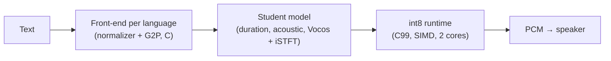

# vtts

**Tiny bilingual text-to-speech that runs entirely on ESP32 microcontrollers.** Text in, speech out of the speaker: no cloud, no network, no Linux. Text normalization, pronunciation, an int8 neural voice and the vocoder all run on the chip, in 1.2–2.6 MB of flash, faster than real time on the ESP32-P4 and the ESP32-S3. Every voice reads one main language + English, including sentences that mix both ("このWi-Fiはpasswordが必要ですか？"). Code and models are Apache-2.0.

🌐 [Website with audio samples](https://tuanpmt.github.io/vtts/) · 🤗 [Models on Hugging Face](https://huggingface.co/tuanpm/vtts) · 📚 [Documentation](docs/README.md)

## Released voices

<!-- BEGIN:released -->
| Language pair | Voice | Size M / S | RTF ESP32-P4 M / S | RTF ESP32-S3 M / S | Download |
|---|---|---|---|---|---|
| 🇻🇳 🇺🇸 Vietnamese + English | `nam-1` (male) | 2.6 MB / 1.2 MB | 0.26 / 0.18 | 0.51 / 0.30 | [v0.4.0](https://github.com/tuanpmt/vtts/releases/tag/v0.4.0) · [HF](https://huggingface.co/tuanpm/vtts/tree/main/vi-en-nam-1) |
| 🇻🇳 🇺🇸 Vietnamese + English | `nu-10` (female) | 2.6 MB / 1.2 MB | 0.26 / 0.18 | 0.51 / 0.30 | [v0.4.0](https://github.com/tuanpmt/vtts/releases/tag/v0.4.0) · [HF](https://huggingface.co/tuanpm/vtts/tree/main/vi-en-nu-10) |
| 🇰🇷 🇺🇸 Korean + English | `nu-ko` (female) | 2.6 MB / 1.2 MB | 0.26 / 0.17 | 0.49 / 0.29 | [v0.5.0](https://github.com/tuanpmt/vtts/releases/tag/v0.5.0) · [HF](https://huggingface.co/tuanpm/vtts/tree/main/ko-en-nu-ko) |
| 🇨🇳 🇺🇸 Chinese (Mandarin) + English | `nu-zh` (female) | 2.6 MB / 1.2 MB | 0.26 / 0.18 | 0.51 / 0.30 | [v0.5.0](https://github.com/tuanpmt/vtts/releases/tag/v0.5.0) · [HF](https://huggingface.co/tuanpm/vtts/tree/main/zh-en-nu-zh) |
| 🇯🇵 🇺🇸 Japanese + English | `nu-ja` (female) | 2.6 MB / 1.2 MB | 0.26 / 0.17 | 0.50 / 0.29 | [v0.6.0](https://github.com/tuanpmt/vtts/releases/tag/v0.6.0) · [HF](https://huggingface.co/tuanpm/vtts/tree/main/ja-en-nu-ja) |
<!-- END:released -->

Each voice has a quality model (M) and a lite model (S, faster, less CPU and flash); both run on both chips. RTF is synthesis time over audio time (below 1 is faster than real time). Quality, samples and the planned pairs: [docs/voices.md](docs/voices.md).

## Quick start

1. Install [ESP-IDF v6.1](https://docs.espressif.com/projects/esp-idf/) and clone this repository.
2. Download the two model files of one voice from its release (or the Hugging Face folder in the table):
   ```bash
   gh release download v0.6.0 -R tuanpmt/vtts -p '*.vtts' -D models   # Japanese + English (nu-ja)
   ```
3. Build and flash, lite model first:
   ```bash
   cd firmware/esp32
   BOARD=esp32-p4-nano ./build.sh ../../models/vtts-jaen-nuja-s-v0.6.q8.vtts ../../models/vtts-jaen-nuja-m-v0.6.q8.vtts -p PORT flash monitor
   ```
   `BOARD` is `esp32-p4-86-panel-eth-2ro` (default), `esp32-p4-nano`, `esp32-s3-touch-lcd-2.8` or `echoear`. `build.sh` picks the text front-end from the models and embeds the lexicons they need.
4. Type a sentence on the serial console and press Enter: the board speaks it. `model s` / `model m` switches the model; the other commands are in the [firmware README](firmware/esp32/README.md#serial-console).

## How it works



Each word is read by the front-end of its language (main language or English), in C on the chip and parity-tested against the Python version used for training. A 0.8–1.8M-parameter student, distilled from a ~24M-parameter VITS teacher trained only on speech synthesized from a designed voice, runs in a malloc-free int8 runtime that streams audio as it is generated. Details: [docs/architecture.md](docs/architecture.md).

## Documentation

| Topic | Where |
|---|---|
| Voices, quality per pair, audio samples, planned pairs | [docs/voices.md](docs/voices.md) |
| On-chip speed, latency, memory | [docs/reports/performance.md](docs/reports/performance.md) |
| Evaluation reports | [vi-en](docs/reports/bilingual-student-eval.md), [ko-en](docs/reports/ko-student-eval.md), [zh-en](docs/reports/zh-student-eval.md), [ja-en](docs/reports/ja-student-eval.md) |
| Firmware, boards, serial console | [firmware/esp32/README.md](firmware/esp32/README.md) |
| C runtime API | [runtime/README.md](runtime/README.md) |
| Model file format | [docs/model-format.md](docs/model-format.md) |
| Pronunciation rules and dictionaries | [docs/frontend/pronunciation-rules.md](docs/frontend/pronunciation-rules.md) |
| Architecture, training a voice, repository layout | [docs/architecture.md](docs/architecture.md) |
| Roadmap | [docs/roadmap.md](docs/roadmap.md) |
| Release history | [CHANGELOG.md](CHANGELOG.md) |
| Contributing (tests, new language or board) | [CONTRIBUTING.md](CONTRIBUTING.md) |

## License

- **Code:** Apache-2.0 ([LICENSE](LICENSE)). Parts derived from Piper/VITS keep their MIT license and the CMU Pronouncing Dictionary its BSD license; see [NOTICE](NOTICE).
- **Models:** the released `.vtts` files (v0.4.0 and later) are Apache-2.0. Their teachers are trained from random initialization only on audio generated with VoxCPM2 (Apache-2.0) from designed voices, not cloned from real people. Label audio from these models as AI-generated.
- **Built with Claude Code:** much of this project was written with [Claude Code](https://claude.com/claude-code) by Anthropic, directed and reviewed by the maintainer; such commits carry a `Co-Authored-By: Claude` trailer. This does not change any license above.
