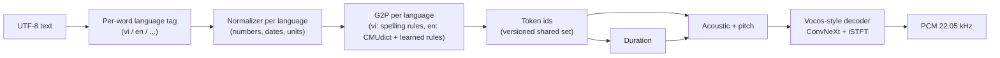

# vtts

**Tiny multilingual text-to-speech that runs entirely on ESP32 microcontrollers.** Text in, speech out of the speaker: no cloud, no network, no Linux. A C99 int8 runtime with streaming synthesis, a rule-based front-end per language, and distilled voices small enough for 1-3 MB of flash.

🇻🇳 [Tiếng Việt](README.vi.md) · 🌐 [Website with audio samples](https://tuanpmt.github.io/vtts/)

- **On the chip, end to end:** text normalization, grapheme-to-phoneme, an int8 acoustic model and an iSTFT vocoder all run on the MCU.
- **Faster than real time with streaming:** speech starts after 0.3-2.4 s depending on chip and model.
- **Two tiers per voice:** a *quality* model for ESP32-P4 and a *lite* model that fits the ESP32-S3.
- **Built to grow:** languages plug in as front-end modules on a versioned token set, so new single-language and bilingual voices reuse the same runtime, firmware and training pipeline.

## Voice catalog

| Voice | Languages | Quality (ESP32-P4) | Lite (ESP32-S3) | Status |
|---|---|---|---|---|
| Vietnamese prototype | 🇻🇳 vi | M-vocos v0.2 (1.7M params, 2.6 MB) | S-vocos v0.1 (0.8M, 1.1 MB) | **Released** (v0.3.0, non-commercial) |
| `nam-1` (male) | 🇻🇳 vi + 🇺🇸 en, code-switching | M | S | **Training**: data done (98 h), teacher in progress |
| `nu-10` (female) | 🇻🇳 vi + 🇺🇸 en, code-switching | M | S | **Training**: data generating, teacher in progress |
| English | 🇺🇸 en | M | S | Planned |
| Chinese (Mandarin) | 🇨🇳 zh | M | S | Planned |
| Chinese + English | 🇨🇳 zh + 🇺🇸 en | M | S | Planned |

Bilingual voices read single-language sentences and mixed sentences such as "Đã kết nối Bluetooth với AirPods" in one voice. The device picks the language per word (`lang vi | en | auto`).

## Hardware and performance

| Board | Chip | Lite model RTF | Quality model RTF | Speech starts (lite / quality) |
|---|---|---:|---:|---:|
| Waveshare ESP32-P4-86-Panel, ESP32-P4-NANO | ESP32-P4, 360 MHz, PIE SIMD | 0.20-0.24 | 0.34-0.42 | 0.3 s / 1.2 s |
| Waveshare ESP32-S3-Touch-LCD-2.8 | ESP32-S3R8, 240 MHz, 8 MB PSRAM | 0.42-0.47 | 0.85-0.99 | 0.8 s / 2.4 s |

RTF below 1 means faster than real time. Both chips use two cores and int8 SIMD kernels. Audio generated on the chip matches the C runtime on a PC (correlation ≥ 0.99999). The ESP32-S3 needs at least 8 MB of PSRAM. Details, CPU load and the optimizations so far: [docs/reports/performance.md](docs/reports/performance.md) (Vietnamese).

## Quality (Vietnamese prototype)

50 out-of-domain sentences (device prompts, numbers, names, questions, long sentences). CER is the character error rate when an ASR model (PhoWhisper-large) transcribes the audio, tones included; UTMOS predicts naturalness. vtts audio comes from the int8 C runtime.

| System | Params | CER ↓ | UTMOS ↑ | Whistle ↓ |
|---|---:|---:|---:|---:|
| **vtts M-vocos v0.2** | 1.73M | **0.012** | 2.19 | 7.8 |
| vtts S-vocos v0.1 | 0.77M | 0.023 | 1.86 | 61.5 |
| Teacher VITS | 23.7M | 0.015 | 2.50 | 14.8 |
| sanoTTS `vi` | 1.57M | 0.064 | 1.49 | 1.5 |
| Piper `vi_VN-25hours_single` | — | 0.089 | 2.06 | 1.1 |

### Listen (generated on an ESP32-P4)

| Sentence | Quality (M) | Lite (S) |
|---|---|---|
| Xin chào, tôi là giọng đọc tiếng Việt chạy hoàn toàn trên chip ESP32-P4. | [▶ M](https://raw.githubusercontent.com/tuanpmt/vtts/main/docs/audio/p4-m-intro.mp3) | [▶ S](https://raw.githubusercontent.com/tuanpmt/vtts/main/docs/audio/p4-s-intro.mp3) |
| Mưa kéo dài hơn hai giờ khiến nhiều đường ở Long Thành, Nhơn Trạch ngập gần nửa mét, xe chết máy, người dân phải dắt bộ, sáng 15/11. | [▶ M](https://raw.githubusercontent.com/tuanpmt/vtts/main/docs/audio/p4-m-news.mp3) | [▶ S](https://raw.githubusercontent.com/tuanpmt/vtts/main/docs/audio/p4-s-news.mp3) |
| Pin còn 15%, nhiệt độ phòng là 28°C. Báo thức đã được đặt lúc 6 giờ 30 sáng mai. | [▶ M](https://raw.githubusercontent.com/tuanpmt/vtts/main/docs/audio/p4-m-numbers.mp3) | [▶ S](https://raw.githubusercontent.com/tuanpmt/vtts/main/docs/audio/p4-s-numbers.mp3) |
| Bạn có muốn bật đèn phòng khách không? | [▶ M](https://raw.githubusercontent.com/tuanpmt/vtts/main/docs/audio/p4-m-question.mp3) | [▶ S](https://raw.githubusercontent.com/tuanpmt/vtts/main/docs/audio/p4-s-question.mp3) |
| A 5-sentence weather bulletin, about 30 s | [▶ M](https://raw.githubusercontent.com/tuanpmt/vtts/main/docs/audio/p4-m-paragraph.mp3) | [▶ S](https://raw.githubusercontent.com/tuanpmt/vtts/main/docs/audio/p4-s-paragraph.mp3) |

## Quick start

### Flash a board

You need ESP-IDF v6.1 and the two model files from [Releases](https://github.com/tuanpmt/vtts/releases).

```bash
gh release download v0.3.0 -R tuanpmt/vtts -p '*.vtts' -D models
cd firmware/esp32
BOARD=nano ./build.sh ../../models/vtts-vi-s-v0.1.q8.vtts ../../models/vtts-vi-m-v0.2.q8.vtts -p PORT flash monitor
```

| `BOARD=` | Board | Speaker path | Default volume |
|---|---|---|---|
| `panel` (default) | ESP32-P4-86-Panel | ES8311 | `vol 70`, `gain 0` |
| `nano` | ESP32-P4-NANO | ES8311 | `vol 90`, `gain 12` |
| `s3` | ESP32-S3-Touch-LCD-2.8 | PCM5101 | `vol 80`, `gain 6` |

Each board's speaker code lives in `firmware/esp32/main/board_audio.c`; adding a board means one Kconfig choice and a pin block. See [firmware/esp32/README.md](firmware/esp32/README.md).

### Serial console

Type a sentence and press Enter; the board speaks it. Other commands:

| Command | Effect |
|---|---|
| `model s` / `model m` | Lite or quality model |
| `vol 0-100`, `gain dB` | Volume; the digital gain has a soft limiter |
| `speed 0.7-1.6` | Speaking rate (higher is slower) |
| `expr 0.5-2.5` | Intonation range (models with a pitch predictor) |
| `bench`, `prof` | RTF on four fixed sentences; time per stage |
| `selftest` | SIMD kernels against plain C, including both cores at once |
| `dump <text>` | Synthesize and send PCM to the PC: `scripts/device/say.py PORT "dump <text>" --dump-dir out/` |

### On a PC

```bash
uv sync --extra gpu                 # Python 3.11, PyTorch
uv run pytest -q                    # tests, including the C runtime under ASan/UBSan
make -C runtime build/vtts_cli      # command-line synthesizer
uv run python -c "from vtts.frontend.text import text_to_ids; print(text_to_ids('Bật Bluetooth lúc 7:30.', 'vi'))"
```

## Architecture



- **Distillation.** Each voice starts from a large VITS teacher (~24M parameters). The teacher produces durations, latents and audio for tens of thousands of sentences, and a 0.8-1.7M-parameter student learns from them in three stages (front, decoder, joint with multi-resolution discriminators). The student is exported to int8 and runs on the chip.
- **Training data.** The prototype uses a public single-speaker corpus. The bilingual voices use speech synthesized with VoxCPM2 (Apache-2.0) in one designed voice, with sentences chosen to cover rare syllables, numbers and code-switching.
- **Front-end parity.** Every language's front-end exists in Python (training) and C (device), and tests check they produce identical token ids.

## Adding a language

Languages share one runtime and one firmware; a new one needs:

1. **Tokens.** Append the language's phoneme or spelling tokens to the shared token set as a new version. Existing ids never change, so older models keep working. Today: v1 = Vietnamese (65 tokens), v2 = v1 + English ARPAbet and stress (107 tokens).
2. **Front-end.** A normalizer (numbers, dates, currency, units) and a G2P, in Python and C with a parity test. The language tagger decides which front-end reads each word.
3. **Data.** Recordings or synthesized speech with transcripts; the pipeline does not depend on the source.
4. **Train.** The teacher, then quality and lite students. The model file header carries the vocabulary size, so the runtime needs no change.

## Repository layout

| Path | Contents |
|---|---|
| `runtime/` | malloc-free C99 runtime: fp32/int8 synthesis, bit-exact streaming, device text front-end; `ports/` has SIMD kernels for ESP32-P4 and ESP32-S3 and the two-core scheduler |
| `firmware/esp32/` | Example app for ESP32-P4 and ESP32-S3 boards: type text on the serial console, the board speaks |
| `src/vtts/` | Python package: front-ends, data, evaluation, teacher, student, export |
| `scripts/` | Pipeline steps: `data/`, `frontend/`, `teacher/`, `student/`, `eval/`, `device/` |
| `eval/` | Evaluation sentence sets, baselines, A/B listening configuration |
| `docs/` | Design, model file format, measurement reports |
| `tests/` | Python and C runtime tests (golden, int8, streaming, front-end parity, fuzz) |

## Roadmap

- [x] Vietnamese prototype voices, quality and lite, on ESP32-P4 and ESP32-S3
- [x] English front-end (normalizer, CMUdict, learned letter-to-sound) and per-word language tagging
- [ ] Bilingual Vietnamese + English voices `nam-1` and `nu-10` (training)
- [ ] English front-end on the device (C, parity-tested)
- [ ] Faster ESP32-S3 runtime so the quality model runs with margin
- [ ] English, Chinese and Chinese + English voices
- [ ] Commercially usable licenses for all released voices

## License

- **Code:** Apache-2.0 (`LICENSE`). Parts derived from Piper/VITS keep their MIT license, and the CMU Pronouncing Dictionary keeps its BSD license; see `NOTICE`.
- **Models in Releases:** the current Vietnamese prototype models are CC BY-NC 4.0 (non-commercial). Their teacher was initialized from a non-commercial Piper checkpoint, and the commercial terms of the training corpus are unclear. The Apache-2.0 code license does not apply to model files.
- **Synthetic voices:** generated with VoxCPM2 (Apache-2.0) from designed voices. Audio from these models should be labeled as AI-generated.
