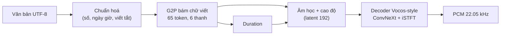

# vtts

Giọng đọc tiếng Việt nhỏ gọn, chạy hoàn toàn trên vi điều khiển ESP32-P4 và ESP32-S3: văn bản vào, âm thanh ra loa, không cần mạng.

🇺🇸 [English](README.md) · 🌐 [Trang nghe thử](https://tuanpmt.github.io/vtts/) · 🤗 [Model trên Hugging Face](https://huggingface.co/tuanpm/vtts-vi)

- **Chạy trên chip:** từ văn bản đến âm thanh đều chạy trên chip: chuẩn hoá văn bản, G2P, model int8, iSTFT. Không cần server hay mạng.
- **Nhanh hơn thời gian thực:** streaming, bắt đầu phát sau 0.3–2.4 s tuỳ chip và model.
- **Nhỏ:** model 1.1 MB (S) hoặc 2.6 MB (M), runtime C99 không dùng `malloc`.
- **Đọc đúng số, ngày giờ, đơn vị:** "16/11/2026, 14:35, 28,5°C" được đọc thành chữ trước khi tổng hợp.

## Board hỗ trợ và hiệu năng

| Board | Chip | RTF S | RTF M | Bắt đầu phát S / M | CPU khi phát (M) |
|---|---|---:|---:|---:|---:|
| Waveshare ESP32-P4-86-Panel, ESP32-P4-NANO | ESP32-P4, 360 MHz | 0.20–0.24 | 0.34–0.42 | 0.3 / 1.2 s | 35% / 28% |
| Waveshare ESP32-S3-Touch-LCD-2.8 | ESP32-S3R8, 240 MHz, PSRAM 8 MB | 0.42–0.47 | 0.85–0.99 | 0.8 / 2.4 s | 75% / 62% |

RTF < 1 nghĩa là tổng hợp nhanh hơn thời gian thực. Cả hai chip đều dùng 2 lõi và lệnh SIMD int8. Audio trên chip khớp với runtime chạy trên máy tính (tương quan ≥ 0.99999). Số đo chi tiết, tải CPU và các bước tối ưu: [docs/reports/performance.md](docs/reports/performance.md).

## Chất lượng

Đo trên 50 câu ngoài miền (thông báo thiết bị, số, tên riêng, câu hỏi, câu dài). CER là tỉ lệ lỗi ký tự khi ASR (PhoWhisper-large) nghe lại, có tính dấu thanh. UTMOS dự đoán độ tự nhiên. Audio của vtts được tạo bằng chính runtime int8 chạy trên chip.

| Hệ thống | Tham số | CER ↓ | UTMOS ↑ | Tiếng rít ↓ |
|---|---:|---:|---:|---:|
| **vtts M-vocos v0.2** | 1.73M | **0.012** | 2.19 | 7.8 |
| vtts S-vocos v0.1 | 0.77M | 0.023 | 1.86 | 61.5 |
| Teacher VITS | 23.7M | 0.015 | 2.50 | 14.8 |
| sanoTTS `vi` | 1.57M | 0.064 | 1.49 | 1.5 |
| Piper `vi_VN-25hours_single` | — | 0.089 | 2.06 | 1.1 |

Model M v0.2 có bộ dự đoán cao độ và năng lượng. Trên 50 câu giữ lại, thời lượng trung bình mỗi câu là 5.80 s (người đọc thật: 6.08 s), độ dao động cao độ 2.37 semitone (người thật: 2.60).

## Nghe thử

Audio sinh trực tiếp trên ESP32-P4 bằng lệnh `dump` của firmware, gửi về máy tính qua serial, chỉ nén sang mp3.

| Câu | M v0.2 | S v0.1 |
|---|---|---|
| Xin chào, tôi là giọng đọc tiếng Việt chạy hoàn toàn trên chip ESP32-P4. | [▶ M](https://raw.githubusercontent.com/tuanpmt/vtts/main/docs/audio/p4-m-intro.mp3) | [▶ S](https://raw.githubusercontent.com/tuanpmt/vtts/main/docs/audio/p4-s-intro.mp3) |
| Mưa kéo dài hơn hai giờ khiến nhiều đường ở Long Thành, Nhơn Trạch ngập gần nửa mét, xe chết máy, người dân phải dắt bộ, sáng 15/11. | [▶ M](https://raw.githubusercontent.com/tuanpmt/vtts/main/docs/audio/p4-m-news.mp3) | [▶ S](https://raw.githubusercontent.com/tuanpmt/vtts/main/docs/audio/p4-s-news.mp3) |
| Pin còn 15%, nhiệt độ phòng là 28°C. Báo thức đã được đặt lúc 6 giờ 30 sáng mai. | [▶ M](https://raw.githubusercontent.com/tuanpmt/vtts/main/docs/audio/p4-m-numbers.mp3) | [▶ S](https://raw.githubusercontent.com/tuanpmt/vtts/main/docs/audio/p4-s-numbers.mp3) |
| Bạn có muốn bật đèn phòng khách không? | [▶ M](https://raw.githubusercontent.com/tuanpmt/vtts/main/docs/audio/p4-m-question.mp3) | [▶ S](https://raw.githubusercontent.com/tuanpmt/vtts/main/docs/audio/p4-s-question.mp3) |
| Đoạn bản tin thời tiết 5 câu, dài khoảng 30 giây | [▶ M](https://raw.githubusercontent.com/tuanpmt/vtts/main/docs/audio/p4-m-paragraph.mp3) | [▶ S](https://raw.githubusercontent.com/tuanpmt/vtts/main/docs/audio/p4-s-paragraph.mp3) |

## Bắt đầu nhanh

### Nạp firmware

Cần ESP-IDF v6.1 và hai file model trong [Releases](https://github.com/tuanpmt/vtts/releases).

```bash
gh release download v0.3.0 -R tuanpmt/vtts -p '*.vtts' -D models
cd firmware/esp32
BOARD=nano ./build.sh ../../models/vtts-vi-s-v0.1.q8.vtts ../../models/vtts-vi-m-v0.2.q8.vtts -p PORT flash monitor
```

| `BOARD=` | Board | Loa | Âm lượng mặc định |
|---|---|---|---|
| `panel` (mặc định) | ESP32-P4-86-Panel | ES8311 | `vol 70`, `gain 0` |
| `nano` | ESP32-P4-NANO | ES8311 | `vol 90`, `gain 12` |
| `s3` | ESP32-S3-Touch-LCD-2.8 | PCM5101 | `vol 80`, `gain 6` |

Phần loa của mỗi board nằm trong `firmware/esp32/main/board_audio.c`. Muốn thêm board thì thêm một lựa chọn trong `main/Kconfig.projbuild` và khai báo chân. Chi tiết trong [firmware/esp32/README.md](firmware/esp32/README.md).

### Lệnh trên cổng serial

Gõ một câu tiếng Việt rồi Enter để board đọc ra loa. Các lệnh khác:

| Lệnh | Tác dụng |
|---|---|
| `model s` / `model m` | Chọn model nhỏ (nhanh) hoặc lớn (hay hơn) |
| `vol 0-100`, `gain dB` | Âm lượng; gain số có bộ giới hạn mềm nên không làm vỡ tiếng |
| `speed 0.7-1.6` | Tốc độ đọc, lớn hơn là chậm hơn |
| `expr 0.5-2.5` | Độ lên xuống của ngữ điệu (model M) |
| `bench`, `prof` | Đo RTF trên 4 câu cố định; thời gian theo từng tầng |
| `selftest` | Kiểm tra kernel SIMD với kết quả tính bằng C |
| `dump <câu>` | Tổng hợp và gửi audio về máy tính: `scripts/device/say.py PORT "dump <câu>" --dump-dir out/` |

### Trên máy tính

```bash
uv sync --extra gpu                 # Python 3.11, PyTorch
uv run pytest -q                    # test, gồm cả build runtime C với ASan/UBSan
make -C runtime build/vtts_cli      # công cụ dòng lệnh C
uv run python -c "from vtts.frontend.text import text_to_ids; print(text_to_ids('Xin chào, hôm nay là 15/11.'))"
```

## Kiến trúc



- **Chưng cất:** model nhỏ (student) được chưng cất từ một teacher VITS lớn. Teacher sinh thời lượng, latent và âm thanh cho hàng chục nghìn câu. Student học lại qua ba giai đoạn: front, decoder, rồi joint với bộ phân biệt đa phân giải.
- **Bộ token bám chữ viết, không gắn với vùng miền:** `tr`/`ch`, `s`/`x`, `r`/`d`/`gi` là các token riêng, 6 thanh theo dấu viết. Thêm giọng vùng miền khác chỉ cần thêm dữ liệu.

Chi tiết thiết kế trong `docs/design/`, định dạng file model trong `docs/model-format.md`.

## Cấu trúc repo

| Thư mục | Nội dung |
|---|---|
| `runtime/` | Runtime C99 không `malloc`: tổng hợp fp32/int8, streaming khớp từng bit với tổng hợp cả câu, front-end văn bản (`vtts_text`). `ports/` chứa kernel SIMD cho ESP32-P4 và ESP32-S3, và phần chia việc cho 2 lõi |
| `firmware/esp32/` | Ứng dụng mẫu cho các board ESP32-P4 và ESP32-S3: gõ câu qua serial, board đọc ra loa |
| `src/vtts/` | Gói Python: front-end, dữ liệu, đánh giá, teacher, student, export |
| `scripts/` | Các bước pipeline: `data/`, `frontend/`, `teacher/`, `student/`, `eval/`, `device/` |
| `eval/` | Tập câu đánh giá, baseline, cấu hình trang nghe A/B |
| `docs/` | Thiết kế, định dạng model, báo cáo số đo |
| `tests/` | Test Python và runtime C (golden, int8, streaming, parity front-end, fuzz) |

## Train lại

1. Dữ liệu: `scripts/data/prepare_infore.py` → `score_dataset.py` → `filter_and_split.py`
2. Teacher: `scripts/teacher/train_teacher.py`, đánh giá bằng `eval_checkpoints.py`
3. Chưng cất: `scripts/student/build_distill_pack.py` → `convert_shards.py` → `add_prosody.py` → `run_prosody_chain.sh`
4. Export và kiểm tra: `export_student.py --int8`, `render_student_c.py`, `scripts/eval/eval_dir.py`

Quy trình không phụ thuộc nguồn dữ liệu: thay thư mục audio và transcript là chạy lại được từ đầu.

## Trạng thái

- **Model hiện tại là prototype:** train trên InfoRe1 (25 giờ, một người đọc). Ngữ điệu vẫn hơi đều, vì người đọc của bộ dữ liệu đọc khá đều giọng.
- **Đang train hai giọng song ngữ Việt–Anh** (`nam-1` nam, `nu-10` nữ), dữ liệu sinh bằng VoxCPM2 (Apache-2.0) với giọng thiết kế, đọc được cả câu trộn hai thứ tiếng. Mỗi giọng sẽ có bản chất lượng cho ESP32-P4 và bản nhẹ cho ESP32-S3. Tiếp theo là tiếng Anh, tiếng Trung và Trung–Anh.

## Giấy phép

- **Code:** Apache-2.0 (`LICENSE`). Phần lấy từ Piper/VITS giữ giấy phép MIT gốc, xem `NOTICE`.
- **Model `.vtts` trong Releases:** CC BY-NC 4.0, chỉ dùng phi thương mại.
  - Lý do: teacher được khởi tạo từ checkpoint Piper lessac (dữ liệu gốc chỉ cho dùng phi thương mại), và điều khoản thương mại của InfoRe1 chưa rõ.
  - Giấy phép Apache-2.0 của code không áp dụng cho các file model.
  - Checkpoint PyTorch và teacher không được phát hành.
