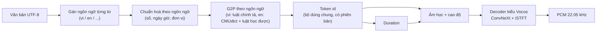

# vtts

**Text-to-speech đa ngôn ngữ nhỏ gọn, chạy hoàn toàn trên vi điều khiển ESP32.** Văn bản vào, âm thanh ra loa: không cloud, không cần mạng, không cần Linux. Gồm runtime C99 int8 tổng hợp streaming, front-end theo luật cho từng ngôn ngữ, và các giọng chưng cất đủ nhỏ để nằm trong 1–3 MB flash.

> Bản dịch tiếng Việt của [README.md](README.md). Khi hai bản khác nhau, bản tiếng Anh là bản chính.

🇺🇸 [English](README.md) · 🌐 [Trang nghe thử](https://tuanpmt.github.io/vtts/) · 🤗 [Model trên Hugging Face](https://huggingface.co/tuanpm/vtts) · 📚 [Tài liệu](docs/README.md)

- **Chạy trọn trên chip:** chuẩn hoá văn bản, G2P, model âm học int8 và vocoder iSTFT đều chạy trên MCU.
- **Nhanh hơn thời gian thực, streaming:** bắt đầu phát sau 0.3–2.4 s tuỳ chip và model.
- **Hai bản cho mỗi giọng:** bản *chất lượng* cho ESP32-P4 và bản *nhẹ* chạy được cả trên ESP32-S3.
- **Nhỏ và dự đoán được:** model 1.1–2.6 MB, runtime C99 không dùng `malloc` (caller cấp một arena có kích thước biết trước).
- **Dễ mở rộng:** mỗi ngôn ngữ là một module front-end trên bộ token có đánh phiên bản, nên các giọng đơn ngữ và song ngữ mới dùng chung runtime, firmware và quy trình train.

## Danh mục giọng

<!-- BEGIN:voices -->
| Giọng | Ngôn ngữ | Chất lượng (ESP32-P4) | Nhẹ (ESP32-S3) | Trạng thái |
|---|---|---|---|---|
| Prototype tiếng Việt | 🇻🇳 vi | M-vocos v0.2 (1.73M tham số, 2.6 MB) | S-vocos v0.1 (0.77M tham số, 1.1 MB) | **Đã phát hành trong v0.3.0 (phi thương mại)** |
| `nam-1` (nam) | 🇻🇳 vi + 🇺🇸 en, đọc câu trộn | M | S | **Đang train: ~98 giờ dữ liệu, đang train teacher** |
| `nu-10` (nữ) | 🇻🇳 vi + 🇺🇸 en, đọc câu trộn | M | S | **Đang train: ~98 giờ dữ liệu, đang train teacher** |
| Tiếng Anh | 🇺🇸 en | M | S | Dự kiến |
| Tiếng Trung (phổ thông) | 🇨🇳 zh | M | S | Dự kiến |
| Trung + Anh | 🇨🇳 zh + 🇺🇸 en, đọc câu trộn | M | S | Dự kiến |
<!-- END:voices -->

Giọng song ngữ đọc được câu một thứ tiếng và câu trộn như "Đã kết nối Bluetooth với AirPods" bằng cùng một giọng; front-end chọn ngôn ngữ cho từng từ. Front-end tiếng Anh đã xong bản Python; bước tiếp theo trước khi phát hành giọng song ngữ là port sang C để chạy trên chip.

File model được đính kèm ở [GitHub Releases](https://github.com/tuanpmt/vtts/releases) và có bản sao trên [Hugging Face](https://huggingface.co/tuanpm/vtts) (mỗi giọng một thư mục; model tiếng Việt đã phát hành nằm trong `vi/`).

## Phần cứng và hiệu năng

<!-- BEGIN:hardware -->
| Board | Chip | RTF model nhẹ | RTF model chất lượng | Bản v0.3.0 (nhẹ / chất lượng) |
|---|---|---|---|---|
| Waveshare ESP32-P4-86-Panel, ESP32-P4-NANO | ESP32-P4, 360 MHz, PIE SIMD | 0.17 | 0.27 | 0.20–0.24 / 0.34–0.42 |
| EchoEar 2.0, Waveshare ESP32-S3-Touch-LCD-2.8 | ESP32-S3, 240 MHz, 8 MB PSRAM | 0.28 | 0.51 | 0.42–0.47 / 0.85–0.99 |

RTF dưới 1 nghĩa là nhanh hơn thời gian thực. Số đo của nhánh main hiện tại; cột cuối là bản phát hành v0.3.0.
<!-- END:hardware -->

Cả hai chip đều dùng 2 lõi và kernel SIMD int8. Audio sinh trên chip khớp với runtime C chạy trên máy tính (tương quan ≥ 0.99999). ESP32-S3 cần PSRAM ít nhất 8 MB. Số đo chi tiết, tải CPU và các bước tối ưu: [docs/reports/performance.md](docs/reports/performance.md). Việc tăng tốc runtime đang tiếp tục: [docs/reports/runtime-optimization-research.md](docs/reports/runtime-optimization-research.md).

## Công nghệ

<!-- BEGIN:tech -->
`UTF-8 text → Language tag per word → Normalizer (numbers, dates, units) → G2P → Duration + acoustic model (int8) → Vocos decoder + iSTFT → PCM 22.05 kHz → I2S speaker`

- **Runtime:** C99, không malloc: bên gọi cấp một arena có kích thước biết trước. Trọng số int8 với scale theo kênh, activation int8 với một scale mỗi frame. Streaming giữ state theo từng layer nên mỗi frame chỉ tính một lần.
- **Trên chip:** Kernel int8 SIMD cho ESP32-P4 (PIE) và ESP32-S3 (SIMD 128-bit), chia việc cho cả hai core bằng FreeRTOS. Audio trên chip khớp với C runtime tham chiếu chạy trên PC.
- **Model:** Teacher VITS (~24M tham số) được distill thành student 0,8–1,7M tham số: bộ dự đoán duration, acoustic model có pitch và energy, decoder ConvNeXt kiểu Vocos với head iSTFT.
- **Front-end:** Mỗi ngôn ngữ một front-end, viết bằng Python cho train và C cho thiết bị, có test bảo đảm ra cùng token id. Tiếng Việt: G2P theo quy tắc chính tả, 6 thanh. Tiếng Anh: CMUdict cùng quy tắc letter-to-sound học từ CMUdict.
- **Dữ liệu:** Bản tiếng Việt prototype dùng một corpus công khai một người đọc. Các giọng song ngữ dùng khoảng 98 giờ mỗi giọng, sinh bằng VoxCPM2 (Apache-2.0) từ giọng thiết kế.
- **Công cụ:** PyTorch để train, ESP-IDF v6.1 cho firmware, PhoWhisper và Whisper đo độ dễ hiểu, UTMOS và DNSMOS đo độ tự nhiên và độ sạch.
<!-- END:tech -->

Chi tiết hơn ở phần [Kiến trúc](#kiến-trúc).

## Chất lượng (prototype tiếng Việt)

Đo trên 50 câu ngoài miền (thông báo thiết bị, số, tên riêng, câu hỏi, câu dài). CER là tỉ lệ lỗi ký tự khi ASR (PhoWhisper-large) nghe lại, có tính dấu thanh; UTMOS dự đoán độ tự nhiên; chỉ số rít đếm tiếng rít trên mỗi giây. Audio của vtts được tạo bằng runtime C int8.

| Hệ thống | Tham số | CER ↓ | UTMOS ↑ | Tiếng rít ↓ |
|---|---:|---:|---:|---:|
| **vtts M-vocos v0.2** | 1.73M | **0.012** | 2.19 | 7.8 |
| vtts S-vocos v0.1 | 0.77M | 0.023 | 1.86 | 61.5 |
| Teacher VITS | 23.7M | 0.015 | 2.50 | 14.8 |
| sanoTTS `vi` | 1.57M | 0.064 | 1.49 | 1.5 |
| Piper `vi_VN-25hours_single` | — | 0.089 | 2.06 | 1.1 |

Model M-vocos v0.2 có bộ dự đoán cao độ và năng lượng. Trên 50 câu giữ lại, thời lượng trung bình mỗi câu là 5.80 s (người đọc thật: 6.08 s), độ dao động cao độ 2.37 semitone (người thật: 2.60). Chi tiết baseline: [docs/reports/baseline.md](docs/reports/baseline.md).

### Nghe thử (sinh trên ESP32-P4)

Audio sinh trực tiếp trên chip bằng lệnh `dump` của firmware, gửi về máy tính qua serial, chỉ nén sang mp3. Thêm mẫu trên [trang web](https://tuanpmt.github.io/vtts/).

<!-- BEGIN:samples -->
🇻🇳 **Tiếng Việt**

| Câu | Quality | Lite |
|---|---|---|
| Xin chào, tôi là giọng đọc tiếng Việt chạy hoàn toàn trên chip ESP32-P4. | [▶ Quality](https://raw.githubusercontent.com/tuanpmt/vtts/main/docs/audio/p4-m-intro.mp3) | [▶ Lite](https://raw.githubusercontent.com/tuanpmt/vtts/main/docs/audio/p4-s-intro.mp3) |
| Mưa kéo dài hơn hai giờ khiến nhiều đường ở Long Thành, Nhơn Trạch ngập gần nửa mét, xe chết máy, người dân phải dắt bộ, sáng 15/11. | [▶ Quality](https://raw.githubusercontent.com/tuanpmt/vtts/main/docs/audio/p4-m-news.mp3) | [▶ Lite](https://raw.githubusercontent.com/tuanpmt/vtts/main/docs/audio/p4-s-news.mp3) |
| Pin còn 15%, nhiệt độ phòng là 28°C. Báo thức đã được đặt lúc 6 giờ 30 sáng mai. | [▶ Quality](https://raw.githubusercontent.com/tuanpmt/vtts/main/docs/audio/p4-m-numbers.mp3) | [▶ Lite](https://raw.githubusercontent.com/tuanpmt/vtts/main/docs/audio/p4-s-numbers.mp3) |
| Bạn có muốn bật đèn phòng khách không? | [▶ Quality](https://raw.githubusercontent.com/tuanpmt/vtts/main/docs/audio/p4-m-question.mp3) | [▶ Lite](https://raw.githubusercontent.com/tuanpmt/vtts/main/docs/audio/p4-s-question.mp3) |
| Bản tin thời tiết 5 câu (dấu phẩy, dấu chấm, số đọc thành chữ), khoảng 30 giây. | [▶ Quality](https://raw.githubusercontent.com/tuanpmt/vtts/main/docs/audio/p4-m-paragraph.mp3) | [▶ Lite](https://raw.githubusercontent.com/tuanpmt/vtts/main/docs/audio/p4-s-paragraph.mp3) |
<!-- END:samples -->

## Bắt đầu nhanh

### Nạp firmware

Cần ESP-IDF v6.1 và hai file model từ [Releases](https://github.com/tuanpmt/vtts/releases) hoặc [Hugging Face](https://huggingface.co/tuanpm/vtts).

```bash
gh release download v0.3.0 -R tuanpmt/vtts -p '*.vtts' -D models
cd firmware/esp32
BOARD=nano ./build.sh ../../models/vtts-vi-s-v0.1.q8.vtts ../../models/vtts-vi-m-v0.2.q8.vtts -p PORT flash monitor
```

<!-- BEGIN:boards -->
| `BOARD=` | Board | Loa | Âm lượng mặc định |
|---|---|---|---|
| `panel` (mặc định) | ESP32-P4-86-Panel | ES8311 | `vol 70`, `gain 0` |
| `nano` | ESP32-P4-NANO | ES8311 | `vol 90`, `gain 12` |
| `s3` | ESP32-S3-Touch-LCD-2.8 | PCM5101 | `vol 80`, `gain 6` |
| `echoear` | EchoEar 2.0 (ESP32-S3) | ES8311 | `vol 75`, `gain 6` |
<!-- END:boards -->

Phần loa của mỗi board nằm trong `firmware/esp32/main/board_audio.c`; thêm board chỉ cần một lựa chọn Kconfig và một khối khai báo chân. Xem [firmware/esp32/README.md](firmware/esp32/README.md).

### Lệnh trên cổng serial

Gõ một câu rồi Enter để board đọc ra loa. Các lệnh khác:

| Lệnh | Tác dụng |
|---|---|
| `model s` / `model m` | Chọn model nhẹ hoặc model chất lượng |
| `vol 0-100`, `gain dB` | Âm lượng; gain số có bộ giới hạn mềm |
| `speed 0.7-1.6` | Tốc độ đọc (lớn hơn là chậm hơn) |
| `expr 0.5-2.5` | Độ lên xuống của ngữ điệu (model có bộ dự đoán cao độ) |
| `bench`, `prof` | RTF trên 4 câu cố định; thời gian theo từng tầng |
| `selftest` | Kiểm tra kernel SIMD với kết quả tính bằng C, gồm cả trường hợp hai lõi chạy cùng lúc |
| `dump <câu>` | Tổng hợp và gửi PCM về máy tính: `scripts/device/say.py PORT "dump <câu>" --dump-dir out/` |

### Trên máy tính

```bash
uv sync --extra gpu                 # Python 3.11, PyTorch
uv run pytest -q                    # test, gồm cả runtime C chạy với ASan/UBSan
make -C runtime build/vtts_cli      # công cụ tổng hợp dòng lệnh
uv run python -c "from vtts.frontend.text import text_to_ids; print(text_to_ids('Bật Bluetooth lúc 7:30.', 'vi'))"
```

## Kiến trúc



- **Chưng cất.** Mỗi giọng bắt đầu từ một teacher VITS lớn (~24M tham số). Teacher sinh thời lượng, latent và âm thanh cho hàng chục nghìn câu; một student 0.8–1.7M tham số học lại qua ba giai đoạn (front, decoder, joint với bộ phân biệt đa phân giải). Student được export sang int8 và chạy trên chip.
- **G2P tiếng Việt bám chữ viết.** Token đi theo chữ viết, không gắn với một phương ngữ (`tr`/`ch`, `s`/`x`, `r`/`d`/`gi` là các token riêng; 6 thanh lấy từ dấu), nên thêm giọng vùng miền chỉ cần thêm dữ liệu.
- **Dữ liệu train.** Prototype dùng một bộ dữ liệu công khai một người đọc (InfoRe1, 25 giờ). Các giọng song ngữ dùng audio sinh bằng VoxCPM2 (Apache-2.0), mỗi giọng là một giọng thiết kế, với tập câu chọn để phủ âm tiết hiếm, số và câu trộn.
- **Front-end khớp nhau.** Front-end của mỗi ngôn ngữ có bản Python (train) và bản C (thiết bị); test kiểm tra hai bản cho ra cùng token id.

Tài liệu thiết kế, định dạng file model và các báo cáo số đo được liệt kê trong [docs/README.md](docs/README.md).

## Thêm một ngôn ngữ

Mọi ngôn ngữ dùng chung một runtime và một firmware; ngôn ngữ mới cần:

1. **Token.** Thêm token âm vị hoặc chữ viết của ngôn ngữ vào bộ token chung dưới dạng một phiên bản mới. Id cũ không bao giờ đổi, nên model cũ vẫn chạy. Hiện có: v1 = tiếng Việt (65 token), v2 = v1 + ARPAbet tiếng Anh và trọng âm (107 token).
2. **Front-end.** Bộ chuẩn hoá (số, ngày, tiền tệ, đơn vị) và G2P, có bản Python và C cùng test parity. Bộ gán ngôn ngữ quyết định front-end nào đọc từng từ.
3. **Dữ liệu.** Bản thu âm hoặc audio tổng hợp kèm transcript; quy trình không phụ thuộc nguồn dữ liệu.
4. **Train.** Teacher, rồi student bản chất lượng và bản nhẹ. Header của file model ghi kích thước bộ token, nên runtime không cần sửa.

Chi tiết trong [CONTRIBUTING.md](CONTRIBUTING.md).

## Train một giọng

1. **Dữ liệu.** Bộ thu âm: `scripts/data/prepare_infore.py` → `score_dataset.py` → `filter_and_split.py`. Bộ tổng hợp: `build_bilingual_corpus.py` → `synth_voxcpm.py` → `synth_to_csv.py`.
2. **Teacher.** `scripts/teacher/train_teacher.py`, đánh giá bằng `eval_checkpoints.py`.
3. **Chưng cất.** `scripts/student/build_distill_pack.py` → `convert_shards.py` → `add_prosody.py` → `run_prosody_chain.sh`.
4. **Export và kiểm tra.** `export_student.py --int8`, `render_student_c.py`, `scripts/eval/eval_dir.py`.

Mỗi script ghi cách dùng ở đầu file.

## Cấu trúc repo

| Thư mục | Nội dung |
|---|---|
| `runtime/` | Runtime C99 không `malloc`: tổng hợp fp32/int8, streaming khớp từng bit, front-end văn bản cho thiết bị; `ports/` chứa kernel SIMD cho ESP32-P4 và ESP32-S3 và phần chia việc cho 2 lõi |
| `firmware/esp32/` | Ứng dụng mẫu cho các board ESP32-P4 và ESP32-S3: gõ câu qua serial, board đọc ra loa |
| `src/vtts/` | Gói Python: front-end, dữ liệu, đánh giá, teacher, student, export |
| `scripts/` | Các bước pipeline: `data/`, `frontend/`, `teacher/`, `student/`, `eval/`, `device/` |
| `eval/` | Tập câu đánh giá, baseline, cấu hình trang nghe A/B |
| `docs/` | Tài liệu thiết kế, định dạng model, báo cáo số đo, trang web ([mục lục](docs/README.md)) |
| `tests/` | Test Python và runtime C (golden, int8, streaming, parity front-end, fuzz) |

## Lộ trình

- [x] Giọng prototype tiếng Việt, bản chất lượng và bản nhẹ, trên ESP32-P4 và ESP32-S3
- [x] Front-end tiếng Anh bằng Python (chuẩn hoá, CMUdict, letter-to-sound học được) và gán ngôn ngữ từng từ
- [x] Dữ liệu tổng hợp cho hai giọng song ngữ `nam-1` và `nu-10`
- [ ] Giọng song ngữ Việt + Anh `nam-1` và `nu-10` (đang train teacher)
- [ ] Front-end tiếng Anh trên thiết bị (C, có test parity)
- [ ] Runtime nhanh hơn để model chất lượng chạy dư sức trên ESP32-S3 (đang làm)
- [ ] Giọng tiếng Anh, tiếng Trung và Trung + Anh
- [ ] Giấy phép dùng thương mại cho mọi giọng đã phát hành

Lịch sử phát hành: [CHANGELOG.md](CHANGELOG.md).

## Đóng góp

Hoan nghênh báo lỗi, số đo trên board khác và front-end cho ngôn ngữ mới. Xem [CONTRIBUTING.md](CONTRIBUTING.md) để biết cách chạy test, thêm ngôn ngữ hoặc board, và quy ước code.

## Giấy phép

- **Code:** Apache-2.0 ([LICENSE](LICENSE)). Phần lấy từ Piper/VITS giữ giấy phép MIT, CMU Pronouncing Dictionary giữ giấy phép BSD; xem [NOTICE](NOTICE).
- **Model đã phát hành:** các model prototype tiếng Việt hiện tại theo CC BY-NC 4.0 (chỉ dùng phi thương mại). Teacher của chúng được khởi tạo từ một checkpoint Piper có dữ liệu gốc chỉ cho dùng phi thương mại, và điều khoản thương mại của bộ InfoRe1 chưa rõ. Giấy phép Apache-2.0 của code không áp dụng cho file model. Checkpoint PyTorch và teacher không được phát hành.
- **Giọng tổng hợp:** các giọng song ngữ được train trên audio sinh bằng VoxCPM2 (Apache-2.0) từ giọng thiết kế, không clone giọng người thật; giấy phép phát hành sẽ được ghi rõ khi phát hành. Audio từ các model này nên được ghi chú là do AI tạo ra.
- **Xây dựng cùng Claude Code:** phần lớn dự án (runtime và kernel SIMD, front-end, quy trình dữ liệu và train, firmware, website, tài liệu) được viết bằng [Claude Code](https://claude.com/claude-code) của Anthropic, dưới sự định hướng và review của người duy trì dự án. Các commit làm theo cách này có dòng `Co-Authored-By: Claude`. Điều này không thay đổi các giấy phép ở trên.
