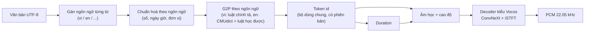

# vtts

**Text-to-speech đa ngôn ngữ nhỏ gọn, chạy hoàn toàn trên vi điều khiển ESP32.** Văn bản vào, âm thanh ra loa: không cloud, không cần mạng, không cần Linux. Gồm runtime C99 int8 tổng hợp streaming, front-end theo luật cho từng ngôn ngữ, và các giọng chưng cất đủ nhỏ để nằm trong 1–3 MB flash.

> Bản dịch tiếng Việt của [README.md](README.md). Khi hai bản khác nhau, bản tiếng Anh là bản chính.

🇺🇸 [English](README.md) · 🌐 [Trang nghe thử](https://tuanpmt.github.io/vtts/) · 🤗 [Model trên Hugging Face](https://huggingface.co/tuanpm/vtts) · 📚 [Tài liệu](docs/README.md)

- **Chạy trọn trên chip:** chuẩn hoá văn bản, G2P, model âm học int8 và vocoder iSTFT đều chạy trên MCU.
- **Giọng song ngữ:** mỗi model đọc một ngôn ngữ chính + tiếng Anh, kể cả câu trộn hai thứ tiếng. Cặp đầu tiên: Việt + Anh, với một giọng nam (`nam-1`) và một giọng nữ (`nu-10`), Apache-2.0.
- **Nhanh hơn thời gian thực, streaming:** bắt đầu phát sau 0.1–0.6 s tuỳ chip và model.
- **Hai cỡ model cho mỗi giọng, chạy trên cả hai chip:** *chất lượng* (M) cho âm thanh tốt nhất và *nhẹ* (S), nhanh hơn khoảng 1,5–1,7 lần, tốn ít CPU và flash hơn. Cả hai đều nhanh hơn thời gian thực trên ESP32-P4 và ESP32-S3; chọn theo chất lượng hay độ dư CPU, không theo chip.
- **Nhỏ và dự đoán được:** model 1.2–2.6 MB, runtime C99 không dùng `malloc` (caller cấp một arena có kích thước biết trước).
- **Dễ mở rộng:** mỗi ngôn ngữ là một module front-end trên bộ token có đánh phiên bản, nên các giọng song ngữ mới dùng chung runtime, firmware và quy trình train.

## Danh mục giọng

<!-- BEGIN:voices -->
| Giọng | Ngôn ngữ | Model chất lượng (M) | Model nhẹ (S) | Trạng thái |
|---|---|---|---|---|
| `nam-1` (nam) | 🇻🇳 vi + 🇺🇸 en, đọc câu trộn | M (1.83M tham số, 2.6 MB) | S (0.82M tham số, 1.2 MB) | **Đã phát hành trong v0.4.0 (Apache-2.0)** |
| `nu-10` (nữ) | 🇻🇳 vi + 🇺🇸 en, đọc câu trộn | M (1.83M tham số, 2.6 MB) | S (0.82M tham số, 1.2 MB) | **Đã phát hành trong v0.4.0 (Apache-2.0)** |
| Trung + Anh | 🇨🇳 zh + 🇺🇸 en, đọc câu trộn | M | S | **Dữ liệu: đang sinh audio tiếng Trung; tiếp theo là front-end** |
| Hàn + Anh | 🇰🇷 ko + 🇺🇸 en, đọc câu trộn | M | S | Dự kiến |
| Nhật + Anh | 🇯🇵 ja + 🇺🇸 en, đọc câu trộn | M | S | Dự kiến |
| Tây Ban Nha + Anh | 🇪🇸 es + 🇺🇸 en, đọc câu trộn | M | S | Dự kiến |
| Bồ Đào Nha (Brazil) + Anh | 🇧🇷 pt + 🇺🇸 en, đọc câu trộn | M | S | Dự kiến |
| Indonesia + Anh | 🇮🇩 id + 🇺🇸 en, đọc câu trộn | M | S | Dự kiến |
| Hindi + Anh | 🇮🇳 hi + 🇺🇸 en, đọc câu trộn | M | S | Dự kiến |
| Thái + Anh | 🇹🇭 th + 🇺🇸 en, đọc câu trộn | M | S | Dự kiến |
| Hà Lan + Anh | 🇳🇱 nl + 🇺🇸 en, đọc câu trộn | M | S | Dự kiến |
| Thụy Điển + Anh | 🇸🇪 sv + 🇺🇸 en, đọc câu trộn | M | S | Dự kiến |
| Na Uy + Anh | 🇳🇴 no + 🇺🇸 en, đọc câu trộn | M | S | Dự kiến |
<!-- END:voices -->

Giọng song ngữ đọc được câu một thứ tiếng và câu trộn như "Đã kết nối Bluetooth với AirPods" bằng cùng một giọng; front-end chọn ngôn ngữ cho từng từ. Front-end tiếng Anh cũng chạy trên thiết bị (bản C, có test khớp với Python), nên câu trộn được xử lý ngay trên chip.

Mọi model phát hành đều song ngữ: một ngôn ngữ chính + tiếng Anh (hiện tại là vi + en). File model được đính kèm ở [GitHub Releases](https://github.com/tuanpmt/vtts/releases) và có bản sao trên [Hugging Face](https://huggingface.co/tuanpm/vtts) (mỗi giọng một thư mục: `vi-en-nam-1/`, `vi-en-nu-10/`).

## Phần cứng và hiệu năng

<!-- BEGIN:hardware -->
| Board | Chip | RTF model nhẹ | RTF model chất lượng |
|---|---|---|---|
| Waveshare ESP32-P4-86-Panel-ETH-2RO, ESP32-P4-NANO | ESP32-P4, 360 MHz, PIE SIMD | 0.18 | 0.26 |
| EchoEar 2.0, Waveshare ESP32-S3-Touch-LCD-2.8 | ESP32-S3, 240 MHz, 8 MB PSRAM | 0.30 | 0.51 |

Cả hai model đều chạy trên cả hai chip. RTF dưới 1 nghĩa là nhanh hơn thời gian thực.
<!-- END:hardware -->

Cả hai chip đều dùng 2 lõi và kernel SIMD int8. Audio sinh trên ESP32-P4 khớp với runtime C chạy trên máy tính (tương quan ≥ 0.999 trên các đoạn mẫu đã đăng). ESP32-S3 cần PSRAM ít nhất 8 MB. Số đo chi tiết, tải CPU và các bước tối ưu: [docs/reports/performance.md](docs/reports/performance.md). Việc tăng tốc runtime đang tiếp tục: [docs/reports/runtime-optimization-research.md](docs/reports/runtime-optimization-research.md).

## Công nghệ

<!-- BEGIN:tech -->
`UTF-8 text → Language tag per word → Normalizer (numbers, dates, units) → G2P → Duration + acoustic model (int8) → Vocos decoder + iSTFT → PCM 22.05 kHz → I2S speaker`

- **Runtime:** C99, không malloc: bên gọi cấp một arena có kích thước biết trước. Trọng số int8 với scale theo kênh, activation int8 với một scale mỗi frame. Streaming giữ state theo từng layer nên mỗi frame chỉ tính một lần.
- **Trên chip:** Kernel int8 SIMD cho ESP32-P4 (PIE) và ESP32-S3 (SIMD 128-bit), chia việc cho cả hai core bằng FreeRTOS. Audio trên chip khớp với C runtime tham chiếu chạy trên PC.
- **Model:** Mỗi giọng có một teacher VITS (~24M tham số) train từ đầu, được distill thành student 0,8–1,8M tham số: bộ dự đoán duration, acoustic model có pitch và energy, decoder ConvNeXt kiểu Vocos với head iSTFT.
- **Front-end:** Mỗi ngôn ngữ một front-end, viết bằng Python cho train và C cho thiết bị, có test bảo đảm ra cùng token id. Tiếng Việt: G2P theo quy tắc chính tả, 6 thanh. Tiếng Anh: CMUdict cùng quy tắc letter-to-sound học từ CMUdict.
- **Dữ liệu:** Mỗi giọng chỉ được train trên giọng nói sinh bằng VoxCPM2 (Apache-2.0) từ một giọng thiết kế (khoảng 98 giờ cho mỗi giọng Việt + Anh), với các câu chọn để phủ âm tiết hiếm, số và câu trộn ngôn ngữ.
- **Công cụ:** PyTorch để train, ESP-IDF v6.1 cho firmware, PhoWhisper và Whisper đo độ dễ hiểu, UTMOS và DNSMOS đo độ tự nhiên và độ sạch.
<!-- END:tech -->

Chi tiết hơn ở phần [Kiến trúc](#kiến-trúc).

## Chất lượng

Ba tập câu ngoài miền, mỗi tập 50 câu (thông báo thiết bị, số, tên riêng, câu hỏi, câu dài), không câu nào có trong dữ liệu train. CER là tỉ lệ lỗi ký tự khi ASR nghe lại: PhoWhisper-large cho tiếng Việt (có tính dấu thanh), Whisper large-v3 cho tiếng Anh và câu tiếng Việt có từ tiếng Anh. UTMOS dự đoán độ tự nhiên. Audio được tạo bằng runtime C int8, cho kết quả giống hệt trên chip.

| Model | Tham số | CER tiếng Việt ↓ | CER tiếng Anh ↓ | CER câu trộn ↓ | UTMOS ↑ (vi / en / trộn) |
|---|---:|---:|---:|---:|---|
| `nam-1` M | 1.83M | 0.021 | 0.015 | 0.030 | 2.59 / 3.25 / 2.63 |
| `nam-1` S | 0.82M | 0.024 | 0.009 | 0.036 | 2.38 / 3.05 / 2.45 |
| `nu-10` M | 1.83M | **0.014** | **0.008** | **0.015** | **2.72 / 3.44 / 2.70** |
| `nu-10` S | 0.82M | 0.015 | 0.013 | 0.027 | 2.52 / 3.26 / 2.50 |

Phần lớn lỗi còn lại là số được ASR viết theo cách khác ("9:30" thành "9.30") và tên thương hiệu trong câu tiếng Việt. Chi tiết và số đo của teacher: [docs/reports/bilingual-student-eval.md](docs/reports/bilingual-student-eval.md).

### Nghe thử (sinh trên ESP32-P4)

Audio sinh trực tiếp trên chip bằng lệnh `dump` của firmware (`lang auto`), gửi về máy tính qua serial, chỉ nén sang mp3; mọi đoạn đều được kiểm tra bằng ASR trước khi đăng. Thêm mẫu trên [trang web](https://tuanpmt.github.io/vtts/).

<!-- BEGIN:samples -->
🇻🇳 🇺🇸 **Việt–English**

| Câu | nam-1 Quality | nam-1 Lite | nu-10 Quality | nu-10 Lite |
|---|---|---|---|---|
| Xin chào, tôi là giọng đọc tiếng Việt và tiếng Anh chạy hoàn toàn trên chip ESP32. | [▶ nam-1 Quality](https://raw.githubusercontent.com/tuanpmt/vtts/main/docs/audio/p4-nam1-m-intro.mp3) | [▶ nam-1 Lite](https://raw.githubusercontent.com/tuanpmt/vtts/main/docs/audio/p4-nam1-s-intro.mp3) | [▶ nu-10 Quality](https://raw.githubusercontent.com/tuanpmt/vtts/main/docs/audio/p4-nu10-m-intro.mp3) | [▶ nu-10 Lite](https://raw.githubusercontent.com/tuanpmt/vtts/main/docs/audio/p4-nu10-s-intro.mp3) |
| Đã kết nối Bluetooth với AirPods, bạn có thể mở Spotify hoặc YouTube Music. | [▶ nam-1 Quality](https://raw.githubusercontent.com/tuanpmt/vtts/main/docs/audio/p4-nam1-m-bluetooth.mp3) | [▶ nam-1 Lite](https://raw.githubusercontent.com/tuanpmt/vtts/main/docs/audio/p4-nam1-s-bluetooth.mp3) | [▶ nu-10 Quality](https://raw.githubusercontent.com/tuanpmt/vtts/main/docs/audio/p4-nu10-m-bluetooth.mp3) | [▶ nu-10 Lite](https://raw.githubusercontent.com/tuanpmt/vtts/main/docs/audio/p4-nu10-s-bluetooth.mp3) |
| Cuộc họp trên Google Meet sẽ bắt đầu lúc 9 giờ, nhớ chuẩn bị file PowerPoint nhé. | [▶ nam-1 Quality](https://raw.githubusercontent.com/tuanpmt/vtts/main/docs/audio/p4-nam1-m-meeting.mp3) | [▶ nam-1 Lite](https://raw.githubusercontent.com/tuanpmt/vtts/main/docs/audio/p4-nam1-s-meeting.mp3) | [▶ nu-10 Quality](https://raw.githubusercontent.com/tuanpmt/vtts/main/docs/audio/p4-nu10-m-meeting.mp3) | [▶ nu-10 Lite](https://raw.githubusercontent.com/tuanpmt/vtts/main/docs/audio/p4-nu10-s-meeting.mp3) |
| Hello! I am a text-to-speech voice that runs entirely on an ESP32 microcontroller. | [▶ nam-1 Quality](https://raw.githubusercontent.com/tuanpmt/vtts/main/docs/audio/p4-nam1-m-en-intro.mp3) | [▶ nam-1 Lite](https://raw.githubusercontent.com/tuanpmt/vtts/main/docs/audio/p4-nam1-s-en-intro.mp3) | [▶ nu-10 Quality](https://raw.githubusercontent.com/tuanpmt/vtts/main/docs/audio/p4-nu10-m-en-intro.mp3) | [▶ nu-10 Lite](https://raw.githubusercontent.com/tuanpmt/vtts/main/docs/audio/p4-nu10-s-en-intro.mp3) |
| Your package will arrive on Tuesday, November 18, between 2 and 4 p.m. | [▶ nam-1 Quality](https://raw.githubusercontent.com/tuanpmt/vtts/main/docs/audio/p4-nam1-m-en-package.mp3) | [▶ nam-1 Lite](https://raw.githubusercontent.com/tuanpmt/vtts/main/docs/audio/p4-nam1-s-en-package.mp3) | [▶ nu-10 Quality](https://raw.githubusercontent.com/tuanpmt/vtts/main/docs/audio/p4-nu10-m-en-package.mp3) | [▶ nu-10 Lite](https://raw.githubusercontent.com/tuanpmt/vtts/main/docs/audio/p4-nu10-s-en-package.mp3) |
| Mưa kéo dài hơn hai giờ khiến nhiều đường ở Long Thành, Nhơn Trạch ngập gần nửa mét, xe chết máy, người dân phải dắt bộ, sáng 15/11. | [▶ nam-1 Quality](https://raw.githubusercontent.com/tuanpmt/vtts/main/docs/audio/p4-nam1-m-news.mp3) | [▶ nam-1 Lite](https://raw.githubusercontent.com/tuanpmt/vtts/main/docs/audio/p4-nam1-s-news.mp3) | [▶ nu-10 Quality](https://raw.githubusercontent.com/tuanpmt/vtts/main/docs/audio/p4-nu10-m-news.mp3) | [▶ nu-10 Lite](https://raw.githubusercontent.com/tuanpmt/vtts/main/docs/audio/p4-nu10-s-news.mp3) |
| Pin còn 15%, nhiệt độ phòng là 28°C. Báo thức đã được đặt lúc 6 giờ 30 sáng mai. | [▶ nam-1 Quality](https://raw.githubusercontent.com/tuanpmt/vtts/main/docs/audio/p4-nam1-m-numbers.mp3) | [▶ nam-1 Lite](https://raw.githubusercontent.com/tuanpmt/vtts/main/docs/audio/p4-nam1-s-numbers.mp3) | [▶ nu-10 Quality](https://raw.githubusercontent.com/tuanpmt/vtts/main/docs/audio/p4-nu10-m-numbers.mp3) | [▶ nu-10 Lite](https://raw.githubusercontent.com/tuanpmt/vtts/main/docs/audio/p4-nu10-s-numbers.mp3) |
| Bạn có muốn bật đèn phòng khách không? | [▶ nam-1 Quality](https://raw.githubusercontent.com/tuanpmt/vtts/main/docs/audio/p4-nam1-m-question.mp3) | [▶ nam-1 Lite](https://raw.githubusercontent.com/tuanpmt/vtts/main/docs/audio/p4-nam1-s-question.mp3) | [▶ nu-10 Quality](https://raw.githubusercontent.com/tuanpmt/vtts/main/docs/audio/p4-nu10-m-question.mp3) | [▶ nu-10 Lite](https://raw.githubusercontent.com/tuanpmt/vtts/main/docs/audio/p4-nu10-s-question.mp3) |
<!-- END:samples -->

## Bắt đầu nhanh

### Nạp firmware

Cần ESP-IDF v6.1 và hai file model của một giọng (bản nhẹ S trước, bản chất lượng M sau) từ [Releases](https://github.com/tuanpmt/vtts/releases) hoặc [Hugging Face](https://huggingface.co/tuanpm/vtts). Tên file là `vtts-vien-nam1-{s,m}-v0.4.q8.vtts` (giọng nam) và `vtts-vien-nu10-{s,m}-v0.4.q8.vtts` (giọng nữ).

```bash
gh release download v0.4.0 -R tuanpmt/vtts -p '*.vtts' -D models
cd firmware/esp32
BOARD=esp32-p4-nano ./build.sh ../../models/vtts-vien-nu10-s-v0.4.q8.vtts ../../models/vtts-vien-nu10-m-v0.4.q8.vtts -p PORT flash monitor
```

<!-- BEGIN:boards -->
| `BOARD=` | Board | Loa | Âm lượng mặc định |
|---|---|---|---|
| `esp32-p4-86-panel-eth-2ro` (mặc định) | ESP32-P4-86-Panel-ETH-2RO | ES8311 | `vol 70`, `gain 0` |
| `esp32-p4-nano` | ESP32-P4-NANO | ES8311 | `vol 90`, `gain 12` |
| `esp32-s3-touch-lcd-2.8` | ESP32-S3-Touch-LCD-2.8 | PCM5101 | `vol 80`, `gain 6` |
| `echoear` | EchoEar 2.0 (ESP32-S3) | ES8311 | `vol 75`, `gain 6` |
<!-- END:boards -->

Mỗi board là một thư mục trong `firmware/esp32/components/bsp/boards/` (chân GPIO, giá trị mặc định, chip và driver loa); thêm board chỉ cần thêm một thư mục. Xem [firmware/esp32/components/bsp/README.md](firmware/esp32/components/bsp/README.md).

### Lệnh trên cổng serial

Gõ một câu rồi Enter để board đọc ra loa. Các lệnh khác:

| Lệnh | Tác dụng |
|---|---|
| `model s` / `model m` | Chọn model nhẹ hoặc model chất lượng |
| `lang <mode>` | Chế độ đọc; các chế độ hợp lệ theo token set của model: `vi` / `en` / `auto` cho vi-en (`vi` vẫn đọc được từ tiếng Anh trong câu tiếng Việt), `zh` cho zh-en, `ko` cho ko-en, `hi` cho hi-en ([chi tiết](firmware/esp32/README.md#languages-and-text-modes)) |
| `vol 0-100`, `gain dB` | Âm lượng; gain số có bộ giới hạn mềm |
| `speed 0.7-1.6` | Tốc độ đọc (lớn hơn là chậm hơn) |
| `expr 0.5-2.5` | Độ lên xuống của ngữ điệu (model có bộ dự đoán cao độ) |
| `bench`, `prof` | RTF trên 4 câu cố định; thời gian theo từng tầng |
| `selftest` | Kiểm tra kernel SIMD với kết quả tính bằng C, gồm cả trường hợp hai lõi chạy cùng lúc |
| `dump <câu>` | Tổng hợp và gửi PCM về máy tính: `scripts/device/say.py PORT "dump <câu>" --dump-dir out/` |
| `ids <ids;ids...>` | Đọc chuỗi token id từ front-end trên máy tính: `scripts/device/say.py --lang vi\|en\|mixed PORT "<câu>"` |
| `help` | Liệt kê các lệnh; `chunk N`, `first N`, `cores 1\|2` và `fusetest` dùng cho thử nghiệm |

Dòng nào không phải lệnh thì được đọc ra loa; mỗi lệnh kết thúc bằng một dòng `DONE`.

### Trên máy tính

```bash
uv sync --extra gpu                 # Python 3.11, PyTorch
uv run pytest -q                    # test, gồm cả runtime C chạy với ASan/UBSan
make -C runtime build/vtts_cli      # công cụ tổng hợp dòng lệnh
uv run python -c "from vtts.frontend.text import text_to_ids; print(text_to_ids('Bật Bluetooth lúc 7:30.', 'vi'))"
```

## Kiến trúc



- **Chưng cất.** Mỗi giọng bắt đầu từ một teacher VITS lớn (~24M tham số). Teacher sinh thời lượng, latent và âm thanh cho hàng chục nghìn câu; một student 0.8–1.8M tham số học lại qua ba giai đoạn (front, decoder, joint với bộ phân biệt đa phân giải). Student được export sang int8 và chạy trên chip.
- **G2P tiếng Việt bám chữ viết.** Token đi theo chữ viết, không gắn với một phương ngữ (`tr`/`ch`, `s`/`x`, `r`/`d`/`gi` là các token riêng; 6 thanh lấy từ dấu), nên thêm giọng vùng miền chỉ cần thêm dữ liệu.
- **Dữ liệu train.** Audio sinh bằng VoxCPM2 (Apache-2.0), mỗi giọng là một giọng thiết kế (khoảng 98 giờ cho mỗi giọng Việt + Anh), với tập câu chọn để phủ âm tiết hiếm, số và câu trộn. Teacher được train từ khởi tạo ngẫu nhiên chỉ trên audio này.
- **Front-end khớp nhau.** Front-end của mỗi ngôn ngữ có bản Python (train) và bản C (thiết bị); test kiểm tra hai bản cho ra cùng token id.

Tài liệu thiết kế, định dạng file model và các báo cáo số đo được liệt kê trong [docs/README.md](docs/README.md).

## Thêm một ngôn ngữ

Mọi ngôn ngữ dùng chung một runtime và một firmware; ngôn ngữ mới cần:

1. **Token.** Thêm token âm vị hoặc chữ viết của ngôn ngữ vào bộ token chung dưới dạng một phiên bản mới. Id cũ không bao giờ đổi, nên model cũ vẫn chạy. Hiện có: v1 = tiếng Việt (65 token), v2 = v1 + ARPAbet tiếng Anh và trọng âm (107 token).
2. **Front-end.** Bộ chuẩn hoá (số, ngày, tiền tệ, đơn vị) và G2P, có bản Python và C cùng test parity. Bộ gán ngôn ngữ quyết định front-end nào đọc từng từ.
3. **Dữ liệu.** Bản thu âm hoặc audio tổng hợp kèm transcript; quy trình không phụ thuộc nguồn dữ liệu.
4. **Train.** Teacher, rồi student bản chất lượng và bản nhẹ. Header của file model ghi kích thước bộ token, nên runtime không cần sửa.

Chi tiết trong [CONTRIBUTING.md](CONTRIBUTING.md).

## Train một giọng

1. **Dữ liệu.** Bộ thu âm: `scripts/data/prepare_infore.py` → `score_dataset.py` → `filter_and_split.py`. Bộ tổng hợp: `build_bilingual_corpus.py` → `synth_voxcpm.py` → `synth_to_csv.py`.
2. **Teacher.** `scripts/teacher/train_teacher.py`, đánh giá bằng `eval_checkpoints.py`.
3. **Chưng cất.** `scripts/student/build_distill_pack.py` → `convert_shards.py` → `add_prosody.py` → `run_prosody_chain.sh`.
4. **Export và kiểm tra.** `export_student.py --int8`, `render_student_c.py`, `scripts/eval/eval_dir.py`.

Mỗi script ghi cách dùng ở đầu file.

## Cấu trúc repo

| Thư mục | Nội dung |
|---|---|
| `runtime/` | Runtime C99 không `malloc`: tổng hợp fp32/int8, streaming khớp từng bit, front-end văn bản cho thiết bị; `ports/` chứa kernel SIMD cho ESP32-P4 và ESP32-S3 và phần chia việc cho 2 lõi |
| `firmware/esp32/` | Ứng dụng mẫu cho các board ESP32-P4 và ESP32-S3: gõ câu qua serial, board đọc ra loa |
| `src/vtts/` | Gói Python: front-end, dữ liệu, đánh giá, teacher, student, export |
| `scripts/` | Các bước pipeline: `data/`, `frontend/`, `teacher/`, `student/`, `eval/`, `device/` |
| `eval/` | Tập câu đánh giá, baseline, cấu hình trang nghe A/B |
| `docs/` | Tài liệu thiết kế, định dạng model, báo cáo số đo, trang web ([mục lục](docs/README.md)) |
| `tests/` | Test Python và runtime C (golden, int8, streaming, parity front-end, fuzz) |

## Lộ trình

vtts phát hành **giọng song ngữ: một ngôn ngữ chính + tiếng Anh**, đọc được câu trộn hai ngôn ngữ. Mỗi model phát hành ứng với một cặp. Chi tiết: [docs/design/plans/2026-11-18-roadmap-bilingual.md](docs/design/plans/2026-11-18-roadmap-bilingual.md).

- [x] Front-end tiếng Anh bằng Python và trên thiết bị (C, có test parity), gán ngôn ngữ từng từ
- [x] Dữ liệu tổng hợp cho hai giọng song ngữ `nam-1` và `nu-10`
- [x] Runtime nhanh hơn: model chất lượng chạy được cả trên ESP32-S3
- [x] **Việt + Anh** `nam-1` (nam) và `nu-10` (nữ), bản chất lượng và bản nhẹ, Apache-2.0 (v0.4.0)
- [ ] **Trung + Anh** (đang sinh audio tiếng Trung; tiếp theo là front-end pinyin)
- [ ] **Hàn + Anh**
- [ ] **Nhật + Anh**
- [ ] **Tây Ban Nha + Anh** (front-end Python đã xong)
- [ ] **Bồ Đào Nha (Brazil) + Anh** (front-end Python đã xong)
- [ ] **Indonesia + Anh** (front-end Python đã xong)
- [ ] **Hindi + Anh** (front-end Python đã xong)
- [ ] **Thái + Anh** (front-end Python đã xong)
- [ ] **Pháp + Anh** (front-end Python đã xong)
- [ ] **Đức + Anh** (front-end Python đã xong)
- [ ] **Ý + Anh** (front-end Python đã xong)
- [ ] **Thổ Nhĩ Kỳ + Anh** (front-end Python đã xong)
- [ ] **Nga + Anh** (front-end Python đã xong)
- [ ] **Ba Lan + Anh** (front-end Python đã xong)
- [ ] **Ả Rập + Anh** (front-end Python đã xong; khôi phục nguyên âm đúng khoảng 86% số từ)
- [ ] **Phần Lan + Anh** (front-end Python đã xong)
- [ ] **Hy Lạp + Anh** (front-end Python đã xong)
- [ ] **Mã Lai + Anh** (front-end Python đã xong)
- [ ] **Tagalog (Filipino) + Anh** (front-end Python đã xong)
- [ ] **Swahili + Anh** (front-end Python và trên thiết bị đã xong)
- [ ] **Hà Lan + Anh** (front-end Python đã xong)
- [ ] **Thụy Điển + Anh** (front-end Python đã xong)
- [ ] **Na Uy + Anh** (front-end Python đã xong)
- [ ] Từ điển phát âm của người dùng

Lịch sử phát hành: [CHANGELOG.md](CHANGELOG.md).

## Đóng góp

Hoan nghênh báo lỗi, số đo trên board khác và front-end cho ngôn ngữ mới. Xem [CONTRIBUTING.md](CONTRIBUTING.md) để biết cách chạy test, thêm ngôn ngữ hoặc board, và quy ước code.

## Giấy phép

- **Code:** Apache-2.0 ([LICENSE](LICENSE)). Phần lấy từ Piper/VITS giữ giấy phép MIT, CMU Pronouncing Dictionary giữ giấy phép BSD; xem [NOTICE](NOTICE).
- **Model:** các file `.vtts` đã phát hành (từ v0.4.0) theo Apache-2.0. Teacher của chúng được train từ khởi tạo ngẫu nhiên, chỉ trên audio sinh bằng VoxCPM2 (Apache-2.0) từ giọng thiết kế, không clone giọng người thật. Audio từ các model này nên được ghi chú là do AI tạo ra. Checkpoint PyTorch và teacher không được phát hành.
- **Xây dựng cùng Claude Code:** phần lớn dự án (runtime và kernel SIMD, front-end, quy trình dữ liệu và train, firmware, website, tài liệu) được viết bằng [Claude Code](https://claude.com/claude-code) của Anthropic, dưới sự định hướng và review của người duy trì dự án. Các commit làm theo cách này có dòng `Co-Authored-By: Claude`. Điều này không thay đổi các giấy phép ở trên.
