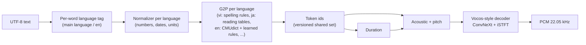

# Architecture

How text becomes speech on the chip, how a voice is trained, and where the code lives. Design decisions as they were made are in [design/](README.md#design).

<!-- BEGIN:tech -->
`UTF-8 text → Language tag per word → Normalizer (numbers, dates, units) → G2P → Duration + acoustic model (int8) → Vocos decoder + iSTFT → PCM 22.05 kHz → I2S speaker`

- **Runtime:** C99, no malloc: the caller passes one arena whose size is known up front. Int8 weights with per-channel scales, int8 activations with one scale per frame. Streaming keeps per-layer state, so every frame is computed once.
- **On the chip:** Int8 SIMD kernels for the ESP32-P4 (PIE) and the ESP32-S3 (128-bit SIMD), work split over both cores with FreeRTOS. Chip audio matches the reference C runtime on a PC.
- **Models:** A VITS teacher (~24M params) per voice, trained from scratch, is distilled into 0.8–1.8M-param students: duration predictor, acoustic model with pitch and energy, Vocos-style ConvNeXt decoder with an iSTFT head.
- **Front-ends:** One per language, in Python for training and in C for the device, tested to give identical token ids. Vietnamese: spelling-based G2P with 6 tones. Korean: Hangul decomposition and the standard pronunciation rules. Mandarin: pinyin readings with a polyphone phrase table and tones. Japanese: kana and kanji readings by longest match over a word table, numbers with counters. Brazilian Portuguese: spelling rules with stress, nasal vowels and the two r sounds, plus per-word Portuguese or English tagging. English: CMUdict plus letter-to-sound rules learned from it.
- **Data:** Every voice is trained only on speech synthesized with VoxCPM2 (Apache-2.0) from a designed voice (about 98 h per Vietnamese + English voice, about 43,600 sentences for the Korean + English voice, 54,636 for the Chinese + English voice, 49,591 for the Japanese + English voice, 45,191 for the Portuguese + English voice), with sentences chosen to cover rare syllables, numbers and code-switching.
- **Tooling:** PyTorch for training, ESP-IDF v6.1 for the firmware, PhoWhisper and Whisper for intelligibility, UTMOS and DNSMOS for naturalness and cleanliness.
<!-- END:tech -->

## Pipeline



- **Distillation.** Each voice starts from a large VITS teacher (~24M parameters). The teacher produces durations, latents and audio for tens of thousands of sentences, and a 0.8–1.8M-parameter student learns from them in three stages (front, decoder, joint with multi-resolution discriminators). The student is exported to int8 and runs on the chip.
- **Spelling-based Vietnamese G2P.** Tokens follow the written form rather than one dialect (`tr`/`ch`, `s`/`x`, `r`/`d`/`gi` stay distinct; 6 tones from the diacritics), so a regional voice only needs new data.
- **Training data.** Speech synthesized with VoxCPM2 (Apache-2.0) in one designed voice each, with sentences chosen to cover rare syllables, numbers and code-switching: about 98 h per Vietnamese + English voice, about 43,600 sentences for Korean + English, 54,636 for Chinese + English, 49,591 for Japanese + English and 45,191 for Portuguese (Brazil) + English (main language, mixed and English sentences, all read by the same voice). Teachers are trained from random initialization on this audio only.
- **Front-end parity.** Every language's front-end exists in Python (training) and C (device), and tests check they produce identical token ids. Large tables are built into blobs read in place from flash: the English lexicon (`VLEX`, 1.9 MB), Mandarin readings (`ZLEX`, 116 KB), Japanese readings and NFKC data (`JLEX`, 721 KB).

The model file format is in [model-format.md](model-format.md), the C API in [runtime/README.md](../runtime/README.md), and how each language is read in [frontend/pronunciation-rules.md](frontend/pronunciation-rules.md).

## Adding a language

Languages share one runtime and one firmware; a new one needs:

1. **Tokens.** Append the language's phoneme or spelling tokens to the shared token set as a new version. Existing ids never change, so older models keep working. Today: v1 = Vietnamese (65 tokens), v2 = v1 + English ARPAbet and stress (107 tokens), and one pair set per language on top of v2 (`ko-en` 153, `zh-en` 171, `ja-en` 144, `pt-en` 150, ...).
2. **Front-end.** A normalizer (numbers, dates, currency, units) and a G2P, in Python and C with a parity test. The language tagger decides which front-end reads each word.
3. **Data.** Recordings or synthesized speech with transcripts; the pipeline does not depend on the source.
4. **Train.** The teacher, then quality and lite students. The model file header carries the vocabulary size and token set, so the runtime needs no change.

Step by step: [CONTRIBUTING.md](../CONTRIBUTING.md#adding-a-language).

## Training a voice

1. **Data.** Recorded corpus: `scripts/data/prepare_infore.py` → `score_dataset.py` → `filter_and_split.py`. Synthesized corpus: `build_bilingual_corpus.py` → `synth_voxcpm.py` → `synth_to_csv.py`.
2. **Teacher.** `scripts/teacher/train_teacher.py`, evaluated with `eval_checkpoints.py`.
3. **Distillation.** `scripts/student/build_distill_pack.py` → `convert_shards.py` → `add_prosody.py` → `run_prosody_chain.sh`.
4. **Export and check.** `export_student.py --int8`, `render_student_c.py`, `scripts/eval/eval_dir.py`.

Each script documents its arguments at the top of the file.

## On a PC

```bash
uv sync --extra gpu                 # Python 3.11, PyTorch
uv run pytest -q                    # tests, including the C runtime under ASan/UBSan
make -C runtime build/vtts_say      # synthesizer from text: vtts_say MODEL.vtts OUT.wav [--lex VLEX] [--ja JLEX] [--lang MODE] TEXT
uv run python -c "from vtts.frontend.text import text_to_ids; print(text_to_ids('Bật Bluetooth lúc 7:30.', 'vi'))"
```

## Repository layout

| Path | Contents |
|---|---|
| `runtime/` | malloc-free C99 runtime: fp32/int8 synthesis, bit-exact streaming, device text front-end; `ports/` has SIMD kernels for ESP32-P4 and ESP32-S3 and the two-core scheduler |
| `firmware/esp32/` | Example app for ESP32-P4 and ESP32-S3 boards: type text on the serial console, the board speaks |
| `src/vtts/` | Python package: front-ends, data, evaluation, teacher, student, export |
| `scripts/` | Pipeline steps: `data/`, `frontend/`, `teacher/`, `student/`, `eval/`, `device/`, `docs/` |
| `eval/` | Evaluation sentence sets, baselines, A/B listening configuration |
| `docs/` | Voices, architecture, design documents, model file format, measurement reports, website ([index](README.md)) |
| `tests/` | Python and C runtime tests (golden, int8, streaming, front-end parity, fuzz) |
