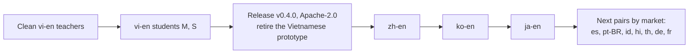

# Roadmap: bilingual voices (X + English)

Status: adopted 2026-11-18. Replaces the earlier plan of single-language voices.

## Direction

vtts ships **bilingual models**: one voice reads its main language, English, and sentences that mix both, the way people talk to devices ("Bật Bluetooth", "打开 Wi-Fi", "Spotify 틀어 줘"). English is the shared second language because product names, units and technical terms on ESP32 devices are mostly English.

- First pairs: **Vietnamese + English, Chinese + English, Korean + English, Japanese + English**.
- More pairs follow by ESP32 market size (see "Choosing the next languages").
- **Single-language models are retired** once the Vietnamese + English voices are published: the Vietnamese prototype leaves the voice catalog, the website and the Hugging Face card. Old releases stay downloadable on GitHub.
- Every released voice must be **Apache-2.0**: teachers are trained from random initialization (or warm-started only from another clean vtts teacher) on synthetic audio from VoxCPM2 (Apache-2.0) with designed voices. No checkpoint descended from a non-commercial or share-alike corpus may be used.
- Each pair gets one male and one female voice, each in two sizes: **Quality (M)** and **Lite (S)**. Both run on the ESP32-P4 and the ESP32-S3; an S3-tuned vocoder variant is added where it helps.

## Shared platform work

These make every new pair cheaper, so they come first or alongside the first new pair.

1. **One token registry for all languages.** Keep the v2 ids (0–106: specials, punctuation, Vietnamese, English ARPAbet and stress) and append one block per language (Mandarin initials, finals and tones; Korean jamo; Japanese kana-based phones; ...). A model uses only the ids of its pair, and the embedding table covers the highest id it uses. Ids never change once released, so a new pair can warm-start from a clean teacher of another pair with its English rows intact.
2. **Language modules** (already in place for vi and en): each language adds a normalizer, a word-to-token function, a tagging rule (script or lexicon) and the matching C module, parity-tested against Python. The device picks the pair from the model header.
3. **Per-pair pipeline script:** corpus → VoxCPM2 synthesis → training list → teacher → evaluation → distillation (M, S) → int8 export → on-chip check → release files. One command per stage, every stage resumable, so a pair runs mostly unattended on the two GPUs.
4. **Per-pair evaluation sets:** out-of-domain sentences for the main language, English, and mixed text (device prompts, numbers, names, questions, long sentences), scored with Whisper (forced language) and UTMOS. Release gate: mixed CER within 0.01 of the vi-en result and no regression in English.
5. **Data probe before each language:** synthesize about 50 sentences per voice with VoxCPM2 and check them with ASR and by ear. A language whose synthetic speech is not clean enough waits for a better source.
6. **Flash budget per pair:** model M about 2.6 MB, S about 1.1 MB, English lexicon 1.9 MB, plus the main-language lexicon. The target is under 8 MB for both sizes and both lexicons, so that 16 MB flash boards keep room for the application.

## Pairs

### Vietnamese + English (in progress)

- Data: about 98 h per voice (`nam-1`, `nu-10`), done.
- Front-end: Python and C, parity-tested, running on the chip.
- Teachers: retraining from random initialization (the first teachers were warm-started from a model trained on another corpus). Evaluate at 150k–200k steps with the same sets as before.
- Then: students M and S for both voices, the S3 vocoder variant, on-chip samples, website and Hugging Face pages, release **v0.4.0** under Apache-2.0, retire the Vietnamese prototype and the v1 token path in the docs (the v1 code path is removed one release later).

### Chinese + English

- Market: Mainland China is about 70% of Espressif's revenue, the largest single market by far.
- Data: Mandarin sentences from Chinese Wikipedia (Simplified, no digits or Latin letters), about 48 h for `nu-10` (synthesizing); add a male voice, Chinese sentences with English terms ("打开 Wi-Fi", "发 email 给我"), and reuse each voice's English audio from vi-en where the voice is the same.
- Front-end: pinyin initials, finals and five tones as tokens; character readings from a default-reading table plus a phrase table for polyphones (only phrases whose reading differs from the per-character default, compact like VLEX); numbers, dates, times, percentages and units read in Chinese; Latin words go to the English module. Tone sandhi is left to the model at first and added as rules if evaluation shows errors.
- Teacher: warm-start from a clean vi-en teacher (shared English rows and acoustics).

### Korean + English

- Market: large consumer-electronics and smart-home market; Korean users expect Korean-first devices.
- Front-end: Hangul syllables decompose algorithmically into jamo, so no reading dictionary is needed; pronunciation rules (liaison, nasalization, tensification, aspiration) as a rule table; Sino-Korean and native numbers by context (counters); Latin words to English.
- Risk: VoxCPM2 Korean quality is unknown; probe first.

### Japanese + English

- Market: strong electronics and maker market; Espressif has an office in Tokyo.
- Front-end: the hardest of the four. Kana map directly to phones, but kanji need a reading lexicon and word segmentation; the device lexicon must stay within the flash budget (a pruned word list plus per-kanji default readings). Pitch accent is left to the model at first.
- Risk: lexicon size and reading errors; probe VoxCPM2 Japanese first. May need a host-side front-end option (`ids` command) until the on-device lexicon is good enough.

## Choosing the next languages

Espressif reports revenue only as Mainland China versus the rest of the world (roughly 70% / 30% in recent reports, with overseas growing faster: +40% in 2025 against +23% in China). Outside China there are no published per-country figures, so the ranking below combines signals:

| Signal | Source |
|---|---|
| Espressif offices: China, India, Czech Republic, Singapore, Brazil, Japan | Espressif company pages |
| Large maker and IoT ecosystems: India, Brazil, Europe, Southeast Asia | market reports, retailer and community activity |
| Front-end effort: Latin-script phonetic spelling is cheap (es, pt, id); Thai and Hindi need more work | own assessment |
| VoxCPM2 synthesis quality per language | probe (step 5 above) |

Proposed order after ja-en, to be re-checked with the data probe and any sales data that becomes available:

1. **Spanish + English** — Latin America, Spain and the US; phonetic spelling, cheap front-end.
2. **Portuguese (Brazil) + English** — Espressif office in Brazil, large IoT market; phonetic spelling.
3. **Indonesian + English** — large Southeast Asian market; Latin script, regular spelling.
4. **Hindi + English** — Espressif office in India and a very large maker community; Devanagari front-end; English-only devices are common, so demand needs checking.
5. **Thai + English**, **German + English**, **French + English** — next by demand.

## Order of work and compute

All work is AI-assisted: front-end code, C ports, parity tests and docs are written with Claude Code; the limiting factor is GPU time and listening checks, not engineering time.

| Stage | Per voice | Notes |
|---|---|---|
| VoxCPM2 synthesis (about 100 h of speech) | about 1 day | rate-limited API; runs while GPUs train other voices |
| Teacher from random initialization | 1–1.5 days of one GPU | warm-start from a clean teacher of another pair is shorter |
| Students M and S, int8 export, on-chip check | about half a day | |
| Front-end per language (Python, C, parity tests) | a few working sessions | in parallel with synthesis |

With two GPUs, one pair (two voices) takes a few days of compute. Synthesis for the next pair runs while the current pair trains, so pairs overlap.

## Retiring single-language models

When v0.4.0 (vi-en) is published:

- Remove the Vietnamese prototype from `docs/site.json` (voices and listening tabs), the READMEs, the website and the Hugging Face card; note in the changelog that v0.3.x models remain on the GitHub releases.
- Firmware and runtime keep reading v1 models for one release, then the v1 token path is removed from the C front-end and the Python front-end.
- The single-language entries ("English", "Chinese (Mandarin)") leave the voice catalog; English is covered by every pair.
