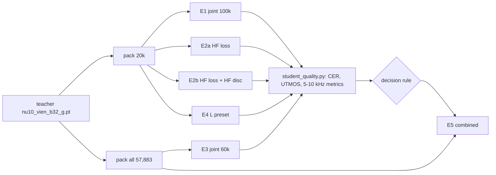

# Student quality experiments (nu-10, vi-en)

> Status: prepared (2026-11-20). Code, presets, runners and the evaluation script are in place and smoke-tested on the Mac (MPS); no GPU run yet.

**Problem.** The v0.4.0 students are about one UTMOS point below their teacher (`nu-10` M: 2.72 / 3.44 / 2.70 on vi / en / mixed against 3.67 / 4.38 / 3.83) and have an audible broadband noise layer at 5–10 kHz ("buzzy"). Intelligibility is already close to the teacher (M CER 0.014 / 0.008 / 0.015). The teacher is good enough and stays fixed: `artifacts/teacher/nu10_vien_b32_g.pt`, sentences `data/bilingual/sentences.jsonl` (57,883 rows: 32,522 vi, 19,241 en, 6,120 mixed).

**Goal.** Find which of four levers (training length, high-band supervision, more distillation data, a larger P4-only model) closes the gap, measured the same way for every run, then combine the winners (E5).

## Baseline recipe (E0, v0.4.0)

`scripts/student/run_bilingual_chain.sh`: a seeded random sample of 20,000 sentences distilled from the teacher (`build_distill_pack.py --limit 20000`, noise scale 0.333), `convert_shards.py`, `add_prosody.py`; then front 10k steps (batch 32), dec 30k (batch 16, MPD), joint 20k (batch 16, MPD + MRD), `export_student.py --int8`.

## Matrix

| Run | Preset | Pack | Joint steps | GAN-stage changes | Inference cost | Runner |
|---|---|---|---:|---|---|---|
| E0 | M-vocos-p-bi | 20k | 20k | none (v0.4.0) | M | `experiments/e0_baseline.sh` (optional) |
| E1 | M-vocos-p-bi | 20k | **100k** | none | M | `experiments/e1_long_joint.sh` |
| E2a | M-vocos-p-bi | 20k | 20k | **+ high-band STFT loss** (≥ 4 kHz, weight 2) in dec and joint | M | `experiments/e2a_hf_loss.sh` |
| E2b | M-vocos-p-bi | 20k | 20k | E2a **+ high-band discriminators** in dec and joint | M | `experiments/e2b_hf_disc.sh` |
| E3 | M-vocos-p-bi | **all (57,883)** | 60k | none | M | `experiments/e3_full_pack.sh` |
| E4 | **L-vocos-p-bi** | 20k | 60k | none | L (P4 only) | `experiments/e4_large_p4.sh` |
| E5 | chosen | chosen | chosen | chosen | chosen | `experiments/e5_combined.sh` (placeholder: full pack + E2b + 100k on M) |

Every run exports an int8 snapshot every 10k joint steps (`OUT/snapshots/<preset>-joint_NNNNNNN.q8.vtts`) and keeps those joint checkpoints, so runs are compared at equal step counts: E1's 20k snapshot is the baseline reproduction (same recipe and pack as v0.4.0), its 60k and 100k snapshots are the two asked lengths, and E3 and E4 can be read against E1 at 20k / 40k / 60k. E0 is only needed if E1's 20k point does not reproduce the released numbers.



## What each option changes

**E1 — longer joint stage.** `run_experiment.sh` trains the joint stage in 10k segments (`train_student.py --max-steps 10000, 20000, …`; the stage resumes from its newest checkpoint, the learning rate is constant, so this is one continuous run) and exports after each segment. `--keep-every 10000` keeps those checkpoints instead of only the newest three.

**E2 — high-band supervision** (`src/vtts/student/train.py`, `discriminators.py`; training only, the exported model is the same size and cost):
- `hf_stft_loss`: spectral convergence + log-magnitude L1 on the bins at or above 4 kHz, at STFT sizes 256 / 512 / 1024 (finer time grid than the 512–2048 of the full-band loss). The full-band SC term and the 80-band mel loss (weight 45) are dominated by the loud low band, so an excess noise floor 20–40 dB below the formants costs almost nothing today. Weight 2 (`--hf-weight`, same weight as the full-band STFT loss).
- `--disc mpd+mrd-hf`: the MPD + MRD set plus three log-magnitude spectrogram discriminators restricted to ≥ 4 kHz (`HighBandDiscriminator`, STFT 256 / 512 / 1024). Their input is 0.1·log|STFT| (`LOG_SCALE`). Risk to watch: in the smoke run (random teacher, 50 steps) their feature-matching term reached about 10 (14 with the unscaled log; 0.2 for MPD + MRD alone), close to the mel loss (11–13). On the GPU, read `l_fm` against `l_mel` in `log.jsonl` after 2k dec steps; if `l_fm` stays above `l_mel`, stop E2b and add a weight for that term instead of letting it dominate. The existing MRD sees linear magnitude, where the 5–10 kHz band is nearly invisible; on the log scale a stationary noise floor in voiced frames (where the teacher has harmonic, pitch-synchronous high-band energy) is easy to tell apart.
- Both apply to dec and joint, because the noise layer is learned when the vocoder is trained (dec) and the joint stage only fine-tunes for 20k steps.

**E3 — bigger pack.** `LIMIT=all`: every sentence of the corpus (2.9× the text, including all mixed and English rows). Joint 60k so the longer stage can use the extra data; snapshots give the 20k point for an equal-step comparison.

**E4 — L student for the ESP32-P4.** Preset `L-vocos-p-bi`: the M front (durations, acoustic and prosody models unchanged) with a vocoder of width 224 and 8 ConvNeXt blocks (M: 160 × 6), MLP ratio 3. 3.48M parameters (M 1.83M), 4.3 MB int8 (M 2.6 MB). 282.5 MMAC/s (M 140.9). Same ops as M, so the runtime and the file format need no change (18 → 20 stream layers of 40; 8 blocks of 9 tensors fit the 256-tensor table).

RTF estimate on the P4 before training (`scripts/student/estimate_rtf.py --bench`):

| Preset | Params | MMAC/s | P4 RTF, analytic | P4 RTF, host bench ratio × M |
|---|---:|---:|---:|---:|
| S-vocos-p-bi | 0.82M | 62.1 | 0.18 (measured 0.17–0.19) | 0.16 |
| M-vocos-p-bi | 1.83M | 140.9 | 0.26 (measured 0.25–0.27) | 0.26 |
| L-vocos-p-bi | 3.48M | 282.5 | **0.40** | **0.38** |

- Analytic: a line through the measured P4 `bench` RTF of S and M (performance.md, v0.4.0) against `count_macs()` gives 0.117 RTF of fixed per-second cost (iSTFT, overlap-add, tokens, float glue) plus 0.00102 RTF per MMAC/s (`vtts.student.macs.estimate_p4_rtf`).
- Host bench: the real C runtime (`runtime/bench/bench.c`, reference kernels) on random-weight int8 exports of each preset, relative to M, scaled by M's 0.26.
- Both are well under the 0.5 target. Wider dot products (224 / 672) keep the int8 kernels busier per call, so the true value is more likely below the line than above. Confirm with `bench` on the chip as soon as the first snapshot exists (a random-weight export also works for timing).
- Larger options checked: 256 × 8 (4.30M, 0.47 analytic) is too close to the limit; 224 × 10 (4.09M, 0.42) puts more parameters into depth, which helps less than width for the high band in the Vocos literature and costs more streaming state.

**E5 — combination.** `e5_combined.sh` runs whatever the decision rule keeps; the default line (full pack, HF loss + HF discriminators, joint 100k on M) is a placeholder to be edited in `run_experiment.sh` (or overridden with `PRESET= LIMIT= JS= HF= DEC_DISC= JOINT_DISC=`) once E1–E4 are read.

## How to launch

On the GPU host, from the repository root, one job per scheduler slot (same environment line as the existing distill jobs):

```bash
export LC_ALL=C.UTF-8 PYTORCH_CUDA_ALLOC_CONF=expandable_segments:True OMP_NUM_THREADS=8 MKL_NUM_THREADS=8 NUMBA_NUM_THREADS=8
G=artifacts/teacher/nu10_vien_b32_g.pt; S=data/bilingual/sentences.jsonl
scripts/student/experiments/e1_long_joint.sh $G $S artifacts/student_q/e1 cuda
scripts/student/experiments/e3_full_pack.sh  $G $S artifacts/student_q/e3 cuda
scripts/student/experiments/e4_large_p4.sh   $G $S artifacts/student_q/e4 cuda
# second wave
scripts/student/experiments/e2a_hf_loss.sh   $G $S artifacts/student_q/e2a cuda
scripts/student/experiments/e2b_hf_disc.sh   $G $S artifacts/student_q/e2b cuda
```

- The pack is shared: `OUT/../pack-<teacher>-<limit>` (20000 or all), built once under a lock by the first runner that needs it; the others wait. `PACK=` points to an existing pack (e.g. `data/distill_nu10_vien/mm/..` if still on disk).
- Outputs: `OUT/<preset>.q8.vtts` (final), `OUT/snapshots/*.q8.vtts`, `OUT/log.jsonl` (training rows incl. `l_hf`), `OUT/run.log`, `OUT/experiment.env`, `OUT/CHAIN_DONE`. Restarting a runner resumes where it stopped.
- `EVAL=hf` scores every snapshot with the 5–10 kHz metrics on the CPU right after export; `EVAL=full` also runs ASR + UTMOS.
- `DRY_RUN=1` prints the resolved settings.
- Paths are relative to the repository root (the runner changes to it), as in the existing jobs.
- Disk: a GAN-stage checkpoint (student, discriminators, both optimizers) is about 0.58 GB. E1 and E5 keep 10 joint checkpoints plus the newest 3 dec ones, about 8 GB each; E3 and E4 about 6 GB. The full pack is about 2.9× the 20k one.

## Evaluation (same for every run)

```bash
uv run --extra gpu python scripts/eval/student_quality.py --model OUT/snapshots/M-vocos-p-bi-joint_0060000.q8.vtts --out reports/quality/e1-60k
uv run --extra gpu python scripts/eval/student_quality.py --audio-root artifacts/eval/nu10_vien --out reports/quality/teacher --name teacher
uv run --extra gpu python scripts/eval/student_quality.py --table reports/quality/*/summary.json
```

1. Renders `eval/sets/{ood,mixed,ood_en}.jsonl` (50 sentences each) with `runtime/build/vtts_say MODEL OUT.wav --lex lex_en.bin --lang auto TEXT`, as in [bilingual-student-eval.md](../../reports/bilingual-student-eval.md).
2. `scripts/eval/eval_dir.py` with the same settings as that report: `ood` PhoWhisper-large; `ood_en` Whisper large-v3 `--lang en --asr-language en`; `mixed` Whisper large-v3 `--lang mixed --asr-language vi`. CER, WER, UTMOS, DNSMOS, whistle.
3. 5–10 kHz noise (`vtts.eval.hfnoise`), per non-overlapping 250 ms window that is voiced (≥ 50% of its frames periodic, autocorrelation of the band below 1.5 kHz ≥ 0.5 at 60–500 Hz) and not near-silent (within 45 dB of the loudest window):
   - **flatness**: mean spectral flatness of the 5–10 kHz bins (1 = white noise);
   - **HF ratio**: 10·log10(5–10 kHz power / total power), dB.
   Pooled over all voiced windows of a set; the teacher's renders give the target values.
4. `summary.json` per model; `--table` prints one comparison row per model.

## Expected GPU time

Assumptions: one 5090 slot shared by 3 jobs (CUDA MPS); GAN stages (dec, joint) 0.30–0.45 s/step; front ≈ 0.10–0.15 s/step (regression only, no discriminator; to be confirmed from `log.jsonl` `sec_per_step`); high-band loss +10% per GAN step, high-band discriminators another +15–50% (three more 2-D conv stacks on short STFTs; the MPS smoke run showed up to 1.9× on dec, so treat E2b's hours as a lower bound); the L vocoder +15% per GAN step (the discriminators and losses, not the frame-rate decoder, dominate a GAN step); a 20k pack ≈ 0.5 h, the full pack ≈ 1.5 h of teacher inference plus prosody extraction on the CPU.

| Run | Pack | Front 10k | Dec 30k | Joint | Total (job hours) |
|---|---:|---:|---:|---:|---:|
| E0 | 0.5 | 0.3–0.4 | 2.5–3.8 | 20k: 1.7–2.5 | 5.0–7.2 |
| E1 | (shared) | 0.3–0.4 | 2.5–3.8 | 100k: 8.3–12.5 | 11–17 |
| E2a | (shared) | 0.3–0.4 | 2.8–4.1 | 20k: 1.8–2.8 | 5–7.3 |
| E2b | (shared) | 0.3–0.4 | 3.1–7.1 | 20k: 2.1–4.7 | 5.5–12.2 |
| E3 | 1.5 | 0.3–0.4 | 2.5–3.8 | 60k: 5–7.5 | 9.3–13.2 |
| E4 | (shared) | 0.3–0.4 | 2.9–4.3 | 60k: 5.8–8.6 | 9–13.3 |
| E5 (placeholder) | (E3's) | 0.3–0.4 | 3.1–7.1 | 100k: 10.4–23.8 | 14–31 |

- E1–E4: about 40–63 job hours. As two waves of three jobs on one slot (E1 + E3 + E4, then E2a + E2b + E0 if needed), the slot is busy for about 17 h + 8–12 h ≈ **25–29 h wall time** before E5, and E5 adds 14–31 h (the upper end only if the high-band discriminators really cost 1.9× on the GPU).
- The first useful reading comes early: E2a/E2b and E1's 20k snapshot are comparable after about 5–8 h, so the second wave can start with the E2 result already known.

## Decision rule

Compare at equal joint steps, against E1's 20k snapshot (the baseline reproduction) and the released `nu-10` M (sanity check: E1@20k should be within ±0.05 UTMOS and ±0.003 CER of it).

1. **Guard — intelligibility.** Reject an option whose CER is worse than the baseline by more than 0.003 absolute on any of the three sets (about the noise of 50 sentences), or whose whistle score doubles.
2. **Primary — naturalness.** Mean UTMOS over the three sets. An option is kept if it gains **≥ 0.10** over the baseline at the same step count.
3. **Secondary — the noise layer.** The 5–10 kHz flatness and HF ratio, as the gap to the teacher's values. An option that closes **≥ 30%** of the flatness gap on all three sets is kept even with a UTMOS gain below 0.10, as long as UTMOS does not drop (> −0.03).
4. **Training length (E1, E3).** Use the earliest snapshot after which mean UTMOS improves by less than 0.03 per further 20k steps; that becomes E5's `JS`.
5. **L (E4).** Kept for the P4 only if it gains ≥ 0.15 mean UTMOS over M at the same step count and the measured P4 `bench` RTF is ≤ 0.5. M stays the default for both chips; L ships as an extra P4 model.
6. **E5** = the kept options together, on M (and on L if E4 is kept). It ships if it beats every single option on mean UTMOS and passes the guard; the final check is the user's listening test on the top two candidates (`scripts/eval/make_listening_page.py`).

## Files

- `src/vtts/student/train.py`: `hf_stft_loss`, `build_disc`, `train(..., hf_weight, hf_lo_hz, keep_every)`, `train_opts` in checkpoints.
- `src/vtts/student/discriminators.py`: `SpecDiscriminator(lo_bin, log_mag)`, `HighBandDiscriminator`.
- `src/vtts/student/config.py`: preset `L-vocos-p-bi`; `src/vtts/student/macs.py`: `estimate_p4_rtf`.
- `scripts/student/train_student.py`: `--disc mpd+mrd-hf`, `--hf-weight`, `--hf-lo-hz`, `--ckpt-every`, `--keep-every`.
- `scripts/student/run_experiment.sh`, `scripts/student/experiments/e*.sh`, `scripts/student/estimate_rtf.py`.
- `src/vtts/eval/hfnoise.py`, `scripts/eval/student_quality.py`.
- Tests: `tests/student/test_quality_experiments.py`, `tests/eval/test_hfnoise.py`, L budget in `tests/student/test_model.py`.

## Smoke test (Mac, MPS)

Every runner was run end to end on an Apple M-series Mac with `DEVICE=mps`, `FS=50 DS=50 JS=50 SNAP=25` and a random-weight full-size teacher on 24 sentences (8 vi, 8 en, 8 mixed): pack → convert → prosody → front → dec → joint in two segments → two int8 snapshots + final model. All finished with `CHAIN_DONE`; losses are finite; `l_hf` appears in the E2/E5 rows.

| Run | Final file | Dec / joint s/step (MPS) | Notes |
|---|---|---:|---|
| E0 | M-vocos-p-bi.q8.vtts, 2.58 MB | 0.77 / 0.65 | |
| E1 | M, 2.58 MB | 1.16 / 0.71 | |
| E2a | M, 2.58 MB | 1.10 / 0.71 | `l_hf` 1.85 → 1.62 |
| E2b | M, 2.58 MB | 1.92 / 1.34 | `l_fm` about 10 (see the risk above) |
| E3 | M, 2.58 MB | — | `LIMIT=all` pack path; fixed a bash 3.2 `set -u` empty-array bug on the way |
| E4 | L-vocos-p-bi.q8.vtts, 4.29 MB | 0.77 / 0.53 | rendered by `vtts_say` on all 150 eval sentences |
| E5 | M, 2.58 MB | — / 1.31 | resumed after a disk-full stop (checked the restart path) |

MPS timings over 50 steps are noisy and do not calibrate the GPU numbers; E2b's 1.5–2× is the only clear overhead. `student_quality.py --no-asr` rendered and scored the E0 and E4 smoke models (150 clips each, about 11 s); the ASR/UTMOS part calls `eval_dir.py` unchanged and was not run on the Mac (models not cached).
