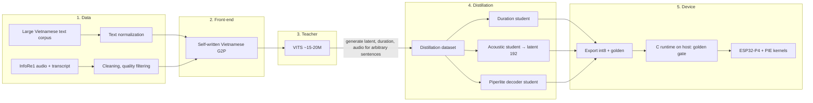
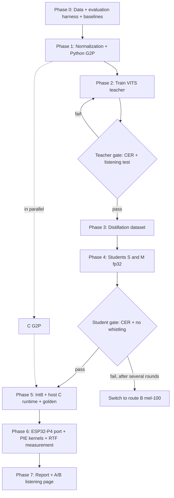

# Design: A compact Vietnamese voice running on ESP32-P4

- Date: 2026-11-14
- Status: implemented. The Vietnamese prototype shipped as v0.1.0–v0.3.0 (M-vocos v0.2 quality model, S-vocos v0.1 lite model). Some decisions changed during implementation (for example, the target boards became Waveshare ESP32-P4-86-Panel / ESP32-P4-NANO and ESP32-S3-Touch-LCD-2.8 rather than M5Stack Tab5, and the decoder became Vocos-style ConvNeXt + iSTFT); see the README and docs/reports for current numbers.
- Scope: prototype phase (quality validation)

## 1. Purpose and rationale

The existing Vietnamese voice in sanoTTS (`vi`, 1.57M parameters) is the weakest voice in that project: SCOREQ 1.53 (the English `amy` voice scores 4.13), Whisper WER 0.468 (another measurement reported 0.261), and no listening test has been done. The root cause is the teacher: it was distilled from Piper `vi_VN-vais1000-medium`, which was trained on about 1000 sentences. A student can only imitate up to the ceiling of its teacher.

Project goal: **rebuild the entire pipeline ourselves** (data → teacher → student → int8 → ESP32-P4) for Vietnamese, with a stronger teacher, and own all of the code so it can be commercialized later.

This phase is a **prototype to validate quality**. Once the quality is good enough, the maintainer will buy licensed recordings, swap the data, and rerun the same pipeline.

## 2. Goals, non-goals, anti-goals

**Goals**
- One Vietnamese voice (Northern accent, single speaker) that is intelligible, has correct tones, and has no buzzing or whistling, at a size that runs in real time on ESP32-P4.
- A **data-source-independent** pipeline: swapping the audio + transcript directory is enough to rerun it end to end.
- All code is written by the project or taken from MIT/Apache/BSD-licensed sources, with no GPL.
- Measurements on real hardware (RTF, memory, match against the reference), not just estimates.

**Non-goals for this phase**
- Multiple voices or dialects (Southern, Central accents).
- Emotion or speaking-style control.
- Web/WASM builds, pip/npm packages.
- Commercialization work (packaging, OTA, voice updates).

**Anti-goals** (still a failure even if it "works")
- Quality that only looks good on automatic metrics but sounds buzzy, whistly or has wrong tones to the ear.
- Runs on the P4 but the int8 output drifts from the fp32 reference without anyone noticing (no golden gate).
- Code or data that brings GPL obligations or non-commercial terms into the **final product**.
- A pipeline tightly coupled to InfoRe1, so it has to be rewritten when switching to licensed data.

## 3. Constraints

### 3.1 Licensing and clean-room rules

| Source | What is allowed |
|---|---|
| sanoTTS, exactly the files listed in `LICENSE.MIT`: `snt_port.h`, `snt_kernels_ref.c`, `snt_nano.*`, `snt_tts.*`, host/wasm ports | May be used directly (keep the MIT notice). In practice only the **port API** (`snt_port.h`) and the reference kernels are needed as reference |
| sanoTTS `snt_front_*`, `snt_piperlite*`, `snt_trellis*` (**GPL-3.0**, not in `LICENSE.MIT`) | **Do not open the `.c` files, do not copy.** The runtime for route A is written by the project (section 5.6) |
| Original Piper `rhasspy/piper` (MIT, archived), original VITS `jaywalnut310/vits` (MIT) | Used directly to train the teacher; the HiFiGAN generator architecture in VITS is the basis for the student decoder and the runtime |
| The rest of sanoTTS: `tools/`, `pypkg/` (GPL-3.0) | Do not open. `docs/` and the README are read only to understand the ideas, not copied |
| espeak-ng, vPhon, `misaki/vi.py`, `piper1-gpl` / `piper-tts` on PyPI (GPL) | Do not read their source, do not import into project code. **Only exception:** run as black-box tools in a separate evaluation environment (`eval/baselines/`), solely to generate baseline audio (section 6). The GPL governs distribution; it does not prohibit running the programs |
| ElevenLabs output | Not used (its usage policy forbids using output to train models) |

Correction to the earlier draft: the draft said "the runtime `mcu/src/snt_*.c` is MIT". That is wrong: the files route A needs (`snt_front_*`, `snt_piperlite*`) are GPL-3.0. The maintainer chose to **write our own runtime**.

The Vietnamese G2P is written from scratch based on descriptions of Vietnamese phonetics, with a **phoneme symbol set designed by the project**, and does not imitate espeak's encoding.

Transparency note: during the survey, the header and the initial/final consonant tables of `pypkg/sanotts/vi_g2p.py` (GPL) were skimmed. Those are common facts of Vietnamese phonetics (for example "d/gi/r → /z/" in the Northern accent). The new G2P will be written from phonetics literature, use a different symbol set, and that file will not be reopened.

### 3.2 Data (prototype)

- **InfoRe1** (`doof-ferb/infore1_25hours`): about 25 hours, 14,935 sentences, one hired speaker. Labeled CC-BY-4.0 on the mirror (original license unclear). WAV audio at 44.1 kHz, 16-bit mono; actual spectral energy extends to about 16 kHz. Transcripts are lowercase, without punctuation, and not proofread.
- Fallbacks: viVoice (CC-BY-NC-SA, permission required) to extract a cleaner voice; FOSD (CC BY 4.0, mp3 16 kHz).
- Used only for the prototype. The final product uses licensed recordings.

### 3.3 Training resources

- One **NVIDIA RTX 3060 8 GB** GPU on a dedicated GPU server accessed over SSH. The Mac is only used for writing code, running light tests and the C runtime; all training, distillation data generation and large-scale ASR evaluation run in this container. Real constraints:
  - A medium-size VITS teacher can be trained with mixed precision and a small batch (about 8–16) and short audio segments. **Warm-start is the default**; no training from scratch.
  - The distillation dataset does not store all [192, frames] latents for 50–100k sentences if disk space is insufficient; the implementer chooses between storing fp16 on disk or generating in batches.
  - Each teacher training round takes many GPU days, so the number of attempts at the teacher gate is limited. If more rounds are needed, a cloud GPU can be rented by the hour, but that is the maintainer's decision.

### 3.4 Target hardware: ESP32-P4

- **No board yet.** Phases 0–5 do not need a board. Phase 6 depends on buying one.
- Proposal: **M5Stack Tab5** (32 MB PSRAM, 16 MB flash, with an audio codec and speaker), because there are existing sanoTTS-jp measurements on this exact board for comparison. Buying the board is the maintainer's decision.

- 2 HP RISC-V cores at about 400 MHz, with FPU and Espressif's own int8 SIMD instruction set (PIE, `esp.*` instructions).
- About 768 KB of internal SRAM (L2MEM); external PSRAM depends on the board (for example, M5Stack Tab5 has 32 MB).
- Community reference numbers: sanoTTS-jp, 559k parameters, W8A8 + PIE on Tab5 reaches **xRT 0.834**; the plain C build reaches 2.79.
- Lessons from sanoTTS on ESP32-S3: SIMD reading weights directly from XIP flash produces garbage; placing weights in PSRAM is 5.7 times slower than internal SRAM. **Weight placement matters as much as the model architecture.**
- Consequence: a 1.5M-parameter int8 model weighs about 1.5 MB and does not fit in internal SRAM. A model of about 0.5M may fit.

### 3.5 Sample rate and latent

- 22,050 Hz, hop 256. Reason: matches Piper/VITS medium, so the student decoder can be initialized from the teacher's generator weights.
- The latent between the acoustic part and the decoder has 192 channels, matching the teacher's latent.

## 4. Approaches considered

| Approach | Description | Trade-offs | Decision |
|---|---|---|---|
| **A. VITS teacher → distill a small student (scaled-down HiFiGAN-style decoder)** | Train VITS on real data; the student learns duration, latent and decoder from the teacher; **self-written int8 C runtime** | Best quality at small size among sanoTTS routes (`amy` 1.46M reaches SCOREQ 4.13). Risks: a small decoder whistles easily; the runtime must be written ourselves (about 2000 lines of C) | **Chosen** (approved by the maintainer, together with the decision to write our own runtime) |
| B. Mel-100 route (like `heart`/`heart-nano`) | Student predicts mel, ConvNeXt + iSTFT decoder; the `snt_nano` runtime is genuinely MIT | Less whistling, license-clean right away; but clearly lower quality at the same size (`heart` 2.27M only reaches 3.48, `heart-nano` reaches 2.29) | Fallback if decoder A fails the listening test |
| C. Train a small model end-to-end directly | No teacher | sanoTTS reports that this was tried and failed at small budgets (whistling) | Rejected |

Why A: highest quality at a size that runs on the P4, and it keeps every later upgrade lever open (section 9). Writing our own runtime instead of using sanoTTS's GPL runtime gives a license-clean result, is done once, and does not tie the student architecture to the sanoTTS graph.

## 5. Design

### 5.1 Overview



### 5.2 Data

- Download InfoRe1, convert to 22,050 Hz mono.
- Trim leading/trailing silence, normalize loudness.
- Automatic filtering:
  - Run Vietnamese ASR (PhoWhisper or Whisper large-v3) on each sentence and drop sentences whose CER against the transcript exceeds a threshold (catches spelling errors and misread sentences).
  - Score with DNSMOS, drop noisy sentences.
  - Drop sentences that are too short or too long.
- Report: number of sentences and hours remaining after filtering, length distribution, tone distribution.
- Split: train, validation, and a **held-out set of 50 sentences** that is never used to train the teacher or the student.
- **Distillation text corpus** (about 50–100k sentences): taken from open text sources (for example Vietnamese Wikipedia), deliberately adding numbers, dates, proper names, questions and exclamations. The text is only used as teacher input and is not redistributed.
- **Out-of-domain (OOD) evaluation set**: about 50 sentences written by the project, including device announcements, numbers, times, addresses, proper names and long sentences.

### 5.3 Front-end: text normalization and G2P

**Text normalization**, written in Python first and ported to C later:
- Cardinal numbers (including the "mươi/mười", "lăm/năm", "mốt/một", "linh/lẻ" rules), decimals, percentages.
- Dates, times, currency (đ, VNĐ, USD), units (km, kg, °C).
- Common abbreviations (TP., Q., P., ...) via an extensible table.
- Letters and foreign words read using Vietnamese letter names.
- Punctuation is kept as pause tokens.

**Spelling-based G2P, not tied to any dialect** (approved by the maintainer, so that Huế, Nghệ An and other accents can be added later without rewriting the G2P):
- Vietnamese is written in syllables with a closed structure: initial, medial glide, nucleus, final, tone. The G2P is rule-based and needs no dictionary.
- Tokens represent **orthographic units with phonemic value**, without merging according to any region: `tr` differs from `ch`, `s` from `x`, `r` from `d` from `gi`, and the finals `-n/-ng`, `-t/-c` are kept separate. The model learns how the voice in the data pronounces them (a Northern voice will learn that `tr` and `ch` sound the same).
- Purely orthographic variants that carry no acoustic difference in any region are still normalized (for example `c/k/q` before different vowels, `g/gh`, `ng/ngh`, tone-mark placement `òa/oà`).
- **6 tone tokens following the written tone marks** (ngang, huyền, sắc, hỏi, ngã, nặng), placed at the end of the syllable. Where a region merges tones (for example hỏi/ngã), the model learns it from the data.
- There are syllable-boundary, word-boundary and punctuation tokens.
- About 60–90 tokens, fixed in a versioned `phoneme_set` file. The teacher and the student share one token set; all voices and all regions share one token set.
- Prototype voice: Northern accent (the InfoRe1 speaker).
- Tests: a table of sample sentences with expected outputs, and a coverage test (every valid syllable can be transcribed).
- C version: pure C99, no `malloc`, output exactly matching the Python version on a test sentence set.

### 5.4 Teacher

- VITS architecture. Use the training code of `rhasspy/piper` (MIT) or the original VITS (MIT), with IDs from the project's G2P as input, not Piper's phonemizer.
- Piper-style "medium" configuration: 22,050 Hz, hop 256, 192-channel latent.
- Initialization: warm-starting from an existing VITS checkpoint is allowed to save training time. This applies only to the prototype phase; for the final product the initialization checkpoint must also be license-clean, or the model is trained from scratch.
- The teacher must run deterministically when generating data (fixed noise scale and seed) so the student learns stable targets.
- Teacher quality gate, which must be passed before distillation:
  - CER on the held-out set clearly better than the current sanoTTS `vi` voice.
  - The maintainer listens and accepts it.

### 5.5 Student (distillation)

The student architecture is designed by the project and restricted to **a small set of operations supported by the self-written runtime** (section 5.6): Conv1d (including depthwise), ConvTranspose1d, LeakyReLU, tanh, residual add, embedding, duration-based expansion. The training code, exporter and runtime are all written from scratch.

| Block | Input → output | Learned from the teacher |
|---|---|---|
| Duration | Phoneme IDs → frames per phoneme (small conv block, log-duration output) | The teacher's durations (from the alignment or from the teacher's duration predictor) |
| Acoustic | Phoneme IDs + durations → latent [192, frames] (token-level conv, duration expansion, frame-level conv) | The latent the teacher feeds into its decoder |
| Decoder | Latent → 22,050 Hz audio. Scaled-down HiFiGAN-style generator: input conv, 3 upsample stages (8×8×4 = 256) each with residual blocks, output conv, tanh | Audio generated by the teacher's decoder from the same latent; initialized from the teacher's generator weights (channels pruned by importance); losses are multi-resolution spectral plus adversarial/feature-matching |

- Train two sizes to measure on the P4:
  - **S**: about 0.5M parameters, aiming to fit in internal SRAM.
  - **M**: about 1.5M parameters, on par with the current `vi` voice.
- Final step: joint fine-tuning of the whole chain to reduce mismatch when the blocks are combined.
- Whistle check: measured with a spectral "ridge/whistle" index, plus a mandatory listening test.

### 5.6 Self-written C runtime, int8 quantization and gates

**Runtime** (the maintainer chose to write it ourselves, under the project's license):
- C99, no `malloc`: all working memory comes from an arena supplied by the caller, with a function to compute the arena size in advance.
- Two builds with the same API: fp32 (reference) and int8.
- Model file format defined by the project: header with magic + version, a dimension table, a tensor table (name, type, offset, size, scale), then the payload. The runtime hardcodes no shapes.
- Optional "stage tap" hook to compare each intermediate tensor with PyTorch when debugging.
- A small per-chip port layer: int8×int8 and int16×int8 dot/matvec, a check that weights reside in SIMD-readable memory, a timer. The plain C build runs on any platform; the PIE build is for the P4.
- The Python exporter and the C runtime read a single format description, so the two sides cannot drift apart.

**Quantization**:
- Symmetric per-output-channel int8 weights. Activations use int16 lanes holding roughly 12-bit values; static per-tensor scales, calibrated on real latents. This quantization technique is common knowledge, described in the sanoTTS README; the project implements it itself.
- Sensitive parts (the final output before tanh, the log-duration head) stay in fp32.
- QAT (quantization-aware training) is used only if int8 fails the gate.

**Golden fixture**: each exported model comes with input IDs, durations, a reference latent and reference PCM.

**Gates**:
- C fp32 versus PyTorch: audio correlation ≥ 0.9999; durations match exactly as integers.
- int8 versus fp32: audio correlation > 0.98 and 0.80 < RMS ratio < 1.25 (correlation is amplitude-independent, so RMS must also be checked).
- int8 durations: at most 1 frame off per phoneme and at most 1% of total frames. Reason: `exp()` followed by rounding creates hard decision boundaries, so int8 cannot match exactly. The golden test uses the fp32 durations when comparing latent/audio, so that a 1-frame difference is not confused with quantization error. This is the author's decision.

### 5.7 Porting to ESP32-P4

- ESP-IDF project, using the self-written runtime plus the P4 port.
- PIE kernels for the port-layer functions (int8 and int16×int8 dot/matvec, weight-placement check). Start with the plain C build (correctness first), then optimize with PIE. Consider esp-nn (Apache-2.0) if it has suitable P4 kernels.
- Weight placement strategy:
  - S: try placing everything in internal SRAM.
  - M: weights in PSRAM, staged layer by layer into SRAM before SIMD computation.
  - Measure both.
- Audio playback: I2S to the board's codec or DAC.
- The bench prints RTF, `arena_peak`, correlation and RMS ratio against golden, in the same format as sanoTTS's BoardBenchmark for comparability.

## 6. Evaluation and success criteria

**Baselines**
1. The current sanoTTS `vi` voice.
2. Piper `vi_VN-25hours_single-low` (same InfoRe1 data).
3. The project's teacher, treated as the quality ceiling.

Baselines 1 and 2 are rendered with their own tools (the `sanotts` package and Piper, which use espeak-ng) as **black boxes**, in a separate virtualenv in `eval/baselines/`. Only the output audio is kept; nothing is imported into project code (see section 3.1).

**Metrics**
- Intelligibility: CER/WER with diacritics (tone errors change the diacritic-marked word, so this metric catches tone errors). Measured with PhoWhisper or Whisper large-v3 on the 50-sentence held-out set and the 50-sentence out-of-domain set.
- Naturalness (proxy): UTMOS/SCOREQ. Only used for comparisons within Vietnamese, not against English numbers.
- Whistling: spectral index plus a listening test.
- Device: RTF, peak memory, golden gate.
- Listening test: an A/B comparison page with samples from the baselines, the teacher, the fp32 student and the int8 student. The maintainer listens and rates them.

**Prototype success criteria** (the numeric thresholds are the author's decision; the maintainer may adjust them)
- Teacher: held-out CER **≤ 50% of the CER of the sanoTTS `vi` voice**, and **≤ the CER of Piper `25hours_single-low`**; and passes the listening test.
- Student M fp32: held-out CER **≤ 1.3 times the teacher's CER**, and no audible whistling.
- int8: passes the golden gate.
- P4: at least one size (S or M) reaches **RTF < 1.0** and passes the golden gate on the real chip.
- The maintainer listens and concludes it is "good enough to invest in licensed recordings".

## 7. Planned directory structure

The new project lives at the repo root, separate from the `sanoTTS/` clone (used only as reference material and gitignored).

```
tts/
  docs/                 design, evaluation reports
  data/                 download + cleaning scripts (real data kept outside git)
  frontend/             text normalization + G2P (Python), tests
  teacher/              VITS config + training scripts
  distill/              distillation dataset generation, train 3 students, joint finetune
  export/               fp32/int8 exporter + golden
  runtime/              self-written C runtime (fp32 + int8) + C G2P + host port
  firmware/esp32p4/     ESP-IDF project, PIE kernels, bench
  eval/                 CER/WER, UTMOS, whistle index, A/B listening page
  eval/baselines/       separate virtualenv for baseline audio (black box, no imports)
```

## 8. Roadmap

No specific dates. Each phase has a gate that must be passed before moving to the next. Code writing (G2P, exporter, kernels, evaluation harness) is mostly done by AI, so the time goes mainly into **GPU training time** and **the maintainer's listening evaluation time**.



Work that can run in parallel while the GPU trains the teacher: the C G2P, the C runtime (tested with a temporary student trained quickly on a small dataset) and buying the P4 board. Phases 0–5 do not need a board.

## 9. Upgrade path after the prototype

1. Replace the data with licensed recordings (about 10–20 hours, studio). Rerun the whole pipeline without code changes.
2. Expand the distillation text corpus (100k sentences or more) to read unfamiliar text well.
3. Stronger teacher: VITS2 or MB-iSTFT-VITS, trained longer.
4. Increase the decoder size within the P4 real-time budget (quality is concentrated mainly in the decoder).
5. Prosody: question/exclamation tokens, phrase-level pause modeling.
6. Streaming: chunked synthesis to reduce time to first audio.
7. If needed, switch to route B and reuse the data, teacher, G2P and duration student.

## 10. Decisions left to the implementer

- Choose between the `rhasspy/piper` training code and the original VITS, and the warm-start checkpoint (within the licensing limits of section 3.1; any warm-start checkpoint will be replaced when training the final product).
- Details of the runtime's model file format.
- Exact CER and DNSMOS thresholds for data filtering (chosen to keep ≥ 18 hours).
- Exact hyperparameters of students S and M, within the graph supported by the runtime.
- The specific source of the distillation text corpus.
- Use esp-nn or write our own PIE kernels.
- Format of the A/B listening page.

## 11. Main risks

| Risk | Signal | Response |
|---|---|---|
| InfoRe1 transcripts contain errors, the teacher learns them | High teacher CER on certain syllables | Filter with ASR; if still poor, switch to a voice from viVoice |
| The student decoder whistles | High whistle index, detected in listening tests | Initialize from the teacher, add adversarial loss, increase decoder size; finally route B |
| Model M is not real-time on the P4 because weights are in PSRAM | RTF > 1 | Stage layers into SRAM; choose S; optimize kernels |
| Teacher training on an 8 GB GPU is too slow | One training round takes many days, loss has not converged | Warm-start, shorter segments, gradient accumulation; rent a cloud GPU by the hour if the maintainer agrees |
| The self-written runtime has subtle numerical bugs | High correlation but RMS off, or drift at one layer | Stage taps compare each tensor with PyTorch; gate on both correlation and RMS |
| No P4 board yet | Phase 6 is blocked | Buy the board in parallel with phases 2–5 |
| int8 fails the golden gate | Correlation < 0.98 | 12-bit activations, per-tensor scales, QAT if needed |
| Licensing of the warm-start checkpoint or data | — | Prototype only; state it clearly in the report; the final product is retrained on licensed data |
