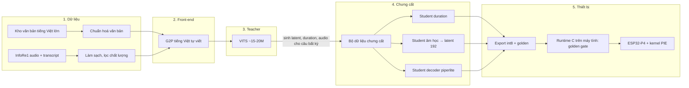
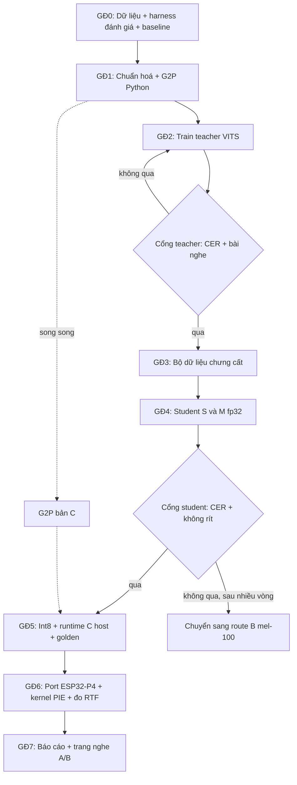

# Thiết kế: Giọng đọc tiếng Việt nhỏ gọn chạy trên ESP32-P4

- Ngày: 2026-11-14
- Trạng thái: chờ duyệt (đã qua builder check, đã cập nhật theo câu trả lời của người dùng)
- Phạm vi: giai đoạn prototype (kiểm chứng chất lượng)

## 1. Mục đích và lý do

Giọng tiếng Việt hiện có trong sanoTTS (`vi`, 1.57M tham số) là giọng yếu nhất của dự án đó: SCOREQ 1.53 (giọng `amy` tiếng Anh đạt 4.13), Whisper WER 0.468 (một lần đo khác ghi 0.261), chưa có bài nghe nào. Nguyên nhân gốc là teacher: nó được chưng cất từ Piper `vi_VN-vais1000-medium`, train trên khoảng 1000 câu. Student chỉ bắt chước được tới trần của teacher.

Mục tiêu dự án: **tự xây lại toàn bộ chuỗi** (dữ liệu → teacher → student → int8 → ESP32-P4) cho tiếng Việt, với teacher mạnh hơn, và sở hữu toàn bộ code để sau này thương mại hoá.

Giai đoạn này là **prototype để kiểm chứng chất lượng**. Khi chất lượng đạt, người dùng sẽ mua bản thu âm có bản quyền, thay dữ liệu và chạy lại cùng quy trình.

## 2. Mục tiêu, không làm, phản mục tiêu

**Mục tiêu**
- Một giọng tiếng Việt (giọng Bắc, một người đọc) rõ chữ, đúng thanh điệu, không rè hay rít, ở cỡ chạy được real-time trên ESP32-P4.
- Quy trình **không phụ thuộc nguồn dữ liệu**: đổi thư mục audio + transcript là chạy lại được từ đầu đến cuối.
- Toàn bộ code do dự án tự viết hoặc lấy từ nguồn giấy phép MIT/Apache/BSD, không dính GPL.
- Số đo trên phần cứng thật (RTF, bộ nhớ, độ khớp so với bản tham chiếu), không chỉ ước lượng.

**Không làm trong giai đoạn này**
- Đa giọng, đa phương ngữ (giọng Nam, giọng Trung).
- Điều khiển cảm xúc hoặc phong cách đọc.
- Phiên bản web/WASM, gói pip/npm.
- Tối ưu thương mại hoá (đóng gói, OTA, cập nhật giọng).

**Phản mục tiêu** (vẫn là thất bại dù "chạy được")
- Chất lượng chỉ đẹp trên số liệu tự động nhưng nghe bằng tai thấy rè, rít hoặc sai thanh.
- Chạy trên P4 nhưng output int8 lệch so với bản fp32 tham chiếu mà không ai phát hiện (không có golden gate).
- Code hoặc dữ liệu kéo theo nghĩa vụ GPL hay điều khoản cấm thương mại vào **sản phẩm cuối**.
- Quy trình gắn chặt vào InfoRe1, đến khi đổi sang dữ liệu bản quyền phải viết lại.

## 3. Ràng buộc

### 3.1 Giấy phép và quy tắc clean-room

| Nguồn | Được làm gì |
|---|---|
| sanoTTS, đúng các file liệt kê trong `LICENSE.MIT`: `snt_port.h`, `snt_kernels_ref.c`, `snt_nano.*`, `snt_tts.*`, port host/wasm | Được dùng trực tiếp (giữ thông báo MIT). Thực tế chỉ cần tham khảo **port API** (`snt_port.h`) và kernel tham chiếu |
| sanoTTS `snt_front_*`, `snt_piperlite*`, `snt_trellis*` (**GPL-3.0**, không nằm trong `LICENSE.MIT`) | **Không mở file `.c`, không chép.** Runtime cho route A do dự án tự viết (mục 5.6) |
| Piper gốc `rhasspy/piper` (MIT, đã archive), VITS gốc `jaywalnut310/vits` (MIT) | Dùng trực tiếp để train teacher; kiến trúc generator HiFiGAN trong VITS là cơ sở cho decoder student và runtime |
| sanoTTS phần còn lại: `tools/`, `pypkg/` (GPL-3.0) | Không mở. `docs/` và README chỉ đọc để hiểu ý tưởng, không chép |
| espeak-ng, vPhon, `misaki/vi.py`, `piper1-gpl` / `piper-tts` trên PyPI (GPL) | Không đọc mã nguồn, không import vào code dự án. **Ngoại lệ duy nhất:** chạy như công cụ hộp đen trong môi trường đánh giá riêng (`eval/baselines/`), chỉ để sinh audio baseline (mục 6). GPL ràng buộc phân phối, không cấm chạy chương trình |
| ElevenLabs output | Không dùng (chính sách sử dụng cấm dùng output để train model) |

Đính chính so với bản nháp trước: bản nháp ghi "runtime `mcu/src/snt_*.c` là MIT". Điều đó sai: các file route A cần (`snt_front_*`, `snt_piperlite*`) là GPL-3.0. Người dùng chọn **tự viết runtime**.

Bộ G2P tiếng Việt được viết mới từ mô tả ngữ âm học tiếng Việt, với **bộ ký hiệu âm vị do dự án tự thiết kế**, không bắt chước cách mã hoá của espeak.

Lưu ý minh bạch: trong lúc khảo sát, phần header và bảng âm đầu/âm cuối của `pypkg/sanotts/vi_g2p.py` (GPL) đã bị đọc lướt. Đó là các sự thật ngữ âm phổ biến của tiếng Việt (ví dụ "d/gi/r → /z/" ở giọng Bắc). G2P mới sẽ được viết từ tài liệu ngữ âm, dùng bộ ký hiệu khác, và không mở lại file đó.

### 3.2 Dữ liệu (prototype)

- **InfoRe1** (`doof-ferb/infore1_25hours`): khoảng 25 giờ, 14,935 câu, một người đọc thuê. Gắn nhãn CC-BY-4.0 trên bản mirror (giấy phép gốc chưa rõ). Audio WAV 44.1 kHz, 16-bit mono, năng lượng phổ thực tế có tới khoảng 16 kHz. Transcript viết thường, không dấu câu, chưa soát chính tả.
- Dự phòng: viVoice (CC-BY-NC-SA, phải xin quyền) để lọc một giọng sạch hơn; FOSD (CC BY 4.0, mp3 16 kHz).
- Chỉ dùng cho prototype. Sản phẩm cuối dùng bản thu âm có bản quyền.

### 3.3 Tài nguyên train

- Một GPU **NVIDIA RTX 3060 8 GB**, trên một máy chủ GPU riêng truy cập qua SSH. Máy Mac chỉ dùng để viết code, chạy test nhẹ và runtime C; mọi việc train, sinh dữ liệu chưng cất và chạy ASR đánh giá trên tập lớn đều chạy trên container này. Ràng buộc thật:
  - Teacher VITS cỡ medium train được với mixed precision và batch nhỏ (khoảng 8–16), segment audio ngắn. **Warm-start là mặc định**, không train từ đầu.
  - Bộ dữ liệu chưng cất không lưu toàn bộ latent [192, frames] cho 50–100k câu nếu ổ đĩa không đủ; người thực hiện chọn giữa lưu fp16 lên đĩa hoặc sinh theo lô.
  - Mỗi vòng train teacher tốn nhiều ngày GPU, nên số vòng thử cho cổng teacher bị giới hạn. Nếu cần thêm vòng, có thể thuê GPU cloud theo giờ, nhưng đó là quyết định của người dùng.

### 3.4 Phần cứng đích: ESP32-P4

- **Hiện chưa có board.** Giai đoạn 0–5 không cần board. Giai đoạn 6 phụ thuộc việc mua board.
- Đề xuất: **M5Stack Tab5** (32 MB PSRAM, 16 MB flash, có codec audio và loa), vì đã có số đo sanoTTS-jp trên chính board này để đối chiếu. Mua board là quyết định của người dùng.

- 2 lõi RISC-V HP khoảng 400 MHz, có FPU, có tập lệnh SIMD int8 riêng của Espressif (PIE, lệnh `esp.*`).
- Khoảng 768 KB SRAM nội (L2MEM), PSRAM ngoài tuỳ board (ví dụ M5Stack Tab5 có 32 MB).
- Số đo tham chiếu từ cộng đồng: sanoTTS-jp 559k tham số, W8A8 + PIE trên Tab5 đạt **xRT 0.834**; bản C thường 2.79.
- Bài học từ sanoTTS trên ESP32-S3: SIMD đọc trọng số trực tiếp từ flash XIP cho ra rác; đặt trọng số ở PSRAM chậm 5.7 lần so với SRAM nội. **Vị trí đặt trọng số quan trọng ngang kiến trúc model.**
- Hệ quả: model 1.5M tham số int8 nặng khoảng 1.5 MB, không vừa SRAM nội. Model khoảng 0.5M có thể vừa.

### 3.5 Sample rate và latent

- 22,050 Hz, hop 256. Lý do: khớp với Piper/VITS medium, nên decoder student có thể khởi tạo từ trọng số generator của teacher.
- Latent giữa phần âm học và decoder có 192 kênh, khớp với latent của teacher.

## 4. Các cách đã cân nhắc

| Cách | Mô tả | Đánh đổi | Quyết định |
|---|---|---|---|
| **A. Teacher VITS → chưng cất student nhỏ (decoder kiểu HiFiGAN thu nhỏ)** | Train VITS trên dữ liệu thật; student học duration, latent và decoder từ teacher; **runtime C int8 tự viết** | Chất lượng ở cỡ nhỏ tốt nhất trong các route của sanoTTS (`amy` 1.46M đạt SCOREQ 4.13). Rủi ro: decoder nhỏ dễ rít; phải tự viết runtime (khoảng 2000 dòng C) | **Chọn** (người dùng duyệt, kèm quyết định tự viết runtime) |
| B. Route mel-100 (giống `heart`/`heart-nano`) | Student dự đoán mel, decoder ConvNeXt + iSTFT; runtime `snt_nano` là MIT thật | Ít rít, sạch giấy phép ngay; nhưng chất lượng thấp hơn rõ ở cùng cỡ (`heart` 2.27M chỉ đạt 3.48, `heart-nano` đạt 2.29) | Dự phòng nếu decoder A không qua bài nghe |
| C. Train trực tiếp model nhỏ end-to-end | Không có teacher | sanoTTS ghi là đã thử và không đạt ở ngân sách nhỏ (rít) | Loại |

Lý do chọn A: chất lượng cao nhất ở cỡ chạy được trên P4, và để mở mọi đòn bẩy nâng cấp về sau (mục 9). Tự viết runtime thay vì dùng runtime GPL của sanoTTS cho kết quả sạch giấy phép, chỉ làm một lần, và kiến trúc student không bị bó theo đồ thị của sanoTTS.

## 5. Thiết kế

### 5.1 Toàn cảnh



### 5.2 Dữ liệu

- Tải InfoRe1, chuyển về 22,050 Hz mono.
- Cắt khoảng lặng đầu/cuối, chuẩn hoá âm lượng.
- Lọc tự động:
  - Chạy ASR tiếng Việt (PhoWhisper hoặc Whisper large-v3) trên từng câu, loại câu có CER so với transcript vượt ngưỡng (bắt lỗi chính tả và câu đọc sai).
  - Chấm DNSMOS, loại câu nhiễu.
  - Loại câu quá ngắn hoặc quá dài.
- Báo cáo: số câu và số giờ còn lại sau lọc, phân bố độ dài, phân bố thanh điệu.
- Tách tập: train, validation, và **held-out 50 câu** không bao giờ đưa vào train teacher hay student.
- **Kho văn bản chưng cất** (khoảng 50–100k câu): lấy từ nguồn văn bản mở (ví dụ Wikipedia tiếng Việt), có chủ đích thêm số, ngày tháng, tên riêng, câu hỏi, câu cảm thán. Văn bản chỉ dùng làm đầu vào cho teacher, không phân phối lại.
- **Bộ đánh giá ngoài miền**: khoảng 50 câu do dự án viết, gồm thông báo thiết bị, số, giờ, địa chỉ, tên riêng và câu dài.

### 5.3 Front-end: chuẩn hoá văn bản và G2P

**Chuẩn hoá văn bản**, viết bằng Python trước và port sang C sau:
- Số đếm (kể cả các luật "mươi/mười", "lăm/năm", "mốt/một", "linh/lẻ"), số thập phân, phần trăm.
- Ngày tháng, giờ, tiền tệ (đ, VNĐ, USD), đơn vị đo (km, kg, °C).
- Viết tắt phổ biến (TP., Q., P., ...) theo một bảng mở rộng được.
- Chữ cái và từ ngoại lai đọc theo tên chữ cái tiếng Việt.
- Dấu câu được giữ lại thành token ngắt nghỉ.

**G2P bám chữ viết, không gắn với một phương ngữ** (người dùng duyệt, để sau này thêm giọng Huế, Nghệ An... mà không phải viết lại G2P):
- Tiếng Việt viết theo âm tiết với cấu trúc đóng: âm đầu, âm đệm, âm chính, âm cuối, thanh điệu. G2P dựa trên luật, không cần từ điển.
- Token biểu diễn **đơn vị chính tả có giá trị âm vị**, không gộp theo bất kỳ vùng nào: `tr` khác `ch`, `s` khác `x`, `r` khác `d` khác `gi`, các âm cuối `-n/-ng`, `-t/-c` giữ riêng. Model tự học cách giọng của dữ liệu phát âm chúng (giọng Bắc sẽ học rằng `tr` và `ch` đọc giống nhau).
- Vẫn chuẩn hoá các biến thể chính tả thuần tuý không mang khác biệt âm thanh ở bất kỳ vùng nào (ví dụ `c/k/q` trước các nguyên âm khác nhau, `g/gh`, `ng/ngh`, vị trí bỏ dấu `òa/oà`).
- **6 token thanh điệu theo dấu viết** (ngang, huyền, sắc, hỏi, ngã, nặng), đặt cuối âm tiết. Vùng nào gộp thanh (ví dụ hỏi/ngã) thì model tự học từ dữ liệu.
- Có token ranh giới âm tiết, token ranh giới từ và token dấu câu.
- Khoảng 60–90 token, cố định trong một file `phoneme_set` có version. Teacher và student dùng chung một bộ; mọi giọng, mọi vùng dùng chung một bộ.
- Giọng của prototype: giọng Bắc (người đọc của InfoRe1).
- Có test: bảng câu mẫu với kết quả kỳ vọng, và test bao phủ (mọi âm tiết hợp lệ đều phiên âm được).
- Bản C: thuần C99, không `malloc`, kết quả khớp tuyệt đối với bản Python trên một bộ câu kiểm tra.

### 5.4 Teacher

- Kiến trúc VITS. Dùng code training của `rhasspy/piper` (MIT) hoặc VITS gốc (MIT), với đầu vào là ID từ G2P của dự án, không dùng phonemizer của Piper.
- Cấu hình cỡ "medium" kiểu Piper: 22,050 Hz, hop 256, latent 192 kênh.
- Khởi tạo: được phép warm-start từ một checkpoint VITS có sẵn để tiết kiệm thời gian train. Chỉ áp dụng ở giai đoạn prototype; với sản phẩm cuối thì checkpoint khởi tạo cũng phải có giấy phép sạch, hoặc train từ đầu.
- Teacher phải chạy tất định khi sinh dữ liệu (cố định noise scale và seed) để student học được mục tiêu ổn định.
- Cổng chất lượng teacher, phải qua trước khi chưng cất:
  - CER trên held-out tốt hơn rõ rệt so với giọng `vi` hiện tại của sanoTTS.
  - Người dùng nghe bằng tai và chấp nhận.

### 5.5 Student (chưng cất)

Kiến trúc student do dự án thiết kế, giới hạn trong **một tập phép toán nhỏ mà runtime tự viết hỗ trợ** (mục 5.6): Conv1d (kể cả depthwise), ConvTranspose1d, LeakyReLU, tanh, cộng residual, embedding, mở rộng theo duration. Code training, exporter và runtime đều viết mới.

| Khối | Đầu vào → đầu ra | Học từ teacher |
|---|---|---|
| Duration | ID âm vị → số frame mỗi âm vị (khối conv nhỏ, đầu ra log-duration) | Duration của teacher (từ alignment hoặc từ bộ dự đoán duration của teacher) |
| Âm học | ID âm vị + duration → latent [192, frames] (conv mức token, mở rộng theo duration, conv mức frame) | Latent mà teacher đưa vào decoder |
| Decoder | Latent → audio 22,050 Hz. Generator kiểu HiFiGAN thu nhỏ: conv vào, 3 tầng upsample (8×8×4 = 256) mỗi tầng kèm khối residual, conv ra, tanh | Audio do decoder của teacher sinh từ cùng latent; khởi tạo từ trọng số generator của teacher (cắt kênh theo độ quan trọng); loss gồm phổ đa độ phân giải và loss đối kháng/feature-matching |

- Train hai cỡ để đo trên P4:
  - **S**: khoảng 0.5M tham số, ưu tiên vừa SRAM nội.
  - **M**: khoảng 1.5M tham số, ngang cỡ giọng `vi` hiện tại.
- Bước cuối: fine-tune chung cả chuỗi để giảm lệch khi ghép các khối.
- Kiểm tra tiếng rít: đo bằng một chỉ số "ridge/whistle" trên phổ, kèm bài nghe bắt buộc.

### 5.6 Runtime C tự viết, lượng tử hoá int8 và cổng kiểm tra

**Runtime** (người dùng chọn tự viết, giấy phép của dự án):
- C99, không `malloc`: mọi bộ nhớ làm việc lấy từ một arena do caller cấp, có hàm tính trước kích thước arena.
- Hai bản cùng API: fp32 (tham chiếu) và int8.
- Định dạng file model do dự án định nghĩa: header có magic + version, bảng kích thước, bảng tensor (tên, kiểu, offset, kích thước, scale), rồi payload. Runtime không hardcode shape nào.
- Hook "stage tap" tuỳ chọn để so từng tensor trung gian với PyTorch khi debug.
- Lớp port nhỏ cho từng chip: dot/matvec int8×int8 và int16×int8, kiểm tra trọng số có nằm ở bộ nhớ SIMD đọc được không, đồng hồ đo thời gian. Bản C thường chạy được trên mọi nền tảng; bản PIE cho P4.
- Exporter Python và runtime C cùng đọc một mô tả định dạng duy nhất, để hai bên không lệch nhau.

**Lượng tử hoá**:
- Trọng số int8 đối xứng theo từng kênh ra. Activation dùng làn int16 giữ giá trị khoảng 12-bit; scale tĩnh theo từng tensor, hiệu chỉnh trên latent thật. Kỹ thuật lượng tử hoá này là kiến thức phổ biến, được ghi trong README của sanoTTS; dự án tự cài đặt.
- Phần nhạy cảm (đầu ra cuối trước tanh, đầu log-duration) được giữ fp32.
- QAT (train có mô phỏng lượng tử hoá) chỉ dùng nếu int8 trượt gate.

**Golden fixture**: mỗi model export kèm ID đầu vào, duration, latent tham chiếu và PCM tham chiếu.

**Cổng kiểm tra**:
- Bản C fp32 so với PyTorch: audio tương quan ≥ 0.9999; duration khớp số nguyên tuyệt đối.
- Bản int8 so với fp32: audio tương quan > 0.98 và 0.80 < tỉ lệ RMS < 1.25 (tương quan không phụ thuộc biên độ, nên phải kiểm cả RMS).
- Duration int8: lệch tối đa 1 frame mỗi âm vị và tối đa 1% tổng số frame. Lý do: phép `exp()` rồi làm tròn tạo ranh giới quyết định cứng, nên int8 không thể khớp tuyệt đối. Golden test dùng duration của fp32 khi so latent/audio, để lệch 1 frame không bị lẫn với lỗi lượng tử hoá. Đây là quyết định của tôi.

### 5.7 Port lên ESP32-P4

- Project ESP-IDF, dùng runtime tự viết cộng thêm port P4.
- Kernel PIE cho các hàm của lớp port (dot/matvec int8 và int16×int8, kiểm tra vị trí trọng số). Bắt đầu với bản C thường (đúng trước), sau đó tối ưu PIE. Cân nhắc dùng esp-nn (Apache-2.0) nếu nó có kernel P4 phù hợp.
- Chiến lược đặt trọng số:
  - S: thử đặt toàn bộ trong SRAM nội.
  - M: trọng số ở PSRAM, nạp dần từng lớp vào SRAM (staging) trước khi tính bằng SIMD.
  - Đo cả hai.
- Phát audio: I2S ra codec hoặc DAC của board.
- Bench in ra RTF, `arena_peak`, tương quan và tỉ lệ RMS so với golden, cùng định dạng như BoardBenchmark của sanoTTS để so sánh được.

## 6. Đánh giá và tiêu chí thành công

**Đường so sánh (baseline)**
1. Giọng `vi` hiện tại của sanoTTS.
2. Piper `vi_VN-25hours_single-low` (cùng dữ liệu InfoRe1).
3. Teacher của dự án, được coi là trần chất lượng.

Baseline 1 và 2 được sinh audio bằng chính công cụ của chúng (gói `sanotts` và Piper, có dùng espeak-ng) như **hộp đen**, trong một virtualenv riêng ở `eval/baselines/`. Chỉ lưu audio đầu ra; không import gì vào code dự án (xem mục 3.1).

**Chỉ số**
- Rõ chữ: CER/WER có dấu (lỗi thanh điệu làm sai chữ có dấu, nên chỉ số này bắt được lỗi thanh). Đo bằng PhoWhisper hoặc Whisper large-v3 trên held-out 50 câu và bộ ngoài miền 50 câu.
- Tự nhiên (proxy): UTMOS/SCOREQ. Chỉ dùng để so trong cùng tiếng Việt, không so với số tiếng Anh.
- Tiếng rít: chỉ số phổ kèm bài nghe.
- Thiết bị: RTF, bộ nhớ đỉnh, golden gate.
- Bài nghe: một trang nghe so sánh A/B có các mẫu của baseline, teacher, student fp32 và student int8. Người dùng nghe và chấm.

**Tiêu chí thành công của prototype** (các ngưỡng số là quyết định của tôi, người dùng có thể chỉnh)
- Teacher: CER trên held-out **≤ 50% CER của giọng `vi` sanoTTS**, đồng thời **≤ CER của Piper `25hours_single-low`**; và qua bài nghe.
- Student M fp32: CER trên held-out **≤ 1.3 lần CER của teacher**, và không có tiếng rít khi nghe.
- Int8: qua golden gate.
- P4: ít nhất một cỡ (S hoặc M) đạt **RTF < 1.0** và qua golden gate trên chip thật.
- Người dùng nghe và kết luận "đủ tốt để đầu tư thu âm bản quyền".

## 7. Cấu trúc thư mục dự kiến

Dự án mới ở thư mục gốc của repo, tách khỏi bản clone `sanoTTS/` (chỉ dùng làm tài liệu tham khảo và được gitignore).

```
tts/
  docs/                 thiết kế, báo cáo đánh giá
  data/                 script tải + làm sạch (dữ liệu thật để ngoài git)
  frontend/             chuẩn hoá văn bản + G2P (Python), test
  teacher/              cấu hình + script train VITS
  distill/              sinh bộ dữ liệu chưng cất, train 3 student, joint finetune
  export/               exporter fp32/int8 + golden
  runtime/              runtime C tự viết (fp32 + int8) + G2P C + port host
  firmware/esp32p4/     project ESP-IDF, kernel PIE, bench
  eval/                 CER/WER, UTMOS, chỉ số rít, trang nghe A/B
  eval/baselines/       virtualenv riêng sinh audio baseline (hộp đen, không import)
```

## 8. Lộ trình

Không gắn ngày cụ thể. Mỗi giai đoạn có cổng kiểm tra phải qua trước khi sang giai đoạn sau. Phần viết code (G2P, exporter, kernel, harness đánh giá) do AI làm là chính, nên thời gian chủ yếu nằm ở **thời gian GPU train** và **thời gian người dùng nghe đánh giá**.



Các việc chạy song song được trong lúc GPU đang train teacher: G2P bản C, runtime C (kiểm tra bằng một student tạm train nhanh trên dữ liệu nhỏ) và việc mua board P4. Giai đoạn 0–5 không cần board.

## 9. Đường nâng cấp sau prototype

1. Thay dữ liệu bằng bản thu âm bản quyền (khoảng 10–20 giờ, phòng thu). Chạy lại toàn bộ quy trình, không sửa code.
2. Mở rộng kho văn bản chưng cất (100k câu trở lên) để đọc tốt văn bản lạ.
3. Teacher mạnh hơn: VITS2 hoặc MB-iSTFT-VITS, train lâu hơn.
4. Tăng cỡ decoder trong giới hạn real-time trên P4 (chất lượng tập trung chủ yếu ở decoder).
5. Ngữ điệu: token câu hỏi/cảm thán, mô hình ngắt nghỉ theo cụm từ.
6. Streaming: tổng hợp theo đoạn để giảm độ trễ đến tiếng đầu tiên.
7. Nếu cần, chuyển sang route B và tái sử dụng dữ liệu, teacher, G2P và student duration.

## 10. Các quyết định để lại cho người thực hiện

- Chọn giữa code training `rhasspy/piper` và VITS gốc, cùng checkpoint warm-start (trong giới hạn giấy phép ở mục 3.1; mọi checkpoint warm-start sẽ được thay khi train sản phẩm cuối).
- Chi tiết định dạng file model của runtime.
- Ngưỡng CER và DNSMOS cụ thể khi lọc dữ liệu (chọn sao cho giữ lại ≥ 18 giờ).
- Siêu tham số chính xác của student S và M, trong giới hạn đồ thị mà runtime hỗ trợ.
- Nguồn kho văn bản chưng cất cụ thể.
- Dùng esp-nn hay tự viết kernel PIE.
- Định dạng trang nghe A/B.

## 11. Rủi ro chính

| Rủi ro | Dấu hiệu | Ứng phó |
|---|---|---|
| Transcript InfoRe1 có lỗi, teacher học sai | CER teacher cao ở một số âm tiết | Lọc bằng ASR; nếu vẫn kém, chuyển sang một giọng trong viVoice |
| Decoder student bị rít | Chỉ số rít cao, bài nghe phát hiện | Khởi tạo từ teacher, thêm loss đối kháng, tăng cỡ decoder; cuối cùng là route B |
| Model M không đạt real-time trên P4 vì trọng số ở PSRAM | RTF > 1 | Staging từng lớp vào SRAM; chọn S; tối ưu kernel |
| GPU 8 GB train teacher quá chậm | Một vòng train kéo dài nhiều ngày, loss chưa hội tụ | Warm-start, giảm segment, gradient accumulation; thuê GPU cloud theo giờ nếu người dùng đồng ý |
| Runtime tự viết có lỗi số học khó thấy | Tương quan cao nhưng RMS lệch, hoặc lệch ở một tầng | Stage tap so từng tensor với PyTorch; gate cả tương quan lẫn RMS |
| Chưa có board P4 | Giai đoạn 6 bị chặn | Mua board song song với giai đoạn 2–5 |
| Int8 trượt golden gate | Tương quan < 0.98 | Activation 12-bit, scale theo từng tensor, QAT nếu cần |
| Giấy phép checkpoint warm-start hoặc dữ liệu | — | Chỉ dùng cho prototype; ghi rõ trong báo cáo; sản phẩm cuối train lại trên dữ liệu bản quyền |
