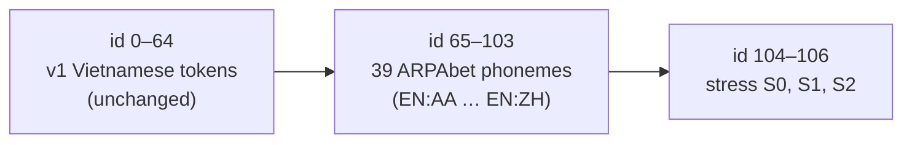
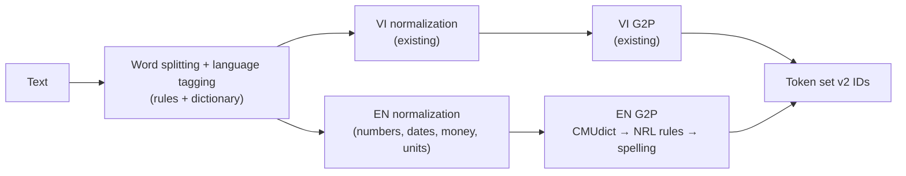
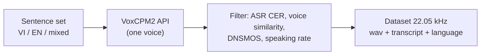

# Design: Bilingual Vietnamese–English model on ESP32-P4 and ESP32-S3

- Date: 2026-11-16
- Status: in progress (2026-11-17). Data synthesized with VoxCPM2 designed voices (about 98 h per voice for `nam-1` male and `nu-10` female); the Python English front-end (token set v2, 107 tokens) is done; teachers are training; the C port of the English front-end is pending.
- Scope: one voice that reads both Vietnamese and English in a single model, including sentences that mix the two languages

## 1. Purpose and rationale

vtts currently reads only Vietnamese. English words in a sentence (Bluetooth, email, product names) are read in a Vietnamized way or spelled out letter by letter. Yet devices used in Vietnam frequently meet mixed sentences ("Đã kết nối Bluetooth với AirPods", "Connected Bluetooth to AirPods") and sometimes need to read entire English sentences.

No open dataset has the same speaker reading both Vietnamese and English, and that is exactly what a model that reads mixed sentences needs. VoxCPM2 (Apache-2.0, 2B parameters, 30 languages including Vietnamese and English) runs on a self-hosted server and provides an API to generate audio with a chosen voice. VoxCPM2 plays the role of a "master" that produces the data. The rest reuses the existing pipeline: VITS teacher → student → int8 → chip.

Side benefit: sentences can be designed to cover rare syllables. The current teacher misreads "nguệch ngoạc", "khuếch", "nghiêng" because the training data does not contain these syllables. In addition, a model built this way has a clear license for commercial release.

## 2. Goals, non-goals, anti-goals

**Goals**
- One `.vtts` model file that reads: Vietnamese sentences, English sentences, and Vietnamese sentences with interspersed English words or phrases. All in the same voice.
- Vietnamese no worse than the current M v0.2 model, and correct reading of rare rhymes.
- Faster than real time on ESP32-P4 and ESP32-S3 (8 MB PSRAM), with the existing runtime and kernels.
- The English front-end (normalization and G2P) has a Python version and a C version with matching output, like the Vietnamese front-end.
- The data generation pipeline does not depend on VoxCPM2: swapping the audio source (another API, or real recordings) is enough to rerun it.

**Non-goals for this phase**
- A third language.
- Multiple voices, emotion control.
- British English: use the American accent per CMUdict.
- Machine-learning language identification. Only rules and dictionaries.

**Anti-goals** (still a failure even if it "works")
- Vietnamese gets worse than v0.2 in exchange for English.
- Within the same model, Vietnamese and English sentences sound like two different people.
- Generated data carries VoxCPM2 errors (wrong tones, stuttering, artifacts) into the model without being filtered or detected.
- Using the voice of someone who did not consent, or sources whose terms forbid training other models. For example: no ElevenLabs, no cloning of the VietBibleVox voice.
- Pulling GPL into the code (espeak-ng, phonemizer, misaki, g2p_en have GPL dependencies).

## 3. Constraints

### 3.1 Licensing

| Source | License | Used for |
|---|---|---|
| VoxCPM2 | Apache-2.0; prohibits impersonation and fraud; recommends labeling AI-generated audio | Generating training audio |
| Reference voice | Chosen by the maintainer: a designed voice, or a person who has consented | The model's voice |
| CMUdict | BSD 2-clause (keep the CMU copyright notice) | English pronunciation dictionary |
| NRL letter-to-sound rules (Elovitz et al., 1976, US Navy report, public domain) | Public domain | Guessing pronunciations for out-of-dictionary words; reimplemented from the paper |
| Vietnamese text: existing Wikipedia corpus (CC BY-SA) and self-written sentences | CC BY-SA or self-written | Sentences for audio generation |
| English text: English Wikipedia (CC BY-SA), LJSpeech transcripts (public domain), self-written sentences | Same as above | Sentences for audio generation |

Do not read or take code from: espeak-ng, phonemizer, misaki, piper-phonemize, g2p_en (its GPL dependency via nltk data would need checking; not used by default).

The license for releasing the bilingual model is decided by the maintainer at release time. The design keeps every source at a level that permits commercial use.

### 3.2 Hardware

- ESP32-P4: model up to about 3 MB; current M RTF is 0.34–0.42.
- ESP32-S3 (8 MB PSRAM, 16 MB flash): current M RTF is 0.85–0.99, close to the limit. The bilingual model must not be more than 10% slower than M; otherwise the S3 can only run the S variant.
- On-chip English dictionary: at most 1.5 MB of flash. Lookups read only from flash, without copying into RAM.

### 3.3 Compatibility

- The runtime reads `vocab` from the model header, so the synthesis part does not need changes.
- Vietnamese tokens keep ids 0–64. New tokens are appended from 65 onward, so that old models and tools keep working with token set v1.

## 4. Approaches considered

| Approach | Pros | Cons | Conclusion |
|---|---|---|---|
| A. Two separate models (VI and EN), pick one per sentence | Simple, each model optimized for one language | Cannot read mixed sentences; the two models' voices differ unless they share a source; double the flash | Not chosen |
| **B. One bilingual model, data generated from VoxCPM2 with a single voice** | Reads mixed sentences, one voice, one file; can cover rare syllables | Depends on VoxCPM2's Vietnamese quality; the model must split its capacity between two languages | **Chosen** |
| C. Bilingual from real data (VietBibleVox + LJSpeech) | Does not depend on VoxCPM2 | Two different speakers, mixed sentences would switch voice mid-sentence; no mixed-sentence data | Not chosen; kept as a fallback for an English-only build |

## 5. Design

### 5.1 Token set v2

- `PHONEME_SET_VERSION = "2"`, `VOCAB_SIZE = 107`.
- Each English vowel carries a stress token placed immediately after it, the same way a tone token follows a Vietnamese syllable.
- Word boundaries share the `SPACE` token; punctuation shares the punctuation tokens.
- No language-marker token: the phonemes are enough to distinguish the two languages, and this way switching language mid-sentence needs no special token.

### 5.2 Front-end

**Per-word language tagging** (`vi`, `en` or `auto` mode; default `vi`):
- Words with Vietnamese diacritics or the letter `đ`: always Vietnamese.
- `vi` mode:
  - words that form a valid Vietnamese syllable are read as Vietnamese ("an", "con", "to" stay Vietnamese);
  - words that cannot form one but are in CMUdict or can be read by the rules are read as English ("Bluetooth", "smartphone");
  - words in the `LOANWORDS` table can still be read in the Vietnamized way if desired; there is a configuration flag.
- `en` mode: every word without diacritics is English; words with diacritics are Vietnamese.
- `auto` mode: a passage with ≥ 20% of words carrying diacritics is treated as `vi`, otherwise as `en`; computed per sentence.
- Numbers and symbols are read in the language of the sentence containing them.

**English normalization:**
- cardinals, ordinals, decimals, percentages;
- dates (11/16/2026 in US style, and "16 Nov 2026"), times (3:30 pm);
- money ($5, €3.50), units (km, kg, °F, °C);
- common abbreviations (Dr., Mr., etc.);
- short all-caps words (USB, AI) spelled out as letter names.

**English G2P:**
1. Look up CMUdict.
2. If not found, try splitting off suffixes or compounds (-s, -ed, -ing, two-part compounds).
3. If that still fails, use the NRL rules.
4. All-caps words of ≤ 4 characters are spelled out.

**On the chip:**
- The dictionary is compressed into a binary blob: sorted words, prefix compression, 6-bit phonemes, about 1–1.5 MB. The blob is embedded in the firmware separately from the model and looked up by block-wise binary search.
- The C and Python versions must produce the same ID sequence on the match test set, including fuzzing, as with the current Vietnamese front-end.

### 5.3 Data

| Part | Amount after filtering | Sentence source |
|---|---:|---|
| Vietnamese | ~30 hours | Existing corpus, plus ~5,000 sentences covering rare syllables (greedy selection by syllables and rhymes seen fewer than 20 times), plus sentences with numbers, dates and times, units, questions |
| English | ~25 hours | English Wikipedia, LJSpeech transcripts, self-written device announcement sentences |
| Mixed sentences | ~5 hours | Vietnamese sentences containing technical terms, product names, English phrases; generated from templates plus a term list |

**Filters** (thresholds tuned after the trial run):
- CER with PhoWhisper (VI) or Whisper large-v3 (EN, mixed sentences) ≤ 0.05;
- voice similarity (cosine of the speaker embedding against the voice centroid) ≥ the trial-run threshold minus 2 standard deviations;
- DNSMOS ≥ 3.2;
- speaking rate within the 2–98th percentile range.

Every rejected sentence is logged with its reason.

**API client:**
- Limits the number of concurrent requests, retries automatically on errors.
- Can be stopped midway and resumed, thanks to a jsonl manifest keyed by sentence id.
- URL and key are read from `~/.config/vtts/voxcpm.env` and never appear in the repo or in logs.

### 5.4 Training

1. **VITS teacher:** trained from scratch on the bilingual dataset with the existing `n_vocab` (256 rows, enough for 107 tokens), about 300k steps.
2. **Distillation:** M-vocos-p student with `vocab = 107`. The distillation sentence set mixes the three parts in the dataset's proportions and keeps the rare-syllable coverage part.
3. **Capacity checkpoint:** if M does not reach the quality in section 6, try a variant about 1.5 times larger (about 2.5M parameters), as long as it still meets the RTF constraint in 3.2.

### 5.5 Runtime and firmware

- **Synthesis runtime:** unchanged.
- **`vtts_text`:** add `vtts_text_set_lang(vi|en|auto)` and the English processing path, receiving the dictionary blob through a pointer (no allocation).
- **Firmware:**
  - `lang vi|en|auto` command;
  - embed the dictionary blob;
  - the bilingual model replaces the M slot (or adds a third slot if flash allows);
  - `bench` adds English and mixed sentences.

## 6. Evaluation and acceptance criteria

**New evaluation sets:**
- `eval/sets/ood_en.jsonl`: 50 sentences (device announcements, numbers, proper names, questions, long sentences);
- `eval/sets/mixed.jsonl`: 50 mixed sentences.

The Vietnamese `ood` set and the hard-words set are kept unchanged.

| Criterion | Pass threshold |
|---|---|
| Vietnamese CER on `ood` (PhoWhisper) | ≤ 0.012 (equal to v0.2) |
| CER on the Vietnamese hard-words set | lower than v0.2 (0.12) |
| English WER on `ood_en` (Whisper large-v3) | ≤ 0.05 |
| Mixed sentences: fraction of English words read correctly (Whisper recognizes the correct word) | ≥ 90% |
| Vietnamese UTMOS | ≥ 2.19 (v0.2) |
| Voice similarity between VI and EN sentences | within the voice-similarity range of the VoxCPM2 data |
| Whistle index | ≤ 10 |
| RTF on P4 / S3 | ≤ 0.45 / ≤ 1.0 |
| Model + dictionary size | ≤ 3 MB + ≤ 1.5 MB |
| On-chip audio matches the host runtime | correlation ≥ 0.9999 |

Finally, an A/B listening page (v0.2 versus bilingual, plus English and mixed sentences) for the maintainer to listen and confirm.

## 7. Risks

| Risk | Mitigation |
|---|---|
| VoxCPM2's Vietnamese has wrong tones or misreads rare rhymes | Trial-run 200 sentences first; if VI CER > 0.03 or tones sound wrong, stop and report to the maintainer (another voice or other parameters may be tried) |
| Voice drift across generation runs | Fix the reference voice and seed if the API allows; filter by voice similarity |
| The 1.7M model lacks capacity for two languages | Capacity checkpoint in 5.4; prioritize keeping Vietnamese quality |
| Wrong language tagging (words spelled the same in both languages) | Rules biased toward Vietnamese in `vi` mode; extensible exception list; a dedicated test set |
| Long data generation time | Bounded parallelism, resumable; re-estimate after the trial run |
| Dictionary takes too much flash on the S3 | Can trim CMUdict to ~60k common words and use rules for the rest; measure both configurations |

## 8. Decisions pending the maintainer

(Historical; the voices and the API were provided and the data has been generated.)

- **Reference voice and how to call the API:** the maintainer will send these once VoxCPM2 is set up.
- **License for releasing the bilingual model:** decided at release time.

Decisions already made by the author, open to change:
- American accent (CMUdict).
- Default mode `vi`.
- English words inside Vietnamese sentences are read as English, except words in the `LOANWORDS` table.
- The bilingual model replaces the M slot in the firmware.
