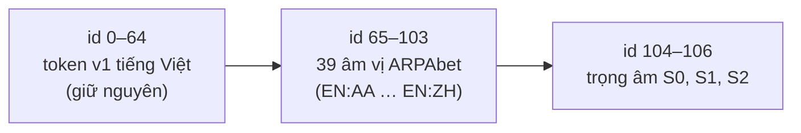
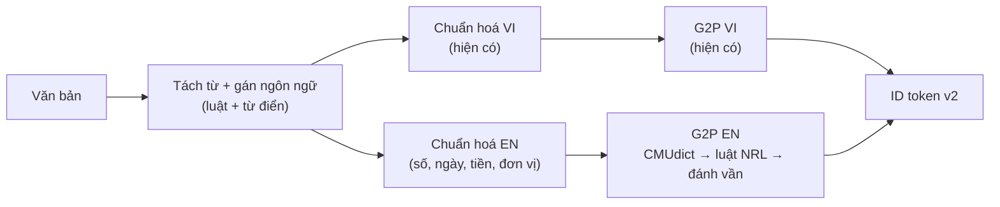
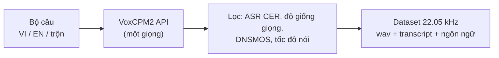

# Thiết kế: Model song ngữ Việt–Anh chạy trên ESP32-P4 và ESP32-S3

- Ngày: 2026-11-16
- Trạng thái: chờ VoxCPM2 API (giọng, hướng dẫn gọi, key) để chạy bước thử dữ liệu
- Phạm vi: một giọng đọc được cả tiếng Việt và tiếng Anh trong một model, kể cả câu trộn hai thứ tiếng

## 1. Mục đích và lý do

Hiện vtts chỉ đọc tiếng Việt. Từ tiếng Anh trong câu (Bluetooth, email, tên sản phẩm) bị đọc theo kiểu Việt hoá hoặc đánh vần. Thiết bị dùng ở Việt Nam lại thường xuyên gặp câu trộn ("Đã kết nối Bluetooth với AirPods") và đôi khi cần đọc hẳn câu tiếng Anh.

Không có bộ dữ liệu mở nào có cùng một người đọc cả tiếng Việt lẫn tiếng Anh, mà model đọc được câu trộn thì cần đúng điều đó. Người dùng đã dựng VoxCPM2 (Apache-2.0, 2B tham số, 30 ngôn ngữ có tiếng Việt và tiếng Anh) và sẽ cung cấp API để sinh audio bằng một giọng đã chọn. VoxCPM2 đóng vai "thầy" tạo dữ liệu. Phần còn lại dùng lại quy trình đã có: teacher VITS → student → int8 → chip.

Lợi ích phụ: có thể thiết kế câu để phủ đủ các âm tiết hiếm. Teacher hiện tại đọc sai "nguệch ngoạc", "khuếch", "nghiêng" vì dữ liệu train không có các âm tiết này. Ngoài ra, model làm theo cách này có giấy phép rõ ràng để phát hành dùng thương mại.

## 2. Mục tiêu, không làm, phản mục tiêu

**Mục tiêu**
- Một file model `.vtts` đọc được: câu tiếng Việt, câu tiếng Anh, và câu tiếng Việt có xen từ hoặc cụm tiếng Anh. Tất cả cùng một giọng.
- Tiếng Việt không kém hơn model M v0.2 hiện tại, và đọc đúng các vần hiếm.
- Chạy nhanh hơn thời gian thực trên ESP32-P4 và ESP32-S3 (PSRAM 8 MB), cùng runtime và kernel hiện có.
- Front-end tiếng Anh (chuẩn hoá và G2P) có bản Python và bản C cho kết quả khớp nhau, như front-end tiếng Việt.
- Quy trình sinh dữ liệu không phụ thuộc VoxCPM2: đổi nguồn audio (API khác, hoặc bản thu thật) là chạy lại được.

**Không làm trong giai đoạn này**
- Ngôn ngữ thứ ba.
- Nhiều giọng, điều khiển cảm xúc.
- Giọng Anh-Anh: dùng giọng Mỹ theo CMUdict.
- Nhận diện ngôn ngữ bằng mô hình học máy. Chỉ dùng luật và từ điển.

**Phản mục tiêu** (vẫn là thất bại dù "chạy được")
- Tiếng Việt kém đi so với v0.2 để đổi lấy tiếng Anh.
- Cùng một model mà câu tiếng Việt và câu tiếng Anh nghe như hai người khác nhau.
- Dữ liệu sinh ra mang lỗi của VoxCPM2 (sai thanh, nói lắp, âm thanh lạ) vào model mà không bị lọc hay phát hiện.
- Dùng giọng của người không đồng ý, hoặc dùng nguồn có điều khoản cấm train model khác. Ví dụ: không dùng ElevenLabs, không clone giọng VietBibleVox.
- Kéo GPL vào code (espeak-ng, phonemizer, misaki, g2p_en có phụ thuộc GPL).

## 3. Ràng buộc

### 3.1 Giấy phép

| Nguồn | Giấy phép | Dùng làm gì |
|---|---|---|
| VoxCPM2 | Apache-2.0; cấm mạo danh, lừa đảo; khuyến nghị ghi nhãn audio do AI tạo | Sinh audio train |
| Giọng mẫu | Do người dùng chọn: giọng thiết kế, hoặc người đã đồng ý | Giọng của model |
| CMUdict | BSD 2 điều khoản (giữ thông báo bản quyền CMU) | Từ điển phát âm tiếng Anh |
| Luật đọc chữ NRL (Elovitz và cộng sự, 1976, báo cáo của Hải quân Mỹ, public domain) | Public domain | Đoán phát âm từ ngoài từ điển; tự viết lại từ bài báo |
| Văn bản tiếng Việt: corpus Wikipedia hiện có (CC BY-SA) và câu tự soạn | CC BY-SA hoặc tự viết | Câu để sinh audio |
| Văn bản tiếng Anh: Wikipedia EN (CC BY-SA), transcript LJSpeech (public domain), câu tự soạn | Như trên | Câu để sinh audio |

Không đọc hay lấy code từ: espeak-ng, phonemizer, misaki, piper-phonemize, g2p_en (phụ thuộc GPL qua nltk data thì cần kiểm tra; mặc định không dùng).

Giấy phép phát hành model song ngữ do người dùng quyết định khi phát hành. Thiết kế giữ mọi nguồn ở mức cho phép dùng thương mại.

### 3.2 Phần cứng

- ESP32-P4: model tối đa khoảng 3 MB, RTF M hiện là 0.34–0.42.
- ESP32-S3 (PSRAM 8 MB, flash 16 MB): RTF M hiện là 0.85–0.99, sát giới hạn. Model song ngữ không được chậm hơn M quá 10%, nếu không S3 chỉ chạy được bản S.
- Từ điển tiếng Anh trên chip: tối đa 1.5 MB flash. Khi tra từ chỉ đọc từ flash, không chép vào RAM.

### 3.3 Tương thích

- Runtime đọc `vocab` từ header model nên không phải sửa phần tổng hợp.
- Token tiếng Việt giữ nguyên id 0–64. Token mới được nối thêm từ 65 trở đi, để model và tool cũ tiếp tục chạy với bộ token v1.

## 4. Các hướng đã cân nhắc

| Hướng | Ưu | Nhược | Kết luận |
|---|---|---|---|
| A. Hai model riêng (VI và EN), mỗi câu chọn một | Đơn giản, mỗi model tối ưu cho một thứ tiếng | Không đọc được câu trộn; giọng hai model khác nhau trừ khi cùng nguồn; tốn gấp đôi flash | Không chọn |
| **B. Một model song ngữ, dữ liệu sinh từ VoxCPM2 bằng một giọng** | Đọc được câu trộn, một giọng, một file; phủ được âm tiết hiếm | Phụ thuộc chất lượng tiếng Việt của VoxCPM2; model phải chia dung lượng cho hai thứ tiếng | **Chọn** |
| C. Song ngữ từ dữ liệu thật (VietBibleVox + LJSpeech) | Không phụ thuộc VoxCPM2 | Hai người đọc khác nhau, câu trộn sẽ đổi giọng giữa câu; không có dữ liệu câu trộn | Không chọn; giữ làm phương án dự phòng cho bản chỉ tiếng Anh |

## 5. Thiết kế

### 5.1 Bộ token v2

- `PHONEME_SET_VERSION = "2"`, `VOCAB_SIZE = 107`.
- Mỗi nguyên âm tiếng Anh mang một token trọng âm đặt ngay sau nó, giống cách token thanh điệu đứng sau âm tiết tiếng Việt.
- Ranh giới từ dùng chung token `SPACE`, dấu câu dùng chung token dấu câu.
- Không có token đánh dấu ngôn ngữ: âm vị đã đủ phân biệt hai thứ tiếng, và như vậy chuyển ngôn ngữ giữa câu không cần token đặc biệt.

### 5.2 Front-end

**Gán ngôn ngữ cho từng từ** (chế độ `vi`, `en` hoặc `auto`; mặc định `vi`):
- Từ có dấu tiếng Việt hoặc chữ `đ`: luôn là tiếng Việt.
- Chế độ `vi`:
  - từ ghép được thành âm tiết tiếng Việt hợp lệ thì đọc tiếng Việt ("an", "con", "to" vẫn là tiếng Việt);
  - từ không ghép được nhưng có trong CMUdict hoặc đọc được bằng luật thì đọc tiếng Anh ("Bluetooth", "smartphone");
  - các từ trong bảng `LOANWORDS` vẫn đọc kiểu Việt hoá nếu người dùng muốn; có cờ cấu hình.
- Chế độ `en`: mọi từ không dấu là tiếng Anh; từ có dấu là tiếng Việt.
- Chế độ `auto`: đoạn văn có tỉ lệ từ có dấu ≥ 20% thì coi là `vi`, ngược lại là `en`; tính theo từng câu.
- Số và ký hiệu đọc theo ngôn ngữ của câu chứa nó.

**Chuẩn hoá tiếng Anh:**
- số đếm, số thứ tự, số thập phân, phần trăm;
- ngày (11/16/2026 theo kiểu Mỹ, và "16 Nov 2026"), giờ (3:30 pm);
- tiền ($5, €3.50), đơn vị (km, kg, °F, °C);
- viết tắt phổ biến (Dr., Mr., etc.);
- chữ in hoa ngắn (USB, AI) đánh vần thành tên chữ cái.

**G2P tiếng Anh:**
1. Tra CMUdict.
2. Không có thì thử tách hậu tố hoặc từ ghép (-s, -ed, -ing, từ ghép hai phần).
3. Không được nữa thì dùng luật NRL.
4. Chữ in hoa ≤ 4 ký tự thì đánh vần.

**Trên chip:**
- Từ điển được nén thành blob nhị phân: từ sắp xếp, nén tiền tố, âm vị 6 bit, khoảng 1–1.5 MB. Blob nhúng vào firmware riêng với model và tra cứu bằng tìm kiếm nhị phân theo khối.
- Bản C và bản Python phải cho ra cùng một chuỗi ID trên bộ test khớp, gồm cả fuzz, như front-end tiếng Việt hiện tại.

### 5.3 Dữ liệu

| Phần | Lượng sau lọc | Nguồn câu |
|---|---:|---|
| Tiếng Việt | ~30 giờ | Corpus hiện có, cộng ~5.000 câu phủ âm tiết hiếm (chọn tham lam theo âm tiết và vần chưa đủ 20 lần), cộng câu có số, ngày giờ, đơn vị, câu hỏi |
| Tiếng Anh | ~25 giờ | Wikipedia EN, transcript LJSpeech, câu thông báo thiết bị tự soạn |
| Câu trộn | ~5 giờ | Câu tiếng Việt chứa thuật ngữ, tên sản phẩm, cụm tiếng Anh; sinh từ mẫu cộng danh sách thuật ngữ |

**Bộ lọc** (ngưỡng được chỉnh sau bước thử):
- CER với PhoWhisper (VI) hoặc Whisper large-v3 (EN, câu trộn) ≤ 0.05;
- độ giống giọng (cosine của embedding speaker so với tâm giọng) ≥ ngưỡng của bước thử trừ 2 độ lệch chuẩn;
- DNSMOS ≥ 3.2;
- tốc độ nói nằm trong khoảng 2–98% phân vị.

Mỗi câu bị loại được ghi lại kèm lý do.

**Client API:**
- Giới hạn số request song song, tự thử lại khi lỗi.
- Có thể dừng giữa chừng rồi chạy tiếp, nhờ manifest jsonl theo id câu.
- URL và key đọc từ `~/.config/vtts/voxcpm.env`, không bao giờ nằm trong repo hay log.

### 5.4 Train

1. **Teacher VITS:** train từ đầu trên dataset song ngữ với `n_vocab` hiện có (256 hàng, đủ cho 107 token), khoảng 300k bước.
2. **Chưng cất:** student M-vocos-p với `vocab = 107`. Bộ câu chưng cất trộn ba phần theo tỉ lệ dataset, và giữ phần phủ âm tiết hiếm.
3. **Mốc kiểm tra dung lượng:** nếu M không đạt chất lượng mục 6, thử biến thể lớn hơn khoảng 1.5 lần (khoảng 2.5M tham số), miễn là vẫn đạt ràng buộc RTF ở 3.2.

### 5.5 Runtime và firmware

- **Runtime tổng hợp:** không đổi.
- **`vtts_text`:** thêm `vtts_text_set_lang(vi|en|auto)` và đường xử lý tiếng Anh, nhận blob từ điển qua con trỏ (không cấp phát).
- **Firmware:**
  - lệnh `lang vi|en|auto`;
  - nhúng blob từ điển;
  - model song ngữ thay khe M (hoặc thêm khe thứ ba nếu flash đủ);
  - `bench` thêm câu tiếng Anh và câu trộn.

## 6. Đánh giá và tiêu chí đạt

**Bộ câu đánh giá mới:**
- `eval/sets/ood_en.jsonl`: 50 câu (thông báo thiết bị, số, tên riêng, câu hỏi, câu dài);
- `eval/sets/mixed.jsonl`: 50 câu trộn.

Giữ nguyên bộ `ood` tiếng Việt và bộ từ khó.

| Tiêu chí | Ngưỡng đạt |
|---|---|
| CER tiếng Việt trên `ood` (PhoWhisper) | ≤ 0.012 (bằng v0.2) |
| CER trên bộ từ khó tiếng Việt | thấp hơn v0.2 (0.12) |
| WER tiếng Anh trên `ood_en` (Whisper large-v3) | ≤ 0.05 |
| Câu trộn: tỉ lệ từ tiếng Anh đọc đúng (Whisper nhận ra đúng từ) | ≥ 90% |
| UTMOS tiếng Việt | ≥ 2.19 (v0.2) |
| Độ giống giọng giữa câu VI và câu EN | trong khoảng giống giọng của dữ liệu VoxCPM2 |
| Tiếng rít | ≤ 10 |
| RTF trên P4 / S3 | ≤ 0.45 / ≤ 1.0 |
| Kích thước model + từ điển | ≤ 3 MB + ≤ 1.5 MB |
| Audio chip khớp runtime trên máy tính | tương quan ≥ 0.9999 |

Cuối cùng là trang nghe A/B (v0.2 so với song ngữ, cộng câu tiếng Anh và câu trộn) để người dùng nghe xác nhận.

## 7. Rủi ro

| Rủi ro | Cách xử lý |
|---|---|
| Tiếng Việt của VoxCPM2 sai thanh hoặc vần hiếm | Chạy thử 200 câu trước; nếu CER VI > 0.03 hoặc nghe sai thanh thì dừng và báo người dùng (có thể thử giọng hoặc tham số khác) |
| Giọng trôi giữa các lần sinh | Cố định giọng mẫu và seed nếu API cho phép; lọc theo độ giống giọng |
| Model 1.7M không đủ chỗ cho hai thứ tiếng | Mốc kiểm tra ở 5.4; ưu tiên giữ chất lượng tiếng Việt |
| Gán ngôn ngữ sai (từ trùng chữ giữa hai thứ tiếng) | Luật thiên về tiếng Việt trong chế độ `vi`; danh sách ngoại lệ mở rộng được; có bộ test riêng |
| Thời gian sinh dữ liệu dài | Chạy song song có giới hạn, chạy tiếp được; ước lượng lại sau bước thử |
| Từ điển chiếm flash trên S3 | Có thể cắt CMUdict còn ~60k từ thường gặp và dùng luật cho phần còn lại; đo cả hai cấu hình |

## 8. Các quyết định đang chờ người dùng

- **Giọng mẫu và cách gọi API:** người dùng sẽ gửi khi dựng xong VoxCPM2.
- **Giấy phép phát hành model song ngữ:** quyết định khi phát hành.

Những quyết định đã tự chọn, có thể sửa:
- Giọng Mỹ (CMUdict).
- Chế độ mặc định `vi`.
- Từ tiếng Anh trong câu tiếng Việt đọc theo tiếng Anh, trừ các từ trong bảng `LOANWORDS`.
- Model song ngữ thay khe M trong firmware.
