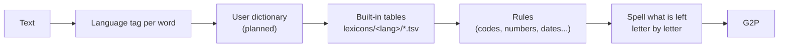
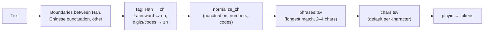
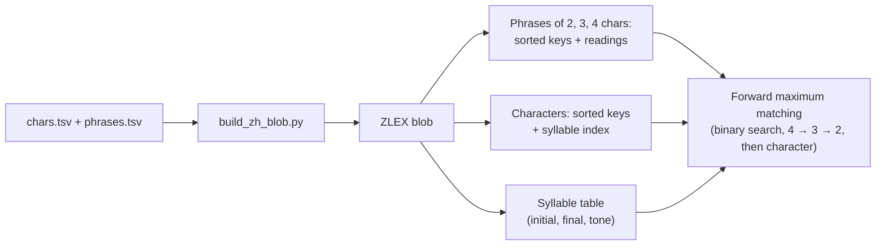
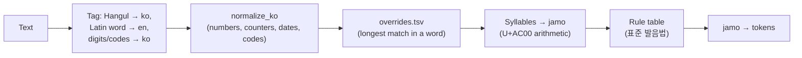
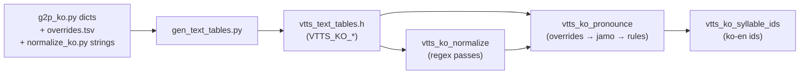
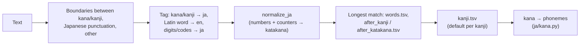
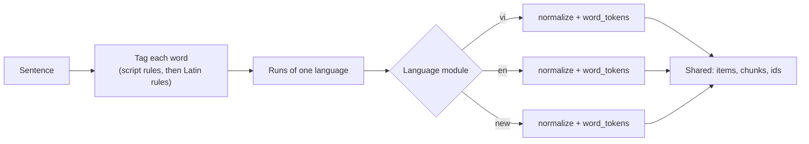

# Pronunciation rules and dictionaries

How vtts turns written text into something speakable, and how to change it. These rules are updated often (new product names, loanwords, regional preferences), so every change follows the same steps and is covered by tests.

## Design

Each language is a module with the same shape:

| Part | Where | What |
|---|---|---|
| Data tables | `src/vtts/frontend/lexicons/<lang>/*.tsv` | Letter names, loanwords, abbreviations, units, currencies, symbols. Plain text, one entry per line. |
| Normalizer | `src/vtts/frontend/normalize.py` (vi), `src/vtts/frontend/en/normalize_en.py` (en) | Rules for numbers, dates, times, codes and the order the tables are applied in. |
| G2P | `g2p.py` (vi, spelling rules), `en/g2p_en.py` (CMUdict + learned letter-to-sound) | Words to phoneme tokens. |
| Device port | `runtime/src/vtts_text.c` + generated `vtts_text_tables.h` | The subset devices need, in C. |

Python is the source of truth. The C tables are generated from the same TSV files, and a parity test checks that Python and C produce identical token ids.

**Precedence:** user dictionary (planned) > built-in tables > rules > spelling letter by letter. A more specific source always wins, so a fix for one word never needs a new rule.

### Language of a word (bilingual voices)

In bilingual mode, `lang.py` tags each word:

- A word with Vietnamese diacritics is Vietnamese.
- A plain Latin word is Vietnamese if it is a valid Vietnamese syllable, a key in `vi/loanwords.tsv` or `vi/abbreviations.tsv`, or a short all-caps word. Otherwise it is English.
- Digits and codes are neutral: they follow the language of the sentence.

In the Latin-script pairs (es-en ...) the same question is answered by `frontend/latin.py`; see [Latin-script pairs](#latin-script-pairs-language-of-a-word).

So **adding a word to `vi/loanwords.tsv` also makes it Vietnamese in bilingual mode.** Do that for words Vietnamese speakers say in a Vietnamese way (`wifi` → "oai phai", `smartphone` → "sờ mát phôn"). Leave out brand names that bilingual voices should say in English (`iPhone`); the English front-end reads them.

## Shared rules

### Product codes

A standalone run of upper-case ASCII letters and digits, with at least one of each, is a code: `ESP32`, `S3`, `RTX3060`, `MP3`, `U23`, `VN123`, `ABC123`. Its letters are spelled and **its digits are read one by one**. Hyphens separate codes (`ESP32-P4` is `ESP32` + `P4`).

| Text | Vietnamese sentence | English sentence |
|---|---|---|
| ESP32-P4 | e ét pê ba hai pê bốn | E S P three two P four |
| RTX3060 | e rờ tê ích xì ba không sáu không | R T X three zero six zero |
| U23 | u hai ba | U two three |

Not codes: mixed case (`iPhone15` → "... mười lăm"), numbers on their own (`COVID-19` → "cô vít mười chín", `RTX 3060` → "ba nghìn không trăm sáu mươi").

Python: `PRODUCT_CODE` in `normalize.py` and `en/normalize_en.py`. C: the code scan in `vtts_text_to_ids` (bit 1 of `date_start`).

## Vietnamese tables (`lexicons/vi/`)

| File | Matching | Example |
|---|---|---|
| `letters.tsv` | one letter, case-insensitive | `s` → ét |
| `loanwords.tsv` | whole word, case-insensitive | `smarthome` → sờ mát hôm |
| `abbreviations.tsv` | case-sensitive, longest first, at word boundaries; a key not ending in `.` must not be followed by a letter or digit | `TP.HCM` → thành phố hồ chí minh |
| `units.tsv` | after a number | `km` → ki lô mét |
| `currencies.tsv` | after a number, case-insensitive | `usd` → đô la |
| `symbols.tsv` | anywhere | `@` → a còng |

Every reading must be valid Vietnamese syllables; `tests/frontend/test_lexicons.py` checks this, so a typo fails the tests instead of being spelled out at run time.

## English

English uses CMUdict (pinned commit, BSD) and letter-to-sound rules learned from it, plus rules in `en/normalize_en.py` (numbers, money, dates, times, units, abbreviations, acronyms of up to 4 letters spelled).

On the device, the lexicon and the letter-to-sound table ship as one `VLEX` blob (about 1.9 MB, built by `scripts/frontend/build_lexicon.py`): CMUdict front-coded in blocks of 32 words with phoneme and stress packed in one byte, and the letter-to-sound window table pruned without changing any prediction (493k to 58k keys). The C normalizer and G2P (`runtime/src/vtts_text_en.c`) match Python exactly, including the regex backtracking of the normalizer; numbers of any length are read like Python.

## Chinese (Mandarin, token set `zh-en`)

Python in `src/vtts/frontend/zh/`, ported to C with exact parity (see [Device (C)](#device-c) below). `text_to_ids(text, "zh")` returns ids of the token set `zh-en`: ids 0–106 are the v2 set unchanged (so English rows can be warm-started from a vi-en teacher; the Vietnamese rows stay unused), followed by the Mandarin block from id 107: 21 initials `ZI:b` … `ZI:s`, 38 finals `ZF:a` … `ZF:i0` and tones `ZT1` … `ZT5` (5 = neutral).

A syllable is `[ZI:initial] ZF:final ZTtone`. Finals are written in full: `y`/`w` are not initials (`yi` → `i`, `you` → `iou`, `wei` → `uei`, `yun` → `vn`), `ju`/`qu`/`xu` use ü (`v`), `iu`/`ui`/`un` are `iou`/`uei`/`uen`, and the apical vowel is `ii` after zh/ch/sh/r and `i0` after z/c/s. Interjections (m, n, ng, hm, hng, yo, ê) map to the nearest regular syllable. The syllables of one Chinese run are joined without the space token; a space separates Chinese from English words.

### Tables (`lexicons/zh/`)

| File | Content | Edited by |
|---|---|---|
| `chars.tsv` | one default reading per character (7,098: GB2312 plus the characters of pypinyin's phrases), numbered pinyin such as `行` → `xing2`, `v` for ü, tone 5 = neutral | generated |
| `phrases.tsv` | 2–4 character phrases whose reading differs from what the shorter phrases and the per-character defaults give (7,170), e.g. `银行` → `yin2 hang2` | generated |
| `overrides.tsv` | hand fixes; a one-character key sets a default, a longer key sets a phrase | by hand |

**Precedence:** at run time, forward maximum matching over `phrases.tsv` (longest phrase first), then `chars.tsv` one character at a time; a character in neither is skipped. When the tables are built, `overrides.tsv` wins over pypinyin's data.

Both generated tables come from pypinyin's data (MIT) through `scripts/frontend/build_zh_lexicon.py`; pypinyin is a dev dependency only. The tables hold citation tones: the sandhi tones of 一 and 不 that pypinyin bakes into some phrases are reset to `yi1`/`bu4`, and no sandhi rule is applied (the model learns it from audio; the hook is `apply_sandhi` in `zh/g2p_zh.py`).

**To change a reading:** add `key<TAB>reading` to `overrides.tsv` (one syllable per character), run `uv run python scripts/frontend/build_zh_lexicon.py`, add a case to `tests/frontend/test_zh_readings.py`, and run `uv run pytest -q tests/frontend`. Do not edit the generated files: the next build overwrites them.

### Normalization (`zh/normalize_zh.py`)

| Text | Reading |
|---|---|
| `，。！？；：、` | `, . ! ? ; : ,` (quotes and brackets dropped, `……` and `——` are a pause) |
| 123, 10010 | 一百二十三, 一万零一十 (二, not 两) |
| 3.14, 15%, -5 | 三点一四, 百分之十五, 负五 |
| 2026年, 2026-11-18 | 二零二六年, 二零二六年十一月十八日 |
| 11月18日 | 十一月十八日 |
| 9:30, 9:05, 18:00 | 九点三十分, 九点零五分, 十八点 |
| 13812345678 (5 or more digits, no separators) | 一三八一二三四五六七八 |
| 3~5, ¥99, 25℃ | 三到五, 九十九元, 二十五摄氏度 |
| ESP32-P4, 5G | letters in English, digits one by one: E S P 三二 P 四, 五 G |

Latin words inside Chinese text go to the English module (`打开Wi-Fi设置` → 打开 / Wi-Fi / 设置). Sentences also end after `。！？；` without a following space.

### Device (C)

`vtts_text_to_ids_ex` with mode `VTTS_LANG_ZH` gives exactly `text_to_ids(text, "zh")` (module `runtime/src/vtts_text_zh.c`, entry `zh` in `LANGS`). The reading tables ship as a `ZLEX` blob of about 116 KB built by `scripts/frontend/build_zh_blob.py` from the same `chars.tsv` and `phrases.tsv` (so `overrides.tsv` is included); the blob is read in place from flash, without `malloc` or copies.

| Part | Layout | Size |
|---|---|---|
| Syllables | 1,300 entries of 4 bytes: initial (0 = none), final, tone | 5 KB |
| Characters | 7,098 keys (code point − U+4E00, u16, sorted) then 7,098 syllable indices | 28 KB |
| Phrases | per length 2, 3, 4: records of the keys then one syllable index per character, sorted by key | 83 KB |

- **Normalization** follows `normalize_zh` pass by pass (full-width forms, pauses, symbols, dropped quotes and brackets, product codes, ISO dates, money, percent, times, years, ranges, negatives, decimals, grouped numbers, long digit strings, integers, Latin words to the English normalizer, joining Han runs), including the regex backtracking that can change a match. Numbers of up to 512 digits are read like Python.
- **Tagging and chunks:** Han, Chinese punctuation and other text are split apart like `split_scripts`; plain Latin words are English, everything else is Chinese. Syllables of a Han run are joined without the space token and each counts as one word for the 40-word chunk limit; English words get a space on both sides.
- **Token ids:** the zh-en ids (`VTTS_ZHEN_*` in the generated `vtts_text_tables.h`) are computed from the blob's (initial, final, tone) indices; ids 0–106 are the v2 ids, so English words use the VLEX lexicon unchanged.
- **Tests:** `runtime/test/text_parity_zh.tsv` (edge cases, the mixed template sentences, Chinese sentences, numbers, dates and times, regex-dense random strings) must match exactly, and a fuzz run in zh mode (mixed Han, ASCII, digits, punctuation, random bytes) must stay inside its buffers: `make -C runtime test` or `uv run pytest tests/export`. After changing a Chinese rule or table, regenerate the fixture with `uv run python scripts/frontend/export_text_parity.py --zh --sentences data/zh/sentences.jsonl --limit 2500 --out runtime/test/text_parity_zh.tsv`.
- **Known gaps (pathological input only):** only ASCII digits count as digits (Python's `\d` also takes other scripts' digits); the control characters U+001C–U+001F and U+0085 are not whitespace in C; a sentence is cut at 4,096 code points, 2,048 items or 1,024 chunks, and a Chinese run whose normalized form exceeds 6,144 code points is dropped.

## Korean (token set `ko-en`)

Python (`src/vtts/frontend/ko/`) and C (`runtime/src/vtts_text_ko.c`, see [Device (C)](#device-c-1)); everything is rules and small tables (no morphological analyzer, no model). `text_to_ids(text, "ko")` returns ids of the token set `ko-en`: ids 0–106 are the v2 set unchanged, followed by the Korean block from id 107 (46 tokens, vocabulary 153):

| Group | Tokens | Jamo |
|---|---|---|
| Onsets (18) | `KO:I:g kk k d tt t b pp p s ss j jj ch h n m r` | ㄱ ㄲ ㅋ ㄷ ㄸ ㅌ ㅂ ㅃ ㅍ ㅅ ㅆ ㅈ ㅉ ㅊ ㅎ ㄴ ㅁ ㄹ (silent ㅇ has no token) |
| Vowels (21) | `KO:V:a ae ya yae eo e yeo ye o wa wae oe yo u wo we wi yu eu ui i` | ㅏ ㅐ ㅑ ㅒ ㅓ ㅔ ㅕ ㅖ ㅗ ㅘ ㅙ ㅚ ㅛ ㅜ ㅝ ㅞ ㅟ ㅠ ㅡ ㅢ ㅣ |
| Codas (7) | `KO:C:k n t l m p ng` | the 7 coda sounds ㄱ ㄴ ㄷ ㄹ ㅁ ㅂ ㅇ |

Tokens are phonemes **after** the pronunciation rules: `학교` → `KO:I:h KO:V:a KO:C:k KO:I:kk KO:V:yo` (학꾜). Words (어절) are separated by the space token; the syllables of a word are joined.

### Pronunciation rules (`ko/g2p_ko.py`, `RULES`)

Applied in this order over each pair of adjacent syllables of one word (never across a space):

| # | Rule | Examples |
|---|---|---|
| 1 | Palatalization (구개음화): ㄷ ㅌ + 이 → 지 치, ㄷ + 히 → 치 | 같이 [가치], 굳이 [구지], 닫히다 [다치다] |
| 2 | Coda ㅎ (ㄶ ㅀ): aspirates ㄱ ㄷ ㅈ, tenses ㅅ, ㄴ before ㄴ, silent before a vowel | 좋다 [조타], 닿소 [다쏘], 놓는 [논는], 좋아 [조아] |
| 3 | Aspiration before ㅎ: ㄱ ㄷ ㅂ ㅈ + ㅎ → ㅋ ㅌ ㅍ ㅊ | 축하 [추카], 입학 [이팍], 앉히다 [안치다] |
| 4 | Liaison (연음); a double coda moves its second part | 한국어 [한구거], 앉아 [안자], 값을 [갑쓸] |
| 5 | Tensification after obstruent codas and the stem codas ㄵ ㄻ ㄼ ㄾ | 학교 [학꾜], 국밥 [국빱], 앉다 [안따] |
| 6 | Coda neutralization (7 codas) and double-coda simplification; ㄺ is ㄹ before ㄱ | 부엌 [부억], 닭 [닥], 읽고 [일꼬], 넓다 [널따] |
| 7 | ㄹ → ㄴ after ㅁ ㅇ ㄱ ㄷ ㅂ | 종로 [종노], 담력 [담녁] |
| 8 | Nasalization (비음화): ㄱ ㄷ ㅂ before ㄴ ㅁ → ㅇ ㄴ ㅁ | 국물 [궁물], 십만 [심만], 독립 [동닙] |
| 9 | Liquidization (유음화): ㄴ next to ㄹ → ㄹ | 신라 [실라], 칼날 [칼랄] |
| 10 | Vowels: ㅢ after a consonant → ㅣ; 져 쪄 쳐 → 저 쩌 처 | 희망 [히망], 가져 [가저] |

Not covered by rules (they need word knowledge; add entries to `overrides.tsv`): ㄴ insertion (솜이불 [솜니불]), 사잇소리 (김밥 [김빱]), Sino-Korean ㄹ + ㄷㅅㅈ (갈등 [갈뜽]), ㄴ+ㄹ read ㄴㄴ (의견란 [의견난]), tensification after the future ㄹ (할 수 [할쑤], 할게 [할께]), rules across words (옷 한 벌 [오탄벌]), and 의 as the particle [에] (kept as ㅢ, an allowed reading).

### Tables (`lexicons/ko/`)

| File | Content | Edited by |
|---|---|---|
| `overrides.tsv` | exceptions to the rules (76 entries): written form → form spelled as pronounced, both Hangul, e.g. `물고기` → `물꼬기` | by hand |

An entry is matched anywhere inside a word, longest first, before the rules run, so `물고기` also covers `물고기를`. The reading must be spelled as pronounced: the rules still run over it and must leave it unchanged (a test checks every entry). **To change a reading:** add `written<TAB>pronounced` to `overrides.tsv`, add a case to `tests/frontend/test_ko_g2p.py`, and run `uv run pytest -q tests/frontend`.

### Normalization (`ko/normalize_ko.py`)

| Text | Reading |
|---|---|
| 350원, 1,250달러, 10번 | 삼백오십 원, 천이백오십 달러, 십 번 (Sino-Korean by default; 1 before 십 백 천 만 is silent) |
| 3개, 2명, 20살, 4마리, 3시간, 1번째 | 세 개, 두 명, 스무 살, 네 마리, 세 시간, 첫 번째 (native 1–99 before native counters: 개 명 시 살 번째 마리 잔 시간 사람 권 병 장 ...) |
| 2026년 11월 18일, 2026-11-18 | 이천이십육년 십일월 십팔일 (6월 유월, 10월 시월) |
| 9시 30분, 9:30, 18:00 | 아홉 시 삼십 분, 아홉 시 삼십 분, 열여덟 시 |
| 3.14, 15%, -5도 | 삼 점 일사, 십오 퍼센트, 마이너스 오 도 |
| 010-1234-5678 (and digit strings starting with 0) | 공일공 일이삼사 오육칠팔 |
| ₩5,000, $20, 25℃, 5km, 3kg, 3~5개 | 오천 원, 이십 달러, 이십오 도, 오 킬로미터, 삼 킬로그램, 셋에서 다섯 개 |
| ESP32-P4 | letters and digits in English: E S P three two P four |

A number is joined to a following particle or to 년/월/일 and separated from a counter by a space. Latin words go to the English module (`Wi-Fi를` → `wi fi` + `를`). A word too long for one chunk is split between syllables.

### Device (C)

`vtts_text_to_ids_ex` with mode `VTTS_LANG_KO` gives exactly `text_to_ids(text, "ko")` (module `runtime/src/vtts_text_ko.c`, entry `ko` in `LANGS`). Unlike Chinese there is no blob: the rule tables, `overrides.tsv` and the normalizer's strings are small, so `runtime/tools/gen_text_tables.py` compiles them into `vtts_text_tables.h` (about 4 KB of tables; the whole module, code and tables, is about 15 KB in the ESP32-P4 and ESP32-S3 firmware). Only the English words need the VLEX lexicon.

| Part | How it is ported | Size |
|---|---|---|
| Jamo | consonants coded as compatibility jamo − U+3130 (ㄱ 1 … ㅎ 30), vowels as their index (ㅏ 0 … ㅣ 20); a syllable is 3 bytes (onset, vowel, coda) | |
| Rule tables | `NEUTRAL`, `LIAISON`, `ASPIRATE_BEFORE_H`, `ASPIRATED`, `H_CODAS`, `TENSE`, `OBSTRUENT_CODAS`, `STEM_CODAS`, `Y_TO_PLAIN` and the token ids, generated from the Python dicts as arrays indexed by jamo code; the small maps inside the rule functions (palatalization, nasalization, ㄹ → ㄴ, liquidization) are written in C | 0.6 KB |
| Exceptions | `overrides.tsv` as (written, reading) syllable offsets from U+AC00, matched longest first like `apply_overrides` | 1.1 KB |
| Normalizer strings | digits, units of 10/10⁴, native numbers, months, counters (longest first, with their kind), symbols, dropped characters, units, currencies | 2 KB |

- **Rules** run in the order of `RULES` (each rule over every pair of adjacent syllables, left to right, the last coda neutralized too), then the vowel rule per syllable; characters that are not Hangul syllables split a word into parts that do not interact, as in `pronounce`.
- **Normalization** follows `normalize_ko` pass by pass (full-width forms, pauses, symbols, dropped quotes and brackets, units, product codes, ISO and dotted dates, phone numbers, times, money, percent, ranges, numbers with their counter, Latin words to the English normalizer). Where regex backtracking can change a match (the alternation `\d{1,3}(,\d{3})+|\d+` with an optional fraction, `\s?` before units and `%`, `\.?` after a dotted date), the candidate ends are tried in the order the regex engine tries them, so `1,2345원` and `1,234,5km` split like Python. Numbers of any length are read like Python (above 20 digits digit by digit).
- **Tagging and chunks:** a word with Hangul (syllables or compatibility jamo) is Korean, a plain Latin word is English, anything else is Korean; no boundaries are inserted (Korean has spaces). Words are separated by the space token; a word of more than 318 tokens is split into one item per syllable, joined without the space token, so the chunk packer can cut it. Sentences also end after `。！？；` without a following space, as for Chinese.
- **Tests:** `runtime/test/text_parity_ko.tsv` (11,369 cases: edge cases, both Korean eval sets, 2,000 mixed template sentences, 3,000 generated sentences, every (coda, next onset, next vowel) of two adjacent syllables plus 4,000 random three-syllable words, numbers, dates and times, regex-dense random strings) must match exactly, and a fuzz run in ko mode (Hangul, jamo, ASCII, numbers with counters, punctuation, random bytes, words without spaces) must stay inside its buffers and inside the ko-en ids: `make -C runtime test` or `uv run pytest tests/export`. A test also checks that `vtts_text_tables.h` holds the current Korean tables. After changing a Korean rule or table, run `uv run python runtime/tools/gen_text_tables.py` and regenerate the fixture with `uv run python scripts/frontend/export_text_parity.py --ko --sentences data/ko/sentences.jsonl --limit 3000 --out runtime/test/text_parity_ko.tsv`.
- **Known gaps (pathological input only):** as for Chinese, only ASCII digits count as digits, the control characters U+001C–U+001F and U+0085 are not whitespace in C, a sentence is cut at 4,096 code points, 2,048 items or 1,024 chunks, and a Korean run whose normalized form exceeds 6,144 code points is dropped (a word longer than 4,095 code points as well).

## Japanese (token set `ja-en`)

Python only for now (`src/vtts/frontend/ja/`); the C port comes later, so the run-time reader is table lookups only (no MeCab, no pyopenjtalk, no model). `text_to_ids(text, "ja")` returns ids of the token set `ja-en`: ids 0–106 are the v2 set unchanged, followed by 37 Japanese phonemes in the style of Open JTalk from id 107 (vocabulary 144):

| Group | Tokens |
|---|---|
| Vowels (5) | `JA:a i u e o` |
| Consonants (14) | `JA:k g s z t d n h b p m y r w` |
| Palatalized (11) | `JA:ky gy sh j ch ny hy by py my ry` |
| Loanword sounds (5) | `JA:ts f v ty dy` (ツァ ファ ヴァ テュ デュ) |
| Special (2) | `JA:N` (moraic nasal ん, one token whatever follows), `JA:cl` (geminate っ) |

A mora is `[consonant] vowel`, `N` or `cl`. **Long vowels are the vowel repeated** (コーヒー → `k o o h i i`), not a separate token; readings from the tables are stored as pronounced (東京 → トーキョー → `t o o ky o o`), while kana written in the text are read as spelled (とう → `t o u`). Devoiced vowels and **pitch accent are not marked** in version 1 (hook: `apply_accent` in `ja/g2p_ja.py`); the model learns them from the audio. A Japanese run is joined without the space token (like Chinese); the space token only separates English words.

### Readings (`ja/g2p_ja.py`, `lexicons/ja/`)

A run is read by forward longest match at every position. After a kanji or a katakana word, the matching context table wins over `words.tsv` when its key is as long, or when the `words.tsv` key is only longer by kana (戦後に: 後 ゴ + に, not 後に ノチニ). No entry starts or ends inside a katakana run, so katakana words are read as written. Where nothing matches, a kanji takes its default reading (々 repeats the previous kanji), kana are read as written and characters without a reading are skipped (`unreadable_ja` lists them; training rows with such characters are left out).

| File | Content | Edited by |
|---|---|---|
| `words.tsv` | 54,637 surfaces (kanji, kanji + kana, a few hiragana words pronounced unlike their spelling such as the particle は → ワ, へ → エ) → katakana as pronounced | generated |
| `after_kanji.tsv` | 4,506 readings used right after a kanji (国 コク in 米国, 中 チュー, 川 ガワ) | generated |
| `after_katakana.tsv` | 857 readings used right after a katakana word (人 ジン in アメリカ人, 川 カワ) | generated |
| `kanji.tsv` | one default reading for each of the 3,000 most frequent kanji (99.76% of kanji occurrences in the build corpus) | generated |
| `overrides.tsv` | hand fixes; a one-kanji key sets the default, any other key a `words.tsv` entry | by hand |

The three word tables hold 60,000 entries, 1.29 MB as TSV (the C port will pack them). They are generated by `scripts/frontend/build_ja_lexicon.py` from Open JTalk's dictionary (mecab-naist-jdic, BSD-3) through pyopenjtalk, a dev dependency only: 400,000 Japanese Wikipedia sentences (`scripts/frontend/fetch_ja_text.py`) are analyzed with pyopenjtalk to choose frequent words and their most frequent reading per context; a word is kept only when the shorter entries and the kanji defaults misread it; then the corpus is re-read with the tables and the text of each misread stretch (alone or with a neighbouring word) becomes an entry when it fixes at least half of its occurrences. Kanji defaults come from aligning compound readings to their characters (usually the on-reading: 学 ガク).

**Agreement with pyopenjtalk** on 2,000 held-out Wikipedia sentences (other articles, filtered like the synthesis corpus): **98.2% of morae** (edit distance over morae), 75% of sentences identical. Doubling the table to 100k entries gains only 0.2 points. Remaining differences: context-dependent readings (中 ナカ/チュー, 後 ノチ/アト/ゴ, 数 カズ/スー), rendaku, rare names, and Open JTalk's own choices (ヴァ read `b a`; vtts keeps `v a`).

Known limits: one reading per key and context, so 一日 is イチニチ (ついたち only from dates, below); no rendaku or sound-change rules beyond the tables; kana spelled with a vowel (ありがとう) keep the spelled vowel unless a table entry gives the pronounced form.

**To change a reading:** add `surface<TAB>reading` (kana as pronounced, long vowels with ー) to `overrides.tsv`, rebuild with `uv run python scripts/frontend/build_ja_lexicon.py --corpus data/ja/lexicon/train.txt --heldout data/ja/lexicon/heldout.txt` (after `fetch_ja_text.py`), add a case to `tests/frontend/test_ja_readings.py`, and run `uv run pytest -q tests/frontend`.

### Kana (`ja/kana.py`)

Katakana are folded to hiragana, then a two-kana combination is tried before a single kana: きゃ `ky a`, しゃ `sh a`, ちゃ `ch a`, じゃ/ぢゃ `j a`, ふぁ `f a`, てぃ `t i`, でぃ `d i`, とぅ `t u`, うぃ `w i`, ゔぁ `v a`, つぁ `ts a`, くぁ `k w a`, いぇ `y e`, でゅ `dy u`. し `sh i`, ち `ch i`, つ `ts u`, ふ `f u`, じ/ぢ `j i`, ず/づ `z u`, を `o`, ん `N`, っ `cl`, ー repeats the previous vowel, ゝ ゞ repeat the previous kana.

### Normalization (`ja/normalize_ja.py`)

Numbers are Sino-Japanese, written in katakana as pronounced, so the sound changes are exact:

| Text | Reading |
|---|---|
| 300, 600, 800, 3000, 8000, 10000 | サンビャク, ロッピャク, ハッピャク, サンゼン, ハッセン, イチマン |
| 2026年11月18日, 2026-11-18 | ニセンニジューロクネン ジューイチガツ ジューハチニチ |
| 1日 (after a month) … 10日, 14日, 20日, 24日 | ツイタチ フツカ ミッカ ヨッカ イツカ ムイカ ナノカ ヨーカ ココノカ トーカ, ジューヨッカ, ハツカ, ニジューヨッカ (1日 elsewhere: イチニチ) |
| 4月, 7月, 9月 | シガツ, シチガツ, クガツ |
| 9時30分, 9:30, 4時, 7時 | クジ サンジュップン, ヨジ, シチジ |
| 1分 2分 3分 4分 6分 8分 10分 | イップン ニフン サンプン ヨンプン ロップン ハップン ジュップン |
| 1本 3本 6本 8本 10本 1000本 | イッポン サンボン ロッポン ハッポン ジュッポン センボン (匹 杯 alike) |
| 1人 2人 4人 7人 | ヒトリ フタリ ヨニン シチニン |
| 1つ … 9つ, 10つ | ヒトツ … ココノツ, トー |
| 1個 6個 10個, 1回 8回, 3階, 1歳 8歳 20歳, 4円, 4年 | イッコ ロッコ ジュッコ, イッカイ ハッカイ, サンガイ, イッサイ ハッサイ ハタチ, ヨエン, ヨネン |
| 15%, 3.14, -5 | ジューゴパーセント, サンテンイチヨン, マイナスゴ |
| 1,234円, 3万人, 1億2000万 | センニヒャクサンジューヨエン, サンマンニン, イチオクニセンマン |
| 1234567 (5 or more digits without a counter), 090-1234-5678 | イチニサンヨンゴロクナナ (0 = ゼロ), ゼロキューゼロ ノ イチニサンヨン ノ … |
| 3〜5個, ¥500, $20, 5km, 25℃ | サンカラゴコ, ゴヒャクエン, ニジュードル, ゴキロメートル, ニジューゴド |
| ESP32-P4 | letters and digits in English: E S P three two P four |

The counters are a table (`COUNTERS`: reading, geminated reading, reading after ン, last-digit and whole-number exceptions). Punctuation 、。！？ maps to `, . ! ?`; 「」『』（）・ are dropped, …… and —— are a pause. Latin words go to the English module (`Wi-Fiを設定` → Wi-Fi / を設定). Sentences also end after 。！？ without a following space.

## Latin-script pairs: language of a word

Spanish (and the other Latin-script pairs) share their letters with English, so `lang.py` asks `latin.latin_word_lang` for each plain word, in this order:

1. A word with the language's own letters (Spanish á é í ó ú ü ñ; Indonesian has none) is that language.
2. A word in `lexicons/<lang>/native.txt` is that language (function words, words also in the English list such as Spanish `red`, `sale`, `come`, adopted words that break the spelling rules: `club`, `internet`, `pizza`).
3. A word in `lexicons/latin/english.txt` is English (common English words and tech terms whose spelling would also fit: `update`, `online`, `router`, `google`). The list is shared by all Latin-script pairs; collisions go in the pair's `native.txt`.
4. A word with a capital after a lower-case letter is English (`iPhone`, `GitHub`, `macOS`).
5. An all-caps word of 2–5 letters is the main language: an acronym spelled with its letter names (`USB` → u ese be).
6. Otherwise the word's spelling decides (`valid_spelling` in the language's `g2p_<lang>.py`: letters, letter groups, onset and coda clusters): `casa`, `Barcelona` fit Spanish; `weekend`, `Bluetooth`, `Spotify`, `Wi-Fi` do not and are English.

Digits and codes are neutral as in the other pairs. Known gaps: English names whose spelling fits the language (`Taylor`, `Elon`) are read in the main language unless listed in `english.txt`.

## Spanish (token set `es-en`)

Python only for now (`src/vtts/frontend/es/`); the C port comes later, so everything is rules and small tables. `text_to_ids(text, "es")` returns ids of the token set `es-en` (model header code 6): ids 0–106 are the v2 set unchanged, followed by 31 Spanish tokens from id 107 (vocabulary 138):

| Group | Tokens |
|---|---|
| Vowels (5) | `ES:a e i o u` |
| Stressed vowels (5) | `ES:a1 e1 i1 o1 u1` |
| Glides (2) | `ES:j` (tiene, hoy), `ES:w` (bueno, huevo) |
| Consonants (19) | `ES:p b t d k g f th s x ch y ll m n ny l r rr` |

The set is dialect-neutral like the Vietnamese one: `th` (c before e/i, z) and `s`, `ll` and `y` stay distinct (seseo and yeísmo are left to the voice); b/v are one phoneme; allophones (spirantized b d g, assimilated n) are not marked.

**Letters** (`es/g2p_es.py`): c before e/i and z → `th`; c, k, qu → `k` (u silent before e/i); ch → `ch`; g before e/i and j → `x`; gu before e/i → `g`, gü → `g w`; h silent; ll → `ll`; ñ → `ny`; v → `b`; x → `k s` (`s` at the start of a word); y before a vowel → `y`, else the vowel i; r at the start of a word or after n, l, s and rr → `rr`, else `r`. Letters of other languages are folded to a base letter (à → a, ç → s).

**Syllables and stress:** in a run of vowels, a e o and accented vowels are nuclei; an unaccented i/u next to another vowel is a glide, and in i+u / u+i the second vowel is the nucleus (ciudad, cuidado, muy). The stressed vowel is the one with a written accent, else the second-to-last nucleus when the word ends in a vowel, n or s, else the last one. Function words (articles, clitic pronouns, most prepositions and conjunctions: `UNSTRESSED`) have no stressed vowel.

**Tables** (`lexicons/es/`): `overrides.tsv` respells words read unlike their spelling in Spanish orthography (`méxico` → méjico, `ok` → okéi, `chalet` → chalé); `native.txt` is described above.

**Normalization** (`es/normalize_es.py`, helpers in `latin_norm.py` shared with the other Latin-script pairs):

| Text | Reading |
|---|---|
| 21 años, 1 perro, 21.000 | veintiún años, un perro, veintiún mil |
| 1.250 / 1,250 / 1.234,5 / 3,14 / 2.5 | mil doscientos cincuenta / same / mil doscientos treinta y cuatro coma cinco / tres coma catorce / dos punto cinco |
| 2.000.000, 1.000.000.000 | dos millones, mil millones |
| 5/3/2026, 2026-11-18 | cinco de marzo de dos mil veintiséis, dieciocho de noviembre de … |
| 14:30 h, 7:00, 1:15 | catorce y treinta, siete en punto, una y quince |
| $1.250,50, 20 €, 1 € | mil doscientos cincuenta coma cincuenta dólares, veinte euros, un euro |
| 15,5%, 25 °C, 5 km, 120 km/h | quince coma cinco por ciento, veinticinco grados, cinco kilómetros, ciento veinte kilómetros por hora |
| 1.º, 2.ª, 3.er | primero, segunda, tercer |
| 600 123 456, +34 …, 0034 | digit by digit (más for +) |
| 10-20, -5 | diez a veinte, menos cinco |
| ESP32-P4, USB, ONU | é ese pe tres dos pe cuatro, ú ese be, onu |
| Sr., Dra., EE. UU., etc. | señor, doctora, estados unidos, etcétera |

Quotes, brackets, ¿ and ¡ are dropped; … and dashes between spaces are a pause. Training rows with letters of other scripts are left out (`unreadable_es`).

## Indonesian (token set `id-en`)

Python only for now (`src/vtts/frontend/id/`). `text_to_ids(text, "id")` returns ids of the token set `id-en` (model header code 7): ids 0–106 are the v2 set unchanged, followed by 34 Indonesian tokens from id 107 (vocabulary 141):

| Group | Tokens |
|---|---|
| Vowels (6) | `ID:a i u e @ o` (`e` as in enak, `@` the schwa of besar) |
| Stressed vowels (5) | `ID:a1 i1 u1 e1 o1` (the schwa is never stressed) |
| Consonants (23) | `ID:p b t d k g ? c j f s z sy kh h m n ny ng l r w y` (`?` glottal stop) |

**Letters** (`id/g2p_id.py`): ng, ny, sy, kh are one sound each; c as in cara, j as in jalan; v → `f`, q → `k`, x → `k s`; k at the end of a word and an apostrophe → `?` (anak, ma'af); a doubled consonant letter is read once (Allah). ai, au, oi, ei at the end of a word are diphthongs (pantai → `t a y`); elsewhere each vowel is a syllable (baik, laut).

**The two e's:** the spelling does not tell the schwa (besar) from the e of enak. `lexicons/id/overrides.tsv` respells words whose e the defaults get wrong (in a reading, `e` is the schwa and `é` the other e: `enak` → énak, `mereka` → meréka, `kereta` → keréta); a word with a suffix (-nya -lah -kah -pun -ku -mu -kan -an -i) or a prefix (di- ke- se- ber- ter- per- pe- me-) uses its stem's entry (mejanya, berbeda, pedesaan). Defaults: e next to another vowel is `e` (teori, video); e in the last syllable is `e` when it ends the word (sore, sate) or is closed by a consonant other than r (boleh, bebek, hotel, persen); every other e is the schwa (besar, kemudian, komputer). Letter names come out of the normalizer with é (`KTP` → ka té pé).

**Stress:** the second-to-last syllable, or the last one when the second-to-last has the schwa (be-SAR, per-GI); function words (yang, dan, di, ke, dari, dengan …) are not stressed.

**Normalization** (`id/normalize_id.py`):

| Text | Reading |
|---|---|
| 11, 21, 100, 1.000, 1.250.000 | sebelas, dua puluh satu, seratus, seribu, satu juta dua ratus lima puluh ribu |
| 3,5 / 2.75 | tiga koma lima / dua titik tujuh puluh lima |
| 17/08/1945, 2026-11-18 | tujuh belas agustus seribu sembilan ratus empat puluh lima, delapan belas november … |
| pukul 14.30, jam 07:00, 9:05 | pukul empat belas lewat tiga puluh menit, jam tujuh, sembilan lewat lima menit |
| Rp50.000, Rp 1,5 juta, $20 | lima puluh ribu rupiah, satu koma lima juta rupiah, dua puluh dolar |
| 15%, 30 °C, 5 km, 80 km/jam | lima belas persen, tiga puluh derajat celsius, lima kilometer, delapan puluh kilometer per jam |
| ke-1, ke-3 | pertama, ketiga |
| 0812-3456-7890, +62 … | digit by digit (nol for 0, plus for +) |
| 10-20, -5 | sepuluh sampai dua puluh, minus lima |
| anak2, anak-anak | anak anak |
| KTP, ESP32-P4, ASEAN | ka té pé, é és pé tiga dua pé empat, asean |
| dll., Jl., No., yg | dan lain lain, jalan, nomor, yang |

Known gaps: e in words missing from the exception table follows the defaults; k before a consonant is not made a glottal stop (rakyat); regional names and Arabic loanwords may need entries.

## Changing a rule or an entry

1. Edit the TSV file (or the rule in the normalizer).
2. Add a case to `tests/frontend/test_normalize.py` (or `test_normalize_en.py`) that shows the new reading.
3. Regenerate the C tables: `uv run python runtime/tools/gen_text_tables.py`.
4. If the rule exists in C, port it to `runtime/src/vtts_text.c`, add example sentences to the parity sentence list and regenerate the fixture: `uv run python scripts/frontend/export_text_parity.py --sentences FILE --out runtime/test/text_parity.tsv`.
5. Update the token snapshots when the change is intended, and list the sentences that changed in the commit message: `tests/fixtures/frontend_golden.jsonl`, `tests/fixtures/text_ids_v1.json`.
6. Run `uv run pytest -q tests/frontend tests/export`.
7. Add a line to the change log below.

Existing models keep working after a change: the token set does not change, only which tokens a word maps to. A reading the model never saw in training may sound less natural until the next training run.

## Adding a language

The bilingual front-end (phoneme set v2) is built from **language modules**, the same in Python and C, around a shared core: sentence splitting, language runs, punctuation handling, chunk packing (at most 40 words and 318 tokens per chunk) and the device protocol. Adding a language touches only its own module, one tagging rule and its tests.

A module provides two functions:

| | Python (`src/vtts/frontend/languages.py`) | C (`runtime/src/vtts_text.c`, `LANGS`) |
|---|---|---|
| Normalize a run | `normalize(text) -> str`: lower-case words and the marks `, . ? ! ; :` separated by spaces | `normalize(ctx, run, n, opts)`: pushes the same words into the workspace |
| Pronounce a word | `word_tokens(word) -> list[str]`: v2 tokens, `[]` to skip the word | `word_ids(word, opts, out, cap)`: the same ids, `0` to skip |
| Syllables of a word (optional, languages without spaces) | `word_units(word) -> list[list[str]]` | `add_word(ws, word, opts)`: adds one item per syllable, joined without SPACE |

Steps:

1. **Tokens.** Add the language's phonemes as new ids at the end of the token set (a new token set version, e.g. v3 = v2 + new phonemes). Never renumber existing ids: models store them.
2. **Data tables.** Put readings in `src/vtts/frontend/lexicons/<lang>/*.tsv` (one `key<TAB>reading` per line) and large dictionaries in a blob like `VLEX` (built by a script, read in place on the device).
3. **Python module.** Write `normalize` and `word_tokens`, register them in `LANGUAGES`, and add the language's code to the modes `text_to_ids` accepts.
4. **Tagging.** In `lang.py`, a language with its own script adds a rule to `SCRIPT_RULES` *before* `vi` (for example Han characters for `zh`), so its words are recognized in any mode. A Latin-script language needs a rule in `word_lang` for plain Latin words, and the `auto` mode decides between the sentence languages.
5. **Tests.** Normalization cases, a data test for the tables, and the shared parity fixtures: `export_text_parity.py --v2` gets sentences of the new language and mixed sentences.
6. **C module.** Port `normalize` and `word_ids` (tables generated from Python by `runtime/tools/gen_text_tables.py`), add an entry to `LANGS` and the tag rule to `word_tag`, then run `uv run pytest tests/export`: the C front-end must match Python exactly.
7. **Voices.** Synthesize or record data with the new token set, train a teacher, distill the students, and add the language to `docs/site.json` (the website and README tables follow).

## User dictionary (planned)

Applications will be able to add their own entries without rebuilding the firmware: the same `key<TAB>reading` format, one file per language, compiled into a small blob that the device loads next to the model. It takes precedence over the built-in tables, so a product name can be fixed in the field. Until then, add the entry to the built-in tables.

## Change log

| Date | Change |
|---|---|
| 2026-11-18 | Indonesian front-end in Python: token set `id-en`, spelling, e and stress rules, `lexicons/id/`, Indonesian number reading, mode `id`. |
| 2026-11-18 | Spanish front-end in Python: token set `es-en`, spelling and stress rules, `lexicons/es/`, Spanish number reading, mode `es`; Latin-script code-switching rules (`latin.py`, `lexicons/latin/english.txt`). |
| 2026-11-18 | Korean front-end in C: mode `VTTS_LANG_KO`, rule tables and `overrides.tsv` compiled into `vtts_text_tables.h` (no blob), exact parity with Python. |
| 2026-11-18 | Japanese front-end in Python: token set `ja-en`, `lexicons/ja/` word, context and kanji tables from Open JTalk's dictionary (98.2% mora agreement with pyopenjtalk), kana rules, Japanese number and counter reading, mode `ja`. |
| 2026-11-18 | Chinese front-end in C: mode `VTTS_LANG_ZH`, `ZLEX` blob (`scripts/frontend/build_zh_blob.py`), exact parity with Python. |
| 2026-11-18 | Korean front-end in Python: token set `ko-en`, standard pronunciation rules as a rule table, `lexicons/ko/overrides.tsv`, Sino-Korean and native number reading, mode `ko`. |
| 2026-11-18 | Chinese front-end in Python: token set `zh-en`, `lexicons/zh/` tables from pypinyin, Chinese number reading, mode `zh`. |
| 2026-11-17 | Bilingual device front-end in C (`vtts_text_to_ids_ex`, VLEX blob), language modules in Python and C. |
| 2026-11-17 | Tables moved from code to `lexicons/vi/*.tsv`. Product codes read digits one by one (vi, en, C). Letter `s` reads "ét" (was "ét xì"). `smartphone` → "sờ mát phôn" (was the invalid "xmát phôn"); added `smarthome` → "sờ mát hôm". |
