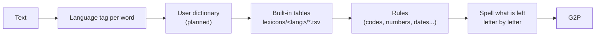
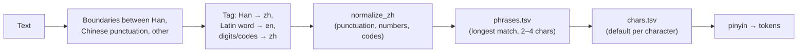
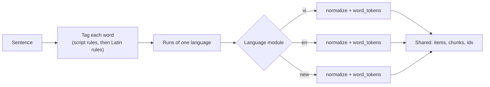

# Pronunciation rules and dictionaries

How vtts turns written text into something speakable, and how to change it. These rules are updated often (new product names, loanwords, regional preferences), so every change follows the same steps and is covered by tests.

## Design

Each language is a module with the same shape:

| Part | Where | What |
|---|---|---|
| Data tables | `src/vtts/frontend/lexicons/<lang>/*.tsv` | Letter names, loanwords, abbreviations, units, currencies, symbols. Plain text, one entry per line. |
| Normalizer | `src/vtts/frontend/normalize.py` (vi), `src/vtts/frontend/en/normalize_en.py` (en) | Rules for numbers, dates, times, codes and the order the tables are applied in. |
| G2P | `g2p.py` (vi, spelling rules), `en/g2p_en.py` (CMUdict + learned letter-to-sound) | Words to phoneme tokens. |
| Device port | `runtime/src/vtts_text.c` + generated `vtts_text_tables.h` | The subset devices need, in C. |

Python is the source of truth. The C tables are generated from the same TSV files, and a parity test checks that Python and C produce identical token ids.

**Precedence:** user dictionary (planned) > built-in tables > rules > spelling letter by letter. A more specific source always wins, so a fix for one word never needs a new rule.

### Language of a word (bilingual voices)

In bilingual mode, `lang.py` tags each word:

- A word with Vietnamese diacritics is Vietnamese.
- A plain Latin word is Vietnamese if it is a valid Vietnamese syllable, a key in `vi/loanwords.tsv` or `vi/abbreviations.tsv`, or a short all-caps word. Otherwise it is English.
- Digits and codes are neutral: they follow the language of the sentence.

So **adding a word to `vi/loanwords.tsv` also makes it Vietnamese in bilingual mode.** Do that for words Vietnamese speakers say in a Vietnamese way (`wifi` → "oai phai", `smartphone` → "sờ mát phôn"). Leave out brand names that bilingual voices should say in English (`iPhone`); the English front-end reads them.

## Shared rules

### Product codes

A standalone run of upper-case ASCII letters and digits, with at least one of each, is a code: `ESP32`, `S3`, `RTX3060`, `MP3`, `U23`, `VN123`, `ABC123`. Its letters are spelled and **its digits are read one by one**. Hyphens separate codes (`ESP32-P4` is `ESP32` + `P4`).

| Text | Vietnamese sentence | English sentence |
|---|---|---|
| ESP32-P4 | e ét pê ba hai pê bốn | E S P three two P four |
| RTX3060 | e rờ tê ích xì ba không sáu không | R T X three zero six zero |
| U23 | u hai ba | U two three |

Not codes: mixed case (`iPhone15` → "... mười lăm"), numbers on their own (`COVID-19` → "cô vít mười chín", `RTX 3060` → "ba nghìn không trăm sáu mươi").

Python: `PRODUCT_CODE` in `normalize.py` and `en/normalize_en.py`. C: the code scan in `vtts_text_to_ids` (bit 1 of `date_start`).

## Vietnamese tables (`lexicons/vi/`)

| File | Matching | Example |
|---|---|---|
| `letters.tsv` | one letter, case-insensitive | `s` → ét |
| `loanwords.tsv` | whole word, case-insensitive | `smarthome` → sờ mát hôm |
| `abbreviations.tsv` | case-sensitive, longest first, at word boundaries; a key not ending in `.` must not be followed by a letter or digit | `TP.HCM` → thành phố hồ chí minh |
| `units.tsv` | after a number | `km` → ki lô mét |
| `currencies.tsv` | after a number, case-insensitive | `usd` → đô la |
| `symbols.tsv` | anywhere | `@` → a còng |

Every reading must be valid Vietnamese syllables; `tests/frontend/test_lexicons.py` checks this, so a typo fails the tests instead of being spelled out at run time.

## English

English uses CMUdict (pinned commit, BSD) and letter-to-sound rules learned from it, plus rules in `en/normalize_en.py` (numbers, money, dates, times, units, abbreviations, acronyms of up to 4 letters spelled).

On the device, the lexicon and the letter-to-sound table ship as one `VLEX` blob (about 1.9 MB, built by `scripts/frontend/build_lexicon.py`): CMUdict front-coded in blocks of 32 words with phoneme and stress packed in one byte, and the letter-to-sound window table pruned without changing any prediction (493k to 58k keys). The C normalizer and G2P (`runtime/src/vtts_text_en.c`) match Python exactly, including the regex backtracking of the normalizer; numbers of any length are read like Python.

## Chinese (Mandarin, token set `zh-en`)

Python only for now (`src/vtts/frontend/zh/`); the C port comes later. `text_to_ids(text, "zh")` returns ids of the token set `zh-en`: ids 0–106 are the v2 set unchanged (so English rows can be warm-started from a vi-en teacher; the Vietnamese rows stay unused), followed by the Mandarin block from id 107: 21 initials `ZI:b` … `ZI:s`, 38 finals `ZF:a` … `ZF:i0` and tones `ZT1` … `ZT5` (5 = neutral).

A syllable is `[ZI:initial] ZF:final ZTtone`. Finals are written in full: `y`/`w` are not initials (`yi` → `i`, `you` → `iou`, `wei` → `uei`, `yun` → `vn`), `ju`/`qu`/`xu` use ü (`v`), `iu`/`ui`/`un` are `iou`/`uei`/`uen`, and the apical vowel is `ii` after zh/ch/sh/r and `i0` after z/c/s. Interjections (m, n, ng, hm, hng, yo, ê) map to the nearest regular syllable. The syllables of one Chinese run are joined without the space token; a space separates Chinese from English words.

### Tables (`lexicons/zh/`)

| File | Content | Edited by |
|---|---|---|
| `chars.tsv` | one default reading per character (7,098: GB2312 plus the characters of pypinyin's phrases), numbered pinyin such as `行` → `xing2`, `v` for ü, tone 5 = neutral | generated |
| `phrases.tsv` | 2–4 character phrases whose reading differs from what the shorter phrases and the per-character defaults give (7,170), e.g. `银行` → `yin2 hang2` | generated |
| `overrides.tsv` | hand fixes; a one-character key sets a default, a longer key sets a phrase | by hand |

**Precedence:** at run time, forward maximum matching over `phrases.tsv` (longest phrase first), then `chars.tsv` one character at a time; a character in neither is skipped. When the tables are built, `overrides.tsv` wins over pypinyin's data.

Both generated tables come from pypinyin's data (MIT) through `scripts/frontend/build_zh_lexicon.py`; pypinyin is a dev dependency only. The tables hold citation tones: the sandhi tones of 一 and 不 that pypinyin bakes into some phrases are reset to `yi1`/`bu4`, and no sandhi rule is applied (the model learns it from audio; the hook is `apply_sandhi` in `zh/g2p_zh.py`).

**To change a reading:** add `key<TAB>reading` to `overrides.tsv` (one syllable per character), run `uv run python scripts/frontend/build_zh_lexicon.py`, add a case to `tests/frontend/test_zh_readings.py`, and run `uv run pytest -q tests/frontend`. Do not edit the generated files: the next build overwrites them.

### Normalization (`zh/normalize_zh.py`)

| Text | Reading |
|---|---|
| `，。！？；：、` | `, . ! ? ; : ,` (quotes and brackets dropped, `……` and `——` are a pause) |
| 123, 10010 | 一百二十三, 一万零一十 (二, not 两) |
| 3.14, 15%, -5 | 三点一四, 百分之十五, 负五 |
| 2026年, 2026-11-18 | 二零二六年, 二零二六年十一月十八日 |
| 11月18日 | 十一月十八日 |
| 9:30, 9:05, 18:00 | 九点三十分, 九点零五分, 十八点 |
| 13812345678 (5 or more digits, no separators) | 一三八一二三四五六七八 |
| 3~5, ¥99, 25℃ | 三到五, 九十九元, 二十五摄氏度 |
| ESP32-P4, 5G | letters in English, digits one by one: E S P 三二 P 四, 五 G |

Latin words inside Chinese text go to the English module (`打开Wi-Fi设置` → 打开 / Wi-Fi / 设置). Sentences also end after `。！？；` without a following space.

## Changing a rule or an entry

1. Edit the TSV file (or the rule in the normalizer).
2. Add a case to `tests/frontend/test_normalize.py` (or `test_normalize_en.py`) that shows the new reading.
3. Regenerate the C tables: `uv run python runtime/tools/gen_text_tables.py`.
4. If the rule exists in C, port it to `runtime/src/vtts_text.c`, add example sentences to the parity sentence list and regenerate the fixture: `uv run python scripts/frontend/export_text_parity.py --sentences FILE --out runtime/test/text_parity.tsv`.
5. Update the token snapshots when the change is intended, and list the sentences that changed in the commit message: `tests/fixtures/frontend_golden.jsonl`, `tests/fixtures/text_ids_v1.json`.
6. Run `uv run pytest -q tests/frontend tests/export`.
7. Add a line to the change log below.

Existing models keep working after a change: the token set does not change, only which tokens a word maps to. A reading the model never saw in training may sound less natural until the next training run.

## Adding a language

The bilingual front-end (phoneme set v2) is built from **language modules**, the same in Python and C, around a shared core: sentence splitting, language runs, punctuation handling, chunk packing (at most 40 words and 318 tokens per chunk) and the device protocol. Adding a language touches only its own module, one tagging rule and its tests.

A module provides two functions:

| | Python (`src/vtts/frontend/languages.py`) | C (`runtime/src/vtts_text.c`, `LANGS`) |
|---|---|---|
| Normalize a run | `normalize(text) -> str`: lower-case words and the marks `, . ? ! ; :` separated by spaces | `normalize(ctx, run, n, lex)`: pushes the same words into the workspace |
| Pronounce a word | `word_tokens(word) -> list[str]`: v2 tokens, `[]` to skip the word | `word_ids(word, lex, out, cap)`: the same ids, `0` to skip |

Steps:

1. **Tokens.** Add the language's phonemes as new ids at the end of the token set (a new token set version, e.g. v3 = v2 + new phonemes). Never renumber existing ids: models store them.
2. **Data tables.** Put readings in `src/vtts/frontend/lexicons/<lang>/*.tsv` (one `key<TAB>reading` per line) and large dictionaries in a blob like `VLEX` (built by a script, read in place on the device).
3. **Python module.** Write `normalize` and `word_tokens`, register them in `LANGUAGES`, and add the language's code to the modes `text_to_ids` accepts.
4. **Tagging.** In `lang.py`, a language with its own script adds a rule to `SCRIPT_RULES` *before* `vi` (for example Han characters for `zh`), so its words are recognized in any mode. A Latin-script language needs a rule in `word_lang` for plain Latin words, and the `auto` mode decides between the sentence languages.
5. **Tests.** Normalization cases, a data test for the tables, and the shared parity fixtures: `export_text_parity.py --v2` gets sentences of the new language and mixed sentences.
6. **C module.** Port `normalize` and `word_ids` (tables generated from Python by `runtime/tools/gen_text_tables.py`), add an entry to `LANGS` and the tag rule to `word_tag`, then run `uv run pytest tests/export`: the C front-end must match Python exactly.
7. **Voices.** Synthesize or record data with the new token set, train a teacher, distill the students, and add the language to `docs/site.json` (the website and README tables follow).

## User dictionary (planned)

Applications will be able to add their own entries without rebuilding the firmware: the same `key<TAB>reading` format, one file per language, compiled into a small blob that the device loads next to the model. It takes precedence over the built-in tables, so a product name can be fixed in the field. Until then, add the entry to the built-in tables.

## Change log

| Date | Change |
|---|---|
| 2026-11-18 | Chinese front-end in Python: token set `zh-en`, `lexicons/zh/` tables from pypinyin, Chinese number reading, mode `zh`. |
| 2026-11-17 | Bilingual device front-end in C (`vtts_text_to_ids_ex`, VLEX blob), language modules in Python and C. |
| 2026-11-17 | Tables moved from code to `lexicons/vi/*.tsv`. Product codes read digits one by one (vi, en, C). Letter `s` reads "ét" (was "ét xì"). `smartphone` → "sờ mát phôn" (was the invalid "xmát phôn"); added `smarthome` → "sờ mát hôm". |
