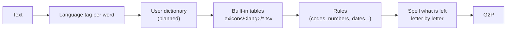

# Pronunciation rules and dictionaries

How vtts turns written text into something speakable, and how to change it. These rules are updated often (new product names, loanwords, regional preferences), so every change follows the same steps and is covered by tests.

## Design

Each language is a module with the same shape:

| Part | Where | What |
|---|---|---|
| Data tables | `src/vtts/frontend/lexicons/<lang>/*.tsv` | Letter names, loanwords, abbreviations, units, currencies, symbols. Plain text, one entry per line. |
| Normalizer | `src/vtts/frontend/normalize.py` (vi), `src/vtts/frontend/en/normalize_en.py` (en) | Rules for numbers, dates, times, codes and the order the tables are applied in. |
| G2P | `g2p.py` (vi, spelling rules), `en/g2p_en.py` (CMUdict + learned letter-to-sound) | Words to phoneme tokens. |
| Device port | `runtime/src/vtts_text.c` + generated `vtts_text_tables.h` | The subset devices need, in C. |

Python is the source of truth. The C tables are generated from the same TSV files, and a parity test checks that Python and C produce identical token ids.

**Precedence:** user dictionary (planned) > built-in tables > rules > spelling letter by letter. A more specific source always wins, so a fix for one word never needs a new rule.

### Language of a word (bilingual voices)

In bilingual mode, `lang.py` tags each word:

- A word with Vietnamese diacritics is Vietnamese.
- A plain Latin word is Vietnamese if it is a valid Vietnamese syllable, a key in `vi/loanwords.tsv` or `vi/abbreviations.tsv`, or a short all-caps word. Otherwise it is English.
- Digits and codes are neutral: they follow the language of the sentence.

So **adding a word to `vi/loanwords.tsv` also makes it Vietnamese in bilingual mode.** Do that for words Vietnamese speakers say in a Vietnamese way (`wifi` → "oai phai", `smartphone` → "sờ mát phôn"). Leave out brand names that bilingual voices should say in English (`iPhone`); the English front-end reads them.

## Shared rules

### Product codes

A standalone run of upper-case ASCII letters and digits, with at least one of each, is a code: `ESP32`, `S3`, `RTX3060`, `MP3`, `U23`, `VN123`, `ABC123`. Its letters are spelled and **its digits are read one by one**. Hyphens separate codes (`ESP32-P4` is `ESP32` + `P4`).

| Text | Vietnamese sentence | English sentence |
|---|---|---|
| ESP32-P4 | e ét pê ba hai pê bốn | E S P three two P four |
| RTX3060 | e rờ tê ích xì ba không sáu không | R T X three zero six zero |
| U23 | u hai ba | U two three |

Not codes: mixed case (`iPhone15` → "... mười lăm"), numbers on their own (`COVID-19` → "cô vít mười chín", `RTX 3060` → "ba nghìn không trăm sáu mươi").

Python: `PRODUCT_CODE` in `normalize.py` and `en/normalize_en.py`. C: the code scan in `vtts_text_to_ids` (bit 1 of `date_start`).

## Vietnamese tables (`lexicons/vi/`)

| File | Matching | Example |
|---|---|---|
| `letters.tsv` | one letter, case-insensitive | `s` → ét |
| `loanwords.tsv` | whole word, case-insensitive | `smarthome` → sờ mát hôm |
| `abbreviations.tsv` | case-sensitive, longest first, at word boundaries; a key not ending in `.` must not be followed by a letter or digit | `TP.HCM` → thành phố hồ chí minh |
| `units.tsv` | after a number | `km` → ki lô mét |
| `currencies.tsv` | after a number, case-insensitive | `usd` → đô la |
| `symbols.tsv` | anywhere | `@` → a còng |

Every reading must be valid Vietnamese syllables; `tests/frontend/test_lexicons.py` checks this, so a typo fails the tests instead of being spelled out at run time.

## English

English uses CMUdict (pinned commit, BSD) and letter-to-sound rules learned from it, plus rules in `en/normalize_en.py` (numbers, money, dates, times, units, abbreviations, acronyms of up to 4 letters spelled). Its small tables will move to `lexicons/en/*.tsv` with the C port of the English front-end.

## Changing a rule or an entry

1. Edit the TSV file (or the rule in the normalizer).
2. Add a case to `tests/frontend/test_normalize.py` (or `test_normalize_en.py`) that shows the new reading.
3. Regenerate the C tables: `uv run python runtime/tools/gen_text_tables.py`.
4. If the rule exists in C, port it to `runtime/src/vtts_text.c`, add example sentences to the parity sentence list and regenerate the fixture: `uv run python scripts/frontend/export_text_parity.py --sentences FILE --out runtime/test/text_parity.tsv`.
5. Update the token snapshots when the change is intended, and list the sentences that changed in the commit message: `tests/fixtures/frontend_golden.jsonl`, `tests/fixtures/text_ids_v1.json`.
6. Run `uv run pytest -q tests/frontend tests/export`.
7. Add a line to the change log below.

Existing models keep working after a change: the token set does not change, only which tokens a word maps to. A reading the model never saw in training may sound less natural until the next training run.

## Adding a language

1. Create `lexicons/<lang>/` with at least `letters.tsv`, and the other tables the language needs.
2. Write the normalizer (numbers, dates, codes using the shared `PRODUCT_CODE` pattern, with the language's digit names) and the G2P, adding the language's tokens to `phoneme_set.py` (new ids only, never renumber).
3. Teach `lang.py` how to recognize the language for bilingual mode.
4. Add tests in the same style as `tests/frontend/test_normalize*.py` and a data test in `test_lexicons.py`.
5. Port to C what devices need, with generated tables and a parity fixture.

## User dictionary (planned)

Applications will be able to add their own entries without rebuilding the firmware: the same `key<TAB>reading` format, one file per language, compiled into a small blob that the device loads next to the model. It takes precedence over the built-in tables, so a product name can be fixed in the field. Until then, add the entry to the built-in tables.

## Change log

| Date | Change |
|---|---|
| 2026-11-17 | Tables moved from code to `lexicons/vi/*.tsv`. Product codes read digits one by one (vi, en, C). Letter `s` reads "ét" (was "ét xì"). `smartphone` → "sờ mát phôn" (was the invalid "xmát phôn"); added `smarthome` → "sờ mát hôm". |
