# Pronunciation rules and dictionaries

How vtts turns written text into something speakable, and how to change it. These rules are updated often (new product names, loanwords, regional preferences), so every change follows the same steps and is covered by tests.

## Design

Each language is a module with the same shape:

| Part | Where | What |
|---|---|---|
| Data tables | `src/vtts/frontend/lexicons/<lang>/*.tsv` | Letter names, loanwords, abbreviations, units, currencies, symbols. Plain text, one entry per line. |
| Normalizer | `src/vtts/frontend/normalize.py` (vi), `src/vtts/frontend/en/normalize_en.py` (en) | Rules for numbers, dates, times, codes and the order the tables are applied in. |
| G2P | `g2p.py` (vi, spelling rules), `en/g2p_en.py` (CMUdict + learned letter-to-sound) | Words to phoneme tokens. |
| Device port | `runtime/src/vtts_text.c` + generated `vtts_text_tables.h` | The subset devices need, in C. |

Python is the source of truth. The C tables are generated from the same TSV files, and a parity test checks that Python and C produce identical token ids.

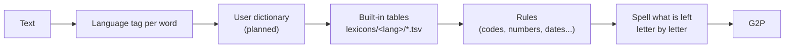

**Precedence:** user dictionary (planned) > built-in tables > rules > spelling letter by letter. A more specific source always wins, so a fix for one word never needs a new rule.

### Language of a word (bilingual voices)

In bilingual mode, `lang.py` tags each word:

- A word with Vietnamese diacritics is Vietnamese.
- A plain Latin word is Vietnamese if it is a valid Vietnamese syllable, a key in `vi/loanwords.tsv` or `vi/abbreviations.tsv`, or a short all-caps word. Otherwise it is English.
- Digits and codes are neutral: they follow the language of the sentence.

In the Latin-script pairs (es-en ...) the same question is answered by `frontend/latin.py`; see [Latin-script pairs](#latin-script-pairs-language-of-a-word).

So **adding a word to `vi/loanwords.tsv` also makes it Vietnamese in bilingual mode.** Do that for words Vietnamese speakers say in a Vietnamese way (`wifi` → "oai phai", `smartphone` → "sờ mát phôn"). Leave out brand names that bilingual voices should say in English (`iPhone`); the English front-end reads them.

## Shared rules

### Product codes

A standalone run of upper-case ASCII letters and digits, with at least one of each, is a code: `ESP32`, `S3`, `RTX3060`, `MP3`, `U23`, `VN123`, `ABC123`. Its letters are spelled and **its digits are read one by one**. Hyphens separate codes (`ESP32-P4` is `ESP32` + `P4`).

| Text | Vietnamese sentence | English sentence |
|---|---|---|
| ESP32-P4 | e ét pê ba hai pê bốn | E S P three two P four |
| RTX3060 | e rờ tê ích xì ba không sáu không | R T X three zero six zero |
| U23 | u hai ba | U two three |

Not codes: mixed case (`iPhone15` → "... mười lăm"), numbers on their own (`COVID-19` → "cô vít mười chín", `RTX 3060` → "ba nghìn không trăm sáu mươi").

Python: `PRODUCT_CODE` in `normalize.py` and `en/normalize_en.py`. C: the code scan in `vtts_text_to_ids` (bit 1 of `date_start`).

## Vietnamese tables (`lexicons/vi/`)

| File | Matching | Example |
|---|---|---|
| `letters.tsv` | one letter, case-insensitive | `s` → ét |
| `loanwords.tsv` | whole word, case-insensitive | `smarthome` → sờ mát hôm |
| `abbreviations.tsv` | case-sensitive, longest first, at word boundaries; a key not ending in `.` must not be followed by a letter or digit | `TP.HCM` → thành phố hồ chí minh |
| `units.tsv` | after a number | `km` → ki lô mét |
| `currencies.tsv` | after a number, case-insensitive | `usd` → đô la |
| `symbols.tsv` | anywhere | `@` → a còng |

Every reading must be valid Vietnamese syllables; `tests/frontend/test_lexicons.py` checks this, so a typo fails the tests instead of being spelled out at run time.

## English

English uses CMUdict (pinned commit, BSD) and letter-to-sound rules learned from it, plus rules in `en/normalize_en.py` (numbers, money, dates, times, units, abbreviations, acronyms of up to 4 letters spelled).

On the device, the lexicon and the letter-to-sound table ship as one `VLEX` blob (about 1.9 MB, built by `scripts/frontend/build_lexicon.py`): CMUdict front-coded in blocks of 32 words with phoneme and stress packed in one byte, and the letter-to-sound window table pruned without changing any prediction (493k to 58k keys). The C normalizer and G2P (`runtime/src/vtts_text_en.c`) match Python exactly, including the regex backtracking of the normalizer; numbers of any length are read like Python.

## Chinese (Mandarin, token set `zh-en`)

Python in `src/vtts/frontend/zh/`, ported to C with exact parity (see [Device (C)](#device-c) below). `text_to_ids(text, "zh")` returns ids of the token set `zh-en`: ids 0–106 are the v2 set unchanged (so English rows can be warm-started from a vi-en teacher; the Vietnamese rows stay unused), followed by the Mandarin block from id 107: 21 initials `ZI:b` … `ZI:s`, 38 finals `ZF:a` … `ZF:i0` and tones `ZT1` … `ZT5` (5 = neutral).

A syllable is `[ZI:initial] ZF:final ZTtone`. Finals are written in full: `y`/`w` are not initials (`yi` → `i`, `you` → `iou`, `wei` → `uei`, `yun` → `vn`), `ju`/`qu`/`xu` use ü (`v`), `iu`/`ui`/`un` are `iou`/`uei`/`uen`, and the apical vowel is `ii` after zh/ch/sh/r and `i0` after z/c/s. Interjections (m, n, ng, hm, hng, yo, ê) map to the nearest regular syllable. The syllables of one Chinese run are joined without the space token; a space separates Chinese from English words.

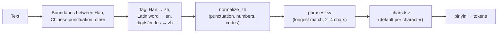

### Tables (`lexicons/zh/`)

| File | Content | Edited by |
|---|---|---|
| `chars.tsv` | one default reading per character (7,098: GB2312 plus the characters of pypinyin's phrases), numbered pinyin such as `行` → `xing2`, `v` for ü, tone 5 = neutral | generated |
| `phrases.tsv` | 2–4 character phrases whose reading differs from what the shorter phrases and the per-character defaults give (7,170), e.g. `银行` → `yin2 hang2` | generated |
| `overrides.tsv` | hand fixes; a one-character key sets a default, a longer key sets a phrase | by hand |

**Precedence:** at run time, forward maximum matching over `phrases.tsv` (longest phrase first), then `chars.tsv` one character at a time; a character in neither is skipped. When the tables are built, `overrides.tsv` wins over pypinyin's data.

Both generated tables come from pypinyin's data (MIT) through `scripts/frontend/build_zh_lexicon.py`; pypinyin is a dev dependency only. The tables hold citation tones: the sandhi tones of 一 and 不 that pypinyin bakes into some phrases are reset to `yi1`/`bu4`, and no sandhi rule is applied (the model learns it from audio; the hook is `apply_sandhi` in `zh/g2p_zh.py`).

**To change a reading:** add `key<TAB>reading` to `overrides.tsv` (one syllable per character), run `uv run python scripts/frontend/build_zh_lexicon.py`, add a case to `tests/frontend/test_zh_readings.py`, and run `uv run pytest -q tests/frontend`. Do not edit the generated files: the next build overwrites them.

### Normalization (`zh/normalize_zh.py`)

| Text | Reading |
|---|---|
| `，。！？；：、` | `, . ! ? ; : ,` (quotes and brackets dropped, `……` and `——` are a pause) |
| 123, 10010 | 一百二十三, 一万零一十 (二, not 两) |
| 3.14, 15%, -5 | 三点一四, 百分之十五, 负五 |
| 2026年, 2026-11-18 | 二零二六年, 二零二六年十一月十八日 |
| 11月18日 | 十一月十八日 |
| 9:30, 9:05, 18:00 | 九点三十分, 九点零五分, 十八点 |
| 13812345678 (5 or more digits, no separators) | 一三八一二三四五六七八 |
| 3~5, ¥99, 25℃ | 三到五, 九十九元, 二十五摄氏度 |
| ESP32-P4, 5G | letters in English, digits one by one: E S P 三二 P 四, 五 G |

Latin words inside Chinese text go to the English module (`打开Wi-Fi设置` → 打开 / Wi-Fi / 设置). Sentences also end after `。！？；` without a following space.

### Device (C)

`vtts_text_to_ids_ex` with mode `VTTS_LANG_ZH` gives exactly `text_to_ids(text, "zh")` (module `runtime/src/vtts_text_zh.c`, entry `zh` in `LANGS`). The reading tables ship as a `ZLEX` blob of about 116 KB built by `scripts/frontend/build_zh_blob.py` from the same `chars.tsv` and `phrases.tsv` (so `overrides.tsv` is included); the blob is read in place from flash, without `malloc` or copies.

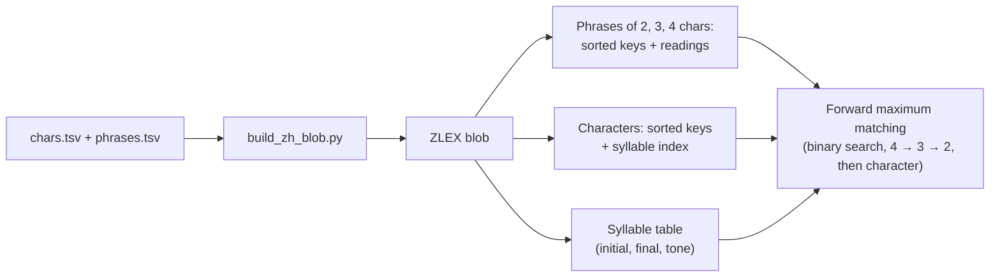

| Part | Layout | Size |
|---|---|---|
| Syllables | 1,300 entries of 4 bytes: initial (0 = none), final, tone | 5 KB |
| Characters | 7,098 keys (code point − U+4E00, u16, sorted) then 7,098 syllable indices | 28 KB |
| Phrases | per length 2, 3, 4: records of the keys then one syllable index per character, sorted by key | 83 KB |

- **Normalization** follows `normalize_zh` pass by pass (full-width forms, pauses, symbols, dropped quotes and brackets, product codes, ISO dates, money, percent, times, years, ranges, negatives, decimals, grouped numbers, long digit strings, integers, Latin words to the English normalizer, joining Han runs), including the regex backtracking that can change a match. Numbers of up to 512 digits are read like Python.
- **Tagging and chunks:** Han, Chinese punctuation and other text are split apart like `split_scripts`; plain Latin words are English, everything else is Chinese. Syllables of a Han run are joined without the space token and each counts as one word for the 40-word chunk limit; English words get a space on both sides.
- **Token ids:** the zh-en ids (`VTTS_ZHEN_*` in the generated `vtts_text_tables.h`) are computed from the blob's (initial, final, tone) indices; ids 0–106 are the v2 ids, so English words use the VLEX lexicon unchanged.
- **Tests:** `runtime/test/text_parity_zh.tsv` (edge cases, the mixed template sentences, Chinese sentences, numbers, dates and times, regex-dense random strings) must match exactly, and a fuzz run in zh mode (mixed Han, ASCII, digits, punctuation, random bytes) must stay inside its buffers: `make -C runtime test` or `uv run pytest tests/export`. After changing a Chinese rule or table, regenerate the fixture with `uv run python scripts/frontend/export_text_parity.py --zh --sentences data/zh/sentences.jsonl --limit 2500 --out runtime/test/text_parity_zh.tsv`.
- **Known gaps (pathological input only):** only ASCII digits count as digits (Python's `\d` also takes other scripts' digits); a sentence is cut at 4,096 code points, 2,048 items or 1,024 chunks, and a Chinese run whose normalized form exceeds 6,144 code points is dropped.

## Korean (token set `ko-en`)

Python (`src/vtts/frontend/ko/`) and C (`runtime/src/vtts_text_ko.c`, see [Device (C)](#device-c-1)); everything is rules and small tables (no morphological analyzer, no model). `text_to_ids(text, "ko")` returns ids of the token set `ko-en`: ids 0–106 are the v2 set unchanged, followed by the Korean block from id 107 (46 tokens, vocabulary 153):

| Group | Tokens | Jamo |
|---|---|---|
| Onsets (18) | `KO:I:g kk k d tt t b pp p s ss j jj ch h n m r` | ㄱ ㄲ ㅋ ㄷ ㄸ ㅌ ㅂ ㅃ ㅍ ㅅ ㅆ ㅈ ㅉ ㅊ ㅎ ㄴ ㅁ ㄹ (silent ㅇ has no token) |
| Vowels (21) | `KO:V:a ae ya yae eo e yeo ye o wa wae oe yo u wo we wi yu eu ui i` | ㅏ ㅐ ㅑ ㅒ ㅓ ㅔ ㅕ ㅖ ㅗ ㅘ ㅙ ㅚ ㅛ ㅜ ㅝ ㅞ ㅟ ㅠ ㅡ ㅢ ㅣ |
| Codas (7) | `KO:C:k n t l m p ng` | the 7 coda sounds ㄱ ㄴ ㄷ ㄹ ㅁ ㅂ ㅇ |

Tokens are phonemes **after** the pronunciation rules: `학교` → `KO:I:h KO:V:a KO:C:k KO:I:kk KO:V:yo` (학꾜). Words (어절) are separated by the space token; the syllables of a word are joined.

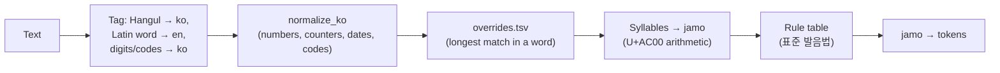

### Pronunciation rules (`ko/g2p_ko.py`, `RULES`)

Applied in this order over each pair of adjacent syllables of one word (never across a space):

| # | Rule | Examples |
|---|---|---|
| 1 | Palatalization (구개음화): ㄷ ㅌ + 이 → 지 치, ㄷ + 히 → 치 | 같이 [가치], 굳이 [구지], 닫히다 [다치다] |
| 2 | Coda ㅎ (ㄶ ㅀ): aspirates ㄱ ㄷ ㅈ, tenses ㅅ, ㄴ before ㄴ, silent before a vowel | 좋다 [조타], 닿소 [다쏘], 놓는 [논는], 좋아 [조아] |
| 3 | Aspiration before ㅎ: ㄱ ㄷ ㅂ ㅈ + ㅎ → ㅋ ㅌ ㅍ ㅊ | 축하 [추카], 입학 [이팍], 앉히다 [안치다] |
| 4 | Liaison (연음); a double coda moves its second part | 한국어 [한구거], 앉아 [안자], 값을 [갑쓸] |
| 5 | Tensification after obstruent codas and the stem codas ㄵ ㄻ ㄼ ㄾ | 학교 [학꾜], 국밥 [국빱], 앉다 [안따] |
| 6 | Coda neutralization (7 codas) and double-coda simplification; ㄺ is ㄹ before ㄱ | 부엌 [부억], 닭 [닥], 읽고 [일꼬], 넓다 [널따] |
| 7 | ㄹ → ㄴ after ㅁ ㅇ ㄱ ㄷ ㅂ | 종로 [종노], 담력 [담녁] |
| 8 | Nasalization (비음화): ㄱ ㄷ ㅂ before ㄴ ㅁ → ㅇ ㄴ ㅁ | 국물 [궁물], 십만 [심만], 독립 [동닙] |
| 9 | Liquidization (유음화): ㄴ next to ㄹ → ㄹ | 신라 [실라], 칼날 [칼랄] |
| 10 | Vowels: ㅢ after a consonant → ㅣ; 져 쪄 쳐 → 저 쩌 처 | 희망 [히망], 가져 [가저] |

Not covered by rules (they need word knowledge; add entries to `overrides.tsv`): ㄴ insertion (솜이불 [솜니불]), 사잇소리 (김밥 [김빱]), Sino-Korean ㄹ + ㄷㅅㅈ (갈등 [갈뜽]), ㄴ+ㄹ read ㄴㄴ (의견란 [의견난]), tensification after the future ㄹ (할 수 [할쑤], 할게 [할께]), rules across words (옷 한 벌 [오탄벌]), and 의 as the particle [에] (kept as ㅢ, an allowed reading).

### Tables (`lexicons/ko/`)

| File | Content | Edited by |
|---|---|---|
| `overrides.tsv` | exceptions to the rules (76 entries): written form → form spelled as pronounced, both Hangul, e.g. `물고기` → `물꼬기` | by hand |

An entry is matched anywhere inside a word, longest first, before the rules run, so `물고기` also covers `물고기를`. The reading must be spelled as pronounced: the rules still run over it and must leave it unchanged (a test checks every entry). **To change a reading:** add `written<TAB>pronounced` to `overrides.tsv`, add a case to `tests/frontend/test_ko_g2p.py`, and run `uv run pytest -q tests/frontend`.

### Normalization (`ko/normalize_ko.py`)

| Text | Reading |
|---|---|
| 350원, 1,250달러, 10번 | 삼백오십 원, 천이백오십 달러, 십 번 (Sino-Korean by default; 1 before 십 백 천 만 is silent) |
| 3개, 2명, 20살, 4마리, 3시간, 1번째 | 세 개, 두 명, 스무 살, 네 마리, 세 시간, 첫 번째 (native 1–99 before native counters: 개 명 시 살 번째 마리 잔 시간 사람 권 병 장 ...) |
| 2026년 11월 18일, 2026-11-18 | 이천이십육년 십일월 십팔일 (6월 유월, 10월 시월) |
| 9시 30분, 9:30, 18:00 | 아홉 시 삼십 분, 아홉 시 삼십 분, 열여덟 시 |
| 3.14, 15%, -5도 | 삼 점 일사, 십오 퍼센트, 마이너스 오 도 |
| 010-1234-5678 (and digit strings starting with 0) | 공일공 일이삼사 오육칠팔 |
| ₩5,000, $20, 25℃, 5km, 3kg, 3~5개 | 오천 원, 이십 달러, 이십오 도, 오 킬로미터, 삼 킬로그램, 셋에서 다섯 개 |
| ESP32-P4 | letters and digits in English: E S P three two P four |

A number is joined to a following particle or to 년/월/일 and separated from a counter by a space. Latin words go to the English module (`Wi-Fi를` → `wi fi` + `를`). A word too long for one chunk is split between syllables.

### Device (C)

`vtts_text_to_ids_ex` with mode `VTTS_LANG_KO` gives exactly `text_to_ids(text, "ko")` (module `runtime/src/vtts_text_ko.c`, entry `ko` in `LANGS`). Unlike Chinese there is no blob: the rule tables, `overrides.tsv` and the normalizer's strings are small, so `runtime/tools/gen_text_tables.py` compiles them into `vtts_text_tables.h` (about 4 KB of tables; the whole module, code and tables, is about 15 KB in the ESP32-P4 and ESP32-S3 firmware). Only the English words need the VLEX lexicon.

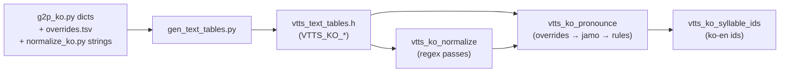

| Part | How it is ported | Size |
|---|---|---|
| Jamo | consonants coded as compatibility jamo − U+3130 (ㄱ 1 … ㅎ 30), vowels as their index (ㅏ 0 … ㅣ 20); a syllable is 3 bytes (onset, vowel, coda) | |
| Rule tables | `NEUTRAL`, `LIAISON`, `ASPIRATE_BEFORE_H`, `ASPIRATED`, `H_CODAS`, `TENSE`, `OBSTRUENT_CODAS`, `STEM_CODAS`, `Y_TO_PLAIN` and the token ids, generated from the Python dicts as arrays indexed by jamo code; the small maps inside the rule functions (palatalization, nasalization, ㄹ → ㄴ, liquidization) are written in C | 0.6 KB |
| Exceptions | `overrides.tsv` as (written, reading) syllable offsets from U+AC00, matched longest first like `apply_overrides` | 1.1 KB |
| Normalizer strings | digits, units of 10/10⁴, native numbers, months, counters (longest first, with their kind), symbols, dropped characters, units, currencies | 2 KB |

- **Rules** run in the order of `RULES` (each rule over every pair of adjacent syllables, left to right, the last coda neutralized too), then the vowel rule per syllable; characters that are not Hangul syllables split a word into parts that do not interact, as in `pronounce`.
- **Normalization** follows `normalize_ko` pass by pass (full-width forms, pauses, symbols, dropped quotes and brackets, units, product codes, ISO and dotted dates, phone numbers, times, money, percent, ranges, numbers with their counter, Latin words to the English normalizer). Where regex backtracking can change a match (the alternation `\d{1,3}(,\d{3})+|\d+` with an optional fraction, `\s?` before units and `%`, `\.?` after a dotted date), the candidate ends are tried in the order the regex engine tries them, so `1,2345원` and `1,234,5km` split like Python. Numbers of any length are read like Python (above 20 digits digit by digit).
- **Tagging and chunks:** a word with Hangul (syllables or compatibility jamo) is Korean, a plain Latin word is English, anything else is Korean; no boundaries are inserted (Korean has spaces). Words are separated by the space token; a word of more than 318 tokens is split into one item per syllable, joined without the space token, so the chunk packer can cut it. Sentences also end after `。！？；` without a following space, as for Chinese.
- **Tests:** `runtime/test/text_parity_ko.tsv` (11,369 cases: edge cases, both Korean eval sets, 2,000 mixed template sentences, 3,000 generated sentences, every (coda, next onset, next vowel) of two adjacent syllables plus 4,000 random three-syllable words, numbers, dates and times, regex-dense random strings) must match exactly, and a fuzz run in ko mode (Hangul, jamo, ASCII, numbers with counters, punctuation, random bytes, words without spaces) must stay inside its buffers and inside the ko-en ids: `make -C runtime test` or `uv run pytest tests/export`. A test also checks that `vtts_text_tables.h` holds the current Korean tables. After changing a Korean rule or table, run `uv run python runtime/tools/gen_text_tables.py` and regenerate the fixture with `uv run python scripts/frontend/export_text_parity.py --ko --sentences data/ko/sentences.jsonl --limit 3000 --out runtime/test/text_parity_ko.tsv`.
- **Known gaps (pathological input only):** as for Chinese, only ASCII digits count as digits, the control characters U+001C–U+001F and U+0085 are not whitespace in C, a sentence is cut at 4,096 code points, 2,048 items or 1,024 chunks, and a Korean run whose normalized form exceeds 6,144 code points is dropped (a word longer than 4,095 code points as well).

## Japanese (token set `ja-en`)

Python (`src/vtts/frontend/ja/`) and C (`runtime/src/vtts_text_ja.c`, see [Device (C)](#device-c-2)); the run-time reader is table lookups only (no MeCab, no pyopenjtalk, no model). `text_to_ids(text, "ja")` returns ids of the token set `ja-en`: ids 0–106 are the v2 set unchanged, followed by 37 Japanese phonemes in the style of Open JTalk from id 107 (vocabulary 144):

| Group | Tokens |
|---|---|
| Vowels (5) | `JA:a i u e o` |
| Consonants (14) | `JA:k g s z t d n h b p m y r w` |
| Palatalized (11) | `JA:ky gy sh j ch ny hy by py my ry` |
| Loanword sounds (5) | `JA:ts f v ty dy` (ツァ ファ ヴァ テュ デュ) |
| Special (2) | `JA:N` (moraic nasal ん, one token whatever follows), `JA:cl` (geminate っ) |

A mora is `[consonant] vowel`, `N` or `cl`. **Long vowels are the vowel repeated** (コーヒー → `k o o h i i`), not a separate token; readings from the tables are stored as pronounced (東京 → トーキョー → `t o o ky o o`), while kana written in the text are read as spelled (とう → `t o u`). Devoiced vowels and **pitch accent are not marked** in version 1 (hook: `apply_accent` in `ja/g2p_ja.py`); the model learns them from the audio. A Japanese run is joined without the space token (like Chinese); the space token only separates English words.

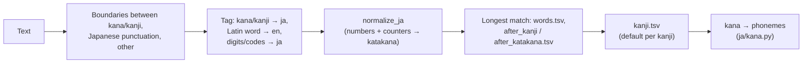

### Readings (`ja/g2p_ja.py`, `lexicons/ja/`)

A run is read by forward longest match at every position. After a kanji or a katakana word, the matching context table wins over `words.tsv` when its key is as long, or when the `words.tsv` key is only longer by kana (戦後に: 後 ゴ + に, not 後に ノチニ). No entry starts or ends inside a katakana run, so katakana words are read as written. Where nothing matches, a kanji takes its default reading (々 repeats the previous kanji), kana are read as written and characters without a reading are skipped (`unreadable_ja` lists them; training rows with such characters are left out).

| File | Content | Edited by |
|---|---|---|
| `words.tsv` | 54,637 surfaces (kanji, kanji + kana, a few hiragana words pronounced unlike their spelling such as the particle は → ワ, へ → エ) → katakana as pronounced | generated |
| `after_kanji.tsv` | 4,506 readings used right after a kanji (国 コク in 米国, 中 チュー, 川 ガワ) | generated |
| `after_katakana.tsv` | 857 readings used right after a katakana word (人 ジン in アメリカ人, 川 カワ) | generated |
| `kanji.tsv` | one default reading for each of the 3,000 most frequent kanji (99.76% of kanji occurrences in the build corpus) | generated |
| `overrides.tsv` | hand fixes; a one-kanji key sets the default, any other key a `words.tsv` entry | by hand |

The three word tables hold 60,000 entries, 1.29 MB as TSV (the C port packs them with the kanji table into a 721 KB blob, below). They are generated by `scripts/frontend/build_ja_lexicon.py` from Open JTalk's dictionary (mecab-naist-jdic, BSD-3) through pyopenjtalk, a dev dependency only: 400,000 Japanese Wikipedia sentences (`scripts/frontend/fetch_ja_text.py`) are analyzed with pyopenjtalk to choose frequent words and their most frequent reading per context; a word is kept only when the shorter entries and the kanji defaults misread it; then the corpus is re-read with the tables and the text of each misread stretch (alone or with a neighbouring word) becomes an entry when it fixes at least half of its occurrences. Kanji defaults come from aligning compound readings to their characters (usually the on-reading: 学 ガク).

**Agreement with pyopenjtalk** on 2,000 held-out Wikipedia sentences (other articles, filtered like the synthesis corpus): **98.2% of morae** (edit distance over morae), 75% of sentences identical. Doubling the table to 100k entries gains only 0.2 points. Remaining differences: context-dependent readings (中 ナカ/チュー, 後 ノチ/アト/ゴ, 数 カズ/スー), rendaku, rare names, and Open JTalk's own choices (ヴァ read `b a`; vtts keeps `v a`).

Known limits: one reading per key and context, so 一日 is イチニチ (ついたち only from dates, below); no rendaku or sound-change rules beyond the tables; kana spelled with a vowel (ありがとう) keep the spelled vowel unless a table entry gives the pronounced form.

**To change a reading:** add `surface<TAB>reading` (kana as pronounced, long vowels with ー) to `overrides.tsv`, rebuild with `uv run python scripts/frontend/build_ja_lexicon.py --corpus data/ja/lexicon/train.txt --heldout data/ja/lexicon/heldout.txt` (after `fetch_ja_text.py`), add a case to `tests/frontend/test_ja_readings.py`, and run `uv run pytest -q tests/frontend`.

### Kana (`ja/kana.py`)

Katakana are folded to hiragana, then a two-kana combination is tried before a single kana: きゃ `ky a`, しゃ `sh a`, ちゃ `ch a`, じゃ/ぢゃ `j a`, ふぁ `f a`, てぃ `t i`, でぃ `d i`, とぅ `t u`, うぃ `w i`, ゔぁ `v a`, つぁ `ts a`, くぁ `k w a`, いぇ `y e`, でゅ `dy u`. し `sh i`, ち `ch i`, つ `ts u`, ふ `f u`, じ/ぢ `j i`, ず/づ `z u`, を `o`, ん `N`, っ `cl`, ー repeats the previous vowel, ゝ ゞ repeat the previous kana.

### Normalization (`ja/normalize_ja.py`)

Numbers are Sino-Japanese, written in katakana as pronounced, so the sound changes are exact:

| Text | Reading |
|---|---|
| 300, 600, 800, 3000, 8000, 10000 | サンビャク, ロッピャク, ハッピャク, サンゼン, ハッセン, イチマン |
| 2026年11月18日, 2026-11-18 | ニセンニジューロクネン ジューイチガツ ジューハチニチ |
| 1日 (after a month) … 10日, 14日, 20日, 24日 | ツイタチ フツカ ミッカ ヨッカ イツカ ムイカ ナノカ ヨーカ ココノカ トーカ, ジューヨッカ, ハツカ, ニジューヨッカ (1日 elsewhere: イチニチ) |
| 4月, 7月, 9月 | シガツ, シチガツ, クガツ |
| 9時30分, 9:30, 4時, 7時 | クジ サンジュップン, ヨジ, シチジ |
| 1分 2分 3分 4分 6分 8分 10分 | イップン ニフン サンプン ヨンプン ロップン ハップン ジュップン |
| 1本 3本 6本 8本 10本 1000本 | イッポン サンボン ロッポン ハッポン ジュッポン センボン (匹 杯 alike) |
| 1人 2人 4人 7人 | ヒトリ フタリ ヨニン シチニン |
| 1つ … 9つ, 10つ | ヒトツ … ココノツ, トー |
| 1個 6個 10個, 1回 8回, 3階, 1歳 8歳 20歳, 4円, 4年 | イッコ ロッコ ジュッコ, イッカイ ハッカイ, サンガイ, イッサイ ハッサイ ハタチ, ヨエン, ヨネン |
| 15%, 3.14, -5 | ジューゴパーセント, サンテンイチヨン, マイナスゴ |
| 1,234円, 3万人, 1億2000万 | センニヒャクサンジューヨエン, サンマンニン, イチオクニセンマン |
| 1234567 (5 or more digits without a counter), 090-1234-5678 | イチニサンヨンゴロクナナ (0 = ゼロ), ゼロキューゼロ ノ イチニサンヨン ノ … |
| 3〜5個, ¥500, $20, 5km, 25℃ | サンカラゴコ, ゴヒャクエン, ニジュードル, ゴキロメートル, ニジューゴド |
| ESP32-P4 | letters and digits in English: E S P three two P four |

The counters are a table (`COUNTERS`: reading, geminated reading, reading after ン, last-digit and whole-number exceptions). Punctuation 、。！？ maps to `, . ! ?`; 「」『』（）・ are dropped, …… and —— are a pause. Latin words go to the English module (`Wi-Fiを設定` → Wi-Fi / を設定). Sentences also end after 。！？ without a following space.

### Device (C)

`vtts_text_to_ids_ex` with mode `VTTS_LANG_JA` gives exactly `text_to_ids(text, "ja")` (module `runtime/src/vtts_text_ja.c`, entry `ja` in `LANGS`). The four reading tables and the NFKC data of the normalizer ship as a `JLEX` blob read in place from flash (`scripts/frontend/build_ja_blob.py`, `vtts_jlex_*`, format in the script's docstring); the kana tables, counters and normalizer strings are compiled into `vtts_text_tables.h` by `runtime/tools/gen_text_tables.py`. English words need the VLEX lexicon.

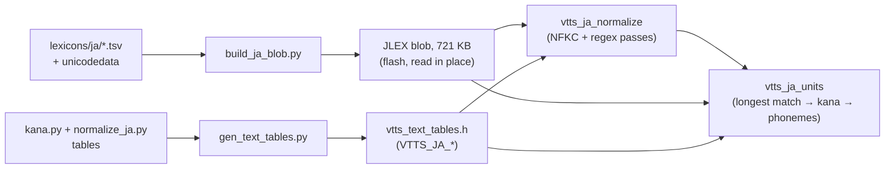

| JLEX part | How it is stored | Size |
|---|---|---|
| `words.tsv` (54,637), `after_kanji.tsv` (4,506), `after_katakana.tsv` (857), `kanji.tsv` (3,000) | keys as UTF-8 sorted bytewise (= code point order), front-coded in blocks of 16 with a block index; readings as one byte per katakana (code point − U+30A0) | 548 + 50 + 9 + 18 KB |
| NFKC | per-code-point full compatibility decompositions (5,795, UTF-8), combining classes (912) and primary composites (941) from the Python that built the blob; Hangul by arithmetic | 81 KB |

- **Lookups** are exact-key searches: a binary search over the first key of each block, then a scan of at most 16 entries. Forward longest match tries the lengths from `max_len` (15) down, skips a length that would end inside a katakana run and applies the context rule of `_lookup` (the context table wins when its key is as long or the `words.tsv` key is only longer by kana). On the host (Apple M-series, `make -C runtime ja_bench`) a lookup takes about 150 ns and a whole sentence of the sample set about 15 µs.
- **Segments** follow `segment`: table words, kanji defaults (々 repeats the previous kanji's reading), kana runs merged until the next non-kana segment; each segment's reading goes through `kana_phonemes` (pairs before single kana, ー repeats the previous vowel, ゝ ゞ ヽ ヾ repeat the previous kana) and is cut into units of at most 10 morae, joined without the space token.
- **Normalization** follows `normalize_ja` pass by pass: NFKC (decomposition, canonical ordering and composition with the blob's tables), full-width forms, pauses, symbols, dropped quotes and brackets, spaces next to Japanese text, 万/億/兆 (with Python's float arithmetic and `str(float)`, exact integers printed exactly), units, product codes, phone numbers, ISO dates, times, money, percent, ranges, numbers with the counter table and its sound changes (big numbers as digit strings), Latin words to the English normalizer. Where regex backtracking can change a match (the alternation `\d{1,3}(,\d{3})+|\d+` with an optional fraction, `\s?`, the optional `⁠` mark and the `\d{1,L}` tail of 万/億/兆), the candidate ends are tried in the regex engine's order. `\d` is Python's (every Unicode decimal digit, read by its value); `[0-9]` and `[A-Za-z]` stay ASCII.
- **Tagging and chunks:** boundaries between Japanese characters, Japanese punctuation and other text as in `split_scripts`; a word with kana or kanji (half-width katakana included) is Japanese, a plain Latin word is English, anything else is Japanese. Sentences also end after `。！？；` (and the danda) without a following space.
- **Tests:** `runtime/test/text_parity_ja.tsv` (12,238 cases: edge cases, both Japanese eval sets, 2,000 mixed template sentences, 3,000 sentences generated from the tables, every context-table key after a kanji or katakana word and 6,000 word keys in context, every kana pair, numbers with every counter, dates, times and regex-dense random strings) must match exactly; `runtime/test/ja_nfkc.tsv` (12,866 cases: every code point NFKC changes and random sequences with combining marks, half-width kana and jamo) checks the NFKC tables; a fuzz run in ja mode must stay inside its buffers and inside the ja-en ids. `make -C runtime ja_test` (part of `make -C runtime test`) or `uv run pytest tests/export`. A larger run of 322,134 generated cases (two seeds of the generators plus targeted 万/億/兆 floats, Unicode digits and NFKC-heavy text) matched exactly. After changing a Japanese table or rule, rebuild the blob (`make -C runtime build/ja_lex.bin`), run `uv run python runtime/tools/gen_text_tables.py` and regenerate the fixtures with `uv run python scripts/frontend/export_text_parity.py --ja --sentences data/ja/sentences.jsonl --limit 3000 --out runtime/test/text_parity_ja.tsv --nfkc-out runtime/test/ja_nfkc.tsv`.
- **Known gaps (pathological input only):** the control characters U+001C–U+001F and U+0085 are not whitespace in C; a sentence is cut at 4,096 code points, 2,048 items or 1,024 chunks, and a Japanese run whose NFKC/normalized form exceeds 6,144 code points is dropped; `float()` of a 万/億/兆 number reads at most 400 characters (Python raises on numbers above 4,300 digits or that overflow); the NFKC tables follow the Unicode version of the Python that built the blob.

## Latin-script pairs: language of a word

Spanish (and the other Latin-script pairs) share their letters with English, so `lang.py` asks `latin.latin_word_lang` for each plain word, in this order:

1. A word with the language's own letters (Spanish á é í ó ú ü ñ; Portuguese á â ã à ç é ê í ó ô õ ú ü; German ä ö ü ß; Italian à è é ì í ò ó ù; Turkish ç ğ ı ö ş ü â î û; Polish ą ć ę ł ń ó ś ź ż; Indonesian has none) is that language, and so is a unit or abbreviation of the language's normalizer (`km`, `kWh`, `etc`, `vc`).
2. A word in `lexicons/<lang>/native.txt` is that language (function words, words also in the English list such as Spanish `red`, `sale`, `come`, adopted words that break the spelling rules: `club`, `internet`, `pizza`).
3. A word in `lexicons/latin/english.txt` is English (common English words and tech terms whose spelling would also fit: `update`, `online`, `router`, `google`). The list is shared by all Latin-script pairs; collisions go in the pair's `native.txt`.
4. A word with a capital after a lower-case letter is English (`iPhone`, `GitHub`, `macOS`).
5. A single letter (a unit, an initial) or an all-caps word of 2–5 letters is the main language: an acronym spelled with its letter names (`USB` → u ese be).
6. Otherwise the word's spelling decides (`valid_spelling` in the language's `g2p_<lang>.py`: letters, letter groups, onset and coda clusters): `casa`, `Barcelona` fit Spanish; `weekend`, `Bluetooth`, `Spotify`, `Wi-Fi` do not and are English.

Digits and codes are neutral as in the other pairs. On random Wikipedia introductions about 4.5% of the words (es, pt) and 9% (id, many English titles) are tagged English, nearly all foreign names and titles. Known gaps: English names whose spelling fits the language (`Taylor`, `Elon`) are read in the main language unless listed in `english.txt`; native names that break the spelling rules (Catalan `Sabadell`, Nahuatl `Chapultepec`) are read in English unless listed in `native.txt`.

## Spanish (token set `es-en`)

Python and C (`src/vtts/frontend/es/`; device: [Latin-script pairs on the device](#latin-script-pairs-on-the-device-c)); everything is rules and small tables. `text_to_ids(text, "es")` returns ids of the token set `es-en` (model header code 6): ids 0–106 are the v2 set unchanged, followed by 31 Spanish tokens from id 107 (vocabulary 138):

| Group | Tokens |
|---|---|
| Vowels (5) | `ES:a e i o u` |
| Stressed vowels (5) | `ES:a1 e1 i1 o1 u1` |
| Glides (2) | `ES:j` (tiene, hoy), `ES:w` (bueno, huevo) |
| Consonants (19) | `ES:p b t d k g f th s x ch y ll m n ny l r rr` |

The set is dialect-neutral like the Vietnamese one: `th` (c before e/i, z) and `s`, `ll` and `y` stay distinct (seseo and yeísmo are left to the voice); b/v are one phoneme; allophones (spirantized b d g, assimilated n) are not marked.

**Letters** (`es/g2p_es.py`): c before e/i and z → `th`; c, k, qu → `k` (u silent before e/i); ch → `ch`; g before e/i and j → `x`; gu before e/i → `g`, gü → `g w`; h silent; ll → `ll`; ñ → `ny`; v → `b`; x → `k s` (`s` at the start of a word); y before a vowel → `y`, else the vowel i; r at the start of a word or after n, l, s and rr → `rr`, else `r`. Letters of other languages are folded to a base letter (à → a, ç → s).

**Syllables and stress:** in a run of vowels, a e o and accented vowels are nuclei; an unaccented i/u next to another vowel is a glide, and in i+u / u+i the second vowel is the nucleus (ciudad, cuidado, muy). The stressed vowel is the one with a written accent, else the second-to-last nucleus when the word ends in a vowel, n or s, else the last one. Function words (articles, clitic pronouns, most prepositions and conjunctions: `UNSTRESSED`) have no stressed vowel.

**Tables** (`lexicons/es/`): `overrides.tsv` respells words read unlike their spelling in Spanish orthography (`méxico` → méjico, `ok` → okéi, `chalet` → chalé); `native.txt` is described above.

**Normalization** (`es/normalize_es.py`, helpers in `latin_norm.py` shared with the other Latin-script pairs):

| Text | Reading |
|---|---|
| 21 años, 1 perro, 21.000 | veintiún años, un perro, veintiún mil |
| 1.250 / 1,250 / 1.234,5 / 3,14 / 2.5 | mil doscientos cincuenta / same / mil doscientos treinta y cuatro coma cinco / tres coma catorce / dos punto cinco |
| 2.000.000, 1.000.000.000 | dos millones, mil millones |
| 5/3/2026, 2026-11-18 | cinco de marzo de dos mil veintiséis, dieciocho de noviembre de … |
| 14:30 h, 7:00, 1:15 | catorce y treinta, siete en punto, una y quince |
| $1.250,50, 20 €, 1 € | mil doscientos cincuenta coma cincuenta dólares, veinte euros, un euro |
| 15,5%, 25 °C, 5 km, 120 km/h | quince coma cinco por ciento, veinticinco grados, cinco kilómetros, ciento veinte kilómetros por hora |
| 1.º, 2.ª, 3.er | primero, segunda, tercer |
| 600 123 456, +34 …, 0034 | digit by digit (más for +) |
| 10-20, -5 | diez a veinte, menos cinco |
| ESP32-P4, USB, ONU | é ese pe tres dos pe cuatro, ú ese be, onu |
| Sr., Dra., EE. UU., etc. | señor, doctora, estados unidos, etcétera |

Quotes, brackets, ¿ and ¡ are dropped; … and dashes between spaces are a pause. Training rows with letters of other scripts are left out (`unreadable_es`).

## Indonesian (token set `id-en`)

Python and C (`src/vtts/frontend/id/`; device: [Latin-script pairs on the device](#latin-script-pairs-on-the-device-c)). `text_to_ids(text, "id")` returns ids of the token set `id-en` (model header code 7): ids 0–106 are the v2 set unchanged, followed by 34 Indonesian tokens from id 107 (vocabulary 141):

| Group | Tokens |
|---|---|
| Vowels (6) | `ID:a i u e @ o` (`e` as in enak, `@` the schwa of besar) |
| Stressed vowels (5) | `ID:a1 i1 u1 e1 o1` (the schwa is never stressed) |
| Consonants (23) | `ID:p b t d k g ? c j f s z sy kh h m n ny ng l r w y` (`?` glottal stop) |

**Letters** (`id/g2p_id.py`): ng, ny, sy, kh are one sound each; c as in cara, j as in jalan; v → `f`, q → `k`, x → `k s`; k at the end of a word and an apostrophe → `?` (anak, ma'af); a doubled consonant letter is read once (Allah). ai, au, oi, ei at the end of a word are diphthongs (pantai → `t a y`); elsewhere each vowel is a syllable (baik, laut).

**The two e's:** the spelling does not tell the schwa (besar) from the e of enak. `lexicons/id/overrides.tsv` respells words whose e the defaults get wrong (in a reading, `e` is the schwa and `é` the other e: `enak` → énak, `mereka` → meréka, `kereta` → keréta); a word with a suffix (-nya -lah -kah -pun -ku -mu -kan -an -i) or a prefix (di- ke- se- ber- ter- per- pe- me-) uses its stem's entry (mejanya, berbeda, pedesaan). Defaults: e next to another vowel is `e` (teori, video); e in the last syllable is `e` when it ends the word (sore, sate) or is closed by a consonant other than r (boleh, bebek, hotel, persen); every other e is the schwa (besar, kemudian, komputer). Letter names come out of the normalizer with é (`KTP` → ka té pé).

**Stress:** the second-to-last syllable, or the last one when the second-to-last has the schwa (be-SAR, per-GI); function words (yang, dan, di, ke, dari, dengan …) are not stressed.

**Normalization** (`id/normalize_id.py`):

| Text | Reading |
|---|---|
| 11, 21, 100, 1.000, 1.250.000 | sebelas, dua puluh satu, seratus, seribu, satu juta dua ratus lima puluh ribu |
| 3,5 / 2.75 | tiga koma lima / dua titik tujuh puluh lima |
| 17/08/1945, 2026-11-18 | tujuh belas agustus seribu sembilan ratus empat puluh lima, delapan belas november … |
| pukul 14.30, jam 07:00, 9:05 | pukul empat belas lewat tiga puluh menit, jam tujuh, sembilan lewat lima menit |
| Rp50.000, Rp 1,5 juta, $20 | lima puluh ribu rupiah, satu koma lima juta rupiah, dua puluh dolar |
| 15%, 30 °C, 5 km, 80 km/jam | lima belas persen, tiga puluh derajat celsius, lima kilometer, delapan puluh kilometer per jam |
| ke-1, ke-3 | pertama, ketiga |
| 0812-3456-7890, +62 … | digit by digit (nol for 0, plus for +) |
| 10-20, -5 | sepuluh sampai dua puluh, minus lima |
| anak2, anak-anak | anak anak |
| KTP, ESP32-P4, ASEAN | ka té pé, é és pé tiga dua pé empat, asean |
| dll., Jl., No., yg | dan lain lain, jalan, nomor, yang |

Known gaps: e in words missing from the exception table follows the defaults; k before a consonant is not made a glottal stop (rakyat); regional names and Arabic loanwords may need entries.

## Portuguese, Brazil (token set `pt-en`)

Python and C (`src/vtts/frontend/pt/`; device: [Latin-script pairs on the device](#latin-script-pairs-on-the-device-c)). `text_to_ids(text, "pt")` returns ids of the token set `pt-en` (model header code 8): ids 0–106 are the v2 set unchanged, followed by 43 Portuguese tokens from id 107 (vocabulary 150):

| Group | Tokens |
|---|---|
| Vowels (5) | `PT:a e i o u` |
| Stressed vowels (7) | `PT:a1 e1 E1 i1 o1 O1 u1` (`E`, `O` open: é, ó) |
| Nasal vowels (5 + 5 stressed) | `PT:an en in on un`, `PT:an1 … un1` |
| Glides (2) | `PT:j w` (pai, mau, mãe, mão, bem) |
| Consonants (19) | `PT:p b t d k g f v s z sh zh m n nh l lh r rr` (`r` the tap of caro, `rr` the strong r of carro, rio and of a syllable-final r) |

Palatalized t/d before i (tia, leite) and the vocalized final l (Brasil) are left to the voice, as is the realization of `rr` (it varies by region).

**Letters** (`pt/g2p_pt.py`): c before e/i and ç → `s`, ch → `sh`; g before e/i and j → `zh`; gu/qu before e/i → `g`/`k` (u silent; a respelling with ü in the exception table makes it heard: cinquenta, frequente), before a/o → `g w`/`k w`; h silent; lh, nh; r at the start of a word, after n/l/s, before a consonant, at the end and rr → `rr`, else `r`; s between vowels → `z`, ss and sc/sç before e/i → `s`; x: at the start → `sh`, ex + vowel at the start → `z` (exemplo), before a consonant → `s` (texto), at the end → `k s`, else `sh` (caixa, lixo; táxi, próximo are in the table); z at the end → `s`.

**Nasal vowels and diphthongs:** ã õ, and a vowel before m/n closing the syllable (campo → `k an1 p u`); -am at the end → `an w` (falam), -em/-ens → `en j` (bem, homens); ão → `an w`, ãe → `an j`, õe → `on j`. An unaccented i/u after a vowel is a glide (pai, muito, partiu) except before a nasal coda, nh or a final r/l (ainda, rainha, cair, Raul).

**Stress and vowel quality:** the vowel with an acute or circumflex accent, else ã/õ, else the second-to-last vowel when the word ends in a, e, o (+ s), am, em, ens, else the last one; function words (o, a, de, que, em, para, com …) are not stressed. A stressed e/o is closed unless written é/ó, followed by a final l (papel, sol) or in -ela(s), -osa(s), -osos (janela, famosa); other open vowels come from `lexicons/pt/overrides.tsv` (respellings: ela → éla, hora → hóra, porta → pórta; 99 entries with the x and ü cases). An unstressed e/o at the end of a word (with an optional s) is read `i`/`u` (leite → `l e1 j t i`, carro → `k a1 rr u`, de → `d i`).

**Normalization** (`pt/normalize_pt.py`):

| Text | Reading |
|---|---|
| 21, 100, 101, 1.200, 1.234, 2026 | vinte e um, cem, cento e um, mil e duzentos, mil duzentos e trinta e quatro, dois mil e vinte e seis |
| 2.500.000, 3,14 / 2.5 | dois milhões e quinhentos mil, três vírgula quatorze / dois ponto cinco |
| 5/3/2026, 1/5/2024 | cinco de março de dois mil e vinte e seis, primeiro de maio de … |
| 14h30, 7h, 1:00, 21:15 | quatorze e trinta, sete horas, uma hora, vinte e uma e quinze |
| R$ 1.250,50, R$ 1,00, R$ 1,5 milhão, US$ 5 | mil duzentos e cinquenta reais e cinquenta centavos, um real, um vírgula cinco milhão de reais, cinco dólares |
| 15,5%, 25 °C, 5 km, 8 GB | quinze vírgula cinco por cento, vinte e cinco graus, cinco quilômetros, oito gigabaites |
| 1º, 2ª | primeiro, segunda |
| (11) 98765-4321, +55 … | digit by digit (mais for +) |
| ESP32-P4, USB, ENEM, CPF | é ésse pê três dois pê quatro, ú ésse bê, enem, cê pê éfe |
| Sr., Dra., etc., vc, pq, tb | senhor, doutora, etcétera, você, porque, também |

Known gaps: open/closed e/o of words missing from the table follow the defaults (closed); x between vowels defaults to `sh`; pretonic vowel raising (menino → minino) and sandhi between words are not marked.

## Italian (token set `it-en`)

Python (`src/vtts/frontend/it/`) and C (see [Italian on the device (C)](#italian-on-the-device-c)); everything is rules and small tables. `text_to_ids(text, "it")` returns ids of the token set `it-en` (model header code 13): ids 0–106 are the v2 set unchanged, followed by 35 Italian tokens from id 107 (vocabulary 142):

| Group | Tokens |
|---|---|
| Vowels (5) | `IT:a e i o u` |
| Stressed vowels (7) | `IT:a1 e1 E1 i1 o1 O1 u1` (`E`, `O` open: bène, buòno) |
| Glides (2) | `IT:j w` (piano, buono, mai) |
| Consonants (21) | `IT:p b t d k g f v s z ts dz ch dj sh m n ny l ly r` (`ch dj` c/g before e/i, `sh` sc, `ny` gn, `ly` gli, `ts dz` z, `z` the voiced s of casa) |

A long (geminate) consonant is the consonant twice (fatto → `f a1 t t o`), as are `ny ly sh ts dz` between vowels (figlio → `f i1 ly ly o`, pesce → `p e1 sh sh e`). Syntactic doubling between words is not marked.

**Letters** (`it/g2p_it.py`): c/g before e/i → `ch`/`dj`, ch/gh → `k`/`g`; in ci, gi, sci + vowel the i only marks the sound (ciao, giorno, scienza) unless it carries an accent; sc before e/i → `sh`, sch → `s k`; gli → `ly` (the i is silent before a vowel), gn → `ny`; qu → `k w`, cq → `k k`; h silent; x → `k s`; j, y → i. s is voiced (`z`) between vowels and before b d g l m n r v (casa, sbaglio, smettere; the northern/broadcast norm), else `s`; tens + sei/sette keep `s` (ventisei). z is `dz` at the start of a word and in -izzare (zero, organizzare), else `ts` (azione, pizza). Letters of other languages are folded to a base letter.

**Glides:** an unaccented i/u next to another vowel is a glide (piano, buono, mai, guida, aiuto); in a word with a single vowel group the i/u is the stressed nucleus (mio, via, due, zia).

**Stress:** the vowel with a written accent (città, perché, però, and accents in respellings); else antepenultimate for -abile/-ibile/-evole, -imo (massimo, ventesimo), -ico/-ica, -ologo, -ografo, -fono, -metro, -olo/-ola after b c g p t v (titolo, piccola), -dine/-gine/-mine (ordine, immagine, termine), -ere (essere, prendere; not the -ére verbs avere, potere, ottenere … of `ERE_PENULT`), double consonant + -ero (vennero), 3rd plural -ono and -avano/-evano/-ivano/-erano/-arono (each with at least three syllables); else the last vowel of a word ending in a consonant (sport, bar), else the second-to-last. A stressed i is written in before reading for -eria after a double consonant or br/nt (pizzeria, libreria) and for -metria, -logia, -grafia, -sofia, -patia, -crazia, -nomia, -fonia, -gnia, -archia … (geologia, compagnia). Function words (articles, articulated prepositions, clitics, e, o, ma, che, non: `UNSTRESSED`) have no stressed vowel.

**Open and closed e/o:** written è ò are open and é ó closed; a stressed e/o is open after the glide of ie/uo (piede, buono), on the antepenultimate syllable (medico, popolo) and in -ente/-enti (not -mente), -enza, -ello, -esimo (E) and -orio/-oria (O); other stressed e/o are closed. The quality is largely lexical, so frequent words are listed in the table.

**Elision:** l'acqua, dell'anno, c'è are one word; the part before the apostrophe is read without stress and joined to the next part (c'/g' before e/i become `ch`/`dj`). When the word after the apostrophe is English (sull'iPhone, l'app), the tagger splits the chunk: the elided word stays Italian (the normalizer keeps a final apostrophe as the letter ʼ, so `sullʼ` is a word, read unstressed) and the rest is read in English. Typographic ’ is read as '. Latin-script tagging (`latin.py`) decides an elided word on the part after the apostrophe (`ELIDED` in `g2p_it.py`) and accepts a hyphenated word whose parts are in `native.txt` (sud-ovest).

**Tables** (`lexicons/it/`): `overrides.tsv` (151 entries) respells words in Italian orthography with an accent on the stressed vowel (`numero` → nùmero, `amico` → amìco, `polizia` → polizìa, `tempo` → tèmpo, `quello` → quéllo); every entry differs from the rules (tested). `native.txt` lists Italian words that are also English entries (in, come, fine, case, note, file) or break the spelling rules (nord, est, ovest, sud, ex).

**Normalization** (`it/normalize_it.py`, helpers in `latin_norm.py`). Numbers are written with spaces between the scale groups and between hundreds and tens so each part keeps its own stress; tens drop their vowel before uno/otto and a final tre is tré:

| Text | Reading |
|---|---|
| 21, 23, 28, 101, 180, 1234 | ventuno, ventitré, ventotto, cento uno, cento ottanta, mille duecento trentaquattro |
| 2026, 21.000, 2.500.000, 10⁹ | duemila ventisei, ventunomila, due milioni cinquecentomila, un miliardo |
| 21 anni, 1 euro, 101 e 102 | ventun anni, un euro, cento uno e cento due (no apocope before e, di, a …) |
| 3,5 / 1.250 / 2.5 | tre virgola cinque / mille duecento cinquanta / due punto cinque |
| 5/3/2026, 1.5.2024, 2026-11-19 | cinque marzo duemila ventisei, primo maggio …, diciannove novembre … |
| 14:30, 1:15, alle 9.15 | quattordici e trenta, l'una e quindici, alle nove e quindici |
| 12,50 €, €20, $5, 3 £ | dodici euro e cinquanta centesimi, venti euro, cinque dollari, tre sterline |
| 25%, 25 °C, 3,5 km, 120 km/h | venticinque per cento, venticinque gradi, tre virgola cinque chilometri, cento venti chilometri orari |
| 1º, 2ª, 21º, 23ª | primo, seconda, ventunesimo, ventitreesima |
| 333 1234567, +39 06 …, 06 1234 5678 | digit by digit (più for +) |
| 10-20, -5 | dieci a venti, meno cinque |
| ESP32-P4, USB, NATO | e esse pi tre due pi quattro, u esse bi, nato |
| Sig., Dott.ssa, ecc., S.p.A., cmq | signor, dottoressa, eccetera, esse pi a, comunque |

Quotes and brackets are dropped; … and dashes between spaces are a pause. Training rows with letters of other scripts are left out (`unreadable_it`).

**Agreement with eSpeak NG** (`scripts/frontend/eval_latin_g2p.py --lang it`, eSpeak NG 1.52 called as an external program only at evaluation time; nothing from it is in vtts), on 1,200 held-out Italian Wikipedia sentences (odd rows of the first 2,400 of `data/it/sentences.jsonl`; the even rows were used to choose table entries), 19,204 words: 96.9% of phonemes, 85.5% of words with the same phonemes, 83.4% read exactly (phonemes and stress), 94.6% stress position on words of two or more vowels, 73.2% agreement on open/closed stressed e/o. Most remaining differences are e/o quality (eSpeak opens more e/o; neither is right for every word), eSpeak not marking `ly ny sh ts` as long, proparoxytone verb forms in -ano (parlano, trovano: read penultimate like Milano, italiano) and foreign names.

Known gaps: the -ano verb forms above; e/o quality of words missing from the table; voiced/voiceless s and z follow the defaults (s is voiced between vowels as in northern Italy; casa is voiceless in Tuscan and southern speech); foreign names whose spelling fits Italian (Peter, Michael) are read in Italian.

### Italian on the device (C)

`vtts_text_to_ids_ex` with mode `VTTS_LANG_IT` gives exactly `text_to_ids(text, "it")` (module `runtime/src/vtts_text_it.c`, entry `it` in `LANGS`; helpers shared with Turkish in `vtts_text_ltx.h`). No blob: `runtime/tools/gen_lt_tables_it_tr.py` (called by `gen_text_tables.py`) writes every table into `vtts_text_it_tables.h` (normalizer tables, number and month words, word lists, `overrides.tsv`, `ELIDED`, the stems of the stress rules, fold() of every code point, spelling clusters) and checks that each string the C code writes appears in `normalize_it.py`; only English words need the VLEX lexicon. The module is compiled only with `VTTS_ENABLE_IT` (1 by default on the host; the firmware sets it from the token sets of its models, see the firmware README): about 51 KB of code and tables (host build, `-Os`).

- **Tagging:** in mode `it` ’ is read as ', ¿ ¡ separate chunks, an elided word before an English word is split off (`latin.split_elision`), and a chunk is Italian, English or neutral by the rules of `latin.latin_word_lang` (own letters, `native.txt`, units and abbreviations, `ELIDED`, the shared English list via `vtts_lt_english`, CamelCase, acronyms, `valid_spelling`).
- **Normalization** follows `normalize_it` pass by pass in the English scratch buffers (no workspace growth); where backtracking can change a match (numbers, `\s?` before units and `%`, phone patterns, hours) the candidate ends are tried in the regex's order.
- **Words** follow `phonemes` exactly: overrides, elided parts, `_mark_ia`, segments with gemination and long consonants, nuclei and glides, stress and e/o quality. A word is cut at 512 letters.
- **Tests:** `runtime/test/text_parity_it.tsv` (11,969 cases: edge cases, both eval sets, 2,000 template x term sentences, the unit-test strings, 3,000 Wikipedia sentences, every lexicon word, random words, numbers, dates, times, money, units, regex-dense random strings) matches exactly; 68,644 more cases and 60,000 character-level random strings matched in a larger run; `text_test --fuzz-it-tr` stays inside the it-en ids under ASan/UBSan. `make -C runtime it_tr_test` or `uv run pytest tests/export`. Regenerate with `uv run python scripts/frontend/export_text_parity.py --lt it --sentences data/it/sentences.jsonl --limit 3000 --out runtime/test/text_parity_it.tsv`.

## Turkish (token set `tr-en`)

Python (`src/vtts/frontend/tr/`) and C (see [Turkish on the device (C)](#turkish-on-the-device-c)); rules and small tables. `text_to_ids(text, "tr")` returns ids of the token set `tr-en` (model header code 15): ids 0–106 are the v2 set unchanged, followed by 39 Turkish tokens from id 107 (vocabulary 146):

| Group | Tokens |
|---|---|
| Vowels (8) | `TR:a e I i o oe u ue` (`I` ı, `oe` ö, `ue` ü) |
| Stressed vowels (8) | `TR:a1 e1 I1 i1 o1 oe1 u1 ue1` |
| Length (1) | `TR:long` after a long vowel (dağ, hâlâ, öğretmen) |
| Consonants (22) | `TR:b c ch d f g gy h zh k ky l m n p r s sh t v y z` (`c` the c of cam, `ch` ç, `sh` ş, `zh` j, `y` y; `ky gy` the palatal k g before â û: kâr, rüzgâr) |

Vowel harmony is already in the spelling, so the letters are read one by one after Turkish lower-casing (`tr_lower`: I → ı, İ → i; the normalizer and the g2p both use it). A doubled consonant is the consonant twice (anne, dikkat). Palatal k g l before front vowels and the dark l are left to the voice.

**ğ and long vowels** (`tr/g2p_tr.py`): ğ after a vowel lengthens it before a consonant or at the end (dağ → `d a1 long`, yağmur); between two front vowels it is `y` (değil, eğer); between other vowels it lengthens the first one and two equal vowels merge (ağaç → `a1 long ch`, soğuk). â î û are long vowels; â û after k g also make them palatal.

**Stress:** the last syllable by default; `lexicons/tr/overrides.tsv` (96 entries, hand-written) respells words with `ˈ` before the stressed vowel: place names (Ankara → ˈankara, İstanbul → isˈtanbul, Türkiye, Avrupa), loanwords (masa, lokanta, fabrika), adverbs and conjunctions (şimdi, sonra, ama, evet, sadece). An entry also applies to the word with case, plural and possessive suffixes (masada, Avrupa'nın; `SUFFIX`). A suffix after an apostrophe is not stressed, so a name keeps its own stress (İstanbul'dan, Ahmet'in). Pre-stressing suffixes put the stress on the syllable before them: the negative -mA + yor / + dI (gelmiyor, gelmedi), -(I)yor (geliyor: on its own vowel), the copula -DIr (şehirdir, olmuştur; -tIr only after a voiceless consonant, so kültür keeps the default) and -(y)lA (amacıyla). The question particle mi with its endings, de/da, ki, ile, ve, ya, veya, ise and bile are unstressed.

**Apostrophes and English words:** a Turkish word with a suffix after an apostrophe (İstanbul'da) is one word. A suffix after an English word is split off by the tagger (iPhone'da → iPhone / 'da): the English word is read in English and the suffix in Turkish, unstressed (the normalizer writes its apostrophe as the letter ʼ). The tagger decides `Cumhuriyeti'nde` on the part before the apostrophe. A dot after a number followed by a lower-case word is an ordinal and does not end a sentence in mode `tr` (5. sınıf; `SENTENCE_END_TR`).

**Tables** (`lexicons/tr/`): `overrides.tsv` as above (every entry differs from the rules, tested); `native.txt` lists Turkish words that are also English entries (her, on, model, site, set, pay, in).

**Normalization** (`tr/normalize_tr.py`, helpers in `latin_norm.py`). Number words are separate words; a suffix after an apostrophe is joined to the last one:

| Text | Reading |
|---|---|
| 11, 21, 100, 101, 1000, 2026 | on bir, yirmi bir, yüz, yüz bir, bin, iki bin yirmi altı |
| 1.250, 2.500.000, 3,5 / 2.5 | bin iki yüz elli, iki milyon beş yüz bin, üç virgül beş / iki nokta beş |
| 2026'da, 5'te, 1'inci, 4'üncü | iki bin yirmi altıda, beşte, birinci, dördüncü |
| 5. sınıf, 21. yüzyıl | beşinci sınıf, yirmi birinci yüzyıl |
| 19.11.2026, 19/11/2026, 2026-11-19 | on dokuz kasım iki bin yirmi altı |
| 14:30, saat 9.15'te | on dört otuz, saat dokuz on beşte |
| 12,50 TL, ₺50, $5, 20 € | on iki lira elli kuruş, elli lira, beş dolar, yirmi avro |
| %25, 25%, 25 °C, 3,5 km, 120 km/h | yüzde yirmi beş, yüzde yirmi beş, yirmi beş derece, üç virgül beş kilometre, saatte yüz yirmi kilometre |
| 0532 123 45 67, +90 … | digit by digit (artı for +) |
| 10-20, -5 | on ile yirmi, eksi beş |
| ESP32-P4, THY, NATO | e se pe üç iki pe dört, te he ye, nato |
| Dr., Prof., vb., vs., M.Ö. | doktor, profesör, ve benzeri, vesaire, milattan önce |

Quotes and brackets are dropped; … and dashes between spaces are a pause. Training rows with letters of other scripts are left out (`unreadable_tr`).

**Agreement with eSpeak NG** (`scripts/frontend/eval_latin_g2p.py --lang tr`, eSpeak NG 1.52 as an external program at evaluation time only), on 1,200 held-out Turkish Wikipedia sentences (odd rows of the first 2,400 of `data/tr/sentences.jsonl`), 14,622 words: 98.8% of phonemes, 98.1% of words with the same phonemes, 83.7% read exactly, 82.5% stress position on words of two or more vowels. eSpeak writes ü in closed syllables as ø (mapped to ü) and puts most stresses on the last syllable, also where Turkish does not (sonra, daha, gibi, Amerika, Türkiye'nin); most stress differences are such words, where the vtts reading follows the standard language.

Known gaps: lexical stress of words missing from the table (place names, loanwords, adverbs) follows the default; pre-stressing suffixes other than the ones above (-ken, -ce, -leyin) are not marked; the palatal k g of loanwords is only marked before â û; ğ between back vowels is read as a long vowel.

### Turkish on the device (C)

`vtts_text_to_ids_ex` with mode `VTTS_LANG_TR` gives exactly `text_to_ids(text, "tr")` (module `runtime/src/vtts_text_tr.c`, entry `tr` in `LANGS`). No blob: the tables (normalizer, number and month words, word lists, `overrides.tsv`, letters and fold() of every code point, spelling clusters, `latin.SUFFIX_LETTERS`) are generated into `vtts_text_tr_tables.h`. Compiled only with `VTTS_ENABLE_TR`: about 44 KB of code and tables (host build, `-Os`).

- **Tagging and sentences:** in mode `tr` a suffix after an English word is split off (iPhone'da), a word is decided on its part before the apostrophe, and a dot after a number followed by one space and a lower-case letter does not end a sentence (`SENTENCE_END_TR`).
- **Normalization** follows `normalize_tr` pass by pass (Turkish lower case with the I/ı, İ/i rule and the merged i + U+0307, suffixes after numbers, dates, times, money and units, ordinals by vowel harmony).
- **Words** follow `phonemes` exactly: overrides with suffixes (`SUFFIX` as a small matcher), ğ and long vowels, the stress mark, pre-stressing suffixes in the Python order, clitics.
- **Tests:** `runtime/test/text_parity_tr.tsv` (11,850 cases, built like the Italian one) matches exactly; 70,585 more cases and 60,000 character-level random strings matched in a larger run; the fuzz run covers both modes. Regenerate with `--lt tr --sentences data/tr/sentences.jsonl`.

## Latin-script pairs on the device (C)

`vtts_text_to_ids_ex` with mode `VTTS_LANG_ES`, `VTTS_LANG_ID` or `VTTS_LANG_PT` gives exactly `text_to_ids(text, "es" | "id" | "pt")` (module `runtime/src/vtts_text_lt.c`, entries `es`, `id`, `pt` in `LANGS`). There is no blob: `runtime/tools/gen_text_tables.py` compiles every table of the three languages into `vtts_text_tables.h`, and only English words need the VLEX lexicon. In the ESP32-P4 firmware the module is about 62 KB (35 KB code, 27 KB tables) for the three languages together.

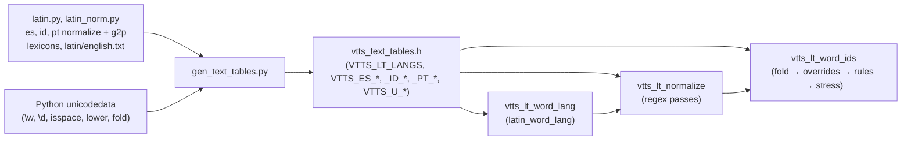

| Part | How it is ported | Size (tables) |
|---|---|---|
| Unicode classes | Python's `\w` (`isalnum()` or `_`, 734 ranges), `\d` (`isdecimal()`, any script, with the digit value), `isspace()`, `str.lower()` as runs, and `fold()` of every code point per language as runs (NFKD base letter, the language's own letters kept); the `re.IGNORECASE` variants of the letters of `pukul`/`jam` (K also matches the Kelvin sign) | about 16 KB |
| Normalizer tables | abbreviations in the order `apply_abbreviations` uses them, units and currencies in the regex alternation order, symbols, dropped characters, letter names, acronyms read as words, month and number words, ordinals | about 6 KB |
| Tagger | `lexicons/latin/english.txt`, `native.txt`, the normalizer's unit and abbreviation keys, and the clusters of each `valid_spelling` (onsets, codas, finals, doubles, foreign groups, digraphs in order) | about 5 KB |
| G2P | the exception tables, unstressed function words, Indonesian affixes, the vowel and accent sets (Portuguese `BASE`) | about 3 KB |

- **Normalization** follows `normalize_es`, `normalize_id` and `normalize_pt` pass by pass (one C function per regex, lookarounds on the pass's input), with the regex engine's backtracking order where it can change a match: the `NUM` alternation `\d{1,3}(?:[.,]\d{3})+(?:[.,]\d+)?|\d+(?:[.,]\d+)?` with the check that follows it (`\s?%`, units, currencies, `(?![\d])`), the hour alternation `[01]?\d|2[0-4]`, optional seconds and `h|hs|hrs` suffixes, phone groups, the optional `+cc` and `(dd)` parts. Numbers of any length are read like Python (Spanish up to 10²⁴ by groups, then digit by digit; Indonesian and Portuguese up to 10¹⁵), including the apocope (`veintiún`), feminine hours and ordinals, Portuguese `e` between groups and reais with centavos.
- **Tagging and chunks:** in the pair modes `¿` and `¡` separate words, a word with the language's letters or any non-Latin character is the language, a plain Latin word follows `latin_word_lang`; each word is one item. Sentences also end right after `。！？；।॥`, as in Python.
- **G2P** ports `fold`, the exception table, `_segments`, `_nuclei` / `_resolve_e` / `_nasalize` / `_glides` and the stress and quality rules; a word without a vowel is spelled with the letter names. Python's `"" in FRONT` (true at the end of a word: final `c` is read `th` in Spanish and `s` in Portuguese) is kept.
- **Tests:** `runtime/test/text_parity_es.tsv`, `_id.tsv`, `_pt.tsv` (about 11,900 cases each: edge cases, both eval sets, 2,000 mixed template sentences, the strings of the language's Python tests, 3,000 generated sentences, every word of the eval sets, templates and lexicons, 6,000 random words of the language's letters, numbers, dates, times, money and units, regex-dense random strings) must match exactly; `make -C runtime lt_test` also runs the fuzz in the three modes (letters of the languages, other scripts, digits of other scripts, every normalizer trigger, random bytes, words without spaces), which must stay inside the buffers and inside each token set. A pytest checks that `vtts_text_tables.h` holds the current tables. After changing a rule or table, run `uv run python runtime/tools/gen_text_tables.py` and `uv run python scripts/frontend/export_text_parity.py --lt es --sentences data/es/sentences.jsonl --limit 3000 --out runtime/test/text_parity_es.tsv` (and `id`, `pt`).
- **Known gaps (pathological input only):** a word is read up to 256 letters and a chunk holds at most 318 tokens (Python makes one longer chunk for a longer word), a sentence is cut at 4,096 code points, and a run whose normalized form exceeds 6,144 code points is dropped. Texts on which Python raises (numbers like `1.000.00` or `1.234.5678`, where `parse_number` calls `int(".")`) do not raise in C: the integer before the first mark is read as a number and the rest digit by digit.

## Hindi (token set `hi-en`)

Python (`src/vtts/frontend/hi/`) and C (`runtime/src/vtts_text_hi.c`, see [Device (C)](#device-c-3)). `text_to_ids(text, "hi")` returns ids of the token set `hi-en` (model header code 10): ids 0–106 are the v2 set unchanged, followed by 50 Hindi tokens from id 107 (vocabulary 157):

| Group | Tokens |
|---|---|
| Vowels (10) | `HI:a aa i ii u uu e ai o au` (`a` the schwa of अ; `ai` = ऐ ॅ, `au` = औ ऑ) |
| Nasalization (1) | `HI:~` after the nasalized vowel |
| Stops and nasals (25) | `HI:k kh g gh ng`, `c ch j jh ny` (च छ ज झ ञ), `T Th D Dh N` (retroflex), `t th d dh n`, `p ph b bh m` |
| Others (14) | `HI:y r l v sh s h` (ष = `sh`), `R Rh` (flaps ड़ ढ़), `q x G z f` (nukta: क़ ख़ ग़ ज़ फ़) |

Latin words are tagged English (`lang.py`); only the units and currency words of the Hindi normalizer (km, GB, Rs) stay Hindi so they are read with their number. Devanagari is tagged `hi` in mode `hi` only.

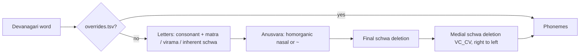

**Letters** (`hi/g2p_hi.py`): a consonant carries the inherent schwa unless a matra or the virama ् follows; the nukta (decomposed or precomposed क़ … य़) changes क ख ग ज फ ड ढ to `q x G z f R Rh`. ज्ञ → `g y`, क्ष → `k sh`, ऋ / ृ → `r i`, ॐ → `o m`, visarga ः → `h`; avagraha, ZWJ and ZWNJ are ignored. Chandrabindu ँ nasalizes its vowel (`हूँ` → `h uu ~`). Anusvara ं after a short vowel (a i u) before a stop is the nasal of that stop (`हिंदी` → `h i n d ii`, `ठंडा` → `Th a N D aa`); otherwise it nasalizes (`दांत` → `d aa ~ t`, `संसार` → `s a ~ s aa r`, `में` → `m e ~`).

**Schwa deletion:** only inherent schwas without a nasal sign or visarga are deleted. Word-final: deleted (`कमल` → `k a m a l`) except in one-letter words (`न`) and after a cluster ending in य or र (`सत्य`, `मित्र`). Medial: right to left, a schwa between V C and C V is deleted (`कमला` → `k a m l aa`, `अपना` → `a p n aa`, `लड़का` → `l a R k aa`, `समझना` → `s a m a jh n aa`: the schwa after झ goes first, so the one after म keeps). `lexicons/hi/overrides.tsv` gives the phonemes of words the rule gets wrong (27 entries): prefixes (असफल), compounds (राष्ट्रपति, लखपति), reduplicated verbs (जगमगाना) and Sanskrit -aN nouns (उदाहरण, वातावरण); a test checks that every entry differs from the rule.

**Normalization** (`hi/normalize_hi.py`):

| Text | Reading |
|---|---|
| 21, 49, 99 (0–99 from `lexicons/hi/numbers.tsv`) | इक्कीस, उनचास, निन्यानबे |
| 250, 1,25,000 / 125,000, 2,50,00,000 | दो सौ पचास, एक लाख पच्चीस हज़ार, दो करोड़ पचास लाख |
| ५, २०२६ | पाँच, दो हज़ार छब्बीस |
| 3.5, 0.25 | तीन दशमलव पाँच, शून्य दशमलव दो पाँच |
| 15/08/1947, 2026-11-19, सन 1947 | पंद्रह अगस्त उन्नीस सौ सैंतालीस, उन्नीस नवंबर दो हज़ार छब्बीस, सन उन्नीस सौ सैंतालीस |
| 7:30, 7:00 बजे | सात बजकर तीस मिनट, सात बजे |
| ₹500, ₹1.50, Rs 99, $20 | पाँच सौ रुपये, एक रुपया पचास पैसे, निन्यानबे रुपये, बीस डॉलर |
| 15%, 5 km, 128GB, 30°C | पंद्रह प्रतिशत, पाँच किलोमीटर, एक सौ अट्ठाईस गीगाबाइट, तीस डिग्री सेल्सियस |
| 10वीं, 5वाँ | दसवीं, पाँचवाँ (1-4 and 6 take the stems पहल दूसर तीसर चौथ छठ) |
| 10-20, -5 | दस से बीस, माइनस पाँच |
| 98765 43210, +91 … | digit by digit (प्लस for +) |
| ESP32, 5G | ई एस पी तीन दो, पाँच जी (Latin letters by their Hindi names) |
| डॉ., प्रो., कि.मी. | डॉक्टर, प्रोफ़ेसर, किलोमीटर |
| । ॥ | end of sentence (`.`) |

Known gaps: schwa deletion at morpheme boundaries of words missing from the table (compounds, prefixes); no stress or ह-coloured vowels (कहना is read k a h n aa); साढ़े / सवा / पौने times; ordinals like 1ला; Urdu-only letters beyond nukta consonants; ऑ is merged with औ and ॅ with ऐ.

### Device (C)

`vtts_text_to_ids_ex` with mode `VTTS_LANG_HI` gives exactly `text_to_ids(text, "hi")` (module `runtime/src/vtts_text_hi.c`, entry `hi` in `LANGS`). As for Korean there is no blob: `runtime/tools/gen_text_tables.py` compiles the letter tables, `overrides.tsv`, `numbers.tsv` and the normalizer's strings into `vtts_text_tables.h` (`hindi_tables()`, about 6 KB of tables; the module, code and tables, adds about 25 KB to the ESP32-P4 firmware). Only English words need the VLEX lexicon.

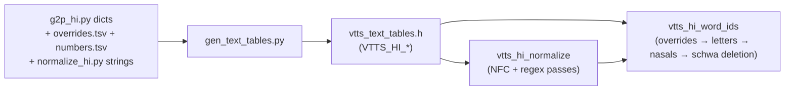

| Part | How it is ported | Size |
|---|---|---|
| Letters | one 4-byte row per code point U+0900–U+097F: kind (consonant, independent vowel, matra, anusvara, chandrabindu, visarga, virama, nukta, ॐ, precomposed nukta letter) and phoneme indices (with the nukta form of a consonant); `HOMORGANIC`, `SHORT`, `FINAL_KEEP` as arrays indexed by phoneme | 0.7 KB |
| Exceptions | `overrides.tsv`: the word (NFC with the nukta letters decomposed, the form the C reads) and its phoneme indices | 0.6 KB |
| Normalizer strings | numbers 0–99, scales, months, letter names, abbreviations, units and currencies (longest first), symbols, ordinal endings and stems, the literals of the code (माइनस, दशमलव, बजे ...), `\w` bits of the Devanagari blocks, combining classes, the ASCII fold of U+00C0–U+024F | 4 KB |

- **Words:** like `_parse`, `_nasals` and `_delete_schwas` over an array of segments (phoneme index, consonant or vowel, inherent schwa, sign); the nasal decisions use the segments before any insertion, and the medial rule runs right to left over the list as it shrinks, as in Python. A word gets at most 318 tokens (one chunk).
- **Normalization** follows `normalize_hi` pass by pass: NFC for Devanagari (nukta letters, canonical order of the marks) and Devanagari digits, abbreviations, danda, dropped characters, ISO and d/m/y dates, times with बजे, years after सन / ईस्वी, money (rupees and paise), phone numbers, percent, units, ordinals, ranges, pauses, product codes, numbers, Latin words (folded to ASCII, then the English normalizer), symbols. Where regex backtracking can change a match (the alternation `\d{1,3}(,\d{2,3})+|\d+` with an optional fraction, `\s?` before units, `%` and ordinal endings, the optional country code and digit groups of a phone number), the candidate ends are tried in the order the regex engine tries them. Numbers of any length are read like Python (from 10¹⁵ digit by digit).
- **Tagging and chunks:** a word with a Devanagari letter or sign is Hindi, a plain Latin word is English unless it is a unit or currency word of the normalizer (km, GB, Rs), anything else is Hindi. Sentences also end right after । and ॥ (and `。！？；`, as for Chinese and Korean).
- **Tests:** `runtime/test/text_parity_hi.tsv` (10,951 cases: edge cases, the Wikipedia probe sentences, 2,000 mixed template sentences, 2,000 sentences built by the corpus rules from their words with numbers and Latin words mixed in, 12,000 random words of 1–6 aksharas for the schwa, nasal and nukta rules, 3,000 number, date, time, money and phone cases with Devanagari digits, 3,000 regex-dense random strings) must match exactly, and a fuzz run in hi mode must stay inside its buffers and inside the hi-en ids: `make -C runtime hi_test` (or `test`) or `uv run pytest tests/export`. A test also checks that `vtts_text_tables.h` holds the current Hindi tables. After changing a Hindi rule or table, run `uv run python runtime/tools/gen_text_tables.py` and regenerate the fixture with `uv run python scripts/frontend/export_text_parity.py --hi --sentences data/hi/sentences.jsonl data/hi/probe_src.jsonl --limit 3000 --out runtime/test/text_parity_hi.tsv`.
- **Known gaps (pathological input only):** Latin letters followed by separate combining marks (U+0300–U+036F) are not composed (Python's NFC may join them into one letter); only ASCII and Devanagari digits count as digits and `\w` outside Devanagari follows the runtime's letter classes; a Devanagari word of more than 318 tokens is cut (Python gives an over-long chunk); a sentence is cut at 4,096 code points, 2,048 items or 1,024 chunks, and a Hindi run whose normalized form exceeds 2,048 code points is dropped.

## Thai (token set `th-en`)

Python (`src/vtts/frontend/th/`) and C (`runtime/src/vtts_text_th.c`, see [Thai on the device (C)](#thai-on-the-device-c)). `text_to_ids(text, "th")` returns ids of the token set `th-en` (model header code 9): ids 0–106 are the v2 set unchanged, followed by 55 Thai tokens from id 107 (vocabulary 162). A syllable is `TH:I:initial [TH:I:second consonant] TH:V:vowel [TH:F:final] TH:Ttone`:

| Group | Tokens |
|---|---|
| Initials (21) | `TH:I:p ph b t th d k kh c ch ? m n ng f s h j r l w` (`?` the glottal stop of อ; a cluster is two initials: ปร → `p r`) |
| Vowels (21) | `TH:V:a aa i ii ue uue u uu e ee ae aae o oo or oor oe ooe ia uea ua` (`ue` ɯ, `ae` ɛ, `or` ɔ, `oe` ɤ; doubled = long) |
| Finals (8) | `TH:F:k p t m n ng w j` (the six final sounds and the glides) |
| Tones (5) | `TH:T1` mid, `T2` low, `T3` falling, `T4` high, `T5` rising |

Thai is written without spaces between words, so a Thai run is read like a Chinese one: its syllables follow each other without `SPACE` and each counts as one word for chunk packing. A space between two Thai runs (Thai puts spaces between clauses and sentences) is read as a pause `,`; spaces around numbers, ๆ and ฯ are not. A dot after a Thai letter ends an abbreviation, not a sentence (พ.ศ. 2567). Latin words are English; a space is put between Thai and Latin letters (เปิดWi-Fiให้).

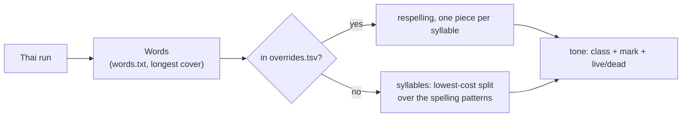

**Words** (`th/g2p_th.segment`): the split of a run with the fewest characters outside `lexicons/th/words.txt` (16,377 words: PyThaiNLP's CC0 word list filtered by Thai National Corpus frequency ≥ 20, built by `scripts/frontend/build_th_lexicon.py`; a lone consonant outside the list counts 3), then the fewest pieces. Text outside the list is read in one piece. ๆ repeats the word before it.

**Syllables** (`th/g2p_th.parse_word`): dynamic programming over the patterns of `VOWELS` (preposed เ แ โ ใ ไ, short/long vowels, diphthongs, ำ ไ ใ เา, ัว/ว, อ, รร) with the initial (single consonant, true cluster กร กล กว คร … ปร พล, จร ซร ศร สร with a silent ร, ทร read `s`, ห before a low sonorant) and the final. Cost 10 per syllable, +4 for an unwritten o (คน; before a final ร it is `oor n`: นคร, พร), +7 for an unwritten a (สบาย), +10 more when that a ends the word, +2 for a leading consonant split from a preposed vowel (เสมอ = ส + เมอ), +10 for an open preposed-vowel syllable before a syllable without a written vowel (แสดง is not แส-ดง); a true cluster gets −1. Letters under ์ are silent (with ิ ุ on them; with the consonant before a silent ร after a final: จันทร์, ศาสตร์); final ร after a stop is silent (บุตร, เมตร); a final ิ ุ after ั + consonant is silent (ปฏิบัติ). บ alone is read บอ (บริษัท). A final ฐ ฒ ษ ศ ธ ฏ inside a word is also read as the next initial with a (รัฐบาล, เทศกาล, พิษณุ; รัฐ also before the next word). ฤ alone is `r ue`, after a consonant `r i` (อังกฤษ), พฤ is `ph r ue`.

**Tones:** the class of the initial (mid ก จ ฎ ฏ ด ต บ ป อ; high ข ฃ ฉ ฐ ถ ผ ฝ ศ ษ ส ห; low the rest), or of a leading ห, or of a mid/high consonant read with an unwritten a before a single low sonorant (สนุก, ขนม, อร่อย). A syllable is live with a long vowel or a final m n ng w j, dead with a short open vowel or a final k p t.

| Class | live, no mark | dead short | dead long | ่ | ้ | ๊ | ๋ |
|---|---|---|---|---|---|---|---|
| mid | mid | low | low | low | falling | high | rising |
| high | rising | low | low | low | falling | – | – |
| low | mid | high | falling | falling | high | – | – |

**Respellings** (`lexicons/th/overrides.tsv`, hand-written, 116 entries): word → syllables written in regular spelling, e.g. ราชการ → ราด-ชะ-กาน, บริษัท → บอ-ริ-สัด, ได้ → ด้าย (long a). A respelled word inside a longer word is read from its respelling (ได้ in ได้รับ). Groups: long a of ได้ ใต้ น้ำ ไม้ เจ้า; อย่า อยู่ อย่าง อยาก, ก็; linking and hidden vowels of Pali/Sanskrit words (มหาวิทยาลัย, คุณภาพ, ธรรมชาติ, ศิลปะ …); leading consonants that do not lend their class (สมาคม) or ำ that does (ตำรวจ); months.

**Normalization** (`th/normalize_th.py`):

| Text | Reading |
|---|---|
| 1, 11, 21, 101, 1001 | หนึ่ง, สิบเอ็ด, ยี่สิบเอ็ด, หนึ่งร้อยเอ็ด, หนึ่งพันเอ็ด |
| 200000, 1000001, 21000000 | สองแสน, หนึ่งล้านหนึ่ง, ยี่สิบเอ็ดล้าน |
| ๒๑, 3.14, -5, 1,250 | ยี่สิบเอ็ด, สามจุดหนึ่งสี่, ลบห้า, หนึ่งพันสองร้อยห้าสิบ |
| 19/11/2569, 2026-11-19, 1 ม.ค., พ.ศ. 2567 | สิบเก้าพฤศจิกายนสองพันห้าร้อยหกสิบเก้า, …, หนึ่งมกราคม, พุทธศักราช… |
| 14:30, 14.30 น. | สิบสี่นาฬิกาสามสิบนาที |
| ฿1,500, $5, 5%, 25°C, 5 km, 10-20 | …บาท, ห้าดอลลาร์, ห้าเปอร์เซ็นต์, ยี่สิบห้าองศาเซลเซียส, ห้ากิโลเมตร, สิบถึงยี่สิบ |
| 081-234-5678, 0812345678 | digit by digit |
| กรุงเทพฯ, ฯลฯ, other ฯ | กรุงเทพมหานคร, และอื่นๆ, dropped |
| ESP32 | letters in English, digits in Thai |

**Agreement:** 90.4% of syllables (91.0% without tones) and 99.4% of tones on syllables with the same sounds agree with TLTK's g2p (PyThaiNLP engine `tltk_g2p`) on 1,193 held-out Thai Wikipedia sentences (30,316 syllables; `scripts/frontend/eval_th_g2p.py`); the rules alone without the word list reach 88.3%. Many remaining differences are loanwords (TLTK writes final ล as l and gives English loans their falling final tone: คอมพิวเตอร์), the length of a in ไ ใ ำ, and linking vowels across words (อดีต-ตะ).

Known gaps: linking and hidden vowels of Pali/Sanskrit words missing from the respellings; ทร in loanwords (read `s`, not `th r`); loanword tones; ambiguous segmentation of names; word stress and the reduction of unstressed syllables are left to the voice.

### Thai on the device (C)

`vtts_text_to_ids_ex` with mode `VTTS_LANG_TH` gives exactly `text_to_ids(text, "th")` (module `runtime/src/vtts_text_th.c`, entry `th` in `LANGS`; mode `th` of token set `th-en`, code 9). As for Korean there is no blob: `runtime/tools/gen_text_tables.py` writes every Thai table into its own header `vtts_text_th_tables.h` (only the Thai module includes it), and only the English words need the VLEX lexicon.

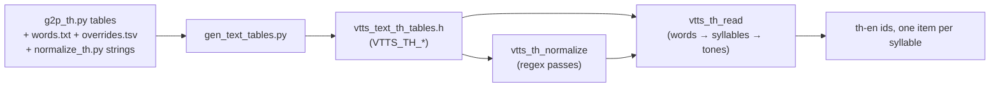

| Part | How it is ported | Size |
|---|---|---|
| Letters | Thai letters coded as code point − U+0E00 (one byte, 0x01–0x4E); one row per code: class, low sonorant, preposed, tone mark, above/below vowel, dependent sign, linking final, silent-ร initial, Python `\w`, plus the initial and final sound | 0.5 KB |
| Spelling patterns | `VOWELS` (preposed letter, letters after the initial, vowel, short, final kind), `CLUSTERS`, the costs and the token ids | 0.5 KB |
| Word list | `words.txt` plus the keys of `overrides.tsv` (16,493 words), sorted and front coded: a byte `0x80 + shared letters` starts each word, its other letters follow; blocks of 16 words start with a full word and are found by binary search (offsets as `uint32`) | 68,108 + 4,124 bytes |
| Respellings | `overrides.tsv` as (word, pieces) byte strings | 1.9 KB |
| Normalizer strings | digits, places, months, abbreviations, units, currencies, symbols, dropped characters | 1.5 KB |

The whole module is about 80 KB of tables (strings and pointer tables included) and 27–36 KB of code on a 64-bit host (`-Os` / `-O2`; less on the ESP32 targets). A word lookup walks the prefixes of the text: the smallest listed word that is ≥ the prefix is found by a binary search over the 1,031 block heads and a scan of one block, and the walk stops at the first prefix no word starts with.

- **Words, syllables, tones** follow `segment`, `parse_word`, `word_syllables` and `run_syllables` step by step: the same dynamic programs with the same tie-breaking (the first candidate with the lowest cost wins, candidates in the order Python generates them), the same silent-letter, linking and leading-consonant passes, the fallback for a dependent sign with nothing before it, ๆ and รัฐ + word. The DP keeps a back pointer and the index of the chosen candidate per position; the path is rebuilt by generating the candidates again.
- **Normalization** follows `normalize_th` pass by pass (Thai digits, full-width forms, pauses, dropped quotes and brackets, ฯ abbreviations, dotted abbreviations, ๆ, product codes, dates, times with น., money, percent, units, phone numbers, ranges, negative numbers, digit strings, numbers, symbols, Latin words to the English normalizer, glued number words, spaces between Thai runs as `,`). Where regex backtracking can change a match (the number alternation with its optional fraction, `\s?` before units and `%`, the phone patterns, digit strings that end before `[\d.,]\d`), the candidate ends are tried in the order the regex engine tries them. Numbers of any length are read like Python (groups of six digits joined by ล้าน).
- **Tagging and chunks:** a chunk is split between Thai and Latin letters, a word with a Thai letter is Thai, a plain Latin word is English, anything else is Thai. Each syllable of a Thai run is one item joined to the previous one without `SPACE`. A dot after a Thai letter does not end a sentence (in every mode, as `SENTENCE_END` in Python), and in th mode a sentence also ends after `。！？；` as for Chinese.
- **Memory:** no new workspace: the normalizer passes run in the English scratch buffers (`en_a`, `en_b`, 6,144 code points each) and the reader uses `en_a` for its tables (about 22 KB: letter codes, the DP over at most 1,024 letters, cut points and candidates) and `en_b` for the syllables of the current word.
- **Tests:** `runtime/test/text_parity_th.tsv` (12,997 cases: edge cases, both Thai eval sets, the strings of the Thai unit tests, 2,000 mixed template sentences, every respelled word, the whole word list in groups of eight words with and without spaces, 3,000 generated sentences, numbers, dates and times, regex-dense random strings) must match exactly, and a fuzz run in th mode (`text_test --fuzz-th`: Thai words and signs, ๆ ฯ ์, abbreviations, Thai digits, numbers, Latin words, punctuation, random bytes, runs without spaces longer than 1,024 letters) must stay inside its buffers and inside the th-en ids: `make -C runtime test` or `uv run pytest tests/export`. A test also checks that `vtts_text_th_tables.h` is current. After changing a Thai rule, word list or table, run `uv run python runtime/tools/gen_text_tables.py` and regenerate the fixture with `uv run python scripts/frontend/export_text_parity.py --th --sentences data/th/sentences.jsonl --limit 3000 --out runtime/test/text_parity_th.tsv`.
- **Known gaps (pathological input only):** a Thai run (a clause without spaces) longer than 1,024 letters is read in pieces of 1,024 letters, so a word can be cut there; as for Korean, only ASCII and Thai digits count as digits, `\w` outside Thai, ASCII and Vietnamese letters follows the C letter test, the control characters U+001C–U+001F and U+0085 are not whitespace, a sentence is cut at 4,096 code points or 2,048 items, and a run whose normalized form exceeds 6,144 code points is dropped.

## French (token set `fr-en`)

Python and C (`src/vtts/frontend/fr/`; device: [French on the device](#french-on-the-device-c)); everything is rules and small hand-written tables (no pronunciation dictionary: the permissive ones do not exist, Lexique and Wiktionary-derived lists are CC BY-SA). `text_to_ids(text, "fr")` returns ids of the token set `fr-en` (model header code 11): ids 0–106 are the v2 set unchanged, followed by 36 French tokens from id 107 (vocabulary 143). Standard (metropolitan) French; no stress tokens (French stress falls on the last syllable of a phrase).

| Group | Tokens |
|---|---|
| Oral vowels (11) | `FR:i e E a O o u y eu oe @` (`E` ɛ, `O` ɔ, `eu` ø of feu, `oe` œ of peur, `@` the schwa of petit; a/ɑ are one vowel) |
| Nasal vowels (4) | `FR:an on in un` (enfant, bon, vin, brun) |
| Glides (3) | `FR:j w H` (pied, oui, `H` = ɥ of huit) |
| Consonants (18) | `FR:p b t d k g f v s z sh zh m n gn ng l r` (`gn` ɲ of montagne, `ng` ŋ of loanwords) |

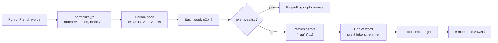

**End of the word** (`_respell_end`): plural -s/-x and final -z, -d, -t, -p are silent, -g after n or a consonant (sang, bourg, doigt), -c after n (blanc), -b after m (plomb); `lexicons/fr/final.txt` lists words that keep their final consonant (bus, net, sud, cap, gaz, huit), `c_silent.txt`, `l_silent.txt`, `f_silent.txt` the reverse (tabac, gentil, clef). -ct, -pt, -st, -c, -f, -l, -r are pronounced. **-ent** of a verb is silent (parlent → `p a r l`); it is `an` in -ment words (moment, seulement; the verbs of `ment_verbs.txt`, aiment, are silent), in -ents, in one-syllable words (dent, vent) and in the 123 nouns, adjectives and adverbs of `ent.txt` (client, souvent, président). -er is `e` (parler, premier) except one-syllable words and `er.txt` (mer, hiver, divers); -ez, -ed are `e`, -et is `E`, -em is `E m` (tandem).

**Letters** (`_scan`): ai ei è ê → `E`, é → `e`, au eau → `o`, ou → `u`, oi → `w a`, oin → `w in`, eu œu → `eu`/`oe`; a vowel before m/n not followed by a vowel or another m/n is nasal (an am en em → `an`; in im ain ein yn → `in`; on om → `on`; un um → `un`; ien yen éen → `j in`, but -ience → `an`; final -um → `O m`: album); i, u, ou before a pronounced vowel are glides `j H w` (pied, nuit, oui), after a consonant + l/r they stay vowels (crier → `k r i j e`, cruel); ill after a vowel and final -il after a vowel are `j` (travail, soleil, feuille, accueil), ill after a consonant is `i j` (fille) except ville, mille, tranquille and word-initial ill (illégal). c/g before e i y are `s`/`zh`, ge before a o is `zh` (mangeons), gu qu before e i are `g`/`k`, ch is `sh` (`k` before a consonant and in chor-, psych-, techn- ...), gn is `gn`, ph `f`, th `t`, h silent; s between vowels is `z`; t of -tion, -tiel, -tience is `s` (not after s/x: question; not -tié, -tier); x is `k s`, `g z` in ex- + vowel (exemple), `z` in deuxième, `s` in soixante.

**e:** é → `e`, è ê ë → `E`; a plain e before a doubled consonant, a cluster that cannot start a syllable, x, or a pronounced final consonant is `E` (belle, reste, mer); before one consonant (or obstruent + l/r) and a vowel it is a schwa (petit, secret); a final e is silent (except in one-syllable words: le, que); an e between a vowel and one consonant + vowel is silent (remerciement, dévouement). **e muet:** a schwa is dropped when exactly one consonant separates it from the vowel before it and a vowel follows (samedi → `s a m d i`, maintenant, boulangerie, acheter), kept in the first syllable of a word (petit, semaine) and after two consonants (appartement, vendredi). **Mid vowels by position:** o is `O` in a closed syllable and before another syllable (porte, école, moment), `o` at the end of a word and before z (mot, rose); eu/œu is `oe` in a closed syllable (peur, neuf, jeune) and `eu` elsewhere (feu, heureux, heureuse).

**Tables** (`lexicons/fr/`, all hand-written): `overrides.tsv` (78 entries) gives a respelling read by the rules (femme → fame, second → segon) or phonemes (monsieur → `m @ s j eu`, six → `s i s`, aujourd'hui), including the function words whose reading the rules cannot give (les, des, et, est); the word lists above; `native.txt` (words that are French although also in `lexicons/latin/english.txt`, such as on, comment, content, six, page, or whose spelling breaks the rules: ski, wagon, zoo, jury).

**Elision and liaison:** an apostrophe word is read as its prefix consonant(s) (l' d' j' m' t' s' c' n' qu', jusqu' lorsqu' puisqu') plus the rest. The normalizer applies liaison after splitting the run into words (`_sandhi`): a word that links gives its consonant to the next word when that word starts with a vowel or a silent h, written as a prefix before an apostrophe (les amis → `les z'amis`, read `l e _ z a m i`):

| Liaison | Words |
|---|---|
| z | les des ces mes tes ses nos vos leurs aux quels quelques plusieurs certains nous vous ils elles deux trois six dix vingts cents, plural adjectives before a noun (petits grands beaux nouveaux anciens autres ...), dans chez sans sous très plus moins tous |
| n | un aucun mon ton son en on bien |
| t | petit grand tout quand vingt cent est sont, inverted verbs (a-t-il, dit-elle, est-il) |
| p, r | trop beaucoup; premier dernier léger entier |

No liaison before an h aspiré (`H_ASPIRE`: haricot, héros, hasard, hors, haut ...), onze, oui, huit, yaourt, et, after a number before un/une/onze (cent un), nor for nous/vous after a preposition (avec nous au cinéma). bon, ancien, moyen, certain, plein, prochain are read like their feminine before a vowel (bon ami → `bonne ami`). allez-y, vas-y take z. Number finals: six and dix lose their s before a consonant (six mois) and link with z (six ans, dix-huit, dix-neuf), keep it at the end and before à, et, ou, sept; huit loses its t before a consonant; vingt keeps its t in 21–29 (vingt-deux) but not in quatre-vingt-deux; neuf links with v before ans and heures; tous at the end of a phrase is read with s; l'est and nord-est are the cardinal point.

**Normalization** (`fr/normalize_fr.py`):

| Text | Reading |
|---|---|
| 21, 71, 80, 81, 91, 200, 201 | vingt et un, soixante et onze, quatre-vingts, quatre-vingt-un, quatre-vingt-onze, deux cents, deux cent un |
| 1 250, 10 000, 80 000, 2 500 000 | mille deux cent cinquante, dix mille, quatre-vingt mille, deux millions cinq cent mille |
| 3,14 / 2.5 / -5 | trois virgule quatorze / deux point cinq / moins cinq |
| 1 heure, 21 pages | une heure, vingt et une pages (une before the feminine nouns of `FEMININE`) |
| 14/07/1789, 2026-11-19, 1er janvier | quatorze juillet mille sept cent quatre-vingt-neuf, dix-neuf novembre …, premier janvier |
| 14 h 30, 14h30, 21:15, 8 h, 1 h | quatorze heures trente, vingt et une heures quinze, huit heures, une heure |
| 12,50 €, 0,50 €, 1 000 000 €, 1,5 million €, $5, 20 £ | douze euros cinquante, cinquante centimes, un million d'euros, un virgule cinq million d'euros, cinq dollars, vingt livres |
| 15,5 %, 25 °C, 5 km, 120 km/h, 8 Go, 1 min | quinze virgule cinq pour cent, vingt-cinq degrés, cinq kilomètres, cent vingt kilomètres heure, huit gigaoctets, une minute |
| 1er, 1re, 2e, 2nd, XIXe, Louis XIV, François Ier | premier, première, deuxième, second, dix-neuvième, Louis quatorze, François premier |
| 06 12 34 56 78, +33 6 12 34 56 78 | in pairs: zéro six, douze, trente-quatre … (plus trente-trois for +33) |
| 10-20 | dix à vingt |
| ESP32-P4, SNCF, ONU | eu èss pé trois deux pé quatre, èss èn cé èf, onu |
| M., Mme, Dr, etc., J.-C., n°, qqn, svp | monsieur, madame, docteur, et cetera, Jésus-Christ, numéro, quelqu'un, s'il vous plaît |

Quotes, « » and brackets are dropped; … and dashes between spaces are a pause; the typographic apostrophe is folded to '. Training rows with letters of other scripts are left out (`unreadable_fr`).

**Tagging:** as the other Latin-script pairs, with the French letters à â æ ç é è ê ë î ï ô œ ù û ü ÿ; an elided clitic takes the language of its word and is split from an English word (l'iPhone → `l'` / `iPhone`); in a hyphenated word one-letter parts are ignored (a-t-il); a Roman ordinal (XIXe) is neutral.

**Agreement with eSpeak NG** (`scripts/frontend/eval_fr_g2p.py`; eSpeak NG is GPL and only used as a measuring stick at evaluation time, nothing is derived from it): on 2,000 held-out French Wikipedia sentences (rows split by parity: "dev" was used to find table entries, "test" was not), test half (641 sentences): phoneme error rate 3.06% over whole sentences (liaison, elision and e muet included; 1.51% with the mid vowels merged), 24.0% of the sentences identical; the words of these sentences read one by one agree 92.9% (98.0% with the mid vowels merged, token-weighted). Dev half: 3.07% / 1.47%, 92.6% / 98.1%. The other sentences of each half have a word tagged English (mostly foreign names) or an eSpeak language switch and are left out. The mid vowels (e/E, o/O, eu/oe) differ most: eSpeak reads école, moment with `o`/`O` differently from the rules, and the yod after a consonant + l/r (crier `k r i j e`) is not in eSpeak.

Known gaps: -ent words (verb or noun) that are missing from `ent.txt` are read as verbs, and homographs (les poules couvent / le couvent, ils président / le président) take the table's reading; open/closed mid vowels follow the position rules (some words differ by speaker); optional liaisons (ils ont‿été, pas‿encore) are not made, and a liaison after `nous`/`vous` as an object pronoun is not avoided; foreign names follow French rules unless they look English; a word whose -s or -t is pronounced only in some contexts (plus, tous, fait) takes the default reading; `M.` followed by a space ends a sentence (shared sentence splitter).

### French on the device (C)

`runtime/src/vtts_text_fr.c` (mode `VTTS_LANG_FR`, token set `fr-en`, code 11) follows the Python module step by step; `runtime/tools/gen_text_tables.py` writes every table into `vtts_text_fr_tables.h` (token names, normalizer strings in the order of the regex alternations, liaison lists, `lexicons/fr/` tables, the spelling-check clusters, `fold()` of every code point as runs, the `re.IGNORECASE` variants of the letters of the case-insensitive patterns). No blob.

- **Compile-time switch:** `VTTS_ENABLE_FR` (`runtime/include/vtts_langs.h`, default 1, so host builds and `make test` cover it). With 0 the module is an empty unit and the mode `fr` is not offered (`vtts_text_default_lang` fails for fr-en models). The firmware sets it from the token sets of the models it embeds (`firmware/esp32/main/vtts_langs.cmake`), so images without an fr-en model do not grow. Code and tables: about 70 KB at -O2 (55 KB at -Os) on the ESP32-P4.
- **Normalization** follows `normalize_fr` pass by pass (apostrophes and no-break spaces, superscript ordinal letters, abbreviations, dropped characters, Roman ordinals and Roman numerals after a name, ISO and d/m/y dates, French and international phone numbers, times, numbers grouped with spaces, money before and after the amount with scales, percent, units, ordinals, ranges, pauses, product codes, numbers with the gender of the next word, symbols, inverted verbs, hyphens, acronyms, lower case, words), then the liaison pass. Where backtracking can change a match (NUM with its optional fraction, `\s?` before units, `%`, currencies and scales, the time pattern), the candidate ends are tried in the order the regex engine tries them. The liaison pass streams over the words: the current word is written to the output and changed there, a liaison consonant for the next word is kept as a pending prefix, so it needs no word array.
- **Tagging:** `_fr_tags`: an elided clitic glued to an English word becomes its own chunk (`l'` / `iPhone`), hyphenated words by their parts, Roman ordinals neutral; plain words by the fr word lists, CamelCase, acronyms and `valid_spelling`. The shared English word list is read from the Latin-script module (`vtts_lt_english_word`).
- **G2P:** fold, the table, prefixes before an apostrophe (a loop, no recursion), `_respell_end`, `_scan`, `_resolve`; scratch in `en_a` (the word, the rules' copy, a head + e, the segments).
- **Memory:** no new workspace: the normalizer runs in `en_a` / `en_b` like the other Latin-script pairs.
- **Tests:** `runtime/test/text_parity_fr.tsv` (12,790 cases: edge cases, both eval sets, the strings of the French unit tests, 2,000 mixed template sentences, 3,000 Wikipedia sentences, every table and list word, random French words, number/date/time/money/unit cases, regex-dense random strings) must match exactly; a larger run (112,760 cases with all Wikipedia and mixed sentences and 80,000 regex-dense strings) and 120,000 character-level random strings also matched exactly. `text_test --fuzz-fr` (French words, liaison triggers, elision, numbers, money, times, Roman numerals, abbreviations, English words, other scripts, random bytes, long words) must stay inside its buffers and the fr-en ids under ASan/UBSan: `make -C runtime fr_test` or `uv run pytest tests/export`. A test checks that `vtts_text_fr_tables.h` is current. After changing a French rule or table, run `uv run python runtime/tools/gen_text_tables.py` and `uv run python scripts/frontend/export_text_parity.py --fr --sentences data/fr/sentences.jsonl --limit 3000 --out runtime/test/text_parity_fr.tsv`.
- **Known gaps (pathological input only):** a word longer than 512 letters is cut there; a sentence with more than 1,024 chunks keeps an elided English word in one chunk; as for the other pairs, a sentence is cut at 4,096 code points or 2,048 items and a run whose normalized form exceeds 6,144 code points is dropped.
## German (token set `de-en`)

Python and C (`src/vtts/frontend/de/`; device: the Device (C) subsection below). `text_to_ids(text, "de")` returns ids of the token set `de-en` (model header code 12): ids 0–106 are the v2 set unchanged, followed by 60 German tokens from id 107 (vocabulary 167). Names follow German SAMPA:

| Group | Tokens |
|---|---|
| Vowels (18) | short `DE:a E I O U Y 9`, long `DE:a: e: E: i: o: u: y: 2:`, diphthongs `DE:aI aU OY` |
| Stressed vowels (18) | the same with `1`: `DE:a1 … a:1 … OY1` (one primary stress per content word) |
| Reduced (2) | `DE:@` (schwa), `DE:6` (vocalized r: der, Uhr, Lehrer) |
| Consonants (22) | `DE:p b t d k g f v s z S Z C x h j m n N l R ?` (`C` ich-Laut, `x` ach-Laut, `S` sch, `N` ng, `R` consonantal r, `?` glottal stop) |

Stress is marked because it is lexical in German (Musik, Telefon, Universität); vowel length is marked because it is phonemic (Staat / Stadt). Affricates are two tokens (`t s`, `p f`, `t S`). An unstressed tense vowel (the o of Politik) uses the long token; secondary stress in compounds is not marked. Standard German (Germany), following the Duden pronunciation where it and eSpeak NG differ (werden `v e:1 6 d @ n`, vor `f o: 6`).

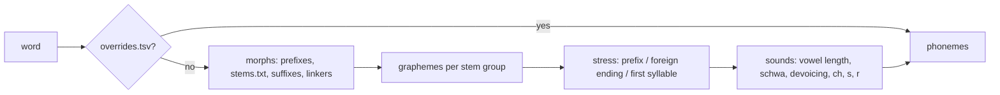

**Morphs** (`de/g2p_de.py`, `segment`): a number word (zweitausendsechsundzwanzig) is cut into number morphs. Any other word gets the lowest-cost split into unstressed prefixes (be- ge- ver- zer- ent- emp- er-), stressed prefixes (ab- an- auf- aus- bei- ein- mit- nach- vor- zu- un- ur- über- unter- durch- um- her- hin- … zurück- zusammen-), stems of `lexicons/de/stems.txt` (about 1,300 hand-written stems; `:` marks a long vowel, `.` a short one and `'` the stress where the rules would be wrong: `bu:ch`, `mo:nd`, `berl'i:n`), suffixes (-ung -heit -keit -schaft -lich -bar -sam -los -chen -lein -nis -ig -isch -in, endings -e -en -er -es -t -st -te …) and linking elements (-s- -es- -n- -en- -e- -er-); text the list does not cover is an unknown stem read by the rules. The split with the fewest unknown pieces, then the most letters in known pieces, then the fewest pieces, then the fewest endings and linkers wins. Restrictions keep it honest: a prefix before an unknown stem needs a full vowel and a German onset in the rest (Gemeinde = ge + meinde, but not gestern, Gegend, Geld) and is not taken before a foreign stressed ending (Generation); an unknown stem inside a word starts with a consonant, has at least five letters before another stem and is not followed by a linker; endings -t -st -te only follow a known stem (sag+t, but not Kunst = kun+st); no cut inside sch, ch, ck, ng, a vowel digraph or a doubled letter (except Volks|schule, er|reichen).

**Letters:** vowels are long before h (Bahn), ß (Fuß), a single consonant and a vowel (Na-me), an obstruent + l/r and a vowel (Ad-ler, Pro-gramm), at the end of a stressed stem closed by one consonant (Tag, sag+t, Glas) and in aa ee oo ie; short before two consonants, doubled letters, ck, tz, sch, ch, x, ng. Pre-tonic unstressed a is short (Familie); an unstressed i before g, k is short (-ig, -iker). An unstressed e after the stress, in an ending or in be-/ge- is `@` (`6` with a final r: Lehrer); before other clusters it stays `E` (Wilhelm). b d g s v are devoiced at the end of a morph and before a voiceless consonant (Tag, Haus, Obst, Erlebnis); -ig → `I C` (König, beschäftigt), -ig + -lich → `I k` (königlich). ch after a o u au → `x`, else `C`; initial ch → `C` before front vowels (Chemie), `S` in French words (Chef), else `k` (Chor); chs → `k s` (sechs); sp/st at the start of a stem → `S p`/`S t` (verstehen, Bahnhof|straße); s before a vowel → `z`; v → `f` in native words (Vater, viel, vor), else `v` (Video, Klavier); z, tz → `t s`; qu → `k v`; r after a vowel at the end of a syllable → `6`; -tion → `t s j o: n`; an unstressed i before the last vowel → `j` (Radio, Gymnasium, Familie); eu before r → `2:` (Ingenieur). A glottal stop `?` is put before a vowel at the start of a word, prefix or stem (beachten → `b @ ? a1 x t @ n`). A consonant doubled across a morph boundary is read once.

**Stress:** a stressed prefix (an-, auf-, un- …) or else the first stem carries the primary stress; über- unter- hinter- wider- are unstressed before a verb ending or -ung (übersetzen, Unterstützung, but Unterricht, Überblick). Inside a stem: a `'` of the stem list; else a stressed foreign ending (-ion -ität -ieren -ie -ur -ent -ant -enz -anz -inz -al -ell -ett -iv -ös -eur -är -at -on -ar -il -ol -ee -ei -ismus -ist -ekt -akt -ikt -ukt -ept -ess -amm, a long vowel + consonant + e in a word of three or more syllables: Tomate, Maschine); the syllable before -ik -iker -ika -ikum -ium -ius -ien -isch -tor (Technik, Musiker, Gymnasium, politisch, Direktor; Musik, Politik, Republik are stressed on -ik); else the first syllable. Compounds of nord/süd with ost/west stress the second part (Nordosten). Unstressed -ie/-ien: Familie, Linie, Serie, Studie, Ferien, Italien, Spanien (`j @`).

**Tables** (`lexicons/de/`, all hand-written, Apache-2.0): `stems.txt` (stems for the split), `overrides.tsv` (about 240 words with their phonemes: articles, pronouns, prepositions, conjunctions and auxiliaries without stress; adverbs stressed on the second part such as zurück, vielleicht, dabei, darauf; frequent words the rules miss such as Abend, gestern, Hotel, Jahrhundert, Österreich), `native.txt` (German words also in the English list or that look English: in, was, Name, Chef) and `english.txt` (English words German text borrows whose spelling fits German: Update, Laptop, Meeting).

**Language of a word** (`latin.latin_word_lang` with `de`): ä ö ü ß make a word German; then the Latin-script rules, with `valid_spelling` rejecting English letter groups (initial or final sh, wh, tch, final th, gh, ght, igh, ou, oy, final -y, -ay, -ey, -ing (not -ling), initial sl sm sn sw tw wr, c outside ch/ck/sch, q without u). On the 20,734 Wikipedia sentences of the corpus 2.5% of the words are tagged English, nearly all English and Romance names and titles.

**Sentences:** in mode `de` the text is split by `split_sentences_de`: a dot after an ordinal number followed by a lower-case word, a month or after an article/preposition (am 3. Mai, die 2. Klasse), after an abbreviation (z. B., Dr., Nr., usw. before a lower-case word) or after a single letter (J. S. Bach) does not end the sentence.

**Normalization** (`de/normalize_de.py`):

| Text | Reading |
|---|---|
| 1 (alone), 1 Stunde, 1 Tag, 21, 100, 101, 1.250, 2026 | eins, eine Stunde, ein Tag, einundzwanzig, hundert, hunderteins, tausendzweihundertfünfzig, zweitausendsechsundzwanzig |
| 1999 (any four-digit 1100–1999), 2.500.000, 3,14, -5 | neunzehnhundertneunundneunzig, zwei Millionen fünfhunderttausend, drei Komma eins vier, minus fünf |
| 3. Mai, am 3. Mai, die 2. Klasse, im 5. Stock | dritter Mai, am dritten Mai, die zweite Klasse, im fünften Stock |
| 03.05.2026, 2026-05-03 | dritter Mai zweitausendsechsundzwanzig (dritten after am, im, vom …) |
| 14:30 Uhr, 9.05 Uhr, 7 Uhr, 14:30 | vierzehn Uhr dreißig, neun Uhr fünf, sieben Uhr |
| 5,50 €, 0,99 €, 1 €, € 5, 20 EUR, $ 3, 10 CHF | fünf Euro fünfzig, neunundneunzig Cent, ein Euro, fünf Euro, zwanzig Euro, drei Dollar, zehn Franken |
| 75 %, 3,5 %, 2 ‰ | fünfundsiebzig Prozent, drei Komma fünf Prozent, zwei Promille |
| 25 °C, 100 km/h, 5 km, 1 min, 3 h, 8 GB, 10.000 mAh | fünfundzwanzig Grad, hundert Kilometer pro Stunde, fünf Kilometer, eine Minute, drei Stunden, acht Gigabyte, zehntausend Milliamperestunden |
| 030 1234567, +49 30 1234567 | digit by digit (plus for +) |
| 10-20 | zehn bis zwanzig |
| z. B., d. h., u. a., usw., bzw., ca., Dr., Prof., Nr., Str., Mio., Mrd., v. Chr. | zum Beispiel, das heißt, unter anderem, und so weiter, beziehungsweise, circa, Doktor, Professor, Nummer, Straße, Millionen, Milliarden, vor Christus |
| ESP32, USB, NATO, WLAN, Lkw, E-Mail | e ess pe drei zwei, u ess be, nato, we lahn, el ka we, (i:me:l) |
| & + = @ § | und, plus, gleich, ät, Paragraf |

**Agreement with eSpeak NG** (`scripts/frontend/eval_de_g2p.py`; eSpeak NG is GPL and used only as a measuring stick, nothing derived from it is shipped): on 882 held-out German Wikipedia sentences (another shuffle seed, sentences of the training corpus removed), 5,732 German words of the test half: 83.7% of the words agree in sounds and (for words of two or more syllables) in stress, 86.2% in sounds without glottal stops, phoneme error rate 3.6%, stress agreement 89.4% on polysyllables with the same sounds. On all 240,788 word tokens of the 20,734-sentence corpus (used to find stems and exceptions) 88.9% agree. Part of the remaining difference is eSpeak itself (werden, vor, gehört, Hauptstadt with `s t`, Weg/weg).

Known gaps: compounds of words missing from `stems.txt` are read as one stem (vowel length and stress of the second part can be wrong: Katastralgemeinden); the length of a stressed vowel before a single final consonant follows the default (long) unless listed (weg is read as the adverb); names and loanwords (Saison, Jeans, George) follow the German rules unless listed; secondary stress and the Swiss and Austrian standard are not modeled; capitalization is not used (Weg / weg, Morgen / morgen).

### Device (C)

`vtts_text_to_ids_ex` with mode `VTTS_LANG_DE` gives exactly `text_to_ids(text, "de")` (module `runtime/src/vtts_text_de.c`, entry `de` in `LANGS`). There is no blob: `runtime/tools/gen_text_tables.py` writes every German table into `vtts_text_de_tables.h` (token names, prefixes and suffixes, the 1,300 stems and the exception table sorted for binary search, the stress, spelling and tagging lists, `fold()` of every code point as runs, the normalizer strings); g2p letters are single bytes (ä ö ü ß as A O U Z). Only English words need the VLEX lexicon. The module is compiled only with `VTTS_ENABLE_DE` (`runtime/include/vtts_langs.h`, 1 by default on the host): the firmware enables it only for a de-en model (`main/vtts_langs.cmake` reads the token sets of the two models). On the ESP32 targets (RISC-V, `-O2`) it is about 91 KB: 41 KB code and 50 KB tables.

- **Sentences** follow `split_sentences_de` (marks followed by a space, the CJK ends, the ordinal, abbreviation and initial rules).
- **Normalization** follows `normalize_de` pass by pass; where regex backtracking can change a match (the number alternation, `\s?` before units, currencies and `%`, the optional seconds and `Uhr` of times, the phone groups, the optional year of dotted dates) the candidate ends are tried in the regex's order. Numbers of any length are read like Python (more than 15 digits digit by digit).
- **Words** follow `word_tokens_de`: the exception table, number words, the stem list, then the same dynamic program as `segment` (states and candidates in Python's order, the first candidate with the lowest cost wins), the prefix split, the inseparable prefixes, groups, graphemes, stress and sounds.
- **Memory:** no new workspace: the normalizer runs in `en_a` / `en_b`, a word is read with `en_a` as scratch (the split table and graphemes, about 20 KB).
- **Tests:** `runtime/test/text_parity_de.tsv` (12,526 cases: edge cases, both German eval sets, the strings of the German unit tests, 2,000 template sentences, 3,000 corpus sentences, every stem and exception word with endings, 8,000 pseudo words over the spelling rules, numbers, dates, times and money, regex-dense random strings) must match exactly, and the fuzz run `text_test --fuzz-de` must stay inside its buffers and the de-en ids: `make -C runtime test` or `uv run pytest tests/export`. A larger run (all corpus, mixed and held-out sentences and 40,000 random strings, 72,661 cases) matched exactly. After changing a German rule or table run `uv run python runtime/tools/gen_text_tables.py` and regenerate the fixture with `uv run python scripts/frontend/export_text_parity.py --de --sentences data/de/sentences.jsonl --limit 3000 --out runtime/test/text_parity_de.tsv`.
- **Known gaps:** a word longer than 64 letters (`VTTS_DE_MAXW`) is cut (the fixture leaves such words out); as for the other Latin-script pairs, `\w` and `str.lower()` follow the generated Unicode tables, a sentence is cut at 4,096 code points or 2,048 items, and a run whose normalized form exceeds 6,144 code points is dropped.
## Russian (token set `ru-en`)

Python (`src/vtts/frontend/ru/`) and C (`runtime/src/vtts_text_ru.c`, see [Russian on the device (C)](#russian-on-the-device-c)). `text_to_ids(text, "ru")` returns ids of the token set `ru-en` (model header code 16): ids 0–106 are the v2 set unchanged, followed by 47 Russian tokens from id 107 (vocabulary 154):

| Group | Tokens |
|---|---|
| Unstressed vowels (5) | `RU:a i u y @` after vowel reduction (`y` = ы, `@` = the schwa) |
| Stressed vowels (6) | `RU:a1 e1 i1 o1 u1 y1` |
| Paired consonants (30) | `RU:p b t d k g f v s z m n l r x`, each also soft: `p' b' ... x'` |
| Unpaired consonants (6) | `RU:sh zh ts` (always hard), `ch shch j` (always soft) |

Cyrillic words are tagged `ru` in mode `ru` only (other Cyrillic letters such as і ї є ґ are read with the nearest Russian letter); plain Latin words are English, except the units and currency codes of the Russian normalizer (km, GB, USD). A full stop followed by a lower-case Cyrillic letter does not end a sentence (т. е., и т. п.).

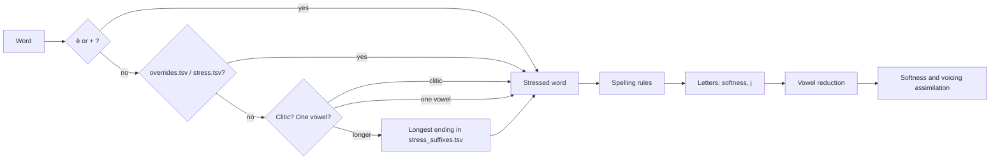

**Stress** is the hard part of Russian: it is lexical, moves within paradigms and is not written. `lexicons/ru/` holds three tables:

- `stress_suffixes.tsv` (47,809 endings): the stressed vowel counted from the end of the word for word endings of 1-7 letters, built from the 1.68 million stressed word forms of Koziev/NLP_Datasets `Stress/all_accents.tsv` (CC0-1.0) by `scripts/frontend/build_ru_stress.py` (a pruned suffix tree: an ending is kept when its most common stress differs from that of the next shorter ending). The longest matching ending decides.
- `stress.tsv` (15,859 words): the word forms that the endings get wrong and that occur at least 3 times in a Russian Wikipedia sample (word counts only, no text), and 4,509 words whose ё Wikipedia writes in more than half of its occurrences (актёр, берёт, ещё, её: ё is always stressed). Both are written with `+` before the stressed vowel (`ещ+ё`).
- `overrides.tsv` (112 entries, hand-written): source errors in frequent words (п+осле, тог+о, нег+о, должн+ы, основн+ой) and the more common reading of frequent homographs (г+орода, д+ома, м+еста, дел+а); a test checks that each entry differs from `stress.tsv`.

A word written with ё is stressed on the ё; one-syllable prepositions, conjunctions and particles (в на по не ни же ли бы то ...) have no stress; a one-vowel word is stressed.

**Spelling rules** (`ru/g2p_ru.py`): unpronounced consonants (чувство, честный, поздно, солнце, сердце), сч зч жч → щ, тч дч → ч, -тся -ться → ц, -тск- -дск- → цк, тц дц → ц, сш зш → ш, сж зж → ж, гк гч → хк хч (легко), г → в in -ого -его (его, нового; not много, дорого), сегодня, что → што, чн → шн in конечно, скучно and a few more; doubled consonants are read once.

**Letters:** a consonant is soft before ь е ё и ю я; ж ш ц stay hard (и → ы, жена) and ч щ й are soft; е ё ю я are `j` + vowel at the start of a word, after a vowel and after ь ъ (семья, объём); э keeps the consonant hard.

**Vowel reduction:** unstressed а/о after a hard consonant are `a` in the syllable right before the stress and at the start of a word, `@` elsewhere (молоко → `m @ l a k o1`); unstressed е я а after a soft consonant are `i` (язык → `j i z y1 k`), a final unstressed я/а after a soft consonant is `@` (время); unstressed е after ж ш ц is `y` (жена → `zh y n a1`). A clitic is read as if its last syllable came right before a stress (на → `n a`, не → `n' i`).

**Assimilation:** с з before т' д' н' and н before т' д' are soft when a vowel follows (кости → `k o1 s' t' i`, not есть); in a run of obstruents the last sets the voicing of the others (сделать → `z' d' ...`, вокзал → `g z`, сказка → `s k`), в takes the voicing of what follows but does not voice what comes before it (свет); obstruents at the end of a word are devoiced (дуб → `d u1 p`). The one-letter prepositions в к с are joined to the next word by the normalizer (`в-доме` → `v d o1 m' i`, `к-другу` → `g d r u1 g u`), so the voicing rules see them together.

**Normalization** (`ru/normalize_ru.py`):

| Text | Reading |
|---|---|
| 21 книга, 2 книги, 1 окно, 2026 | двадцать одна книга, две книги, одно окно, две тысячи двадцать шесть |
| до 32 °C, от 10 до 20, 10-20 | до тридцати двух градусов цельсия, от десяти до двадцати (genitive after до от около более с ...) |
| 3,5, 2,5 кг, 3,14159 | три целых пять десятых, две целых пять десятых килограмма, три запятая один четыре один пять девять |
| 15.03.2026, 5 мая, с 1 мая | пятнадцатое марта две тысячи двадцать шестого года, пятое мая, с первого мая |
| в 2026 году, 2020 г., в 1990-х годах | в две тысячи двадцать шестом году, две тысячи двадцатого года, в тысяча девятьсот девяностых годах |
| 1-й, 3-го, на 3-м этаже, 90-е годы, 2-х | первый, третьего, на третьем этаже, девяностые годы, двух |
| XX век, в XX веке, Пётр I, Екатерина II | двадцатый век, в двадцатом веке, пётр первый, екатерина вторая |
| 14:30, 9:05 | четырнадцать тридцать, девять ноль пять |
| 1 500 руб., 10,50 ₽, $5, 20 € | тысяча пятьсот рублей, десять рублей пятьдесят копеек, пять долларов, двадцать евро |
| 3 млн рублей, 5 тыс. человек, 75% | три миллиона рублей, пять тысяч человек, семьдесят пять процентов |
| 5 км, 60 км/ч, 128 ГБ, 5 GB | пять километров, шестьдесят километров в час, сто двадцать восемь гигабайт, пять гигабайт |
| 5-этажный, 100-летие | пятиэтажный, столетие |
| +7 (495) 123-45-67 | digit by digit (плюс for +) |
| ESP32, СССР, НАТО | и эс пи три два (Latin letters by Russian names), эс эс эс эр, нато (a few acronyms read as words) |
| т. е., и т. д., т. к., ул., г. | то есть, и так далее, так как, улица, город |

Agreement is cheap: the gender of the noun after 1 and 2 is guessed from its ending (а/я feminine, о/е neuter; ы/и after 2 feminine), units and currencies have their own gender and noun forms (1 рубль, 2 рубля, 5 рублей). Other cases (instrumental, prepositional of cardinals) are read nominative.

**Agreement with eSpeak NG** (a measuring stick only, `scripts/frontend/eval_ru_g2p.py`, 2,000 held-out Wikipedia sentences, 19,473 running words without clitics): stress 92.9% of words with two or more vowels (90% of them stressed by the endings table, 92.8% agreement there; 5% by `stress.tsv`; 2.6% by a written ё), 76.4% of words read the same on a coarse alphabet, 4.5% phoneme error rate. Many differences are eSpeak's: it stresses году тому берегу борьбе on the stem, keeps geminates (группа), reads сельский with a hard л; others are real homographs (города, стороны).

Known gaps: homographs are read one way (замок, мука, дома, стороны, все/всё when ё is not written); stress of unknown compounds and names follows the endings table; secondary stress is not marked; long ж' (дрожжи), geminates and [ɨ] after ц in some endings are simplified; cardinals are not declined except the genitive after a few prepositions; times are read as plain numbers.

### Russian on the device (C)

`vtts_text_to_ids_ex` with mode `VTTS_LANG_RU` gives exactly `text_to_ids(text, "ru")` (module `runtime/src/vtts_text_ru.c`, entry `ru` in `LANGS`, compiled when `VTTS_ENABLE_RU` is non-zero; host builds and `make test` default to 1, the firmware enables it only for ru-en models):

- **Stress tables:** the RLEX blob (`include/vtts_rlex.h`, built by `scripts/frontend/build_ru_blob.py` from `overrides.tsv`, `stress.tsv` and `stress_suffixes.tsv`; 358 KB: front-coded keys of one byte per letter in blocks of 16, binary search over the blocks) is passed as `vtts_text_opts.ru` and read in place from flash. Without it every word takes the default ending rule.
- **Patterns:** the normalizer's regular expressions and the spelling rules are not rewritten by hand: `runtime/tools/gen_slavic_tables.py` parses each Python pattern with Python's own parser (`re._parser`) and writes its parse tree into `src/vtts_text_ru_tables.h`; `src/vtts_re.c` (about 3 KB) matches these trees the way Python does (alternatives in order, greedy repeats, lookarounds, back references, Python's Unicode `\d \w \s`). The replacement functions follow the Python ones line by line; the other tables (numbers, ordinal endings, units, currencies, abbreviations, letter names, the per-character fold table) are generated from the Python modules too.
- **Limits:** a word is read up to 64 letters (Python reads any length; the normalizer's compounds are limited to 4-digit numbers so no generated word comes near it); numbers keep 18 significant digits (larger ones are read digit by digit, as in Python from 10^15). A word needs about 7 KB of stack, the matcher about 256 bytes per nested group. The workspace is unchanged (the passes run in `en_a` / `en_b`).
- **Parity:** `runtime/test/text_parity_ru.tsv` (13,960 cases: edge cases, both eval sets, template x term sentences, Wikipedia sentences with and without digits, generated sentences, every override and stress word and every ending of the stress tables, numbers, dates, times, money and units, regex-dense random strings; `scripts/frontend/export_parity_ru_pl.py --lang ru`) matches exactly, as do 60,000 further random cases and 39,758 corpus sentences (not committed); `text_test --fuzz-ru` (3,000 texts up to 15,000 bytes, with and without the blob, ASan and UBSan) keeps every id inside the ru-en set.
- **Flash** (ESP32-P4, `-O2`): about 72 KB of code and tables for Russian plus 3 KB for the matcher, and the 358 KB blob.

## Polish (token set `pl-en`)

Python (`src/vtts/frontend/pl/`) and C (`runtime/src/vtts_text_pl.c`, see [Polish on the device (C)](#polish-on-the-device-c)). `text_to_ids(text, "pl")` returns ids of the token set `pl-en` (model header code 17): ids 0–106 are the v2 set unchanged, followed by 44 Polish tokens from id 107 (vocabulary 151):

| Group | Tokens |
|---|---|
| Vowels (8) | `PL:a e i o u y` (`y` = the y of "my", ó = u) and the nasal vowels `on` (ą) `en` (ę) |
| Stressed vowels (8) | `PL:a1 e1 i1 o1 u1 y1 on1 en1` |
| Consonants (28) | `PL:p b t d k g f v s z m n l r j`, `sh zh ch dzh` (sz ż/rz cz dż), `s' z' c' dz' n'` (ś ź ć dź ń), `x` (ch h), `w` (ł), `ts dz` (c dz) |

Polish is a Latin-script pair (see [Latin-script pairs: language of a word](#latin-script-pairs-language-of-a-word)): a word with ą ć ę ł ń ó ś ź ż is Polish; `lexicons/pl/native.txt` keeps Polish words that are also English entries (do, to, ten, on, my, we) and the abbreviations read with a number (mln, tys); the spelling check rejects q v x, the English letter groups th ph sh gh wh ee oo ou ay ey oy, doubled letters other than nn zz jj ii and the endings -ing -ly -gy (Polish onsets and codas are too free to test clusters, so `update`, `router`, `online` rely on the English list).

**Letters** (`pl/g2p_pl.py`): ch h → `x`, cz → `ch`, sz → `sh`, rz ż → `zh`, dż → `dzh`, dz → `dz`, dź → `dz'`, szcz → `sh ch`, ł → `w`, w → `v`, ó → `u`; x → `k s`, q → `k`. An i after c s z n dz marks softness (ci si zi ni dzi = ć ś ź ń dź) and is silent before a vowel (`ciasto` → `c' a1 s t o`, `nie` → `n' e`, `linii` → `l i1 n' i`); after another consonant before a vowel it is `j` (`miasto` → `m j a1 s t o`, `kiedy` → `k j e1 d y`, `historii` → `... r j i`). au eu are `a w` / `e w` (`autor` → `a1 w t o r`, `Europa`) except after na- za- prze- przy- do- po- (`nauka`), in a final -um (`muzeum`) and before sz (`Tadeusz`).

**Nasal vowels:** before p b → vowel + `m` (`dąb` → `d o1 m p`), before t d c dz cz dż k g → + `n` (`ręka` → `r e1 n k a`, `kąt`), before ć dź → + `n'` (`będzie` → `b e1 n' dz' e`), before l ł → oral (`wziął`, `zaczęli`); a final ę is `e` (`idę`); elsewhere `on` / `en` (`są`, `mąż`, `szczęście`).

**Voicing:** in a run of obstruents the last sets the voicing of the others (`wódka` → `t k`, `prośba` → `z' b`, `także` → `g zh`); w and rz (not ż) after a voiceless consonant are devoiced (`twój` → `t f`, `przy` → `p sh`, `krzesło` → `k sh`); obstruents at the end of a word are devoiced (`chleb` → `p`, `róg` → `k`). The prepositions w z are joined to the next word by the normalizer (`w-domu` → `v d o1 m u`, `w-Polsce` → `f p ...`, `z-tobą` → `s t ...`).

**Stress** on the second-to-last syllable; the third-to-last in the Greek and Latin -yka/-ika nouns listed in `lexicons/pl/antepenult.txt` (40 stems: `muzyka`, `muzyce`, `matematyka`, `Ameryka`; not `języka`, `silnika`, which are masculine nouns + a) and in the past forms -liśmy -łyśmy -liście -łyście (`byliśmy`); the fourth-to-last in -byśmy -byście (`zrobilibyśmy`). One-syllable prepositions, conjunctions and particles (w z na do o i a że się nie by ...) are unstressed. `lexicons/pl/overrides.tsv` respells the rest (uniwersytet, rzeczpospolita).

**Normalization** (`pl/normalize_pl.py`):

| Text | Reading |
|---|---|
| 21 lat, 1 książka, 1 okno, 2026 | dwadzieścia jeden lat, jedna książka, jedno okno, dwa tysiące dwadzieścia sześć |
| do 30 °C, 10-20 osób | do trzydziestu stopni celsjusza, od dziesięciu do dwudziestu osób (genitive after od do około ponad z ...) |
| 1,2 kg, 2,25, 3,14159 | jeden i dwie dziesiąte kilograma, dwa i dwadzieścia pięć setnych, trzy przecinek jeden cztery jeden pięć dziewięć |
| 15.12.2026, 5 maja | piętnasty grudnia dwa tysiące dwudziestego szóstego roku, piąty maja |
| w 2026 roku, 1990 r., w XIX wieku, XXI wiek | w dwa tysiące dwudziestym szóstym roku, tysiąc dziewięćset dziewięćdziesiątego roku, w dziewiętnastym wieku, dwudziesty pierwszy wiek |
| 15:45, o 14:30, do 7:00 | piętnasta czterdzieści pięć, o czternastej trzydzieści, do siódmej |
| 1250 zł, 23,99 zł, $5, 20 € | tysiąc dwieście pięćdziesiąt złotych, dwadzieścia trzy złote dziewięćdziesiąt dziewięć groszy, pięć dolarów, dwadzieścia euro |
| 3 mln zł, 5 tys. osób, 75% | trzy miliony złotych, pięć tysięcy osób, siedemdziesiąt pięć procent |
| 5 km, 128 GB, 100 Mb/s | pięć kilometrów, sto dwadzieścia osiem gigabajtów, sto megabitów na sekundę |
| +48 123 456 789, 600 123 456 | digit by digit (plus for +) |
| ESP32, USB, PKP, NATO | e es pe trzy dwa, u es be, pe ka pe, nato (a few acronyms read as words) |
| np., tj., itd., itp., ul., dr | na przykład, to jest, i tak dalej, i tym podobne, ulica, doktor |

Agreement is cheap: 1 takes the gender of the noun after it (jedna książka, jedno okno: a following word ending in a / o e ę um); dwa / dwie is not guessed (masculine and feminine plurals end alike); units and currencies have their noun forms by the number (1 złoty, 2 złote, 5 złotych, 12 złotych), a decimal takes the genitive singular (2,5 kilograma).

**Agreement with eSpeak NG** (a measuring stick only, `scripts/frontend/eval_pl_g2p.py`, 2,000 held-out Wikipedia sentences, 19,909 running words without clitics): stress 99.2%, 86.4% of words read the same on a coarse alphabet, 3.0% phoneme error rate. Most differences are conventions: eSpeak drops the j of mi/wi/pi before a vowel (`miasto`), reads trz as one affricate and ę before ś as e + ń; stress differences are mostly eSpeak's (`muzyka` on the second syllable) and foreign names.

Known gaps: rz read as r + z across a morpheme boundary (marznąć, Tarzan); dwa / dwie, case agreement of numbers other than the genitive after a few prepositions; ordinals written without a dot or ending (na 3 piętrze is read as a cardinal); English names whose spelling fits Polish (Taylor, Elon) are read in Polish unless listed in `english.txt`.

### Polish on the device (C)

`vtts_text_to_ids_ex` with mode `VTTS_LANG_PL` gives exactly `text_to_ids(text, "pl")` (module `runtime/src/vtts_text_pl.c`, entry `pl` in `LANGS`, compiled when `VTTS_ENABLE_PL` is non-zero; host builds default to 1, the firmware enables it only for pl-en models). There is no blob: the word lists (native words, the -yka/-ika forms, overrides, letter names), the number words and endings, the fold table and the normalizer's regular expressions (as Python's own parse trees, matched by `src/vtts_re.c` like the Russian ones) are generated into `src/vtts_text_pl_tables.h` by `runtime/tools/gen_slavic_tables.py`; the shared English word list of the Latin-script pairs is read through `vtts_lt_english`. A word is read up to 64 letters; a word needs about 6 KB of stack.

**Parity:** `runtime/test/text_parity_pl.tsv` (11,153 cases: edge cases, both eval sets, template x term sentences, Wikipedia sentences with and without digits, generated sentences, every override, antepenult form and native word, numbers, dates, times, money and units, regex-dense random strings; `scripts/frontend/export_parity_ru_pl.py --lang pl`) matches exactly, as do 59,995 further random cases and 41,537 corpus sentences (not committed); `text_test --fuzz-pl` (ASan, UBSan) keeps every id inside the pl-en set. **Flash** (ESP32-P4, `-O2`): about 66 KB of code and tables (plus the 3 KB matcher shared with Russian).
## Arabic (token set `ar-en`)

Python (`src/vtts/frontend/ar/`) and C (`runtime/src/vtts_text_ar.c`, see [Device (C)](#device-c-4)). `text_to_ids(text, "ar")` returns ids of the token set `ar-en` (model header code 19): ids 0–106 are the v2 set unchanged, followed by 42 Arabic tokens from id 107 (vocabulary 149). Modern Standard Arabic, read word by word in the pausal form (no case endings):

| Group | Tokens |
|---|---|
| Consonants (30) | `AR:? b t th j H x d dh r z s sh S D T Z 3 gh f q k l m n h w y` (`?` hamza, `H` ح, `x` خ, `3` ع, `gh` غ, `S D T Z` the emphatics ص ض ط ظ), loanword `g v` (گ ڨ, ڤ) |
| Vowels (6) | `AR:a i u aa ii uu` |
| Stressed vowels (6) | `AR:a1 i1 u1 aa1 ii1 uu1` |

A geminate (shadda, an assimilated article) is the consonant twice. Latin words are tagged English (`lang.py`); only the units and currency words of the Arabic normalizer (km, GB, USD) stay Arabic so they are read with their number. Unicode stores Arabic in reading order, so right-to-left text needs no reordering; ؟ ؛ ۔ end a sentence like ? ; . and ، is a comma.

**The hard part: short vowels are not written.** Arabic text normally has only consonants and long vowels (كتب can be kataba, kutiba, kutub ...). The front-end restores vowels as follows; read the accuracy numbers below before investing in an Arabic voice.

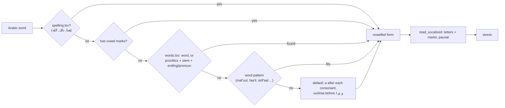

**Vowel restoration** (`ar/g2p_ar.py`, `vocalize`):

1. `lexicons/ar/spelling.tsv` (28 entries): words whose spelling hides a long vowel or has a silent letter (هذا haadhaa, ذلك, لكن, هؤلاء, أولئك, الله, عمرو, مائة, داود), also after proclitics; applied to vowelled text too.
2. A word that has vowel marks (fatha, damma, kasra, sukun, tanwin, dagger alif) is read as written, so users can disambiguate (عِلْم ʕilm, عَلَم ʕalam).
3. `lexicons/ar/words.tsv` (6,920 entries, hand-written from the maintainer's and Claude's own knowledge of Arabic, no entry copied or derived from Tashkeela, SAMA/Buckwalter, Mishkal/Arramooz, CAMeL or any other GPL, LDC or CC BY-SA source: the most frequent words of Arabic Wikipedia and of the synthesis corpus, whose frequencies were used only to choose the words, in batches of about 1,000; a test checks that every value spells its key): the whole word, else the split with the longest stem in the table after the proclitics و ف, ب ك ل, the article ال (and لل), with an ending rebuilt from the stem (ة ات ون ين ان ية ي يين يون يات تان تين: حكومات from حكومة, الدولية from دولة) or a pronoun suffix (ه ها هم هما هن ك كم كن نا ني; a noun takes the genitive i before it, and hu/hum become hi/him after i). A missing hamza on the first letter (اكثر) and the Egyptian final ى for ي (الوطنى) also find the entry.
4. Word patterns (`PATTERNS`) on the stem without the article, proclitics and endings: istifʕaal, mustafʕal, mutafaʕʕil, infiʕaal, iftiʕaal, mufʕal, mafʕuul, mafaaʕiil, mufaaʕil, tafʕiil, tafaaʕul, tafaʕʕul, ʔifʕaal, ʔafʕaal, ʔafʕal, yafʕal, faaʕiil, faaʕil, fiʕaal, faʕiil, fuʕuul, fuʕluul, faʕlaa, faʕl (CCC: nouns read better than CaCaC verbs), the verb forms istafʕal, infaʕal, iftaʕal; endings -iyya, -aat, -uun, -iin, -a, -ii, -an (ًا), -uu (وا), -at (ت).
5. The default reading: a consonant before و / ي followed by a consonant has uu / ii, before ا aa, a consonant before a consonant + long vowel closes its syllable (فيسبوك fiisbuuk), every other consonant but the last gets a.

**Reading** (`read_vocalized`), always pausal: final short vowels and tanwin are dropped (except in two-letter words: هُوَ huwa, مَعَ maʕa), -an written with alif is aa, ة is a, nisba -iyy is ii. The article: its alif is "a" at the start of a word (no glottal stop: hamzat al-wasl) and silent after a proclitic; its ل is assimilated to a sun letter (ت ث د ذ ر ز س ش ص ض ط ظ ل ن: الشمس a sh sh a m s); a liaison kasra on the ل (الِاتحاد) is read. Hamza seats أ إ ؤ ئ ء are `?` (unmarked أ has a, إ has i), آ is `? aa`; ا after a, و after u, ي after i are long vowels; و ي after a are diphthongs; ى is aa; shadda doubles; sukun has no vowel. **Stress**: the last syllable when superheavy (CVVC, CVCC), else the penultimate when heavy, else the antepenultimate, never a word-initial syllable without an onset (the article); one-syllable words are unstressed.

**Accuracy of the vowel restoration** (`scripts/frontend/eval_ar_vowels.py`): against the fully vowelled QCRI WikiNews test set (70 news articles, about 16,000 words; github.com/kdarwish/Farasa, "feel free to copy and distribute"; used only to measure, not in the repository), each word stripped of its marks and read by the front-end, compared with the reference read by the same pausal rules (stress and case endings do not count):

| Half | Words | Word accuracy | Phoneme error rate | Lexicon (share, accuracy) | Patterns | Default |
|---|---|---|---|---|---|---|
| dev (used to look at errors) | 8,190 | 84.5% | 4.5% | 85.7%, 91.4% | 8.1%, 48.6% | 6.2%, 35.8% |
| test (not looked at) | 8,026 | **85.8%** | **4.0%** | 86.2%, 92.4% | 7.7%, 48.4% | 6.1%, 40.3% |
| test, rules only (no words.tsv) | 8,026 | 46.9% | 14.6% | – | 60.2%, 48.2% | 39.8%, 45.0% |

Accuracy against the size of the table (entries added in batches of about 1,000 by frequency; the test half was only measured, its errors were not looked at):

| Entries | dev words / PER | test words / PER |
|---|---|---|
| 1,966 | 76.7% / 6.8% | 78.3% / 6.3% |
| 2,869 | 79.3% / 6.1% | 80.5% / 5.7% |
| 3,921 | 81.3% / 5.5% | 82.6% / 5.0% |
| 4,942 | 82.7% / 5.0% | 84.0% / 4.6% |
| 5,973 | 83.6% / 4.8% | 85.0% / 4.3% |
| 6,920 | 84.5% / 4.5% | 85.8% / 4.0% |

The gain fell from about 2.5 points per 1,000 entries to about 0.9: the words still missing are rarer (names, inflected verb forms), and the table words themselves are right only about 92% of the time (homographs read one way, case and mood are not modelled), so more entries approach a ceiling of roughly 90%. So about one word in seven is still read with at least one wrong vowel: words outside the table are right only about half the time, and homographs in the table (عام ʕaam / ʕaamm, ولد walad / wulida, أن an / anna, كتب kutub / kataba) take their most frequent reading. On the Wikipedia corpus built for synthesis 84% of the words come from the table, 6% from the patterns and 8% from the default reading. A statistical diacritizer would reach about 95–97% words but none with a permissive licence was found that fits the device (Tashkeela and the Buckwalter/SAMA analyzers are GPL / LDC; Mishkal and Arramooz are GPL; the CAMeL Lab WikiNewsMax corpus is CC BY-SA); text with vowel marks is read exactly.

**Normalization** (`ar/normalize_ar.py`): the words it writes carry their vowels, so they are read exactly.

| Text | Reading |
|---|---|
| ٢١, ۲۱, 21 | واحد وعشرون (masculine, pausal) |
| 11, 12, 15, 100, 200, 300 | أحد عشر, اثنا عشر, خمسة عشر, مئة, مئتان, ثلاثمئة |
| 1000, 2000, 3000, 11000, 2500000 | ألف, ألفان, ثلاثة آلاف, أحد عشر ألفا, مليونان وخمسمئة ألف |
| 3.5, ٢٫٥, -5, 1,250 | ثلاثة فاصلة خمسة, اثنان فاصلة خمسة, سالب خمسة, ألف ومئتان وخمسون |
| 15/08/1947, 2026-11-19 | خمسة عشر أغسطس ألف وتسعمئة وسبعة وأربعين (the year in the genitive) |
| عام 2024, 1445 هـ, 2024 م | عام ألفين وأربعة وعشرين, … هجري, … ميلادي |
| 10:30, 7:15 ص, 8:05 م | عشرة ونصف, سبعة وربع صباحا, ثمانية وخمسة دقيقة مساء |
| $100, 5 $, 20 ر.س, 50 د.إ, € £ | مئة دولار, خمسة دولارات, عشرون ريالا سعودي, خمسون درهما إماراتي (the count's noun form) |
| 15%, ١٥٪, 5 km, 5 كم, 128GB, 30°C | خمسة عشر بالمئة, خمسة كيلومتر, مئة وثمانية وعشرون غيغابايت, ثلاثون درجة مئوية |
| 10-20, من 10-20 | من عشرة إلى عشرين |
| 0501234567, +966 … | digit by digit (زائد for +) |
| ESP32, 5G | إي إس بي ثلاثة اثنان, خمسة جي (Latin letters by their Arabic names) |
| د., إلخ, ق.م, ص.ب | دكتور, إلى آخره, قبل الميلاد, صندوق بريد |
| ، ؛ ؟ ۔ ٪ ـ | , ; ? . % (tatweel dropped) |

Known gaps: the vowel restoration above (no context, no syntax: case endings are never read, ة is always pausal a, so construct states read madiina dimashq rather than madiinat dimashq); feminine numbers and the polarity of 3–10 with the counted noun are not applied (numbers are masculine); ordinals written as digits are read as cardinals; dialect words and spellings (other than final ى for ي) are read as MSA; the default reading of foreign names is often wrong.

### Device (C)

`vtts_text_to_ids_ex` with mode `VTTS_LANG_AR` gives exactly `text_to_ids(text, "ar")` (module `runtime/src/vtts_text_ar.c`, entry `ar` in `LANGS`). There is no blob: `runtime/tools/gen_text_tables.py` writes `vtts_text_ar_tables.h` from the Python sources (the letter and mark classes of U+0600–U+06FF and the Lo / word-class bits of the other Arabic blocks, the NFC compositions and combining classes, `words.tsv` and `spelling.tsv` sorted with letters as code point − 0x600 (one byte), the index of the keys with an unseated hamza, proclitics, pronouns, endings, the 35 word patterns as element lists with their templates, and the normalizer's strings). The module is compiled only with `VTTS_ENABLE_AR` (vtts_langs.h; 1 by default so host builds and `make test` cover it); the firmware enables it only for an ar-en model (`firmware/esp32/main/vtts_langs.cmake` reads the token sets of the two embedded models). Without it the `ar` mode is not offered and the module, its tables and its glue in `vtts_text.c` are left out.

| Part | How it is ported | Flash (ESP32-P4, -O2) |
|---|---|---|
| Word table, spelling table | word table: sorted entries `[key length][key letters][one byte per letter with the codes of its first and second vowel mark]` (the letters are not repeated), an offset for every 16th entry, binary search; a second index for keys whose first letter أ إ آ is written ا; spelling table `[key][vowelled value]` | 75 KB |
| Letters, NFC, patterns, clitics, endings | 4 bytes per code point of U+0600–U+06FF (flags, consonant, fold, combining class), bit sets for the other blocks, 8 compositions | 2 KB |
| Normalizer strings | numbers, scales, months, Latin letter names, abbreviations, units, currencies with their count forms, symbols, literals (UTF-8) | 9 KB |
| Code | vocalize (spelling, own marks, word table with clitic splits and endings, patterns, default), read_vocalized, stress, normalize_ar pass by pass | 25 KB |

Measured on the firmware (ESP32-P4, ESP-IDF 6.1): the app is 110,448 bytes larger with `VTTS_ENABLE_AR=1` than without.

- **Words:** like `vocalize` (NFC, tatweel removed, `strip_marks`), the splits of `_proclitic_splits` in the same order with the same tie-break, `_with_ending`, `_attach`, `_template` and `default_vocalize`, then `_letters`, `read_vocalized` and `stress`. A word gets at most 318 tokens (one chunk) and is read from its first 480 code points; the scratch is the workspace's `en_a` / `en_b` (no new workspace memory).
- **Normalization** follows `normalize_ar` pass by pass: NFC for Arabic (hamza and madda letters, canonical order of the marks), Arabic-Indic and Eastern digits, ٫ ٬ ٪ ، ؛ ؟ ۔ and tatweel, each abbreviation as its own pass, dropped characters, ISO and d/m/y dates, times with ص / م, years with هـ / م, years after عام / سنة, money before and after the number, phone numbers, percent, units, ranges with من, pauses, product codes, numbers, Latin words (folded to ASCII, then the English normalizer), symbols, lower case. Where regex backtracking can change a match (NUM with thousands groups and a fraction, `\s?` before units, currencies and `%`, the optional country code and digit groups of a phone number, the time's seconds and part of day), the candidate ends are tried in the order the regex engine tries them.
- **Tagging and chunks:** a word with an Arabic letter is Arabic, a plain Latin word is English unless it is a unit or currency word of the normalizer (km, GB, USD), anything else is Arabic. In every mode, ، ؛ ؟ are stripped from a chunk's edges and a sentence ends at whitespace after ؟ ؛ ۔ (as `EDGE` and `SENTENCE_END` in Python); in mode ar a sentence also ends right after 。！？；।॥ as in the other pair modes.
- **Tests:** `runtime/test/text_parity_ar.tsv` (16,325 cases: edge cases, both Arabic eval sets, the unit-test strings, 2,000 Wikipedia sentences and 1,500 built from their words with numbers and Latin words, 2,000 template × term sentences, every table word with clitics, endings and pronouns, 15,000 random words of 1–8 letters, 40% with random vowel marks, 3,000 number, date, time, money and unit cases with Arabic-Indic digits, 3,000 regex-dense random strings) must match exactly, and a fuzz run in ar mode (ASan/UBSan) must stay inside its buffers and inside the ar-en ids: `make -C runtime ar_test` (or `test`) or `uv run pytest tests/export`. A test also checks that `vtts_text_ar_tables.h` holds the current tables. After changing an Arabic rule or table, run `uv run python runtime/tools/gen_text_tables.py` and regenerate the fixture with `uv run python scripts/frontend/export_text_parity.py --ar --sentences data/ar/sentences.jsonl --limit 2000 --out runtime/test/text_parity_ar.tsv`.
- **Known gaps (pathological input only):** Latin letters followed by separate combining marks are not composed (Python's NFC may join them); only ASCII, Arabic-Indic and Eastern Arabic digits count as digits; an Arabic word of more than 480 code points is cut there and one of more than 318 tokens is cut (Python gives an over-long chunk); a sentence is cut at 4,096 code points, 2,048 items or 1,024 chunks, and an Arabic run whose normalized form exceeds 2,048 code points is dropped.
## Finnish (token set `fi-en`)

Python (`src/vtts/frontend/fi/`) and C (`runtime/src/vtts_text_fi.c`, see [Finnish on the device (C)](#finnish-on-the-device-c)); everything is rules and small tables. `text_to_ids(text, "fi")` returns ids of the token set `fi-en` (model header code 25): ids 0–106 are the v2 set unchanged, followed by 35 Finnish tokens from id 107 (vocabulary 142):

| Group | Tokens |
|---|---|
| Vowels (8) | `FI:a e i o u y ae oe` (`ae` = ä, `oe` = ö) |
| Stressed vowels (8) | `FI:a1 … oe1` |
| Length (1) | `FI::` after a long vowel or consonant |
| Consonants (18) | `FI:p t k b d g f s sh zh h v j l r m n ng` (`b d g f sh zh` for loanwords) |

Finnish spelling is phonemic: one letter is one sound and a doubled letter is a long sound, so the reading is rules only.

**Letters** (`fi/g2p_fi.py`): a doubled letter is the sound + `:` (saari `s a1 : r i`, kukka `k u1 k : a`); `ng` is the long velar nasal `ng :` before a vowel (kengät), a short `ng` before a consonant or at the end; `n` before `k` is `ng` (Helsinki `h e1 l s i ng k i`), before `p b` it is `m` (kansanpuolue). Loan letters: c → `s` before e i y ä ö, else `k` (ck `k :`); q `k` (qu `k v`); w `v`; x `k s`; z `t s` (zz `t : s`); š `sh`, ž `zh`; ch and sch `sh`; ph `f`; th `t`; å is read `o`, ü `y`, other accented letters are folded to their base letter. `sh` is `s h`: in Finnish it is nearly always a compound boundary (hengityshäiriö); loanwords with /ʃ/ are respelled with š in `overrides.tsv` (shakki). Diphthongs are two vowel tokens.

**Stress:** the first vowel of every word is stressed. Number words written as one word (kaksisataakolmekymmentäneljä, also the inflected forms of ranges) are split into their parts and each part's first vowel is stressed (the secondary stresses of the compound); other compounds (rautatieasema) are not split. Short conjunctions (ja, tai, että, kuin, mutta, sekä, vaan, eli, jos, kun) have no stressed vowel.

**Tables** (`lexicons/fi/`): `overrides.tsv` respells loanwords read unlike their spelling in Finnish orthography (show → šou, design → disain, ok → ookoo, 19 entries); `native.txt` lists Finnish words of the English list (`on`, `he`, `home`, `tie`) and adopted words that break the spelling check (`pizza`, `shakki`, `golf`).

**Language of a word:** the Latin-script rules above with Finnish's own letters ä ö å š ž and `valid_spelling` (no c q w x z, th ph ck, sh at the start; no y next to a o u, as in play, boy, you; onsets of one consonant or a loan cluster pr tr kr st sp sk …; a vowel or n t s l r at the end). A word of both `native.txt` and the English list follows its neighbours: it is English when the nearest tagged word on each side is English ("Turn on the light"), else Finnish ("Spotify on hyvä"). On 3,000 Finnish Wikipedia sentences 4.2% of the words are tagged English, nearly all foreign names and titles. A dot followed by a lower-case word or a digit does not end a sentence in mode `fi` (3. toukokuuta, n. 50, esim. kissa).

**Normalization** (`fi/normalize_fi.py`, helpers in `latin_norm.py`). Numbers are read in the nominative; below a million they are one word as in Finnish spelling, miljoona and miljardi are separate words:

| Text | Reading |
|---|---|
| 21, 2026, 1 000 000, 2 500 000 | kaksikymmentäyksi, kaksituhattakaksikymmentäkuusi, miljoona, kaksi miljoonaa viisisataatuhatta |
| 3,5 / -5 | kolme pilkku viisi / miinus viisi |
| 3. toukokuuta, 1. maailmansota | kolmas toukokuuta, ensimmäinen maailmansota (an ordinal is a number + dot before a lower-case word) |
| 3.5.2026, 3.5., 2026-05-03 | kolmas toukokuuta kaksituhattakaksikymmentäkuusi |
| klo 14.30, kello 9, 9.05, 14:30 | kello neljätoista kolmekymmentä, kello yhdeksän, yhdeksän nolla viisi, neljätoista kolmekymmentä |
| 12,50 €, 1 €, $20 | kaksitoista euroa viisikymmentä senttiä, yksi euro, kaksikymmentä dollaria |
| 15 %, 1 %, 5 km, 1 km, 25 °C | viisitoista prosenttia, yksi prosentti, viisi kilometriä, yksi kilometri, kaksikymmentäviisi astetta (partitive after numbers other than one) |
| 1939–1945 | tuhannestayhdeksästäsadastakolmestakymmenestäyhdeksästä tuhanteenyhdeksäänsataanneljäänkymmeneenviiteen (elative to illative) |
| 040 123 4567, +358 40 … | digit by digit (plus for +) |
| ESP32-P4, USB, Nato | ee äs pee kolme kaksi pee neljä, uu äs bee, nato |
| esim., jne., n., mm., ns., klo, eKr., kpl | esimerkiksi, ja niin edelleen, noin, muun muassa, niin sanottu, kello, ennen Kristusta, kappaletta |

**Agreement** with eSpeak NG's Finnish (`scripts/frontend/eval_espeak_fi_el.py`, eSpeak used only as a measuring stick) on 10,355 Finnish words of 1,000 held-out Wikipedia sentences: 99.98% of phonemes, 99.84% of words exact; the stressed vowel agrees on 93.2% of the words (the rest are the unstressed conjunctions, which eSpeak stresses when read alone). Known gaps: compound boundaries inside words (secondary stress, ng/nk across a boundary), loanwords and foreign names outside `overrides.tsv` are read by Finnish spelling, case forms of numbers other than the ranges are not produced (5 km is always "viisi kilometriä").

### Finnish on the device (C)

`vtts_text_to_ids_ex` with `VTTS_LANG_FI` (token set fi-en, model header code 25) gives exactly the ids of `text_to_ids(text, "fi")`. `runtime/src/vtts_text_fi.c` ports `normalize_fi.py` pass by pass (the regexes with Python's Unicode classes `\w \d \s` and `str.lower()` of `vtts_text_lt.c`, backtracking cases tried in the regex's order), `g2p_fi.py` (fold, respellings, spelling segments, number-word parts by the same longest-first split) and the fi tagging rules (word lists, CamelCase, acronyms, `valid_spelling`); `vtts_text.c` adds the neighbour rule for words of both lists and the dot rule of `split_sentences_raw`. All tables (tokens, abbreviations, units, number words and case forms, letter names, word lists, respellings, the fold of every code point as runs) are generated into `vtts_text_fi_tables.h` by `runtime/tools/gen_text_tables.py`; no blob, no malloc, the text workspace does not grow.

The module is compiled only when `VTTS_ENABLE_FI` is not 0 (default 1 on the host, so `make -C runtime test` covers it); the firmware enables it only when one of its models is fi-en (`VTTS_LANGS`, see `firmware/esp32/README.md`). On the ESP32-P4 it adds about 38 KB (code and tables, 37 KB in `vtts_text_fi.c`).

Tests: `runtime/test/text_parity_fi.tsv` (11,545 cases: edge cases, both eval sets, 2,000 template x term sentences, the tests' strings, 3,000 corpus sentences, every word list and exception entry, number/date/time/money/unit cases, 3,000 regex-dense random strings) matches exactly (`make -C runtime fi_test`, `tests/export/test_runtime_golden.py`); a larger run of 69,343 cases (26,000 corpus sentences, 40,000 random strings) also matched; the fuzz run (`text_test --fuzz-fi`, 6,000 random texts under ASan/UBSan) keeps every id inside the fi-en set.

## Greek (token set `el-en`)

Python (`src/vtts/frontend/el/`) and C (`runtime/src/vtts_text_el.c`, see [Greek on the device (C)](#greek-on-the-device-c)); rules and one small table. `text_to_ids(text, "el")` returns ids of the token set `el-en` (model header code 26): ids 0–106 are the v2 set unchanged, followed by 32 Greek tokens from id 107 (vocabulary 139):

| Group | Tokens |
|---|---|
| Vowels (5) | `EL:a e i o u` |
| Stressed vowels (5) | `EL:a1 e1 i1 o1 u1` (the tonos) |
| Consonants (21) | `EL:p t k b d g f v th dh gh s z x ts dz m n ng l r` (`th` θ, `dh` δ, `gh` γ, `x` χ, `ng` ŋ) |
| Glide (1) | `EL:j` (an unstressed i before a vowel: παιδιά `p e dh j a1`) |

Palatal allophones (κ γ χ before e/i: [c ʝ ç]) are left to the voice: the next vowel or `j` tells them.

**Script and case:** a word with Greek letters is Greek in mode `el` (`lang.py`, a script rule before the Vietnamese one, so other modes are unchanged); plain Latin words are English except the normalizer's units and currency words (`km`, `GB`). Lower case is `str.lower()` after NFC, which keeps accented capitals (Ά → ά) and writes the final sigma (ΟΔΟΣ → οδος). `;` (and U+037E, which NFC folds to it) is the Greek question mark: it ends a sentence as in every mode and is read as `?` (also when it follows an English word: "Άνοιξες το Netflix;"); the ano teleia `·` is read as `;`. A dot followed by a lower-case word or a digit does not end a sentence (`χλμ. σε`, `περ. είκοσι`).

**Letters** (`el/g2p_el.py`, after NFD so the tonos and dialytika are marks on their letter):

| Spelling | Reading |
|---|---|
| α ε η ι υ ο ω | a e i i i o o |
| αι, ει οι υι, ου | e, i, u (not with a dialytika on the second letter: λαϊκός; not with a tonos on the first: τσάι); the tonos of a digraph is on its second letter (είναι) |
| αυ ευ ηυ | a e i + `v` before a vowel or voiced consonant (αύριο), + `f` before θ κ ξ π σ τ φ χ ψ or at the end (αυτός); a following β/φ is the same sound (Εύβοια) |
| β γ δ ζ θ κ λ μ ν ξ π ρ σ/ς τ φ χ ψ | v gh dh z th k l m n `k s` p r s t f x `p s`; σ before a voiced consonant is `z` (κόσμος) |
| μπ ντ γκ | `b d g` (γκ inside a word `ng g`); γγ `ng g`, γχ `ng x`, γξ `ng k s` |
| τσ τζ | `ts`, `dz`; a doubled letter is one sound (Έλληνας) |

**Glide (synizesis):** an unstressed i sound (ι η υ ει οι) between a single consonant and a vowel is `j` when the next vowel is stressed (παιδιά, χωριό) or the i follows the stressed vowel (ήλιος, σπίτια, διάρκεια); always after γ (γιατί) and in words without a tonos (by spelling these are one syllable: για, μια, ποιος); never after a consonant + ρ/λ (τριάντα) or before another i sound (χρησιμοποιείται). `lexicons/el/overrides.tsv` (21 entries) gives the phonemes of words with a glide the rules do not see (διακόσια, βιολί, ενδιαφέρον).

**Stress:** the vowel with a tonos (two in enclitic groups: άνθρωπός); a word of one syllable without a tonos is stressed unless it is a function word (articles, clitic pronouns, prepositions, conjunctions: `UNSTRESSED`); a longer word without a tonos (text in capitals) is stressed on the second-to-last syllable.

**Normalization** (`el/normalize_el.py`). Numbers agree in gender with the next word, guessed from its ending (default neuter): -ες -εις and a short list of feminine nouns (ώρα, μέρα, a month in the genitive) are feminine, -οι -ους -ος -ης -ας masculine. Gender changes 1, 3, 4 (also inside 13, 14, 21 …), the hundreds and 1000; thousands are counted in the feminine.

| Text | Reading |
|---|---|
| 3 παιδιά, 3 αδελφές, 4 φίλους, 200 γυναίκες, 1 ώρα | τρία παιδιά, τρεις αδελφές, τέσσερις φίλους, διακόσιες γυναίκες, μία ώρα |
| 100, 101, 1000, 2026, 21000, 2.500.000 | εκατό, εκατόν ένα, χίλια, δύο χιλιάδες είκοσι έξι, είκοσι μία χιλιάδες, δύο εκατομμύρια πεντακόσιες χιλιάδες |
| 3,5 / -5 / 10-20 | τρία κόμμα πέντε / μείον πέντε / δέκα έως είκοσι |
| 1ος, 2η, 21ο, 20ός | πρώτος, δεύτερη, εικοστό πρώτο, εικοστός |
| 3/5/1990, 1 Μαΐου, 2026-11-19 | τρεις μαΐου χίλια εννιακόσια ενενήντα, πρώτη μαΐου, δεκαεννέα νοεμβρίου … |
| 14:30, στις 9.15 | δεκατέσσερις και τριάντα, στις εννέα και δεκαπέντε |
| 12,50 €, 1 €, $20, £3 | δώδεκα ευρώ και πενήντα λεπτά, ένα ευρώ, είκοσι δολάρια, τρεις λίρες |
| 15%, 25 °C, 5 km, 3 χλμ. | δεκαπέντε τοις εκατό, είκοσι πέντε βαθμοί κελσίου, πέντε χιλιόμετρα, τρία χιλιόμετρα |
| 210 1234567, +30 69… | digit by digit (συν for +) |
| π.χ., κ.λπ., δηλ., μ.Χ., τηλ., κ. | παραδείγματος χάρη, και λοιπά, δηλαδή, μετά Χριστόν, τηλέφωνο, κύριος |
| ΔΕΗ, ΟΤΕ, ΑΒΓ, ΗΠΑ | δεή, οτέ (read as words), άλφα βήτα γάμα (spelled), ηνωμένες πολιτείες |
| ESP32-P4 | ι ες πι τρία δύο πι τέσσερα (Latin letters by their Greek names, digits one by one) |

Latin words inside a Greek run go through the English normalizer and are read in English.

**Agreement** with eSpeak NG's Greek (`scripts/frontend/eval_espeak_fi_el.py`, eSpeak used only as a measuring stick) on 14,470 Greek words of 1,000 held-out Wikipedia sentences: 99.04% of phonemes, 94.9% of words exact, stressed vowel 99.99% (words of two or more syllables). eSpeak writes ʝ and the glide alike and the palatal stops without a glide, so both sides are reduced to compare. Nearly all the differences are places where eSpeak reads a hiatus and the front-end a synizesis (χωριό, διάρκεια, ίδιος: the front-end follows standard speech), σ voiced before a voiced consonant (κόσμος `k o1 z m o s`, eSpeak `s`) and μια (eSpeak `m ɲ a`). Known gaps: the synizesis of learned words depends on the word (δημιουργία keeps the hiatus, παραδοσιακή is read with it by many speakers); the gender guess reads only the next word's ending (masculine plurals in -ες take the feminine forms of the hundreds: διακόσιες μήνες); polytonic text is read by dropping the breathings; numbers in other cases than the nominative/accusative are not produced.

### Greek on the device (C)

`vtts_text_to_ids_ex` with `VTTS_LANG_EL` (token set el-en, model header code 26) gives exactly the ids of `text_to_ids(text, "el")`. `runtime/src/vtts_text_el.c` ports `normalize_el.py` pass by pass (gender of the next word, the Greek number regex with `.` thousands and `,` decimals, the backtracking cases of the phone and date rules, the capitals test, the Latin pass through the English normalizer) and `g2p_el.py` (lower case with the final sigma, decomposition of every Greek letter, digraphs, synizesis, stress, the phoneme overrides); `vtts_text.c` adds mode `VTTS_LANG_EL`, the script tagging, `;` and U+037E read as `?` and the dot rule of `split_sentences_raw`. All tables (tokens, the decomposition of every code point whose NFD starts with a Greek letter, number words by gender, ordinal stems and endings, months, abbreviations, units and currencies with their gender, letter names, acronyms) are generated into `vtts_text_el_tables.h` by `runtime/tools/gen_text_tables.py`; no blob, no malloc, the text workspace does not grow.

Compiled only when `VTTS_ENABLE_EL` is not 0 (default 1 on the host); the firmware enables it only when one of its models is el-en (`VTTS_LANGS`). On the ESP32-P4 it adds about 34 KB (code and tables).

Tests: `runtime/test/text_parity_el.tsv` (11,533 cases built like the Finnish fixture: edge cases, both eval sets, template x term sentences, the tests' strings, corpus sentences, word and table entries, number/date/time/money/unit cases, regex-dense random strings) matches exactly (`make -C runtime el_test`); a larger run of 69,257 cases also matched; the fuzz run (`text_test --fuzz-el` under ASan/UBSan) keeps every id inside the el-en set.
## Malay (token set `ms-en`)

Python (`src/vtts/frontend/ms/`) and C (`runtime/src/vtts_text_lt.c`, see [Malay on the device](#malay-on-the-device-c)), Malaysian standard Malay (Bahasa Melayu). `text_to_ids(text, "ms")` returns ids of the token set `ms-en` (model header code 28): ids 0–106 are the v2 set unchanged, followed by 38 Malay tokens from id 107 (vocabulary 145):

| Group | Tokens |
|---|---|
| Vowels (6) | `MS:a i u e @ o` (`e` the e taling of elok, `@` the e pepet of besar) |
| Stressed vowels (5) | `MS:a1 i1 u1 e1 o1` (the schwa is never stressed) |
| Consonants (27) | `MS:p b t d k g ? c j f v s z sy kh gh dh th h m n ny ng l r w y` (`?` glottal stop) |

**Shared with Indonesian.** Malaysian and Indonesian spelling were unified in 1972, so the letter, e, diphthong and stress rules are the Indonesian code (`id/g2p_id.py`: `rule_phonemes`, `respell`, `fold`, `valid_spelling` take the language's digraphs, letter sounds, function words and tables as parameters; Indonesian readings are unchanged). See [Indonesian](#indonesian-token-set-id-en) for the rules. Malay differs in:

- **Letters:** v stays `v` (universiti, video); gh, dh and th are one sound each (ghaib, Ramadhan, Mahathir: Arabic loanwords and names); sh and ch in names are read `sy` and `c` (Shah, China); ngg is ng + g (tinggi, Inggeris), where the Indonesian rules drop the g.
- **The two e's:** `lexicons/ms/overrides.tsv` (39 entries: nénék, ésok, téksi, béza, télévisyén, éléktrik ...) is looked up first, then the shared `lexicons/id/overrides.tsv` (méja, keréta, mérah ...). An entry equal to its key (sistem, filem) reads every e of the word as the schwa, which also overrides an Indonesian entry. The e of a word-initial ke-/se- before a vowel is the schwa (seorang, keadaan).
- **Final a** is read `a`, as in the standard reading (Bahasa Baku), not reduced to the schwa of colloquial Peninsular speech. The lowering of i/u in a closed final syllable (untuk [untoʔ], masih [maseh]) is left to the voice.
- **Function words** not stressed: the Indonesian list plus daripada, kepada.

**Language of a word:** the Latin-script rules with `lexicons/ms/native.txt` (Malay words that are also English entries: menu, model, set; names that break the spelling check: Malaysia, Muhammad, Mahathir, Shah, majlis) and the Indonesian spelling check with gh and dh as letters. A Malay word with th, sh or ch needs a `native.txt` entry, so English the, think, shop stay English.

**Normalization** (`ms/normalize_ms.py`; the 1–999 reading and the date, phone, ordinal and reduplication patterns are shared with `id/normalize_id.py`):

| Text | Reading |
|---|---|
| 8, 11, 100, 1,000, 1,000,000 | lapan, sebelas, seratus, seribu, sejuta |
| 0, 10**9 | sifar, satu bilion |
| 1,250.50 / 3.14 / 1.000.000 | seribu dua ratus lima puluh perpuluhan lima kosong / tiga perpuluhan satu empat / sejuta |
| 31/08/1957, 2026-11-19, 19 Nov 2026 | tiga puluh satu ogos seribu sembilan ratus lima puluh tujuh, sembilan belas november … |
| pukul 8.30 pagi, 3.45 petang, jam 07:00 | pukul lapan tiga puluh minit pagi, tiga empat puluh lima minit petang, jam tujuh |
| RM12.50, RM0.50, RM 1.5 juta, 80 sen | dua belas ringgit lima puluh sen, lima puluh sen, satu perpuluhan lima juta ringgit, lapan puluh sen |
| 15%, 30 °C, 5 km, 90 km/j | lima belas peratus, tiga puluh darjah selsius, lima kilometer, sembilan puluh kilometer sejam |
| ke-1, ke-3 | pertama, ketiga |
| 012-345 6789, +60 … | digit by digit (kosong for 0, tambah for +) |
| 10-20, -5 | sepuluh hingga dua puluh, negatif lima |
| KTM, ESP32-P4, UMNO | ké ti ém, i és pi tiga dua pi empat, umno (letter names follow the English alphabet, as Malaysians spell acronyms) |
| Jln., En., Pn., Sdn. Bhd., Kg., dll., yg | jalan, encik, puan, sendirian berhad, kampung, dan lain lain, yang |

Numbers use the Malaysian marks: a comma before groups of three digits is a thousands mark and the point a decimal mark (1.250 is one point two five zero); several dot groups (1.000.000) are still thousands. The decimals are read digit by digit after perpuluhan. A time with a point is read as a time after pukul or jam and before pagi, tengah hari, petang, malam.

**Agreement** with eSpeak NG (`espeak-ng -v ms`, a measuring stick only) on 1,000 held-out Malay Wikipedia sentences (`scripts/frontend/eval_g2p_reference.py --lang ms --half test`, the odd rows of the first 2,000; the even rows were used to find table entries): 88.4% of the words read exactly and a phoneme error rate of 2.7%, with eSpeak's final schwa of words ending in a counted as a and its lowered vowel of a closed final syllable as the front-end's. Most of the remaining differences are eSpeak's colloquial reductions (merupakan → mərupəkan, adalah → adəlah), its final k for the glottal stop of loanwords (terletak) and foreign names. Stress agrees on 84% of the words with the same phonemes; eSpeak puts Malay stress on the first syllable of many words, so this number says little.

**Known gaps:** e in words missing from both tables follows the defaults; the closed-final-syllable lowering and the glottal stop of a syllable-final k before a consonant (rakyat) are not written; Malay words with the English letter groups th, sh, ch need `native.txt` entries; number words do not agree with classifiers (sebuah, seorang are left as written).

### Malay on the device (C)

`vtts_text_to_ids_ex` with mode `VTTS_LANG_MS` gives exactly `text_to_ids(text, "ms")` for models with token set `ms-en` (header code 28). Malay runs the Indonesian code paths of `runtime/src/vtts_text_lt.c` (entry `ms` in `LANGS`, `VTTS_LT_MS`) with its own tables, generated by `runtime/tools/gen_text_tables.py` into `runtime/src/vtts_text_ms_tables.h` (the Indonesian letters, `fold()` runs, clusters and foreign groups are shared). No blob; English words need the VLEX lexicon. The code and tables are compiled only with `VTTS_ENABLE_MS` (default 1 on the host; the firmware sets it when a model is ms-en): about 9 KB on the ESP32-P4 (3.3 KB code, 5.4 KB tables). Without it the mode is unsupported (`vtts_text_lang_for` fails, `vtts_text_to_ids_ex` returns < 0).

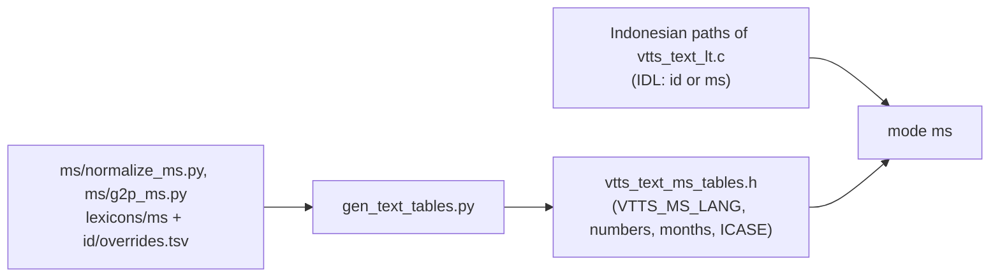

- **Normalization:** the Indonesian passes with the Malay readings (lapan, sejuta, bilion, sifar, negatif, hingga, peratus, tambah, minit, saat) plus the Malay ones: `DATE_ABBR` (month abbreviations, then the month names, in the regex alternation order with `re.IGNORECASE`: the Kelvin sign is a k; ſ, İ and ı match but their `lower()` is not a key, so the text is kept, as in Python), the time before a day part (`8.30 pagi`), ringgit with two decimals as sen, `SEN`, and Malaysian number marks (`parse_number`) with the decimals digit by digit after perpuluhan.
- **G2P:** the Indonesian `_segments`, `_resolve_e`, diphthong and stress code with the Malay digraphs and letter sounds (gh dh th sh→sy ch→c, v kept), ngg read ng + g, the schwa of ke-/se- before a vowel, the Malay function words and the merged e table (Malay entries over the Indonesian ones).
- **Tests:** `runtime/test/text_parity_ms.tsv` (13,814 cases: the Latin-pair sets of `export_text_parity.py --lt ms` plus Malay dates, times with day parts, ringgit, sen and number marks) must match exactly; `make -C runtime ms_test` also runs `text_test --fuzz-ms` under ASan/UBSan (ids inside ms-en). A pytest checks that `vtts_text_ms_tables.h` is current and that a build with `VTTS_ENABLE_MS=0` keeps the other modes and rejects ms. After a change: `uv run python runtime/tools/gen_text_tables.py` and `uv run python scripts/frontend/export_text_parity.py --lt ms --sentences data/ms/sentences.jsonl --limit 3000 --out runtime/test/text_parity_ms.tsv`.
- **Known gaps:** those of the Latin-script pairs (word length, chunk and run limits).

## Tagalog (token set `tl-en`)

Python (`src/vtts/frontend/tl/`) and C (`runtime/src/vtts_text_tl.c`, see [Tagalog on the device](#tagalog-on-the-device-c)), Tagalog (Filipino) with English words (Taglish). `text_to_ids(text, "tl")` returns ids of the token set `tl-en` (model header code 29): ids 0–106 are the v2 set unchanged, followed by 32 Tagalog tokens from id 107 (vocabulary 139):

| Group | Tokens |
|---|---|
| Vowels (5) | `TL:a e i o u` (e/i and o/u as written) |
| Stressed vowels (5) | `TL:a1 e1 i1 o1 u1` |
| Consonants (22) | `TL:p b t d k g ? m n ng s h l r w y` and the loanword sounds `f v z j ch sh` (`?` glottal stop) |

**Letters** (`tl/g2p_tl.py`): ng is one sound and ngg is ng + g; the word mga is read "manga" and the particle ng "nang"; c is s before e/i and k elsewhere, qu before e/i and q are k, ch and ts are `ch` (tsinelas), ll is l + y (Villa), ñ is n + y, x is k + s; f, v, z, j stay (loanwords and names); a doubled consonant letter is read once.

**Glottal stop and stress** are not written in everyday Tagalog, so they come from rules and a table:

- `?` between two vowels (tao → ta?o, kain, maaari), after a hyphen before a vowel (mag-aral; the normalizer writes `mag'aral`; a reduplication such as araw-araw becomes two words), and at the end of a word with a final glottal stop.
- Stress: the second-to-last syllable by default (malumay), the last syllable for Spanish loanwords ending in -yon (after two syllables), -dad, -yal/-nal/-tal, -ar, -el, -or (rehiyon, siyudad, opisyal, militar, papel).
- `lexicons/tl/stress.tsv` (186 hand-written entries) respells words with the Filipino accent marks: acute = the stressed vowel (mabilis akó, gandá, or any syllable: músika), grave on the last vowel = final glottal stop with the default stress (malumi batà, lupà), circumflex on the last vowel = stressed final vowel with a glottal stop (maragsa hindî, walâ). The same marks are read when they appear in the text. A whole-word entry may also change letters (Spanish names: jose → hosé, juan → huwán); an entry without marks keeps the default and stops the root lookup (kasama is not ka- + samâ).
- A word not in the table is looked up without the linker -ng or the contractions 't/'y (isá → isáng, dalawampû → dalawampu't: same syllables, no final glottal stop), then as a root without up to two prefixes (mag- nag- pag- ma- na- pa- ka- i- maka- naka- paka- pinaka- ...), the infixes -um-/-in- and a suffix (-an -in -han -hin -nan -nin): with prefixes and infixes the root keeps its stress counted from the end and its final glottal stop (maganda, napakaganda, kumain); with a suffix a root with final stress keeps the stress on the last syllable (kagandahán) and any other root takes the default.
- Particles (ang, ng, sa, si, ni, ay, at, na, mga, ko, mo, ka, ba, pa, po ...) are not stressed.

**Language of a word:** the Latin-script rules with `lexicons/tl/native.txt` (at and man, which are also English entries; ng, mga; places and names with Spanish letters: Cebu, Quezon, Luzon, Jose) and a Tagalog spelling check: no English letter groups or the letters c f j q v x z, no doubled letters other than aa ii uu and the oo of loob, doon, roon, noon, look, poot, Tagalog onsets (pr tr ky dy sy kw ts ...) and one final consonant. A word with ñ or a Filipino accent mark is Tagalog. In this pair only, a hyphenated word with a part in the English list is English (i-share, nag-email, na-update are read by the English front-end).

**Normalization** (`tl/normalize_tl.py`). Numbers are read with the native Tagalog numbers, and with the linker before a noun (a lower-case word that is not a particle); two places follow the everyday Spanish-derived norm:

| Text | Reading |
|---|---|
| 3 aso, 11, 21 tao, 100, 400, 1,250 | tatlong aso, labing isa, dalawampu't isang tao, isang daan, apat na raan, isang libo at dalawang daan at limampu |
| 2026, 1,000,000 | dalawang libo at dalawampu't anim, isang milyon |
| 3.14, -5 | tatlo punto isa apat, minus lima |
| 1:00, 3:30, 14:15, 19:45, 8:05 a.m. | ala una, alas tres i medya, alas dos i kinse ng hapon, alas siyete i kuwarenta'y singko ng gabi, alas otso i singko ng umaga (Spanish hours and minutes on the 12-hour clock; 13–23 get ng hapon / ng gabi unless the text says the part of the day) |
| ₱50, PHP 250 | singkuwenta pesos, dos siyentos singkuwenta pesos (whole pesos 2–999: Spanish, as prices are said) |
| ₱1, ₱1,500, ₱12.50, $20 | isang piso, isang libo at limang daang piso, labindalawang piso at limampung sentimo, dalawampung dolyar |
| 11/19/2026, Nobyembre 19, 2026, 2026-06-12 | ikalabinsiyam ng nobyembre , dalawang libo at dalawampu't anim (month first, as in the Philippines; day first when the first number is above 12) |
| ika-1, ika-3 puwesto | una, ikatlong puwesto |
| 15%, 5 km, 2 kg, 34°C | labinlimang porsiyento, limang kilometro, dalawang kilo, tatlumpu't apat na digri selsiyus |
| 0917-123-4567 | digit by digit (sero for 0) |
| 10-20 | sampu hanggang dalawampu |
| DOH, ESP32-P4 | di o eyts, i es pi tatlo dalawa pi apat (letter names follow the English alphabet, as Filipinos spell acronyms) |
| Gng., Bb., Brgy., Blg., atbp. | ginang, binibini, barangay, bilang, at iba pa |

Month abbreviations are read only with their dot (Nob. 19), so the words may and set stay words.

**Agreement** with Wiktionary's pronunciations (a measuring stick only: CC BY-SA, read at evaluation time from a kaikki.org extract, nothing included) on 1,000 held-out Tagalog Wikipedia sentences (`scripts/frontend/eval_g2p_reference.py --lang tl --ref ... --half test`; 77% of the word tokens have a Wiktionary pronunciation): 97.7% of the words read exactly (sounds and glottal stops, any of the entry's variants), a phoneme error rate of 0.7%, and the same stressed syllable on 70% of the words with two or more syllables. Most stress differences are particles the front-end leaves unstressed (mga alone is 4% of the words), words with final stress missing from the table (katawán, paaralán, kinatawán: the stress of suffixed words varies from word to word) and loanwords.

**Known gaps:** the stress of words outside the table (about a third of Tagalog words have final stress) and of most suffixed words; the final glottal stop of words outside the table; English words whose spelling fits Tagalog and are not in the English list are read in Tagalog; phone numbers and years are read with native numbers, where many speakers use English; numbers do not take Spanish forms outside clock times and peso prices.

### Tagalog on the device (C)

`vtts_text_to_ids_ex` with mode `VTTS_LANG_TL` gives exactly `text_to_ids(text, "tl")` for models with token set `tl-en` (header code 29). Tagalog is its own module, `runtime/src/vtts_text_tl.c` (entry `tl` in `LANGS`), with tables generated by `runtime/tools/gen_text_tables.py` into `runtime/src/vtts_text_tl_tables.h`; Python's `\w`, `\d`, `\s`, `lower()` and the English word list come from `vtts_text_lt.c` (`vtts_u_*`, `vtts_lt_is_english`). No blob; English words need the VLEX lexicon. The code and tables are compiled only with `VTTS_ENABLE_TL` (default 1 on the host; the firmware sets it when a model is tl-en): about 33 KB on the ESP32-P4 (24 KB code, 8 KB tables in the firmware build at -O2). Without it the mode is unknown (`vtts_text_lang_for` fails, `vtts_text_to_ids_ex` returns < 0); a tl-en model still loads (raw ids).

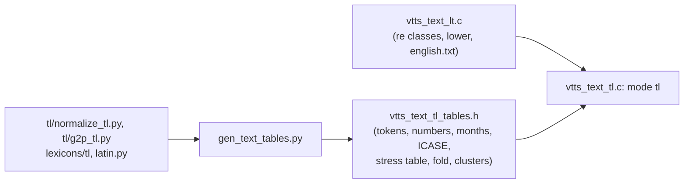

- **Tagging:** ñ and the accent marks of `LATIN_PAIRS["tl"]`, `native.txt` and the normalizer's units and abbreviations, the English list, a hyphenated word with an English part (i-share), CamelCase, acronyms, then `valid_spelling` (NATIVE_OO, foreign groups, doubles, onset/coda/final clusters).
- **Normalization:** one function per regex pass in the Python order (abbreviations, DROP, ISO, month-first and day-first dates, month-name dates, the clock time with `alas`/`ala` and the part of the day, phone numbers, pesos with the Spanish prices, percent, units, `ika-` ordinals, ranges, pauses, product codes, numbers with the linker before a noun, symbols, reduplication, the glottal hyphen, acronyms, `finish`), with the regexes' backtracking order. The `re.IGNORECASE` patterns use the generated look-alike table (İ, ı, ſ, the Kelvin sign) and the glottal-hyphen classes are generated by testing every code point.
- **G2P:** `fold()` from a generated table of every code point above U+007F (base letter and up to two kept marks), the stress table (keys sorted, folded spelling and pattern precomputed), clitics, up to two prefixes, -um-/-in- and suffixes in Python's order, the Spanish final stress, `_segments` and the spelled-out letters of words without a vowel.
- **Tests:** `runtime/test/text_parity_tl.tsv` (11,920 cases: edge cases, both eval sets, template × term sentences, 3,000 sentences of `data/tl/sentences.jsonl` and `mixed.jsonl`, every table word with affixes and clitics, random Tagalog words, numbers, dates, times and money, regex-dense random strings) must match exactly; `make -C runtime tl_test` also runs `text_test --fuzz-tl` under ASan/UBSan (ids inside tl-en) and `token_set_test` built with `VTTS_ENABLE_TL=0`. A pytest checks that `vtts_text_tl_tables.h` is current. After a change: `uv run python runtime/tools/gen_text_tables.py` and `uv run python scripts/frontend/export_text_parity.py --tl --sentences data/tl/sentences.jsonl data/tl/mixed.jsonl --limit 3000 --out runtime/test/text_parity_tl.tsv`.
- **Known gaps:** those of the Latin-script pairs: a word is cut at 256 letters, and a run whose normalized text exceeds the English scratch (6,144 code points, e.g. thousands of digits) is dropped; the text workspace does not grow.

## Swahili (token set `sw-en`)

Python (`src/vtts/frontend/sw/`) and C (`runtime/src/vtts_text_sw.c`, see Device (C) below), Swahili with English words. `text_to_ids(text, "sw")` returns ids of the token set `sw-en` (model header code 33): ids 0–106 are the v2 set unchanged, followed by 40 Swahili tokens from id 107 (vocabulary 147):

| Group | Tokens |
|---|---|
| Vowels (5) | `SW:a e i o u` |
| Stressed vowels (5) | `SW:a1 e1 i1 o1 u1` |
| Consonants (26) | `SW:p b t d k g ch j f v s z sh h m n ny ng l r w y th dh gh kh` (`ng` is the velar nasal of ng'ombe) |
| Prenasalized stops (4) | `SW:mb nd nj ngg` (`ngg` is the ng of ngoma) |

**Letters** (`sw/g2p_sw.py`): ch, sh, ny, th, dh, gh, kh are one sound each; ng' (also with ’) is the velar nasal `ng`, ng is the prenasalized `ngg`; mb, nd, nj are prenasalized stops; nz is n + z. Every vowel is a syllable (ki-a-tu, ka-a). A doubled consonant letter other than nn, mm is read once; c (outside ch) and q are k, x is k + s.

**Syllabic nasals:** a word-initial m before a consonant other than b, w, y and a word-initial n before a consonant other than d, j, g, y, z are syllabic (m-tu, m-to-to, m-zee, m-vu-a, n-chi, n-ne): they count as a syllable for the stress but have no vowel token. Inside a word a nasal before a consonant closes the syllable before it (kaunti, jinsi); nn and mm are both read (wanne).

**Stress:** the second-to-last syllable (ki-TA-bu, m-TO-to, ba-ra-BA-ra); when that syllable is a syllabic nasal (m-tu, n-chi) no vowel is marked. `lexicons/sw/stress.tsv` respells the few words stressed elsewhere with an acute accent (lázima). Particles (na, ya, wa, kwa, ni, la, za, cha, vya, si, pa, mwa, ku, li, ma) are not stressed.

**Language of a word:** the Latin-script rules with `lexicons/sw/native.txt` (menu, visa, safari, which are also English entries; names that end in a consonant: Dar es Salaam, Zanzibar, Mohamed) and a Swahili spelling check: the word ends in a vowel (not in a consonant + le: single, table), has no c outside ch, q or x, and every consonant run has at most three consonants (digraphs counted as one), no h after another consonant and no doubled consonant other than a syllabic mm, nn. Swahili words nearly always end in a vowel, so most English words fail the check; English words ending in a vowel (time, game, make) are in the shared English list.

**Normalization** (`sw/normalize_sw.py`). Numbers are read in the counting form; the words that come before a number in Swahili (currency, percent, unit) are moved there:

| Text | Reading |
|---|---|
| 11, 21, 101, 120, 2026 | kumi na moja, ishirini na moja, mia moja na moja, mia moja ishirini, elfu mbili na ishirini na sita |
| 100,000, 250,000, 1,000,000 | laki moja, laki mbili na elfu hamsini, milioni moja |
| 3.14, -5 | tatu nukta moja nne, hasi tano |
| TSh 5,000, 5,000/=, KSh 1,500.50, $20 | shilingi elfu tano, shilingi elfu tano, shilingi elfu moja mia tano na senti hamsini, dola ishirini |
| 15%, asilimia 75% | asilimia kumi na tano, asilimia sabini na tano |
| 5 km, km 190, 25°C | kilomita tano, kilomita mia moja tisini, nyuzi joto ishirini na tano |
| 14:30, saa 9:15, saa 3:05 asubuhi, 7:00 | saa kumi na nne na nusu, saa tisa na robo, saa tatu na dakika tano asubuhi, saa saba |
| 19/11/2026 | tarehe kumi na tisa novemba elfu mbili na ishirini na sita (day first) |
| wa 1, ya 2, ya 3 | wa kwanza, ya pili, ya tatu |
| 0712 345 678 | digit by digit (sifuri for 0, jumlisha for +) |
| 10-20 | kumi hadi ishirini |
| CCM, TANESCO, ESP32-P4 | si si em, tanesco, i es pi tatu mbili pi nne (letter names follow the English alphabet, as acronyms are spelled in East Africa) |
| n.k., k.m., Bw., Bi., Dkt., Mh., S.L.P. | na kadhalika, kwa mfano, bwana, bibi, daktari, mheshimiwa, sanduku la posta |

**Time:** clock times are read as written, with saa and the hour as a counting number (14:30 → saa kumi na nne na nusu), and are **not converted** to Swahili time (in which 7:00 is saa moja, the first hour of the day). The text does not say which system it uses, and a writer who means Swahili time usually writes it that way (saa 3 asubuhi → saa tatu asubuhi, kept as written). Minutes: 15 → na robo, 30 → na nusu, others → na dakika N.

**Agreement** with eSpeak NG (`espeak-ng -v sw`, a measuring stick only) on 1,000 held-out Swahili Wikipedia sentences (`scripts/frontend/eval_g2p_reference.py --lang sw --half test`): 99.7% of the words read exactly, a phoneme error rate of 0.1% and the same stressed syllable on 99.8% of the words with two or more syllables. Both are rule-based readings of a phonemic spelling, so the number mostly confirms the letter rules; the differences are eSpeak misreadings (ng'ombe, tangu), its velar n before k (kakonko) and foreign names.

**Known gaps:** numbers do not agree with the noun class (watu 2 is read watu mbili, not watu wawili; vitu 2 vitu mbili, not viwili), and ordinals other than kwanza and pili are read as cardinals; Swahili time is never derived from a 24-hour time; Arabic loanwords with irregular stress need entries in `stress.tsv`; English words ending in a vowel that are not in the English list are read in Swahili.

### Device (C)

`vtts_text_to_ids_ex` with mode `VTTS_LANG_SW` gives exactly `text_to_ids(text, "sw")` (module `runtime/src/vtts_text_sw.c`, entry `sw` in `LANGS`, token set code 33). There is no blob: `gen_text_tables.py` (`swahili_tables()`) writes every table into `vtts_text_sw_tables.h`; the English word list and Python's `\w`, `\d`, `isspace` and `lower` classes are shared with the Latin-script module (`vtts_text_lt.c`, `vtts_lt_english`), and only English words need the VLEX lexicon. The module is compiled only with `VTTS_ENABLE_SW=1` (the default on the host; the firmware sets it from the token sets of its models). In the ESP32-P4 firmware it adds about 20 KB at `-Os` (about 25 KB at the firmware's `-O2`): 14 KB of code and 6 KB of tables.

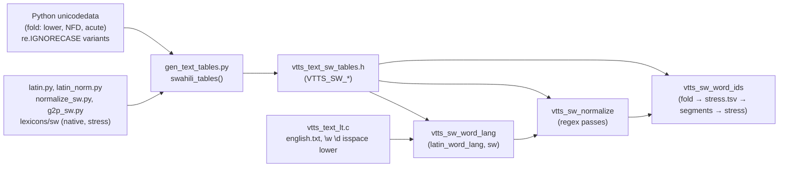

| Part | How it is ported | Size (tables) |
|---|---|---|
| Normalizer tables | abbreviations in the order `apply_abbreviations` uses them, units (with the `UNIT_BEFORE` subset) and currencies in the regex alternation order, the symbols and words of `MONEY_AFTER` (read from the compiled pattern), symbols, concords, letter names, acronyms read as words, number and month words; the `re.IGNORECASE` variants of the letters of `tarehe`, `saa`, `asilimia` and the concords (K also matches the Kelvin sign, s the long s, i the dotted and dotless I) | about 2 KB |
| Tagger | `native.txt`, the normalizer's unit and abbreviation keys, the digraph codes of `valid_spelling` (the English list is shared) | about 0.5 KB |
| G2P | token names, `stress.tsv`, the unstressed particles, digraphs and their sounds, and `fold()` of every code point as 209 runs (letter, acute accent kept after a vowel) | about 3.5 KB |

- **Normalization** follows `normalize_sw` pass by pass (one C function per regex, lookarounds on the pass's input): abbreviations, ’ to ', dropped characters, ISO and day-first dates, times, phone numbers, money before and after the amount, percent, units after and before the number, ordinals after a concord, ranges, pauses, product codes, numbers, symbols, acronyms. The optional case-insensitive prefixes (`tarehe`, `saa`, `asilimia`) are tried before the bare match at each position, and where backtracking can change a match the candidate ends are tried in the regex engine's order (the `NUM` alternation with the check after it, the hour alternation `[01]?\d|2[0-4]`, optional seconds, `\s?` before `/=`, a currency symbol or a currency word, phone groups). Numbers of any length are read like Python (from 10¹⁵ digit by digit), with Swahili `parse_number` (comma groups, or two or more dot groups, else the first mark is the decimal point).
- **Tagging and chunks:** `¿` and `¡` separate words; a plain Latin word is split into parts at `-` only (the apostrophe of ng'ombe is a letter), then the word lists, CamelCase, acronyms and `valid_spelling` decide; each word is one item. Sentences also end right after `。！？；।॥`, as in Python.
- **G2P** ports `fold` (lower case, ’ to ', NFD, a-z and ' kept, an acute accent kept right after a vowel), the stress table, `_segments` (digraphs in order, syllabic m/n, doubled letters, c q x) and the penultimate stress over vowels and syllabic nasals; a word without a vowel is spelled with the letter names.
- **Tests:** `runtime/test/text_parity_sw.tsv` (12,801 cases: edge cases, both eval sets, 2,000 mixed template sentences, the strings of the Swahili Python tests, 1,500 Wikipedia and 1,500 mixed corpus sentences, 1,000 generated sentences, every word of the eval sets, templates and word lists, 6,000 random Swahili-like words, number, date, time, money and unit cases, 3,000 regex-dense random strings) must match exactly; `make -C runtime sw_test` (part of `test`) also runs the fuzz in sw mode (inside the buffers and the sw-en ids, under ASan and UBSan) and checks a build with `VTTS_ENABLE_SW=0` (sw-en loads, no text mode). A pytest checks that `vtts_text_sw_tables.h` is current. After changing a rule or table, run `uv run python runtime/tools/gen_text_tables.py` and `uv run python scripts/frontend/export_text_parity.py --sw --sentences data/sw/sentences.jsonl data/sw/mixed.jsonl --limit 1500 --out runtime/test/text_parity_sw.tsv`.
- **Known gaps (pathological input only):** a word is read up to 256 code points and a chunk holds at most 318 tokens, a sentence is cut at 4,096 code points, and a run whose normalized form exceeds 6,144 code points is dropped (long digit strings expand most in Swahili). Texts on which Python raises (numbers like `1.234,5`, where `number` calls `int(",")`) do not raise in C: separators inside the digits are skipped.
## Dutch, Swedish and Norwegian: shared normalizer

The three languages share one normalizer, `src/vtts/frontend/scan_norm.py`: a single left-to-right scan over the code points of a run, with no regular expressions, so that the C port follows it step by step. Each language gives a `Spec` with its tables (abbreviations, units, currencies, letter names, symbols, months) and its number readers. At each position, in order: a currency before a number (`€ 5`, `kr 50`); an abbreviation of the table (case-sensitive, longest first); a minus before a digit; at a digit: an ISO or day-month-year date, a time (`h:mm`; `h.mm` only after `kl.` or before `uur`), a phone number (`+` or a leading 0, at least 8 digits in groups), a number with an attached unit or ordinal mark, a code of digits and letters (`4G`), else a number with thousands groups (`1.000`, `1 000 000`), a decimal comma, a range, and after it %, ‰, a unit or a currency; a run of letters (a code with digits, an acronym of 2–5 capitals spelled with the language's letter names unless it is read as a word, else the lower-case word); marks; pauses (… — –); symbols. Sentences are cut like everywhere else, except after a dot that ends an abbreviation of the table, a single letter (initials) or, in Norwegian, an ordinal number before a lower-case word (`17. mai`).

### Device (C), shared parts

`runtime/src/vtts_text_nx.c` ports `scan_norm.py` (the scanner, step by step, writing UTF-8 words into the workspace's `en_a`), `split_sentences` and the tagging of `latin.latin_word_lang` (the shared English list through `vtts_lt_english_word`); `vtts_text_nx_nl.c` ports `g2p_nl.py` and the Dutch number words, `vtts_text_nx_sc.c` ports `scand_g2p.py` with the Swedish and Norwegian number words. All tables are generated from the Python sources into `vtts_text_nx_tables.h` (`runtime/tools/gen_text_tables_nx.py`, called by `gen_text_tables.py`; no blob). Each language is compiled only with `VTTS_ENABLE_NL`, `VTTS_ENABLE_SV`, `VTTS_ENABLE_NO` (1 by default on the host; the firmware sets them from the token sets of its models). The text workspace does not grow (words in `en_a`, the g2p scratch in `en_b`); the files keep about 12 KB of static buffers. Limits that Python does not have: a word is read up to 256 letters and a digit run up to 512 digits (longer input is cut). Flash (RISC-V `-O2`, code and tables): the shared part about 15 KB, Dutch about 29 KB, Swedish or Norwegian about 28 KB (46 KB for both).

## Dutch (token set `nl-en`)

Python (`src/vtts/frontend/nl/`); everything is rules and small hand-written tables. `text_to_ids(text, "nl")` returns ids of the token set `nl-en` (model header code 21): ids 0–106 are the v2 set unchanged, followed by 52 Dutch tokens from id 107 (vocabulary 159):

| Group | Tokens |
|---|---|
| Short vowels (5) | `NL:A E I O Y` (kat, bed, pit, pot, put) |
| Long vowels (7) | `NL:a: e: o: 2:` (aa, ee, oo, eu) and `NL:i u y` (ie, oe, uu) |
| Diphthongs (3) | `NL:Ei` (ei, ij), `NL:9y` (ui), `NL:Au` (au, ou) |
| Stressed vowels (15) | the 15 vowels above with `1` (`NL:a:1`) |
| Schwa (1) | `NL:@` (never stressed) |
| Consonants (21) | `NL:p b t d k g f v s z x h S Z m n N l r w j` |

`x` is both g and ch (the northern merger of the velar fricatives); `N` = ng, `S` = sj and the ch of loanwords (chef), `Z` = the g of garage, `w` the labiodental w; `g` only in loanwords. One-syllable function words (`FUNCTION_WORDS`: de, het, een, en, van ...) have no stress mark; other words have one.

**Letters** (`nl/g2p_nl.py`): graphemes longest first: ieuw eeuw aai ooi oei (vowel + w/j), eau, auw ouw au ou, aa ee oo uu ie oe eu ui ei ij, the single vowels (accents mark the stress: é è ê; the diaeresis ë ï starts a new syllable), sch (`s x`; final -sch `s`), ch, ng, nk (`N k`), sj, th, ph, qu (`k w`), ck, dt, c (`s` before e i y, else `k`), x (`k s`), doubled consonants as one sound; n before k is `N`; -tio- is `S` (station, nationaal); final -gie `Z i` (energie; not -logie); -tie after a vowel `t s i`, else `s i` (informatie, functie); -age `a: Z @`.

**Vowel length:** a single vowel letter is long in an open syllable (at the end of the word, before one consonant and a vowel, or before an obstruent + l/r and a vowel) and short in a closed one; ch, sch, ng, nk, x, ck and qu close the syllable.

**Schwa:** an unstressed e after the stress in a final syllable before nothing or n r l m s nd nt rd rt ns rs ld (+s, st) or inside the word when only n r l m close its syllable (honderden, wetenschap, overzicht), not before a doubled consonant (stellen); the final e; the e of a prefix; an unstressed open e right before the stress (telefoon; further before the stress it is `e:`); -ig `@ x`; -lijk `l @ k`. The n of -en is kept.

**Stress:** an accented vowel; a stressed ending (`STRESSED_ENDINGS`: -iteit -teit -erij -arij -euse -eur -ier -aal -ieel -reel -ant -ent -ist -iek -ief -ine -ade -age -aat -iet -ijn -uur -oen -oon -ees -aan -ette -ale -rele -ee -ij, also before -e -en -s -es -n); -ie after r g f k m d p b; the ee of studeert, gepubliceerd; -eren after a vowel and one consonant (studeren, not veranderen); the syllable before -tie -sie -isch -isme; else the first syllable after an unstressed prefix (be- ge- ver- ont- her- er-, only before a Dutch onset and not before the stems of `NOT_PREFIX`: beter, geven, verder ...). Number words (eenentwintig, tweeduizendzesentwintig) are read morph by morph with the stress on the first morph, so vowel length does not leak across morphs. Final devoicing (b d → p t at the end and before a voiceless consonant).

**Tables** (`lexicons/nl/`): `overrides.tsv` (phonemes written out for function words, months, stress exceptions such as `amsterdam`, `museum`, `vanwege`); `native.txt` (Dutch words also in the shared English list: in, is, door, was, of); `english.txt` (English words whose spelling fits Dutch: software, reminder). `valid_spelling` rejects ck wh tch ay oy ght ii, sh / ph at the start, sh ph igh dge at the end (inside a word they are a morph boundary: staatshoofd, opheffing, vaardigheid, grondgebied) and a final w not after u.

**Normalization** (`nl/normalize_nl.py` with `scan_norm.py`):

| Text | Reading |
|---|---|
| 1, 21, 22, 101, 2026 | één, eenentwintig, tweeëntwintig, honderdeen, tweeduizendzesentwintig |
| 1999, 2.500.000, 3,14, 0,05 | negentienhonderdnegenennegentig, twee miljoen vijfhonderdduizend, drie komma veertien, nul komma nul vijf |
| 1e, 2de, 8ste, 21ste | eerste, tweede, achtste, eenentwintigste |
| 3-5-2026, 2026-05-03 | drie mei tweeduizendzesentwintig |
| 14:30, 9.30 uur | veertien uur dertig, negen uur dertig |
| € 5,50, 5,-, 3 euro | vijf euro en vijftig cent, vijf euro, drie euro |
| 75%, 25 °C, 5 km, 1 km, 5 min | vijfenzeventig procent, vijfentwintig graden celsius, vijf kilometer, één kilometer, vijf minuten |
| 06-12345678, +31 20 … | digit by digit (plus for +) |
| 10-20, -5 | tien tot twintig, min vijf |
| ESP32-P4, USB, NAVO | ee es pee drie twee pee vier, uu es bee, navo |
| bijv., o.a., d.w.z., t/m, 't | bijvoorbeeld, onder andere, dat wil zeggen, tot en met, het |

A leading apostrophe stays on 's 't 'n ('s avonds is read `s`). Agreement with eSpeak NG (voice nl; a measuring stick only, nothing derived from it is shipped; `scripts/frontend/eval_g2p_espeak.py --lang nl`) over the words of 1,000 held-out Wikipedia sentences (the odd rows of the first 2,000 of `data/nl/sentences.jsonl`; the even rows were used to find rules): 85.3% of 13,026 word tokens read the same (sounds and the stressed vowel of polysyllables), 89.8% the same sounds, phoneme error rate 2.8%, stress agreement 88.3%. The article een is left out (eSpeak reads it in isolation as the numeral één). Known gaps: compounds are not split (a vowel before a compound boundary can get the wrong length: noorwegen; an e of a second part can be read as schwa: onderwerpen), the stress of Latin and Greek loans without a known ending (problemen, kalender) needs an override, voicing assimilation (zakdoek) is not marked.

### Device (C)

`vtts_text_to_ids_ex` with `VTTS_LANG_NL` gives exactly `text_to_ids(text, "nl")` (see the shared parts above): the fixture `runtime/test/text_parity_nl.tsv` (12,101 cases: edge cases, both eval sets, template × term sentences, the unit-test strings, corpus sentences, every table entry, random words, number/date/time/money/unit cases and random strings dense in the scanner's triggers) is exact, and so is a larger uncommitted run of 62,711 cases; `text_test --fuzz-nx` stays inside the nl-en token set under ASan/UBSan.

## Swedish and Norwegian: shared spelling rules

`src/vtts/frontend/scand_g2p.py` holds the rules both languages share; each language gives a `Rules` table (`sv/g2p_sv.py`, `no/g2p_no.py`). A word is read from the override table, else as number morphs (`tjugotvå`, `tjueen`: the morphs of `NUMBER_MORPHS`, the tone of the last morph that has one), else after an unstressed prefix (be-, för- / for-, before a stem with a vowel and a valid onset, not before the look-alike stems of `not_prefix`; the stem's stress is accent 1), else by the rules: graphemes longest first (the soft k g sk at the start of a stem before a front vowel), stress (a stressed ending, also before an inflection; the vowel before -isk -iker; else the first syllable; an ending right after a doubled consonant does not count: annat), complementary vowel length (a stressed vowel is long before nothing, one consonant letter, or rd rn rl; short before two consonants, a doubled consonant, x and a final m; unstressed vowels are short), an unstressed e in a final ending (-e -en -er -el -et ...) as the schwa, the language's silent letters, and then the retroflex consonants: r + t d n s l is one retroflex consonant (`t` d` n` s` l``), and t d n s l right after one are retroflex too (rst → `s` t``).

Word tones are tokens: `'1` (accent 1, acute) or `'2` (accent 2, grave) right after the stressed vowel. A stress on the last syllable (every stressed one-syllable word) is accent 1; so is a stress after an unstressed prefix, and a two-syllable word ending in one of the language's `acute_endings` (the definite and plural forms of one-syllable words: bilen, huset); any other word stressed before its last syllable has accent 2. The ending of `secondary` (-het -dom -skap ...) after an accent-2 stress gets the secondary-stress token `,` after its vowel (frihet, kärlek). One-syllable function words have no tone token (their vowel length follows the rules). Known gaps: compounds are not split (the second part's vowel length and secondary stress are not marked, except the endings above; a compound with a final stressed-looking part can be stressed wrongly), the tone of words outside these patterns needs an override.

## Swedish (token set `sv-en`)

Python (`src/vtts/frontend/sv/`, with `scand_g2p.py` and `scan_norm.py`); rules and small hand-written tables. `text_to_ids(text, "sv")` returns ids of the token set `sv-en` (model header code 23): ids 0–106 are the v2 set unchanged, followed by 48 Swedish tokens from id 107 (vocabulary 155):

| Group | Tokens |
|---|---|
| Long vowels (11) | `SV:i: y: e: E: {: 2: 9: }: u: o: A:` (`}:` = long u, `u:` = long o, `o:` = long å, `{:` `9:` = ä ö before r) |
| Short vowels (10) | `SV:I Y e E { 9 8 U O a` (`8` = short u) |
| Schwa (1) | `SV:@` |
| Prosody (3) | `SV:'1` `SV:'2` (accent 1 / 2 after the stressed vowel), `SV:,` (secondary stress) |
| Consonants (23) | `SV:p b t d k g f v s S C h m n N l r j` and the retroflex `t` d` n` s` l`` (`S` = sj-ljud, `C` = tj-ljud) |

**Letters** (`sv/g2p_sv.py`, `RULES`): sj skj stj sch ch → `S`; -tion -sion -ssion → `S u: n` (stressed); tj kj → `C`; at the start of a stem k → `C`, g → `j`, sk → `S` before e i y ä ö (kyrka, göra, skicka); dj gj hj lj → `j` at the start; ng → `N`, gn → `N n`, nk → `N k`, ck → `k`, x → `k s`, z → `s`, w → `v`, qu → `k v`, ph → `f`, th → `t`, dt → `t`; c is `s` before e i y ä ö, else `k`; g after l r at the end or before a front vowel → `j` (älg, berg, Norge); the g of -ig and -igt is silent (rolig, roligt). Vowels: long a `A:`, e `e:`, i `i:`, o `u:`, u `}:`, y `y:`, å `o:`, ä `E:`, ö `2:`; short `a e I O 8 Y O E 9`; e ä ö before r `{:`/`{` and `9:`/`9`; an unstressed final o is `U` (tjugo).

**Stress:** the stressed endings -tion -sion -ssion -ologi -logi -grafi -itet -ism -ist -ent -ant -era -erar -erade -erad -erat -eri -ik -ur -är -ör -ös -ell -iv -al -at -on -in -ett -ern -é -og (also before -en -er -et -erna -a -e -n -ar -or -s -t ...); the vowel before -isk -iker; the prefixes be- (`b @`) and för- (`f 9 r`). Accent 1 for two-syllable words in -el -er -en -et -em; secondary stress on -het -dom -skap -lek -sam -bar.

**Tables** (`lexicons/sv/`): `overrides.tsv` (function words in their spoken form: och `O k`, jag, de / dem `d O m`, det `d e:`, mig dig sig `m E j`; short vowels of en den men han man kan in än; tones and stress exceptions: Sverige, kommun, exempel, tillsammans); `native.txt` (Swedish words in the shared English list and Swedish names with c: man, in, och, Carl); `english.txt` (English words that fit Swedish spelling: software, update). `valid_spelling` rejects sh ch ph wh ou ay ey oy aw ew ow ght dge tch w q (qv of names is Swedish: Lindqvist), th at the start, igh at the end and c outside ck and before e i y.

**Normalization** (`sv/normalize_sv.py` with `scan_norm.py`):

| Text | Reading |
|---|---|
| 1, 21, 101, 2026 | ett, tjugoett, hundraett, tvåtusentjugosex |
| 1999, 1 250 000, 3,14 | nittonhundranittionio, en miljon tvåhundrafemtiotusen, tre komma fjorton |
| 1:a, 2:a, 3:e, 21:a; 3 maj | första, andra, tredje, tjugoförsta; tredje maj |
| 2026-05-03, 3/5/2026 | tredje maj tvåtusentjugosex |
| 14:30, kl. 14.30, 9:05 | fjorton trettio, klockan fjorton trettio, nio noll fem |
| 12,50 kr, 50:-, 99 kr., € 5 | tolv kronor och femtio öre, femtio kronor, nittionio kronor ., fem euro |
| 75 %, 25 °C, 5 km, 5 min | sjuttiofem procent, tjugofem grader celsius, fem kilometer, fem minuter |
| 08-123 45 67, +46 … | digit by digit (plus for +) |
| 10-20, -5 | tio till tjugo, minus fem |
| ESP32-P4, USB, NATO | e ess pe tre två pe fyra, u ess be, nato |
| t.ex., bl.a., osv., kl., ca | till exempel, bland annat, och så vidare, klockan, cirka (also capitalized) |

Agreement with eSpeak NG (voice sv; a measuring stick only; `scripts/frontend/eval_g2p_espeak.py --lang sv`) over the words of 1,000 held-out Wikipedia sentences: 70.2% of 13,186 word tokens read the same (sounds and the stressed vowel of polysyllables), 72.5% the same sounds, phoneme error rate 8.0%, stress agreement 92.3% (content words only: 56.7% / 60.2% / 8.9%). Tones and retroflex consonants are not compared (eSpeak's Swedish voice does not mark them), short e and ä and the allophones of ä ö before r are one vowel in the comparison. Most of the remaining differences are eSpeak's written-language forms of function words (det `d e: t`, de `d e:`, några `n o: g r a`) and short vowels where Swedish has long ones (ut, nu, hur), compounds (svampart, nordväst) and loanword stress.

### Device (C)

`vtts_text_to_ids_ex` with `VTTS_LANG_SV` gives exactly `text_to_ids(text, "sv")` (see the shared parts above): the fixture `runtime/test/text_parity_sv.tsv` (11,940 cases: edge cases, both eval sets, template × term sentences, the unit-test strings, corpus sentences, every table entry, random words, number/date/time/money/unit cases and random strings dense in the scanner's triggers) is exact, and so is a larger uncommitted run of 58,325 cases; `text_test --fuzz-nx` stays inside the sv-en token set under ASan/UBSan.

## Norwegian, Bokmål (token set `no-en`)

Python (`src/vtts/frontend/no/`, with `scand_g2p.py` and `scan_norm.py`); Bokmål spelling read with Urban East Norwegian pronunciation; rules and small hand-written tables. `text_to_ids(text, "no")` returns ids of the token set `no-en` (model header code 24): ids 0–106 are the v2 set unchanged, followed by 49 Norwegian tokens from id 107 (vocabulary 156):

| Group | Tokens |
|---|---|
| Long vowels (9) | `NO:i: y: e: {: 2: }: u: o: A:` (`{:` = æ, `}:` = long u, `u:` = long o, `o:` = long å) |
| Short vowels (9) | `NO:I Y E { 9 } U O A` |
| Diphthongs (4) | `NO:{I` (ei), `NO:9Y` (øy), `NO:{}` (au), `NO:Ai` (ai) |
| Schwa (1) | `NO:@` |
| Prosody (3) | `NO:'1` `NO:'2` (tonem 1 / 2 after the stressed vowel), `NO:,` (secondary stress) |
| Consonants (23) | `NO:p b t d k g f v s S C h m n N l r j` and the retroflex `t` d` n` s` l`` (`S` = sj-lyd, `C` = kj-lyd) |

**Letters** (`no/g2p_no.py`, `RULES`): skj sj sch ch → `S`; kj tj → `C`; at the start of a stem k → `C`, g → `j`, sk → `S` before i y ei øy (kirke, gi, ski); hv gj hj dj lj → `v` / `j` at the start; ng → `N`, gn → `N n`, nk → `N k`, ck → `k`, dt → `t`, x → `k s`, z → `s`, w → `v`, qu → `k v`, ph → `f`, th → `t`; c is `s` before e i y æ ø, else `k`. Vowels: long a `A:`, e `e:`, i `i:`, o `u:`, u `}:`, y `y:`, æ `{:`, ø `2:`, å `o:`; short `A E I O } Y { 9 O`; e before an r that ends the syllable `{:` / `{` (er, her, verden; not studere); an unstressed final o is `U`. Silent letters: a final d after a vowel, l, n or r (god, tid, land, kald, gård), d after l n before a final -e -er -en -et -es (holde, landet), the g of -ig and -ige (viktig, hyggelig), the t of an unstressed final -et (huset → `h }: '1 s @`; not in -het). The retroflex rule of `scand_g2p.py` gives rs rt rd rn rl (norsk, kort, barn, første).

**Stress and tones:** the stressed endings -sjon -ologi -logi -grafi -itet -isme -ist -ent -ant -ere -erer -erte -ert -eri -ikk -ur -ør -øs -ell -iv -al -at -on -in -ett -é -og -anse -ense (also before -en -er -et -ene -e -a -n -s -t ...); the vowel before -isk -iker; the prefixes be- (`b E`) and for- (`f O r`). Tonem 1 for a final stress, after a prefix and for two-syllable words in -el -en -et; plurals in -er and other words stressed before the last syllable have tonem 2; secondary stress on -het -dom -skap -else -sam -bar.

**Tables** (`lexicons/no/`): `overrides.tsv` (function words in their spoken form: og `O`, jeg `j {I`, det `d e:`, de `d i:`, hva `v A:`; tones and stress exceptions: ikke, Norge, Oslo, kommune, eksempel); `native.txt` (Norwegian words in the shared English list: for, at, store, time); `english.txt` (English words that fit Norwegian spelling). `valid_spelling` rejects ch wh ay ey oy aw ew ow ght dge tch ck w q, sh ph th at the start, sh ph igh at the end (inside a word they are a morph boundary: Akershus, opphav) and c outside ck and before e i y.

**Normalization** (`no/normalize_no.py` with `scan_norm.py`), moderne tellemåte:

| Text | Reading |
|---|---|
| 1, 21, 105, 1250, 2026 | en, tjueen, hundre og fem, tusen to hundre og femti, to tusen og tjueseks |
| 1999, 1905, 1 250 000, 3,14 | nitten nittini, nitten hundre og fem, en million to hundre og femti tusen, tre komma fjorten |
| 17. mai, 3. plass, 3 mai | syttende mai, tredje plass, tredje mai (the dot does not end the sentence) |
| 17.05.2026, 2026-05-17 | syttende mai to tusen og tjueseks |
| 14:30, kl. 14.30, 9:05 | fjorten tretti, klokken fjorten tretti, ni null fem |
| 12,50 kr, kr 99, 50,- | tolv kroner og femti øre, nittini kroner, femti kroner |
| 75 %, 25 °C, 5 km | syttifem prosent, tjuefem grader celsius, fem kilometer |
| +47 912 34 567, 22 12 34 56 | digit by digit (pluss for +); eight digits in pairs are read as numbers (tjueto tolv ...) |
| 10-20, -5 | ti til tjue, minus fem |
| ESP32-P4, USB, NATO | e ess pe tre to pe fire, u ess be, nato |
| f.eks., bl.a., osv., kl. | for eksempel, blant annet, og så videre, klokken (also capitalized) |

An integer of 1100–1999 is read as a year (1250 → tolv femti) as in the other two languages.

Agreement with eSpeak NG (voice nb; a measuring stick only; `scripts/frontend/eval_g2p_espeak.py --lang no`) over the words of 1,000 held-out Wikipedia sentences: 44.1% of 13,005 word tokens read the same, 46.0% the same sounds, phoneme error rate 16.2%, stress agreement 91.2% (content words only, `--content`: 43.3% / 46.5% / 13.3%). eSpeak's Norwegian voice reads the spelling rather than Urban East Norwegian: it keeps the final d and the t of -et (god `g u: d`, huset `h }: s E t`, tid), reads og as `u: g` and does not merge e before r; most differences are these, plus compounds and loanword stress.

### Device (C)

`vtts_text_to_ids_ex` with `VTTS_LANG_NO` gives exactly `text_to_ids(text, "no")` (see the shared parts above): the fixture `runtime/test/text_parity_no.tsv` (11,912 cases: edge cases, both eval sets, template × term sentences, the unit-test strings, corpus sentences, every table entry, random words, number/date/time/money/unit cases and random strings dense in the scanner's triggers) is exact, and so is a larger uncommitted run of 59,186 cases; `text_test --fuzz-nx` stays inside the no-en token set under ASan/UBSan.

## Changing a rule or an entry

1. Edit the TSV file (or the rule in the normalizer).
2. Add a case to `tests/frontend/test_normalize.py` (or `test_normalize_en.py`) that shows the new reading.
3. Regenerate the C tables: `uv run python runtime/tools/gen_text_tables.py`.
4. If the rule exists in C, port it to `runtime/src/vtts_text.c`, add example sentences to the parity sentence list and regenerate the fixture: `uv run python scripts/frontend/export_text_parity.py --sentences FILE --out runtime/test/text_parity.tsv`.
5. Update the token snapshots when the change is intended, and list the sentences that changed in the commit message: `tests/fixtures/frontend_golden.jsonl`, `tests/fixtures/text_ids_v1.json`.
6. Run `uv run pytest -q tests/frontend tests/export`.
7. Add a line to the change log below.

Existing models keep working after a change: the token set does not change, only which tokens a word maps to. A reading the model never saw in training may sound less natural until the next training run.

## Adding a language

The bilingual front-end (phoneme set v2) is built from **language modules**, the same in Python and C, around a shared core: sentence splitting, language runs, punctuation handling, chunk packing (at most 40 words and 318 tokens per chunk) and the device protocol. Adding a language touches only its own module, one tagging rule and its tests.

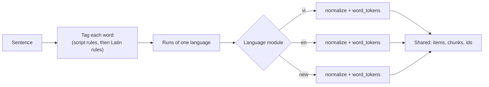

A module provides two functions:

| | Python (`src/vtts/frontend/languages.py`) | C (`runtime/src/vtts_text.c`, `LANGS`) |
|---|---|---|
| Normalize a run | `normalize(text) -> str`: lower-case words and the marks `, . ? ! ; :` separated by spaces | `normalize(ctx, run, n, opts)`: pushes the same words into the workspace |
| Pronounce a word | `word_tokens(word) -> list[str]`: v2 tokens, `[]` to skip the word | `word_ids(word, opts, out, cap)`: the same ids, `0` to skip |
| Syllables of a word (optional, languages without spaces) | `word_units(word) -> list[list[str]]` | `add_word(ws, word, opts)`: adds one item per syllable, joined without SPACE |

Steps:

1. **Tokens.** Add the language's phonemes as new ids at the end of the token set (a new token set version, e.g. v3 = v2 + new phonemes). Never renumber existing ids: models store them.
2. **Data tables.** Put readings in `src/vtts/frontend/lexicons/<lang>/*.tsv` (one `key<TAB>reading` per line) and large dictionaries in a blob like `VLEX` (built by a script, read in place on the device).
3. **Python module.** Write `normalize` and `word_tokens`, register them in `LANGUAGES`, and add the language's code to the modes `text_to_ids` accepts.
4. **Tagging.** In `lang.py`, a language with its own script adds a rule to `SCRIPT_RULES` *before* `vi` (for example Han characters for `zh`), so its words are recognized in any mode. A Latin-script language needs a rule in `word_lang` for plain Latin words, and the `auto` mode decides between the sentence languages.
5. **Tests.** Normalization cases, a data test for the tables, and the shared parity fixtures: `export_text_parity.py --v2` gets sentences of the new language and mixed sentences.
6. **C module.** Port `normalize` and `word_ids` (tables generated from Python by `runtime/tools/gen_text_tables.py`), add an entry to `LANGS` and the tag rule to `word_tag`, then run `uv run pytest tests/export`: the C front-end must match Python exactly.
7. **Voices.** Synthesize or record data with the new token set, train a teacher, distill the students, and add the language to `docs/site.json` (the website and README tables follow).

## User dictionary (planned)

Applications will be able to add their own entries without rebuilding the firmware: the same `key<TAB>reading` format, one file per language, compiled into a small blob that the device loads next to the model. It takes precedence over the built-in tables, so a product name can be fixed in the field. Until then, add the entry to the built-in tables.

## Change log

| Date | Change |
|---|---|
| 2026-11-19 | French front-end in C: mode `VTTS_LANG_FR` behind `VTTS_ENABLE_FR`, tables compiled into `vtts_text_fr_tables.h` (no blob), exact parity with Python. |
| 2026-11-19 | French front-end in Python: token set `fr-en`, silent letters, -ent and -er endings, nasal vowels, e muet, mid vowels by position, liaison and elision, `lexicons/fr/`, French number reading, mode `fr`. |
| 2026-11-19 | Italian and Turkish front-ends in C: modes `VTTS_LANG_IT`, `VTTS_LANG_TR`, tables in `vtts_text_it_tables.h` / `vtts_text_tr_tables.h` (no blob), each compiled only with `VTTS_ENABLE_IT` / `VTTS_ENABLE_TR`, exact parity with Python. |
| 2026-11-19 | Turkish front-end in Python: token set `tr-en`, letters, ğ and long vowels, stress (default final, overrides with suffixes, pre-stressing suffixes), `lexicons/tr/`, Turkish number reading, suffixes after apostrophes, mode `tr`. |
| 2026-11-19 | Italian front-end in Python: token set `it-en`, spelling, gemination, stress and e/o rules, `lexicons/it/`, Italian number reading, elision, mode `it`. |
| 2026-11-19 | Polish front-end in C: mode `VTTS_LANG_PL`, tables and the Python patterns compiled into `vtts_text_pl_tables.h` (no blob), compiled with `VTTS_ENABLE_PL`, exact parity with Python. |
| 2026-11-19 | Russian front-end in C: mode `VTTS_LANG_RU`, RLEX blob (`scripts/frontend/build_ru_blob.py`, stress tables, 358 KB), the Python patterns as parse trees (`gen_slavic_tables.py`, `vtts_re.c`), compiled with `VTTS_ENABLE_RU`, exact parity with Python. |
| 2026-11-19 | Polish front-end in Python: token set `pl-en`, spelling, nasal-vowel, voicing and stress rules, `lexicons/pl/` (native words, -yka/-ika stems, overrides), Polish number reading with cheap agreement, mode `pl`. |
| 2026-11-19 | Russian front-end in Python: token set `ru-en`, stress from an endings table and a word table built from a CC0 stress dictionary (`lexicons/ru/`), ё restoration, spelling, reduction and assimilation rules, Russian number reading with cheap agreement, mode `ru`. |
| 2026-11-19 | Greek front-end in C: mode `VTTS_LANG_EL` (`VTTS_ENABLE_EL`), tables generated into `vtts_text_el_tables.h` (no blob), exact parity with Python. |
| 2026-11-19 | Finnish front-end in C: mode `VTTS_LANG_FI` (`VTTS_ENABLE_FI`), tables generated into `vtts_text_fi_tables.h` (no blob), exact parity with Python. |
| 2026-11-19 | Greek front-end in Python: token set `el-en`, digraphs, αυ/ευ, μπ ντ γκ, synizesis and tonos stress rules, `lexicons/el/overrides.tsv`, Greek number reading with gender, the Greek question mark, mode `el`. |
| 2026-11-19 | Finnish front-end in Python: token set `fi-en`, spelling, length and first-syllable stress rules, number-word stresses, `lexicons/fi/`, Finnish number reading, mode `fi`. |
| 2026-11-19 | Swahili front-end in Python: token set `sw-en`, spelling rules with prenasalized stops and syllabic nasals, penultimate stress, `lexicons/sw/`, Swahili number, money, unit and time reading (no conversion to Swahili time), mode `sw`. |
| 2026-11-19 | Tagalog front-end in Python: token set `tl-en`, spelling, glottal-stop and stress rules, `lexicons/tl/stress.tsv` with the Filipino accent marks (also for affixed forms), native and Spanish-derived number reading, mode `tl`. |
| 2026-11-19 | Malay front-end in Python: token set `ms-en`, the Indonesian rules shared with Malay letters, `lexicons/ms/` (overrides over the Indonesian table, native words), Malay number, money and time reading, mode `ms`. |
| 2026-11-19 | Hindi front-end in C: mode `VTTS_LANG_HI`, letter tables, `overrides.tsv` and `numbers.tsv` compiled into `vtts_text_tables.h` (no blob), exact parity with Python. |
| 2026-11-19 | Spanish, Indonesian and Portuguese front-ends in C: modes `VTTS_LANG_ES`, `VTTS_LANG_ID`, `VTTS_LANG_PT`, all tables (and Python's Unicode classes) compiled into `vtts_text_tables.h` (no blob), exact parity with Python. |
| 2026-11-19 | Japanese front-end in C: mode `VTTS_LANG_JA`, `JLEX` blob (`scripts/frontend/build_ja_blob.py`, reading tables and NFKC data, 721 KB), exact parity with Python. |
| 2026-11-19 | Thai front-end in C: mode `VTTS_LANG_TH`, word list (front coded), respellings, spelling patterns and normalizer strings compiled into `vtts_text_th_tables.h` (no blob), exact parity with Python. |
| 2026-11-19 | Hindi front-end in Python: token set `hi-en`, Devanagari letters, nasals and schwa deletion, `lexicons/hi/` (numbers 0-99, overrides), Hindi number reading, mode `hi`. |
| 2026-11-19 | Thai front-end in Python: token set `th-en`, word list from PyThaiNLP, syllable patterns, consonant classes and tone rules, `lexicons/th/`, Thai number reading, mode `th`. |
| 2026-11-18 | Portuguese (Brazil) front-end in Python: token set `pt-en`, spelling, nasal, stress and vowel-quality rules, `lexicons/pt/`, Portuguese number reading, mode `pt`. |
| 2026-11-18 | Indonesian front-end in Python: token set `id-en`, spelling, e and stress rules, `lexicons/id/`, Indonesian number reading, mode `id`. |
| 2026-11-18 | Spanish front-end in Python: token set `es-en`, spelling and stress rules, `lexicons/es/`, Spanish number reading, mode `es`; Latin-script code-switching rules (`latin.py`, `lexicons/latin/english.txt`). |
| 2026-11-18 | Korean front-end in C: mode `VTTS_LANG_KO`, rule tables and `overrides.tsv` compiled into `vtts_text_tables.h` (no blob), exact parity with Python. |
| 2026-11-18 | Japanese front-end in Python: token set `ja-en`, `lexicons/ja/` word, context and kanji tables from Open JTalk's dictionary (98.2% mora agreement with pyopenjtalk), kana rules, Japanese number and counter reading, mode `ja`. |
| 2026-11-18 | Chinese front-end in C: mode `VTTS_LANG_ZH`, `ZLEX` blob (`scripts/frontend/build_zh_blob.py`), exact parity with Python. |
| 2026-11-18 | Korean front-end in Python: token set `ko-en`, standard pronunciation rules as a rule table, `lexicons/ko/overrides.tsv`, Sino-Korean and native number reading, mode `ko`. |
| 2026-11-18 | Chinese front-end in Python: token set `zh-en`, `lexicons/zh/` tables from pypinyin, Chinese number reading, mode `zh`. |
| 2026-11-17 | Bilingual device front-end in C (`vtts_text_to_ids_ex`, VLEX blob), language modules in Python and C. |
| 2026-11-17 | Tables moved from code to `lexicons/vi/*.tsv`. Product codes read digits one by one (vi, en, C). Letter `s` reads "ét" (was "ét xì"). `smartphone` → "sờ mát phôn" (was the invalid "xmát phôn"); added `smarthome` → "sờ mát hôm". |
