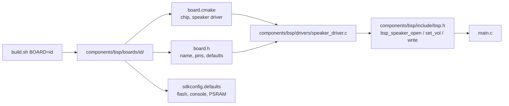

# Board support package (BSP)

An ESP-IDF component with the speaker drivers shared by all boards (`drivers/`) and one folder per board (`boards/<id>/`). `BOARD=<id> ./build.sh ...` selects a board (it builds in `build_<id>/` with `sdkconfig.<id>`); the application (`main/`) only uses the `bsp_*` functions of `include/bsp.h`. Adding a board means adding a folder; code changes are needed only for a speaker chip without a driver yet.

| `BOARD=` | Board | Chip | Speaker driver |
|---|---|---|---|
| `esp32-p4-86-panel-eth-2ro` | Waveshare ESP32-P4-86-Panel-ETH-2RO | ESP32-P4 | `es8311` |
| `esp32-p4-nano` | Waveshare ESP32-P4-NANO | ESP32-P4 | `es8311` |
| `esp32-s3-touch-lcd-2.8` | Waveshare ESP32-S3-Touch-LCD-2.8 | ESP32-S3 | `i2s_dac` (PCM5101) |
| `echoear` | EchoEar 2.0 | ESP32-S3 | `es8311` |
| `metalio-eink4-plus` | Metalio E-INK4-Plus | ESP32-S31 | `bt_audio` (Bluetooth audio chip, TCA9555) |

## Layout



Kconfig is layered: `firmware/esp32/sdkconfig.defaults` (all boards), then `sdkconfig.defaults.<chip>` (loaded by ESP-IDF for the target), then `boards/<id>/sdkconfig.defaults`.

## A board folder

`board.cmake`:

```cmake
set(BSP_TARGET esp32s3)   # esp32p4 | esp32s3 | esp32s31
set(BSP_SPEAKER es8311)   # a driver in drivers/speaker_<driver>.c
# optional: shared helpers from drivers/ that the speaker driver needs
# list(APPEND BSP_EXTRA_SRCS "drivers/tca9555.c")
```

`board.h`, with the macros the driver uses:

| Macro | Meaning | Drivers |
|---|---|---|
| `BSP_NAME` | Name printed at boot | all |
| `BSP_DEFAULT_VOL`, `BSP_DEFAULT_GAIN_DB` | Default volume 0..100 and digital gain in dB (before a soft limiter) | all |
| `BSP_POWER_HOLD_GPIO` | Optional: driven high first thing at boot (power self-latch) | all |
| `BSP_I2S_PORT`, `BSP_I2S_MCLK`, `BSP_I2S_BCLK`, `BSP_I2S_WS`, `BSP_I2S_DOUT` | I2S port and pins (`I2S_GPIO_UNUSED` for no MCLK; `bt_audio` has no MCLK) | all |
| `BSP_I2C_PORT`, `BSP_I2C_SDA`, `BSP_I2C_SCL` | Codec or I/O expander control bus | `es8311`, `bt_audio` |
| `BSP_PA_EN` | Amplifier enable pin | `es8311` |
| `BSP_DAC_UPSAMPLE` | DAC rate as a multiple of the model rate (default 2) | `i2s_dac` |
| `BSP_USB_SWITCH_GPIO`, `BSP_USB_SWITCH_LEVEL` | Optional: a USB path switch driven at boot so the port reaches the USB-Serial-JTAG console | all |
| `BSP_I2S_RATE` | Fixed I2S rate set by the audio chip (the firmware resamples the model output to it) | `bt_audio` |
| `BSP_IOEXP_ADDR`, `BSP_IOEXP_OUT_MASK`, `BSP_IOEXP_OUT_INIT`, `BSP_IOEXP_PA_EN`, `BSP_IOEXP_BT_PWR` | TCA9555 on the `BSP_I2C_*` bus (address, 0 = probe 0x20-0x27): outputs and their start levels, amplifier enable pin, audio chip power pin (pins 0-15 = P0.0-P1.7) | `bt_audio` |
| `BSP_BT_UART_PORT`, `BSP_BT_UART_TX`, `BSP_BT_UART_RX`, `BSP_BT_UART_BAUD`, `BSP_BT_SETTLE_MS` | Audio chip AT command UART (115200 by default) and its start-up time | `bt_audio` |

`sdkconfig.defaults`: what differs from the chip defaults, typically the flash size and the PSRAM mode.

## Adding a board

1. Copy the folder of the most similar board to `boards/<id>/` and set the pins from the schematic.
2. If the speaker chip has no driver yet, add `drivers/speaker_<driver>.c` implementing `bsp_speaker_open`, `bsp_speaker_set_vol` and `bsp_speaker_write` (see `include/bsp.h`), and its dependency to this component's `idf_component.yml` if needed. A speaker that cannot run at the model rate (22050 Hz) returns the rate it does run at from `bsp_speaker_open`; `main/speaker.c` then resamples the stream (`runtime/src/vtts_resample.c`).
3. `BOARD=<id> ./build.sh S_MODEL.vtts M_MODEL.vtts -p PORT flash monitor`, then run `selftest`, `bench` and a long paragraph with playback (no underruns), and adjust the default volume and gain by ear.
4. Add a row to the table above and to `boards` in `docs/site.json` (README and website follow), and the numbers to `docs/reports/performance.md`.

A new chip family also needs SIMD kernels in `runtime/ports/` that pass `selftest`; see [runtime/README.md](../../../../runtime/README.md#porting).
